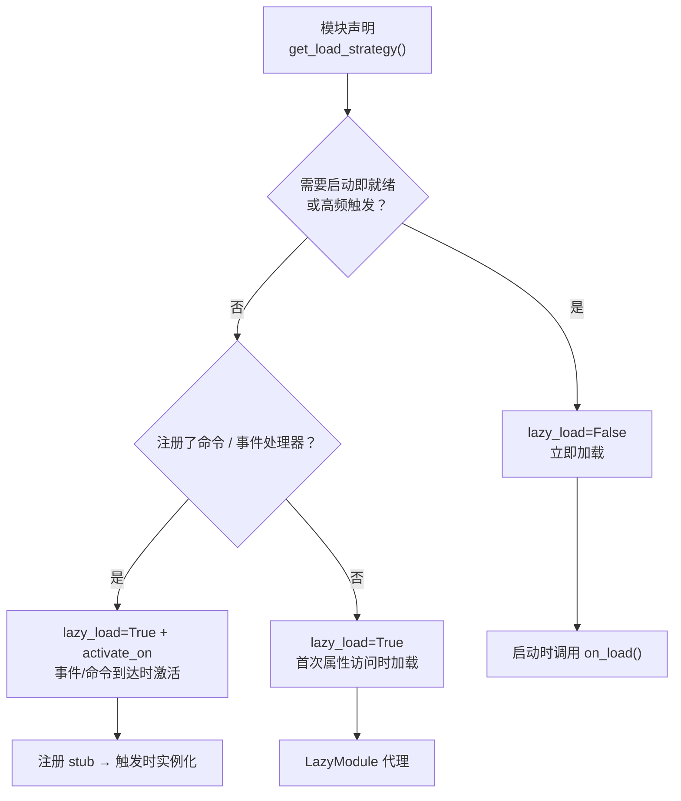
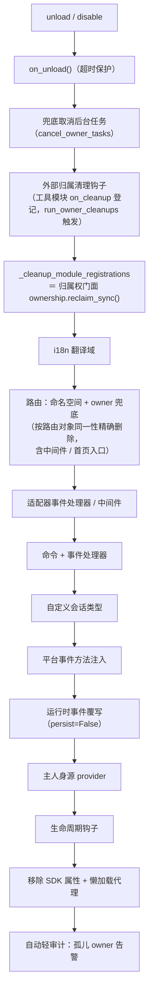

# ErisPulse 热重载与懒加载休眠

本技能由 ErisPulse 文档自动构建（generate-skills.py）。
仓库：https://github.com/ErisPulse/ErisPulse
各节末尾标注了来源文档路径，需要最新内容请以仓库 docs/zh-CN/ 为准。

## 内容大纲

AI 按需读取：只读需要的章节即可，不必全文加载。

- 懒加载与休眠: 44-54 行
- 概述: 56-63 行
- 工作原理: 65-79 行
- 事件驱动懒激活（activate_on）: 81-157 行
- 懒加载休眠（dormant_after）: 159-205 行
- 配置懒加载: 207-234 行
- 使用懒加载模块: 236-291 行
- 最佳实践: 293-321 行
- 注意事项: 323-328 行
- 归属权与热重载边界: 330-359 行
- owner 上下文机制: 361-384 行
- 归属资源全景: 386-420 行
- 卸载/禁用清理序列: 422-448 行
- 归属权统一门面（ownership）: 450-477 行
- 热重载失败回滚: 479-497 行
- 热重载边界: 499-569 行
- 设计边界：哪些资源不随卸载清理: 571-584 行
- 内部实现：归属如何工作: 586-637 行
- 模块作者指南: 639-691 行
- 工具模块指南：托管其它模块的句柄: 693-740 行
- 模块开发入门（加载策略）: 742-752 行
- 项目结构: 754-766 行
- pyproject.toml 配置: 768-786 行
- __init__.py: 788-792 行
- Core.py - 基础模块: 794-833 行
- 测试模块: 835-853 行
- 核心概念: 855-958 行

## 懒加载与休眠

> 来源: `docs/zh-CN/advanced/lazy-loading.md`（https://github.com/ErisPulse/ErisPulse/blob/main/docs/zh-CN/advanced/lazy-loading.md）

# 懒加载模块系统

> [!TIP]
> **什么时候需要读这篇**：使用懒加载模块或 activate_on 事件驱动激活时。不需要则跳过，不影响其它功能的使用。


ErisPulse SDK 的懒加载模块系统让模块推迟到**实际被访问时**才初始化——启动阶段只登记占位代理，未被用到的模块不占用启动时间与内存。

## 概述

懒加载模块系统是 ErisPulse 的核心特性之一，它通过以下方式工作：

- **延迟初始化**：模块只有在第一次被访问时才会实际加载和初始化
- **透明使用**：对于开发者来说，懒加载模块与普通模块在使用上几乎没有区别
- **自动依赖管理**：模块依赖会在被使用时自动初始化
- **生命周期支持**：对于继承自 `BaseModule` 的模块，会自动调用生命周期方法

## 工作原理

### LazyModule 类

懒加载系统的核心是 `LazyModule` 类，它是一个包装器，在第一次访问时才实际初始化模块。

### 初始化过程

当模块首次被访问时，`LazyModule` 会执行以下操作：

1. 获取模块类的 `__init__` 参数信息
2. 根据参数决定是否传入 `sdk` 引用
3. 设置模块的 `moduleInfo` 属性
4. 对于继承自 `BaseModule` 的模块，调用 `on_load` 方法
5. 触发 `module.init` 生命周期事件

## 事件驱动懒激活（activate_on）

> [!NOTE]
> 本特性需要 ErisPulse **2.8.0+**。

`lazy_load=True` 的模块默认只在**首次属性访问**时加载。若模块注册了命令/事件处理器，
传统做法只能 `lazy_load=False` 立即加载。`activate_on` 提供了第三种选择：**声明触发器，
首个匹配事件/命令到达时自动激活模块**——既不常驻内存，又不丢失触发入口。

```python
from ErisPulse.loaders import ModuleLoadStrategy

class MyModule(BaseModule):
    @staticmethod
    def get_load_strategy():
        return ModuleLoadStrategy(
            lazy_load=True,
            activate_on=[
                # ---- 事件触发（被动到达，无需用户感知）----
                "message",                                    # 类型级：任何消息事件
                {"notice": "group_member_increase"},          # 类型 + 单个 detail_type
                {"message": ["private", "group"]},            # 类型 + 多个 detail_type

                # ---- 命令触发（主动输入，占位命令对 Help 可见）----
                {"command": "roll"},                          # 简写：命令名
                {"command": ["roll", "dice"]},                # 命令名列表
                {"command": {                                 # dict 声明（name 必填）
                    "name": "dice",
                    "help": "掷一个骰子",
                    "usage": "/dice",
                    "group": "娱乐",
                    "aliases": ["d"],
                    "hidden": False,
                }},
            ],
        )
```

### 命令 dict 声明参数

dict 形式镜像 `@command()` 装饰器的用户级参数，用于在模块加载前就注册占位命令：

| 参数 | 类型 | 默认 | 说明 |
|------|------|------|------|
| `name` | `str` | **必填** | 命令名；须与 `on_load` 中 `@command(name)` 一致，否则激活后占位注销、命令不存在 |
| `help` | `str` | 回退链 | Help 中显示的介绍；未声明时按回退链取值（见下） |
| `usage` | `str` | 自动生成 | 用法行，默认 `{prefix}{name}` |
| `group` | `str` | `None` | 命令分组 |
| `aliases` | `list[str]` | `[]` | 别名同时注册，**输入别名同样触发激活** |
| `hidden` | `bool` | `False` | `True` 时占位命令同样隐藏（与激活后真实命令的隐藏语义对齐）；知道命令名的用户输入仍可触发 |

**不支持** `priority` / `permission` / `master`：占位命令的使命只是触发激活，
权限检查由激活后的真实命令执行（占位阶段拦截权限反而会让"输入命令激活"失效）。

### 占位命令 help 回退链

模块未加载时 Help 显示的命令介绍，按以下顺序取值（取到即止）：

1. dict 声明的命令级 `help`（最精确）
2. 模块 `get_meta()` 的 `description`
3. 模块 `__description__` 属性
4. 包元数据的 `Summary`（PyPI 包简介）
5. 通用提示：「此命令来自懒加载模块 X，首次使用将自动加载该模块」

### 触发语义

- **事件 stub**：以极低优先级（`ACTIVATION_STUB_PRIORITY`）注册到对应事件管理器，
  在所有普通处理器之后兜底触发；激活后将当前事件转发给模块的真实处理器
- **命令 stub**：注册占位命令；激活后占位注销、真实命令接管当次触发
- **防重入**：`asyncio.Lock` 保证并发触发下只激活一次
- **作用域过滤**：stub 带模块 owner 身份，模块未对该 Bot / 会话 / 平台启用时不触发
- **失败语义**：激活失败进入冷却期（`ACTIVATE_RETRY_COOLDOWN_SECS`，30 秒），
  冷却内事件短路避免重复尝试；冷却结束后再次触发自动重试，stub 全程保留
- **去重**：同名命令以简写 + dict 混合声明时去重（dict 优先）；dict 缺 `name`
  或事件 `detail_type` 误写 dict 时告警并忽略

> 架构图与完整语义详见 [架构概览](../architecture.md#事件驱动懒激活activate_on触发架构)。

## 懒加载休眠（dormant_after）

> [!NOTE]
> 本特性需要 ErisPulse **2.11.0+**。

懒激活的模块长期闲置后，框架可将其**归眠**：释放运行时资源（归属任务 / 连接 / 事件注册），
但保留懒加载代理与注册存根——模块回到"已注册未加载"状态，下次属性访问 /
`module.call` / `activate_on` 事件**透明唤醒**（重新实例化并执行 `on_load`），
无需任何唤醒 API。归眠后的系统状态与"从未激活"完全一致。

### 声明方式

```python
@staticmethod
def get_load_strategy():
    return ModuleLoadStrategy(
        lazy_load=True,
        dormant_after="30m",   # 闲置 30 分钟自动归眠；不声明 = 永不休眠（默认）
    )
```

时长语法与命令治理的 `cooldown` 完全一致（`90s` / `1h30m` / `1d`）。清扫器按固定间隔
（60 秒）扫描，实际归眠时点 = 阈值 + 最多一个扫描间隔；也可随时手动归眠：
`await sdk.module.sleep("模块名")`。显式 `unload` 仍是彻底卸载（懒代理一并移除）。

### 状态接续

归眠前框架触发 `on_before_unload(reason="dormant")`（卸载流水线第一步，资源仍完好），
模块把状态保存到 `sdk.storage`；唤醒后在 `on_load` 中恢复：

```python
async def on_before_unload(self, event):
    if event["reason"] in ("dormant", "reload", "disable"):
        await self.sdk.storage.aset(f"{self._module_name}:counter", self._count)

async def on_load(self, event):
    self._count = await self.sdk.storage.aget(f"{self._module_name}:counter") or 0
```

### 语义与边界

- **依赖方安全**：懒模块的依赖方经由持久代理（`sdk.<Name>`）或 `module.call` 访问，
  归眠前后行为一致；直接持有真实实例引用属反模式（泄漏审计器可见）
- **事件不达**：归眠模块不再接收事件——需要事件唤醒的模块请同时声明 `activate_on`
  （事件先唤醒再转发）；排查"命令没反应"时注意确认模块是否处于归眠态
- **唤醒失败可自愈**：唤醒（重新初始化）失败进入 30 秒冷却，冷却后再次访问自动重试，
  不会永久失效

## 配置懒加载

### 全局配置

在配置文件中启用/禁用全局懒加载：

```toml
[ErisPulse.framework]
enable_lazy_loading = true  # true=启用懒加载(默认)，false=禁用懒加载
```

### 模块级别控制

模块可以通过实现 `get_load_strategy()` 静态方法来控制加载策略：

```python
from ErisPulse.Core.Bases import BaseModule
from ErisPulse.loaders import ModuleLoadStrategy

class MyModule(BaseModule):
    @staticmethod
    def get_load_strategy():
        """返回模块加载策略"""
        return ModuleLoadStrategy(
            lazy_load=False,  # 返回 False 表示立即加载
            priority=100      # 加载优先级，数值越大优先级越高
        )
```

## 使用懒加载模块

### 基本使用

对于开发者来说，懒加载模块与普通模块在使用上几乎没有区别：

```python
# 通过SDK访问懒加载模块
from ErisPulse import sdk

# 以下访问会触发模块懒加载
result = await sdk.my_module.my_method()
```

### 统一的模块获取入口

无论是通过 SDK 属性、模块管理器属性访问，还是通过 `module.get()` 查询，
对于“已注册但尚未加载”的懒加载模块，都会返回同一个懒加载代理，访问其属性才会真正触发初始化：

```python
# 三种方式拿到的都是懒加载代理（在模块未加载时），行为一致、对用户透明
sdk.my_module          # 触发加载的入口
sdk.module.my_module   # 同样返回懒加载代理
sdk.module.get("my_module")  # 也返回懒加载代理，本身不会触发加载

# 访问代理的任意属性才会真正初始化模块
result = await sdk.my_module.my_method()
```

`module.get()` 是**查询**接口，本身不触发加载：
- 模块已加载 → 返回真实实例
- 模块已注册但未加载 → 返回懒加载代理（访问属性才初始化）
- 模块未注册 → 返回 `None`

如需显式触发加载，请使用 `await sdk.load_module("my_module")`。

### 异步初始化

对于需要异步初始化的模块，建议先显式加载：

```python
# 先显式加载模块
await sdk.load_module("my_module")

# 然后使用模块
result = await sdk.my_module.my_method()
```

### 同步初始化

对于不需要异步初始化的模块，可以直接访问：

```python
# 直接访问会自动同步初始化
result = sdk.my_module.some_sync_method()
```

## 最佳实践

选择加载策略时，可参考以下决策流程：



### 推荐使用懒加载的场景（lazy_load=True）

- 被动调用的工具类（如数据查询模块，格式转换器等，仅只在其他模块调用时才需要）
- 注册命令/事件处理器但非高频使用的模块——配合 `activate_on` 声明触发器，首个匹配事件/命令到达时自动激活，无需放弃懒加载

### 推荐禁用懒加载的场景（lazy_load=False）

- 需要在启动时立即就绪的模块（如为其它模块提供基础服务的核心模块）
- 高频触发的监听器（每条消息都要处理）——`activate_on` 转发有一次激活开销，高频场景立即加载更直接
- 定时任务模块
- 需要在应用启动时就初始化的模块

> `priority` 参数控制立即加载模块间的初始化顺序，数值越大越先初始化。同优先级的模块按注册顺序加载。

## 注意事项

1. 如果您的模块使用了懒加载，如果其它模块从未在ErisPulse内进行过调用，则您的模块永远不会被初始化。
2. 如果您的模块中包含了诸如监听Event的模块，或其它主动监听类似模块，有两种选择：声明 `activate_on` 触发器（保持懒加载，事件到达时自动激活），或声明需要立即被加载（`lazy_load=False`），否则会影响您模块的正常业务。
3. 我们不建议您禁用懒加载，除非有特殊需求，否则它可能为您带来诸如依赖管理和生命周期事件等的问题。
4. `activate_on` 的命令 dict 声明中，`name` 必须与模块 `on_load` 中 `@command()` 注册的真实命令名一致——否则模块激活后占位命令注销，声明与实现不一致的命令将不存在。

## 归属权与热重载边界

> 来源: `docs/zh-CN/advanced/ownership.md`（https://github.com/ErisPulse/ErisPulse/blob/main/docs/zh-CN/advanced/ownership.md）

# 归属权（owner）系统

> [!TIP]
> **什么时候需要读这篇**：排查资源泄漏、理解卸载清理链路或声明归属资源时。不需要则跳过，不影响其它功能的使用。

> **读完你会知道**：owner 上下文如何自动归属资源、归属资源全景表、卸载/禁用时
> 清理链的完整时序，以及哪些资源不随卸载清理（设计边界）。
>
> **本篇不涉及**：资源"何时生效"的权限判定（见[作用域（scope）](scope.md)）；
> 后台任务的推荐写法与强制取消边界（见[生命周期管理 · 后台任务归属与自动取消](lifecycle.md#后台任务归属与自动取消)）。


归属权是模块"即插即用"的基石：模块在加载期间注册的一切框架资源自动记名，
卸载/禁用时按记名一键回收——模块作者只需声明资源，无需手写清理逻辑。

> **相关系统**：作用域（scope）在事件分发时决定"资源是否生效"，
> 归属权在生命周期中决定"资源归谁、谁卸载时被回收"。
> 作用域详见[统一控制面（scope）](scope.md)，后台任务详见
> [生命周期管理](lifecycle.md#后台任务归属与自动取消)。

{!--< tips >!--}
1. 归属在**注册瞬间**按 `current_owner` 自动记录，模块代码零改动
2. 卸载/禁用共用同一条清理链（`_cleanup_module_registrations`），每步失败仅告警不中断
3. 用户配置语义的资源（持久化覆写 / scope 规则 / 命令 ACL）**不**随模块卸载清理
4. 工具模块托管的外部句柄可用 `on_cleanup(cb)` 挂入清理链，对方模块卸载时自动回调（见[工具模块指南](#工具模块指南托管其它模块的句柄)）
{!--< /tips >!--}

## owner 上下文机制

owner 通过上下文变量 `current_owner` 传递（`ErisPulse.runtime.context`）：

```python
from ErisPulse.runtime import owner_scope, get_current_owner

with owner_scope("MyModule"):
    # 此区间内注册的一切资源自动归属 MyModule
    assert get_current_owner() == "MyModule"
```

框架在以下时机自动注入 owner（模块/适配器代码无需手动包裹）：

| 时机 | owner 值 | 位置 |
|------|----------|------|
| 模块 `load()` | 模块名 | 实例化 + `on_load` 全程 |
| 适配器 `start()` / `restart()` | 平台名 | 适配器启动全程 |
| `activate_on` 懒加载 stub 注册 | 模块名 | 占位命令/处理器注册 |
| 事件处理器执行期 | 处理器归属模块名 | handler / 命令入口重注入 |

执行期重注入意味着：模块在 `on_load` 里声明的命令处理器**运行中**调用
注册型 API（如 `sdk.adapter.on()`、`overrides.*.set(persist=False)`），
同样会自动归属本模块。

## 归属资源全景

模块在加载上下文内注册的以下资源均记录归属，卸载/禁用时自动回收：

| 资源 | 注册方式 | 清理调用 |
|------|----------|----------|
| 命令 | `@command()` / 命令 dict 声明 | `command.unregister_by_owner()` |
| 事件处理器 | `@message` / `@notice` / `@request` / `@meta` | `handler.unregister_by_owner()` |
| 适配器事件监听 | `sdk.adapter.on()` / `raw=True` | `adapter.unregister_handlers_by_owner()` |
| 适配器中间件 | `@sdk.adapter.middleware` | 同上 |
| 路由（HTTP/WS/SSE） | `router.http()` / `websocket()` / `sse()` | 按命名空间 + 按 owner 双重兜底 |
| 路由中间件 | `@router.middleware()` / `add_middleware()` | `router.unregister_all_by_owner()` |
| Dashboard 首页入口 | `router.register_home_entry()` | `unregister_home_entries_by_owner()` |
| 自定义会话类型 | `register_custom_type()` | `unregister_custom_types_by_owner()` |
| 平台事件方法注入 | `register_event_method()` / `register_event_mixin()` | `unregister_event_methods_by_owner()`（模块卸载自动回收，旧闭包不再泄漏） |
| 后台任务 | `self.spawn()` | `cancel_owner_tasks()` |
| 外部归属清理钩子（工具模块托管） | `runtime.on_cleanup(cb)` | `run_owner_cleanups()`（卸载/禁用/适配器关闭链内触发） |
| 生命周期钩子 | `lifecycle.register()` | `lifecycle.unregister_by_owner()` |
| 主人身源 provider | `master.provider` | `master.unregister_by_owner()` |
| i18n 翻译键 | `I18nClass` 声明（domain=模块名） | `i18n.unregister_domain()` |
| 事件覆写（运行时） | `overrides.*.set(persist=False)` | `overrides.unregister_by_owner()` |
| 交互会话（wait_reply 等待 / 租约） | `event.wait_reply()` / `sdk.interaction.acquire()` | `interaction.cancel_by_owner()`（等待方立即收到取消） |
| 上下文数据 | `runtime/context` 按 owner 记录 | 按模块精确清理 |

适配器侧的对应资源（以平台名为 owner）在适配器 `shutdown()` / `restart()`
时由 `_cleanup_adapter_resources` 回收，另含：

| 资源 | 清理调用 |
|------|----------|
| 适配器自有的 `on()` 处理器与中间件 | `adapter.unregister_handlers_by_owner(platform)` |
| 平台事件方法扩展（`EventMixin`） | `unregister_platform_event_methods(platform)` |
| 自定义会话类型 | `unregister_custom_types_by_owner(platform)` |
| 交互会话（该平台挂起的 wait_reply / 租约） | `interaction.cancel_by_platform(platform)` |
| i18n 翻译域（domain=配置键） | `i18n.unregister_domain(配置键)` |
| 细颗粒命名空间路由 | `router.unregister_all_by_owner(platform)` |

## 卸载/禁用清理序列

`unload()` 与 `disable()` 共用同一条清理链（每步独立 try/except，
失败仅记日志，**不中断后续清理**）：



`sdk.uninit()` 退出时另有全局兜底：全部适配器 shutdown → 全部模块 unload →
`router.stop()`（清空路由/中间件/首页入口）→ `cancel_all_background_tasks()` →
清空事件处理器与钩子。

## 归属权统一门面（ownership）

清理链的十六个步骤收敛在归属权统一门面 `ErisPulse.Core.ownership` 下，
四个动词覆盖"注销、计数、扫描、审计"——子系统各自的 `*_by_owner` 注销
函数保持不变，作为门面的内部实现：

| 动词 | 用途 |
|------|------|
| `ownership.reclaim(owner)` | 统一注销 owner 名下全部资源（任务取消 → 清理钩子 → 注册类资源；异步完整版） |
| `ownership.reclaim_sync(owner)` | 注册类资源注销（同步版，供同步卸载路径） |
| `ownership.counts(owner=None)` | 只读统计 owner 在册资源（None 为全部 owner） |
| `ownership.orphans()` | 孤儿扫描：资源在册而 owner 已注销（泄漏实锤清单） |
| `ownership.audit(owner, deep=)` | 泄漏审计报告（计数 + 孤儿 + 可选 gc 实例普查） |

```python
from ErisPulse.Core import ownership

ownership.reclaim_sync("MyModule")       # {'commands': 1, 'routes_http': 2, ...}
ownership.counts("MyModule")             # 在册资源计数
ownership.orphans()                      # [{"owner": "ghost", "total": 2, ...}]
```

**审计入口**：

- 卸载 / 重载后**自动轻审计**：发现孤儿 owner 资源即 WARNING 告警（零开销计数扫描）
- `sdk.module.audit(name, deep=True)`：模块实例 gc 普查——实例不可回收时
  给出引用方类型（定位"谁攥着旧实例"）；有全局暂停开销，仅显式排障使用
- 深普查属显式操作，不设配置键、不做自动修复

## 热重载失败回滚

热重载为"**卸载前快照 → 失败自动恢复 → 重放 on_load**"：新版本语法错误、
依赖缺失、加载失败时，旧实例与注册状态（注册表条目、sdk 属性、sys.modules
条目）自动还原，随后在归属上下文内**重放旧实例的 `on_load`**（`reason`
为 `"rollback"`），让卸载阶段断开的外部资源重新建立；结束后发射
`module.rollback` 事件（载荷 `{module_name, success}`）。

边界说明：

- 重放失败或超时**只告警**，不回滚回滚——旧实例停留在"已收尾"状态
  （与 2.11.2 及更早行为一致），日志会明确提示
- 第三方在运行期手动缓存的对旧实例的引用不在恢复范围
- 目标包已被卸载（entry-point 消失）视作卸载成功，不做回滚
- `on_unload` 载荷携带 `reason`（`unload` / `reload` / `disable` /
  `cascade` / `dormant` / `load-failed`），模块可在 `reload` 时推迟关闭
  需要跨重载存活的资源

热重载的完整能力边界、跨循环语义与模块侧守则见下节。

## 热重载边界

热重载能替换代码、重建注册、回滚失败的重载——但它**不是进程重启**。
回收的是**归属权系统登记在册的运行时资源**；不属任何 owner 的资源、用户
配置语义的数据、第三方库内部缓存的引用，都不会随重载消失。

### 能力边界

| 对象 | 重载后行为 | 说明 |
|------|-----------|------|
| 模块代码 / 类定义 | 支持，重新导入 | 旧 `sys.modules` 条目被清理 |
| `on_unload` / `on_load` | 支持，按序触发 | 失败回滚时重放 `on_load`（见上节） |
| 命令 / 处理器 / 路由 / 生命周期钩子 | 支持，自动注销再注册 | 经归属回收链清理 |
| `spawn_background` / `spawn_later` / `spawn_thread` | 支持，按 owner 取消 | 线程只登记观测、无法强杀 |
| 主循环上任何 `asyncio.create_task` | 支持，自动归属取消 | 任务工厂拦截（含第三方库内部创建） |
| 存储桥接循环上派生的任务 | 支持，自动归属取消 | 桥接循环同样装了任务工厂 |
| `ownership.track()` 登记的资源 | 支持，调用 `release()` | 任务工厂够不着的 Loop-bound 资源 |
| `on_cleanup` 钩子 | 支持，触发 | 工具模块借此抛弃托管的句柄 |
| 持久化覆写（`persist=True`）/ 配置文件 | 不处理，保留 | 用户资产 |
| 第三方库内部缓存的对象引用 | 不处理 | 框架看不到，需模块自行解引用 |
| 模块自己 `new` 的事件循环 / 裸线程 | 不回收 | 见下方守则 |
| 适配器回滚后的资源 | 未对齐 | 适配器侧暂不重放 `start()` |

### 三层资源治理

1. **无感拦截层**——事件循环级任务工厂。owner 上下文内任何任务创建自动归属，
   覆盖主循环与存储桥接循环。
2. **归属化调度层**——`spawn_background` / `spawn_later` / `spawn_thread`。
3. **合作式登记层**——`ownership.track()` / `on_cleanup()`，用于结构性
   够不着的资源（Loop-bound 连接池、第三方 client）。

### 事件循环边界

| 循环 | 谁创建 | 装任务工厂 | 用途 |
|------|--------|-----------|------|
| 主循环 | `sdk.run()` / `sdk.init()` | 已安装 | 全部业务代码 |
| 存储桥接循环 | `AsyncBridge`（首次同步存储调用） | 已安装 | 同步存储 API 的后台执行 |
| 临时循环 | `spawn_background` 兜底 | 未安装，用完即关 | 主循环未就绪时的最后手段 |

**临时循环是最后手段**：它会同步阻塞调用线程，且循环关闭后协程内部再派生的
子任务会丢失（日志有 `temp_loop_fallback` 警告）。看到该警告说明模块在错误
的时机调度了后台任务。

**跨循环取消是尽力而为**：`cancel_owner_tasks` 发现任务在其它仍在运行的循环
上时，用 `call_soon_threadsafe` 投递取消并打 `cross_loop_task_residual`
警告，但**不等待**其结束（跨循环等待不安全）。看到该警告应检查是否自建了
事件循环。

### 模块侧守则

```python
# 推荐
spawn_background(self._poll())            # 归属化后台任务
spawn_later(30, lambda: self._cleanup())  # 归属化延迟任务
spawn_thread("poller", self._loop_body)   # 归属化线程（入口自动带 owner）
ownership.track(pool)                     # 显式登记 Loop-bound 资源
await sdk.storage.aget(key)               # 异步上下文直接用异步 API

# 避免
asyncio.create_task(self._poll())         # 裸调用：无引用易被 GC
asyncio.new_event_loop()                  # 自建循环：归属体系完全够不着
threading.Thread(target=self._loop_body)  # 裸线程：入口无 owner 上下文
self._storage.get(key)                    # 异步上下文里同步调存储：阻塞主循环
```

### 排查清单

1. 日志有 `cross_loop_task_residual`？→ 有资源落在自建循环上
2. 日志有 `temp_loop_fallback`？→ 后台任务在主循环就绪前被调度
3. 报 `attached to a different loop`？→ 检查是否自建循环或跨循环复用连接对象
4. `ownership.orphans()` 有输出？→ 有 owner 名下资源在卸载后仍存活

## 设计边界：哪些资源不随卸载清理

归属权只回收**模块代码注册的运行时资源**。以下资源属**用户配置语义**
（控制权在用户，可能刻意配置），模块卸载后随配置持久保留：

| 资源 | 语义 | 说明 |
|------|------|------|
| `overrides.*.set(persist=True)` | 持久化覆写 | 写入配置文件，跨重启生效；模块卸载不删（用户显式配置） |
| `scope.set_action()` 等作用域规则 | 权限控制面 | 由用户/Dashboard 管理，卸载模块不回收规则 |
| `overrides.acl.set(persist=True)` | 命令 ACL | 同上 |
| Conversation `save()` 持久化 | 多轮对话存档 | 数据资产不清理 |

运行时临时写入（`persist=False`）则随 owner 回收——**持久化与否即
"用户资产"与"模块运行时状态"的分界线**。

## 内部实现：归属如何工作

**一句话**：归因链（contextvar 传播）决定"记在谁头上"，取消链（任务登记表）决定"卸载时能否被取消"——两条链路独立运作，资源被正确清理需二者兼备。

归属系统由**两条独立链路**构成，理解它们的分工是排查归属问题的前提：

### 归因链（contextvar 传播）

`runtime/context.py` 的 `current_owner` 等 ContextVar 负责**归因**——
"此刻这段代码注册的资源/发起的调用记在谁头上"。传播规则遵循 Python
contextvars 语义：

| 执行路径 | context 是否传播 | 归因结果 |
|---------|----------------|---------|
| 同步调用链 / `await` 链 | ✅ 传播 | 正确归因 |
| `owner_scope` 内 `asyncio.create_task` | ✅ 传播（task 拷贝创建时刻的 context） | 任务**内部**的框架调用正确归因 |
| `run_in_executor` / 裸线程 | ❌ 不传播 | 归因丢失 |
| 自建事件循环 | ❌ 不传播 | 归因丢失 |

> 归因 ≠ 登记：context 传播只影响"记在谁头上"，资源能否被清理
> 取决于是否进入了下述取消链。

### 取消链（任务登记表）

`runtime/tasks.py` 的 `_owner_tasks` 登记表负责**生命周期**——
"owner 名下有哪些未完成任务，卸载时统一取消"。任务进入登记表的途径：

1. **显式调度**：`spawn_background()` / `self.spawn()` → 创建时捕获
   `current_owner`（或显式 `owner=` 参数）→ 登记入表；
2. **Task Factory 自动登记**（2.8.3）：`install_owner_task_factory()`
   在框架启动时安装到主事件循环——**任何**任务创建（含第三方库内部的
   `create_task`）经过工厂时读取 `current_owner`，非 None 即登记。

登记表自清理：每个任务带 `done_callback`，完成即从表中移除，无泄漏。

### 取消时序（模块卸载）

```
module.unload()
  → on_unload(event)                    # 模块自行清理（兜底超时保护）
  → 框架注销该 owner 的命令/事件/钩子/路由
  → cancel_owner_tasks(owner)           # 任务登记表兜底取消
      → 逐个 task.cancel()              # 排除当前执行取消逻辑的任务自身
      → await gather(pending, timeout)  # 等待回收（超时不再阻塞）
```

### 排查思路

- **资源没被清理** → 查登记表：`get_owner_tasks("MyModule")` 是否含该任务；
  不含即注册路径未经过归属链（import 期 / 线程 / 独立循环），对照上表定位。
- **归因错误** → 查 `get_current_owner()` 在出错时刻的值；异步延迟执行
  （回调/任务）的归因取自创建时刻 context，而非执行时刻。

## 模块作者指南

### 推荐写法

```python
from ErisPulse import sdk
from ErisPulse.Core.Event import command
from ErisPulse.runtime import owner_scope, spawn_background

class MyModule(BaseModule):
    async def on_load(self, event):
        # 框架资源：自动归属，无需手动清理
        self.task = self.spawn(self.polling())      # 后台任务
        sdk.router.register_home_entry("我的模块", "/my")  # 首页入口

        # 模块自有资源：包进 owner_scope 即纳入归属体系
        with owner_scope("MyModule"):
            self.client.on_event(self._handle)      # 假想的自定义注册

    async def on_unload(self, event):
        # 框架资源已被自动回收，只需清理 owner_scope 覆盖不到的自有资源
        await self.client.close()
```

### 注意事项

- **import 期注册无归属**：模块顶层（import 时）注册的钩子/处理器发生在
  `owner_scope` 之前，会被视为框架级资源（owner=None）而**不被清理**。
  一律放到 `on_load()` 内注册。
- **自定义 domain 的 i18n 注册**：`i18n.register(domain=...)` 的 domain
  不等于模块名时不会被自动回收，请保持 domain=模块名。
- **后台任务推荐 `self.spawn()`**：2.8.3 起裸 `asyncio.create_task` 也会**自动隐式归属**
  （Task Factory 自动登记，卸载时兜底取消）；但 `self.spawn()` 仍是推荐写法——
  支持非主循环线程调度回主循环、显式 `owner=` 指定与 fire-and-forget 防 GC。
  **2.8.3 之前**的版本裸任务不归属，必须用 `self.spawn()`。
- 清理链"失败仅告警"：单步清理异常不会阻断其余资源回收，日志 DEBUG/WARNING
  级别可见，排障时可开启 TRACE。

### 注册时机 → 归属结果对照表

| 注册场景 | 归属结果 | 说明 |
|---------|---------|------|
| `on_load()` 内经框架 API（命令/事件/lifecycle/路由装饰器）注册 | 归属模块 | 卸载时自动注销 |
| 模块顶层（import 期）注册 | **无归属**（owner=None） | 不被清理，请勿使用 |
| `self.spawn()` 创建的后台任务 | 归属模块 | 卸载时自动取消 |
| `owner_scope("Name")` 内经第三方 API 注册 | 归属模块 | 依赖第三方回调在 scope 内同步执行 |
| 裸 `asyncio.create_task`（含 `loop.create_task` / `ensure_future`） | **自动归属**（Task Factory，2.8.3+） | 创建瞬间读取 `current_owner`，owner 上下文内自动登记、卸载兜底取消；见下文[内部实现](#内部实现归属如何工作) |
| 第三方库异步回调（aiohttp / APScheduler 等）内部创建的任务 | **自动归属**（Task Factory，2.8.3+） | 回调执行时若 `current_owner` 已注入（如框架处理器执行期间），任务自动登记 |
| `run_in_executor`（线程池） | **无归属**（非 asyncio.Task） | 线程不受任务工厂管辖，须自行管理生命周期 |
| 独立事件循环（自建 loop）中的注册 | **无归属** | Task Factory 仅安装于主循环；contextvars 也不跨事件循环传播 |

> 原则：**归属跟随注册瞬间的 `current_owner` 上下文**；任何异步延迟、
> 线程池、独立循环都会脱离该上下文——需要归属时请显式进入 `owner_scope`。

## 工具模块指南：托管其它模块的句柄

**场景**：定时任务、注册表、连接池这类"工具模块"会替其它模块保管东西——
对方在 `on_load` 里调用 `sdk.Cron.on_trigger(handler)`，你的容器里就存下了
一个指向对方实例的回调。框架会自动清理对方注册的一切框架资源，但清理不了
你**私有容器里的引用**：对方卸载后你的容器还拉着它的实例，它就无法被
GC 回收（内存泄漏，`purge` 泄漏诊断报"不可回收"）。

**解法**：在登记对方东西的同一个函数里调用 `on_cleanup()`，
框架会在对方卸载 / 禁用时自动回调你的清理函数：

```python
from ErisPulse.Core.Bases import BaseModule
from ErisPulse.runtime import off_cleanup, on_cleanup

class CronModule(BaseModule):
    def __init__(self):
        self._entries = {}  # {模块名: 该模块托管的回调列表}

    def on_trigger(self, handler):
        # 自动识别调用方模块名（on_load 直接调用 / module.call 均正确），
        # 返回值是解析出的 owner，可直接用作记名键
        owner = on_cleanup(self._drop)
        self._entries.setdefault(owner, []).append(handler)

    def _drop(self, owner: str):
        """对方模块被卸载/禁用时由框架自动调用：抛弃它的句柄即可"""
        self._entries.pop(owner, None)

    async def on_unload(self, event):
        off_cleanup(self._drop)  # ③ 自己卸载前注销钩子，避免钩子表持有 self
```

框架保证的行为：

| 关注点 | 行为 |
|--------|------|
| 触发时机 | 对方模块 unload / disable，或适配器关闭——均在框架清理链内触发，早于 purge 泄漏诊断 |
| 调用方识别 | 直接调用取 `current_owner`；经 `module.call()` 被调用取调用方（`current_caller`）；也可 `on_cleanup(cb, owner="模块名")` 显式指定。**强制校验**：owner 无法解析（三种来源均缺失）时抛 `ValueError`——私有工具模块应在自身加载上下文内登记钩子 |
| 回调签名 | `cb(owner: str)`，同步 / 异步均可；异步带超时保护（`CLEANUP_CALLBACK_TIMEOUT_SECS`，默认 10 秒） |
| 容错 | 单个回调异常 / 超时只记日志，不影响其余钩子与清理链 |
| 重复登记 | 同一 `(owner, callback)` 幂等去重 |

**什么时候不需要**：如果对方注册的是框架资源（命令、事件处理器、路由、
后台任务……），框架已全自动清理（见上文[归属资源全景](#归属资源全景)）。
只有你私有容器里持有的对方句柄才需要 `on_cleanup`。
模块开发视角的速查版见
[最佳实践 · 工具模块](../developer-guide/modules/best-practices.md#工具模块托管别人东西时要接住卸载通知)。

## 模块开发入门（加载策略）

> 来源: `docs/zh-CN/developer-guide/modules/getting-started.md`（https://github.com/ErisPulse/ErisPulse/blob/main/docs/zh-CN/developer-guide/modules/getting-started.md）

# 模块开发入门

> [!NOTE]
> **L1 核心必读**——首页"阅读路径"中的五篇核心文档之一，模块开发必备。


跟着这篇走完，你会得到一个能响应 `/hello` 命令的可运行模块，并了解模块的项目结构、注册方式与加载 / 卸载钩子——后续所有模块文档都建立在这套骨架上。

## 项目结构

一个标准的模块结构：

```
MyModule/
├── pyproject.toml
├── README.md
├── LICENSE
└── MyModule/
    ├── __init__.py
    └── Core.py
```

## pyproject.toml 配置

```toml
[project]
name = "ErisPulse-MyModule"
version = "1.0.0"
description = "模块功能描述"
readme = "README.md"
requires-python = ">=3.10"
license = { file = "LICENSE" }
authors = [ { name = "yourname", email = "your@mail.com" } ]
dependencies = []

[project.urls]
"homepage" = "https://github.com/yourname/MyModule"

[project.entry-points."erispulse.module"]
"MyModule" = "MyModule:Main"
```

## __init__.py

```python
from .Core import Main
```

## Core.py - 基础模块

```python
from ErisPulse import sdk
# 推荐根导入（2.10+）：常用符号直接从根包导入，深路径仍兼容
from ErisPulse import BaseModule, command

class Main(BaseModule):
    def __init__(self, sdk):
        self.sdk = sdk
        self.logger = sdk.logger.get_child("MyModule")
        self.storage = sdk.storage
    
    @staticmethod
    def get_load_strategy():
        """返回模块加载策略"""
        from ErisPulse.loaders import ModuleLoadStrategy
        return ModuleLoadStrategy(
            lazy_load=True,
            priority=0,
            depends=[],  # 可选：依赖的其他模块列表
            # 可选：事件驱动懒激活——声明触发器，首个匹配事件/命令到达时自动加载
            # activate_on=[{"command": {"name": "hello", "help": "发送问候"}}],
        )
    
    async def on_load(self, event):
        """模块加载时调用"""
        @command("hello", help="发送问候")
        async def hello_command(event):
            name = event.get_user_nickname() or "朋友"
            await event.reply(f"你好，{name}！")
        
        self.logger.info("模块已加载")
    
    async def on_unload(self, event):
        """模块卸载时调用"""
        self.logger.info("模块已卸载")
```

> **配置读取**：上面的基础示例未使用配置。需要读取配置时，推荐声明嵌套的 `ConfigClass` 并通过 `self.cfg` 实时读取（见 [模块核心概念](core-concepts.md#声明式配置推荐)）。手动调用 `_load_config()` 的旧写法已废弃。

## 测试模块

### 本地测试

```bash
# 在项目目录安装模块
epsdk install ./MyModule

# 运行项目
epsdk run main.py --reload
```

### 测试命令

发送命令测试：

```
/hello
```

## 核心概念

### BaseModule 基类

所有模块必须继承 `BaseModule`，提供以下方法：

| 方法 | 说明 | 必须 |
|------|------|------|
| `__init__(self, sdk)` | 构造函数（框架传入 `sdk` 实例） | 否 |
| `get_load_strategy()` | 返回加载策略 | 否 |
| `get_meta()` | 返回模块介绍元信息（可选） | 否 |
| `on_load(self, event)` | 模块加载时调用 | 是 |
| `on_unload(self, event)` | 模块卸载时调用 | 是 |

### 模块介绍 meta

> [!NOTE]
> 本特性需要 ErisPulse **2.8.0+**。

通过 `get_meta()` 声明模块的介绍元信息（这个模块是干什么的、属于哪一类等）。
元信息是模块的**通用介绍数据**，供 help 模块、Dashboard 模块列表、模块商店等各类界面/生态模块消费。

与 `get_load_strategy()` 返回 `ModuleLoadStrategy` 一致，**推荐返回 `ModuleMeta` 配置类实例**（属性键入、IDE 补全），也兼容直接返回 dict：

```python
class MyModule(BaseModule):
    @staticmethod
    def get_meta() -> ModuleMeta:
        return ModuleMeta(
            name="天气",               # 显示名（默认注册名）
            description="查询城市天气",  # 模块简介
            version="1.0.0",
            author="ErisDev",
            group="工具",               # 功能分组
            tags=["天气", "查询"],
        )
```

兼容写法（dict）：

```python
class MyModule(BaseModule):
    @staticmethod
    def get_meta() -> dict:
        return {
            "name": "天气",
            "description": "查询城市天气",
            "version": "1.0.0",
            "author": "ErisDev",
            "group": "工具",
            "tags": ["天气", "查询"],
        }
```

- `module.get_meta("MyModule")` 读取已解析的元信息（类声明 > 注册 info，自动补全该模块的命令名）。
- `module.get_commands_overview()` 聚合「模块 meta + 其注册的命令（别名/分组/帮助）」，按模块组织的命令总览。
- 命令归属模块通过 `cmd_info["owner"]` 获取（注册时由上下文系统自动注入）。

#### meta 字段的 i18n 支持

元信息字段值可用纯字符串，或 i18n 字典 `{"i18n": "key.path", "default": "兜底文本"}`（与配置 `description` 约定一致）。
翻译键通过 `I18nClass` 声明注册，`module.get_meta()` 读取时自动解析为当前语言文本：

```python
class MyModule(BaseModule):
    class I18nClass(BaseI18n):
        meta_description: I18nKey = I18nKey(
            default="Weather lookup",
            zh_CN="查询城市天气",
            en="Weather lookup",
        )

    @staticmethod
    def get_meta() -> ModuleMeta:
        return ModuleMeta(
            name="天气",
            description={"i18n": "MyModule.meta_description", "default": "Weather lookup"},
        )
```

### SDK 对象

通过 `sdk` 对象访问核心功能：

```python
from ErisPulse import sdk

sdk.storage    # 存储系统
sdk.config     # 配置系统
sdk.logger     # 日志系统
sdk.adapter    # 适配器系统
sdk.router     # 路由系统
sdk.lifecycle  # 生命周期系统
```

### 继续学习路径

- [模块核心概念](core-concepts.md) - 深入了解模块架构
- [Event 包装类详解](event-wrapper.md) - 学习 Event 对象

### 写完之后

- [模块最佳实践](best-practices.md) - 开发高质量模块
