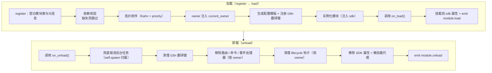
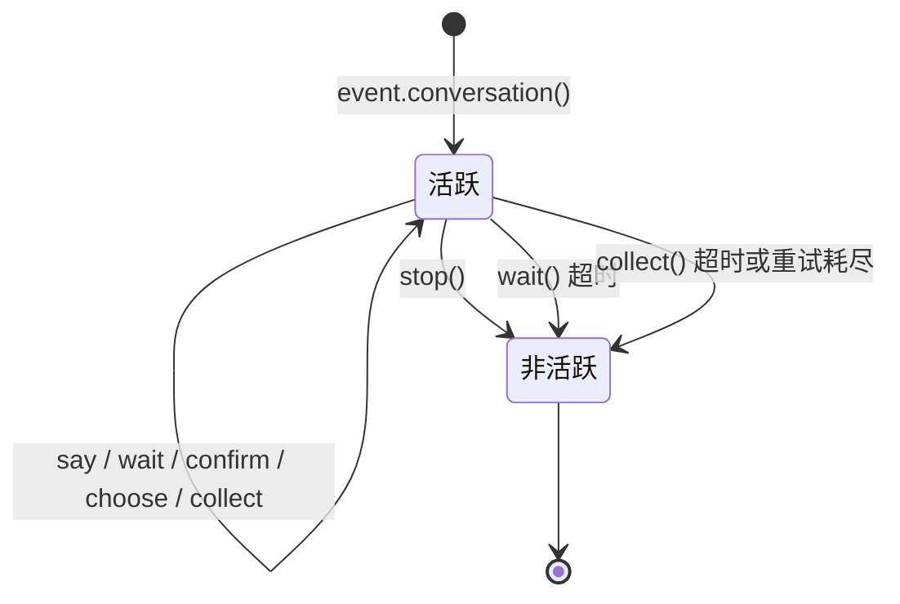

# ErisPulse 模块开发

本技能由 ErisPulse 文档自动构建（generate-skills.py）。
仓库：https://github.com/ErisPulse/ErisPulse
各节末尾标注了来源文档路径，需要最新内容请以仓库 docs/zh-CN/ 为准。

## 模块开发入门

> 来源: `docs/zh-CN/developer-guide/modules/getting-started.md`（https://github.com/ErisPulse/ErisPulse/blob/main/docs/zh-CN/developer-guide/modules/getting-started.md）

# 模块开发入门

> [!NOTE]
> **L1 核心必读**——首页"阅读路径"中的五篇核心文档之一，模块开发必备。


跟着这篇走完，你会得到一个能响应 `/hello` 命令的可运行模块，并了解模块的项目结构、注册方式与加载 / 卸载钩子——后续所有模块文档都建立在这套骨架上。

## 项目结构

一个标准的模块结构：

```
MyModule/
├── pyproject.toml
├── README.md
├── LICENSE
└── MyModule/
    ├── __init__.py
    └── Core.py
```

## pyproject.toml 配置

```toml
[project]
name = "ErisPulse-MyModule"
version = "1.0.0"
description = "模块功能描述"
readme = "README.md"
requires-python = ">=3.10"
license = { file = "LICENSE" }
authors = [ { name = "yourname", email = "your@mail.com" } ]
dependencies = []

[project.urls]
"homepage" = "https://github.com/yourname/MyModule"

[project.entry-points."erispulse.module"]
"MyModule" = "MyModule:Main"
```

## __init__.py

```python
from .Core import Main
```

## Core.py - 基础模块

```python
from ErisPulse import sdk
# 推荐根导入（2.10+）：常用符号直接从根包导入，深路径仍兼容
from ErisPulse import BaseModule, command

class Main(BaseModule):
    def __init__(self, sdk):
        self.sdk = sdk
        self.logger = sdk.logger.get_child("MyModule")
        self.storage = sdk.storage
    
    @staticmethod
    def get_load_strategy():
        """返回模块加载策略"""
        from ErisPulse.loaders import ModuleLoadStrategy
        return ModuleLoadStrategy(
            lazy_load=True,
            priority=0,
            depends=[],  # 可选：依赖的其他模块列表
            # 可选：事件驱动懒激活——声明触发器，首个匹配事件/命令到达时自动加载
            # activate_on=[{"command": {"name": "hello", "help": "发送问候"}}],
        )
    
    async def on_load(self, event):
        """模块加载时调用"""
        @command("hello", help="发送问候")
        async def hello_command(event):
            name = event.get_user_nickname() or "朋友"
            await event.reply(f"你好，{name}！")
        
        self.logger.info("模块已加载")
    
    async def on_unload(self, event):
        """模块卸载时调用"""
        self.logger.info("模块已卸载")
```

> **配置读取**：上面的基础示例未使用配置。需要读取配置时，推荐声明嵌套的 `ConfigClass` 并通过 `self.cfg` 实时读取（见 [模块核心概念](core-concepts.md#声明式配置推荐)）。手动调用 `_load_config()` 的旧写法已废弃。

## 测试模块

### 本地测试

```bash
# 在项目目录安装模块
epsdk install ./MyModule

# 运行项目
epsdk run main.py --reload
```

### 测试命令

发送命令测试：

```
/hello
```

## 核心概念

### BaseModule 基类

所有模块必须继承 `BaseModule`，提供以下方法：

| 方法 | 说明 | 必须 |
|------|------|------|
| `__init__(self, sdk)` | 构造函数（框架传入 `sdk` 实例） | 否 |
| `get_load_strategy()` | 返回加载策略 | 否 |
| `get_meta()` | 返回模块介绍元信息（可选） | 否 |
| `on_load(self, event)` | 模块加载时调用 | 是 |
| `on_unload(self, event)` | 模块卸载时调用 | 是 |

### 模块介绍 meta

> [!NOTE]
> 本特性需要 ErisPulse **2.8.0+**。

通过 `get_meta()` 声明模块的介绍元信息（这个模块是干什么的、属于哪一类等）。
元信息是模块的**通用介绍数据**，供 help 模块、Dashboard 模块列表、模块商店等各类界面/生态模块消费。

与 `get_load_strategy()` 返回 `ModuleLoadStrategy` 一致，**推荐返回 `ModuleMeta` 配置类实例**（属性键入、IDE 补全），也兼容直接返回 dict：

```python
class MyModule(BaseModule):
    @staticmethod
    def get_meta() -> ModuleMeta:
        return ModuleMeta(
            name="天气",               # 显示名（默认注册名）
            description="查询城市天气",  # 模块简介
            version="1.0.0",
            author="ErisDev",
            group="工具",               # 功能分组
            tags=["天气", "查询"],
        )
```

兼容写法（dict）：

```python
class MyModule(BaseModule):
    @staticmethod
    def get_meta() -> dict:
        return {
            "name": "天气",
            "description": "查询城市天气",
            "version": "1.0.0",
            "author": "ErisDev",
            "group": "工具",
            "tags": ["天气", "查询"],
        }
```

- `module.get_meta("MyModule")` 读取已解析的元信息（类声明 > 注册 info，自动补全该模块的命令名）。
- `module.get_commands_overview()` 聚合「模块 meta + 其注册的命令（别名/分组/帮助）」，按模块组织的命令总览。
- 命令归属模块通过 `cmd_info["owner"]` 获取（注册时由上下文系统自动注入）。

#### meta 字段的 i18n 支持

元信息字段值可用纯字符串，或 i18n 字典 `{"i18n": "key.path", "default": "兜底文本"}`（与配置 `description` 约定一致）。
翻译键通过 `I18nClass` 声明注册，`module.get_meta()` 读取时自动解析为当前语言文本：

```python
class MyModule(BaseModule):
    class I18nClass(BaseI18n):
        meta_description: I18nKey = I18nKey(
            default="Weather lookup",
            zh_CN="查询城市天气",
            en="Weather lookup",
        )

    @staticmethod
    def get_meta() -> ModuleMeta:
        return ModuleMeta(
            name="天气",
            description={"i18n": "MyModule.meta_description", "default": "Weather lookup"},
        )
```

### SDK 对象

通过 `sdk` 对象访问核心功能：

```python
from ErisPulse import sdk

sdk.storage    # 存储系统
sdk.config     # 配置系统
sdk.logger     # 日志系统
sdk.adapter    # 适配器系统
sdk.router     # 路由系统
sdk.lifecycle  # 生命周期系统
```

### 继续学习路径

- [模块核心概念](core-concepts.md) - 深入了解模块架构
- [Event 包装类详解](event-wrapper.md) - 学习 Event 对象

### 写完之后

- [模块最佳实践](best-practices.md) - 开发高质量模块

## 模块核心概念

> 来源: `docs/zh-CN/developer-guide/modules/core-concepts.md`（https://github.com/ErisPulse/ErisPulse/blob/main/docs/zh-CN/developer-guide/modules/core-concepts.md）

# 模块核心概念

> [!NOTE]
> **L1 核心必读**——首页"阅读路径"中的五篇核心文档之一，模块开发必备。


这篇讲清模块从加载到卸载的完整生命周期、声明式配置与存储的用法——哪些事框架自动替你做、你只需要写什么，看完就有数。

## 模块生命周期

### 加载策略

```python
from ErisPulse.Core.Bases import BaseModule
from ErisPulse.loaders import ModuleLoadStrategy

class MyModule(BaseModule):
    @staticmethod
    def get_load_strategy():
        """返回模块加载策略"""
        return ModuleLoadStrategy(
            lazy_load=True,   # 懒加载还是立即加载
            priority=0,       # 加载优先级（数值越大越先加载）
            depends=["OtherModule"]  # 可选：声明依赖的其他模块
        )
```

> `depends` 声明的模块如果未注册，当前模块将被跳过并记录警告。加载顺序由拓扑排序决定，同层级按 `priority` 降序。

> [!NOTE]
> **级联卸载 / 级联重载**（ErisPulse **2.8.0+**）：卸载被其它模块依赖的模块时，依赖它的模块会**先被级联卸载**（日志说明级联链）；热重载任意模块（本地插件 / 运行时注册 / PyPI 安装包）时，依赖它的模块同样**级联重载**，避免依赖者持有失效实例引用继续运行。声明循环依赖会在加载时以 `RuntimeError` 拒绝。
>
> **reload 即全量重载**（ErisPulse **2.11.0+**）：`reload()` 默认按顶层包名清理 import 缓存并重导依赖者代码，卸载前自动语法预检（失败拒绝卸载、旧实例继续服务），成功后核对代码身份（假重载告警 / `stale` 标记）；load 失败现场可经 `sdk.module.last_error(名字)` 直接查询（含 traceback）。

### on_load 方法

模块加载时调用，用于初始化资源和注册事件处理器：

```python
async def on_load(self, event):
    # 注册事件处理器
    @command("hello", help="问候命令")
    async def hello_handler(event):
        await event.reply("你好！")
    
    # 使用 SDK 内置 HTTP 客户端（自动管理连接池，无需手动创建 session）
    # 通过 sdk.client 即可发送请求
```

### on_unload 方法

模块卸载时调用，用于清理资源：

```python
async def on_unload(self, event):
    # 清理自定义资源
    # sdk.client 由框架管理，无需手动关闭
    
    # 取消事件处理器（框架会自动处理）
    self.logger.info("模块已卸载")
```

> 后台任务的创建与清理（`self.spawn()` / 框架兜底取消）详见 [生命周期管理](../../advanced/lifecycle.md#后台任务归属与自动取消)。

### on_before_unload 方法

> [!NOTE]
> 本钩子需要 ErisPulse **2.11.0+**。

卸载流水线**第一步**（先于 `on_unload` 与资源回收）触发的可选钩子——此时模块的一切
资源仍然完好，适合在卸载 / 归眠 / 重载前把状态保存到 `sdk.storage`，下次 `on_load`
恢复（懒加载休眠的状态接续即基于此）：

```python
async def on_before_unload(self, event):
    # event["reason"] 标注来意：unload / reload / disable / cascade / dormant
    if event["reason"] in ("reload", "dormant"):
        await self.sdk.storage.aset(f"{self._module_name}:state", self.collect_state())
```

钩子失败仅告警，不阻塞卸载流程；未声明该钩子的模块行为不变。归眠 / 唤醒语义详见
[懒加载休眠](../../advanced/lazy-loading.md#懒加载休眠dormant_after)。

### 卸载与彻底卸载（purge）

> [!NOTE]
> 本特性需要 ErisPulse **2.8.0+**。

`unload()` 默认只**取消加载**（卸载实例与资源），但保留注册存根（模块类与元信息）——模块仍可被 discover 重新发现、`load()` 重新实例化，无需重新 `register()`。

当需要**彻底卸载**（释放模块类引用、清理 `sys.modules`，让插件及其独占依赖可被 GC 回收）时，传入 `purge=True`：

```python
# 只取消加载：保留注册存根，可随时重新 load()
await sdk.module.unload("MyModule")

# 彻底卸载：删除注册存根 + 清理 sys.modules（插件来源）
await sdk.module.unload("MyModule", purge=True)
```

| 语义 | `unload()` 默认 | `unload(purge=True)` |
|------|-----------------|----------------------|
| 卸载实例与资源（事件/task/路由/lifecycle/i18n） | ✅ | ✅ |
| 保留注册存根（模块类与元信息） | ✅ | ❌ 删除 |
| 清理 `sys.modules`（仅插件文件夹来源） | ❌ | ✅ |
| 模块类可被 GC 回收 | ❌ | ✅ |
| 重新加载 | `load()` 直接可用 | 需先 `register()` + `load()` |

> `purge=True` 时级联卸载的依赖者同样被 purge；卸载后框架会 `gc.collect()` 并检查模块类/实例是否可回收，残留引用会在日志中告警（含引用方，DEBUG 级）。

### 生命周期全景

把上面的方法串起来，框架在加载与卸载一个模块时，**在背后为你做的全部事情**：



**加载时框架帮你做了什么**（你只需写 `on_load`，其余自动完成）：

| 环节 | 框架自动做的 |
|------|-------------|
| owner 注入 | 实例化期间用 `owner_scope` 包住模块名——你 `on_load` 里注册的命令/事件/钩子/后台任务**自动归属本模块**，卸载时按 owner 一键清理 |
| 配置模板 | 声明了 `ConfigClass` 的模块，框架自动生成/填充 `ErisPulse.<ModuleName>` 配置段 |
| i18n 翻译键 | 声明了 `I18nClass` 的模块，翻译键自动注册（卸载时自动注销） |
| 依赖拓扑 | 按 `depends` 声明排序，确保被依赖模块先加载；循环依赖以 `RuntimeError` 拒绝 |
| SDK 挂载 | 实例化后挂到 `sdk.<ModuleName>`，你才能 `sdk.MyModule.xxx` 访问 |

**卸载时框架帮你清理的**（对应上面的 U1→U7）：`on_unload` 跑完后再兜底清理——后台任务强制取消（`self.spawn` 创建的，优雅收尾请在 `on_unload` 自行做）、i18n 键、路由、命令/事件处理器、lifecycle 钩子，最后移除 SDK 属性。`purge=True` 额外删除注册存根 + 清理 `sys.modules`。

> 这些自动清理就是「你只需写 `on_load`/`on_unload`，不用手动 unregister」的底气——框架用 owner 归属把「谁注册的谁清理」做成了一键式。

## SDK 对象

### 访问核心模块

```python
from ErisPulse import sdk

# 通过 sdk 对象访问所有核心模块
sdk.logger.info("日志")
sdk.storage.set("key", "value")
config = sdk.config.getConfig("MyModule")
```

### 模块间通信

```python
# 访问其他模块
other_module = sdk.OtherModule
result = await other_module.some_method()
```

## 适配器发送方法查询

由于新的标准规范要求使用重写 `__getattr__` 方法来实现兜底发送机制，导致无法使用 `hasattr` 方法来检查方法是否存在。从 `2.3.5` 开始，新增了查询发送方法的功能。

### 列出支持的发送方法

```python
# 列出平台支持的所有发送方法
methods = sdk.adapter.list_sends("onebot11")
# 返回: ["Text", "Image", "Voice", "Markdown", ...]
```

### 获取方法详细信息

```python
# 获取某个方法的详细信息
info = sdk.adapter.send_info("onebot11", "Text")
# 返回:
# {
#     "name": "Text",
#     "parameters": [
#         {"name": "text", "type": "str", "default": null, "annotation": "str"}
#     ],
#     "return_type": "Awaitable[Any]",
#     "docstring": "发送文本消息..."
# }
```

## 配置管理

### 声明式配置（推荐）

从 v2.5.2 起，模块可通过 `ConfigClass` 声明配置类，与适配器使用同一套配置 Schema 系统。配置通过 `self.cfg` 实时读取，修改后立即生效：

```python
from dataclasses import dataclass, field
from ErisPulse.Core.Bases import BaseModule
from ErisPulse.Core.Bases import BaseConfig

@dataclass
class MyModuleConfig(BaseConfig):
    api_key: str = field(
        default="",
        metadata={
            "description": {"i18n": "my_module.api_key", "default": "API 密钥"},
            "required": True,
            "secret": True,
            "ui": {"widget": "password", "group": "basic", "order": 1},
        },
    )
    timeout: int = field(
        default=30,
        metadata={
            "description": {"i18n": "my_module.timeout", "default": "超时时间（秒）"},
            "ui": {"widget": "number", "group": "advanced", "order": 2},
        },
    )

class MyModule(BaseModule):
    ConfigClass = MyModuleConfig

    def __init__(self, sdk):
        self.sdk = sdk
        self.logger = sdk.logger.get_child("MyModule")

    async def on_load(self, event):
        self.logger.info("模块已加载")

    async def on_unload(self, event):
        pass

    async def do_something(self):
        cfg = self.cfg  # 实时读取，类型安全
        api_key = cfg.api_key
        timeout = cfg.timeout
```

`BaseConfig` 是通用配置基类，适用于适配器、模块、外部项目等任何场景。配置字段支持 i18n 多语言描述（详见 [i18n 文档](../../advanced/i18n.md#配置字段多语言)）。

> [!NOTE]
> 模块（含适配器）的加载、卸载、启停等生命周期由框架统一管理（`module manager` / `scope` 提供查询与控制 API）。`ConfigClass` 只应承载业务参数，模块无需在内部再次嵌套判断"自己要不要启动"的逻辑。

配置 Schema 系统还支持（v2.8.0+，详见 [适配器 core-concepts](../adapters/core-concepts.md#metadata-约定)）：

- **docstring 自动生成字段描述**：未声明 metadata `description` 时，自动从 docstring 的 `:ivar 字段: 说明` 或 `Attributes:` 段提取兜底
- **嵌套 dataclass 配置**：字段类型为嵌套 dataclass 时，schema/模板/校验递归处理，WebUI 渲染为嵌套分组
- **`example` 不落盘字段**：`metadata={"example": True}` 的字段不写入 config.toml，仅记录在 `config.full.example`（适合冗杂又很少触碰的高级配置项），用户手动设置后正常持久化

### 声明式翻译键（v2.7.0+）

从 v2.7.0 起，模块还可以像声明 `ConfigClass` 一样，通过嵌套类 `I18nClass` 集中声明翻译键。框架会在加载时**自动注册**所有声明的翻译键，无需手动调用 `i18n.register()`，且注册时机早于配置模板生成，确保配置描述中引用的 i18n 键已可用。

```python
from ErisPulse.Core.Bases import BaseConfig, BaseI18n, I18nKey

class MyModule(BaseModule):
    # 配置类（可选）
    @dataclass
    class ConfigClass(BaseConfig):
        welcome_msg: str = field(
            default="欢迎",
            metadata={
                "description": {"i18n": "mymodule.welcome_msg", "default": "欢迎消息"},
            },
        )

    # 翻译键集合类（可选）
    class I18nClass(BaseI18n):
        # 属性名自动拼接为完整键路径：<模块名>.<属性名>
        welcome_msg: I18nKey = I18nKey(
            default="Welcome Message",   # 语言无关的兜底
            zh_CN="欢迎消息",
            zh_TW="歡迎訊息",
            en="Welcome Message",
            ja="ウェルカムメッセージ",
            ru="Приветственное сообщение",
        )
        hello: I18nKey = I18nKey(
            default="Hello, {name}!",
            zh_CN="你好，{name}！",
            zh_TW="你好，{name}！",
            en="Hello, {name}!",
            ja="こんにちは、{name}！",
            ru="Привет, {name}!",
        )
```

详情见 [i18n 推荐写法](../../advanced/i18n.md#推荐写法通过-i18nclass-声明翻译键-v270)。

### 手动读取配置（已废弃）

> **已废弃**：请改用 [声明式配置](#声明式配置推荐) + `self.cfg` 实时读取。

```python
class MyModule(BaseModule):
    def __init__(self, sdk):
        self.sdk = sdk

    def _load_config(self):
        config = self.sdk.config.getConfig("MyModule")
        if not config:
            self.sdk.config.setConfig("MyModule", {"api_key": "", "timeout": 30})
            return {"api_key": "", "timeout": 30}
        return config
```

## 存储系统

### 基本使用

```python
# 存储数据
sdk.storage.set("user:123", {"name": "张三"})

# 获取数据
user = sdk.storage.get("user:123", {})

# 删除数据
sdk.storage.delete("user:123")
```

### 事务使用

```python
# 使用事务确保数据一致性
with sdk.storage.transaction():
    sdk.storage.set("key1", "value1")
    sdk.storage.set("key2", "value2")
    # 如果任何操作失败，所有更改都会回滚
```

## 事件处理

### 事件处理器注册

```python
from ErisPulse.Core.Event import command, message

# 注册命令
@command("info", help="获取信息")
async def info_handler(event):
    await event.reply("这是信息")

# 注册消息处理器
@message.on_group_message()
async def group_handler(event):
    sdk.logger.info(f"收到群消息: {event.get_text()}")
```

### 事件处理器生命周期

框架会自动管理事件处理器的注册和注销，你只需要在 `on_load` 中注册即可。

## 懒加载机制

### 工作原理

```python
# 模块首次被访问时才会初始化
result = await sdk.my_module.some_method()
# ↑ 这里会触发模块初始化
```

### 立即加载

对于需要立即初始化的模块（如监听器、定时器）：

```python
@staticmethod
def get_load_strategy():
    return ModuleLoadStrategy(
        lazy_load=False,  # 立即加载
        priority=100
    )
```

## 错误处理

### 异常捕获

```python
async def handle_event(self, event):
    try:
        # 业务逻辑
        await self.process_event(event)
    except ValueError as e:
        self.logger.warning(f"参数错误: {e}")
        await event.reply(f"参数错误: {e}")
    except Exception as e:
        self.logger.error(f"处理失败: {e}")
        raise
```

### 日志记录

```python
# 使用不同的日志级别
self.logger.debug("调试信息")    # 详细调试信息
self.logger.info("运行状态")      # 正常运行信息
self.logger.warning("警告信息")  # 警告信息
self.logger.error("错误信息")    # 错误信息
self.logger.critical("致命错误") # 致命错误
```

### 继续学习路径

- [Event 包装类](event-wrapper.md) - 事件处理详解

### 深入与排查

- [模块最佳实践](best-practices.md) - 开发高质量模块
- [模块开发入门](getting-started.md) - 回看第一个模块的搭建步骤

## Event 包装类

> 来源: `docs/zh-CN/developer-guide/modules/event-wrapper.md`（https://github.com/ErisPulse/ErisPulse/blob/main/docs/zh-CN/developer-guide/modules/event-wrapper.md）

# Event 包装类详解

> [!NOTE]
> **L1 核心必读**——首页"阅读路径"中的五篇核心文档之一，模块开发必备。


处理器里的 `event` 参数之所以能直接 `.get_text()` / `.reply()` / `.wait_reply()`，靠的就是 Event 包装类。本篇是它的完整方法清单——写事件处理器时按需查阅，方法签名与行为都以这里为准。

## 为 event 参数添加类型注解

事件处理器的 `event` 参数是 **Event 包装类**（dict 子类）。强烈建议为它添加类型注解：

```python
from ErisPulse.Core.Event import Event

@message.on_private_message()
async def handler(event: Event):
    text = event.get_text()   # IDE 自动补全所有便捷方法
    await event.reply(text)   # 拼写错误在静态检查时即可发现
```

不加注解时 IDE 无法识别 Event 上的方法（`get_text()` / `reply()` / `wait_reply()` / 平台扩展方法均不提示），只能靠记忆拼写。

> **注意区分**：事件处理器回调的 `event` 是 **Event 包装类**（注解为 `Event`）；模块生命周期方法 `on_load` / `on_unload` 的 `event` 是普通 **dict**（注解为 `dict`），二者不要混淆。

## 核心特性

- **完全兼容字典**：Event 继承自 dict
- **便捷方法**：提供大量便捷方法
- **点式访问**：支持使用点号访问事件字段
- **向后兼容**：所有方法都是可选的

## 核心字段方法

```python
from ErisPulse.Core.Event import command

@command("info")
async def info_command(event: Event):
    event_id = event.get_id()
    platform = event.get_platform()
    time = event.get_time()
    print(f"ID: {event_id}, 平台: {platform}, 时间: {time}")
```

## 消息事件方法

```python
from ErisPulse.Core.Event import message

@message.on_private_message()
async def private_handler(event: Event):
    text = event.get_text()
    user_id = event.get_user_id()
    nickname = event.get_user_nickname()
    await event.reply(f"你好，{nickname}！")
```

## 消息类型判断

```python
from ErisPulse.Core.Event import message

@message.on_group_message()
async def group_handler(event: Event):
    is_private = event.is_private_message()
    is_group = event.is_group_message()
    is_at = event.is_at_message()
    await event.reply(f"类型: {'私聊' if is_private else '群聊'}")
```

## 回复功能

```python
from ErisPulse.Core.Event import command

@command("ask")
async def ask_command(event: Event):
    await event.reply("请输入你的名字:")
    reply = await event.wait_reply(timeout=30)
    if reply:
        name = reply.get_text()
        await event.reply(f"你好，{name}！")

@command("price")
async def price_command(event: Event):
    await event.reply("请输入金额（如：5元）:")
    # 回复必须匹配正则，否则继续等待直到超时
    reply = await event.wait_reply(timeout=30, regex=r"\d+\s*元")
    if reply:
        await event.reply(f"收到金额：{reply.get_text()}")
```

## 交互会话进阶

> [!NOTE]
> 本节能力需要 ErisPulse **2.8.0+**。

```python
# 会话定时提醒：5 分钟无回复则提醒，用户回复后自动取消
reminder = event.remind(300, "还在吗？不想聊了回复「退出」")
reminder.cancel()  # 也可手动取消

# 超时升级：到点必达（不被回复取消），如长时间未处理通知主人
event.escalate(1800, lambda e: notify_master("工单超时"))

# 多路等待：同时等"同意"与"拒绝"，先到先得
which, reply = await event.select(
    event.expect(pattern="同意*", user="10001"),
    event.expect(pattern="拒绝*", user="10002"),
    timeout=60,
)
if which is None:
    await event.reply("超时未收到审批")

# 会话级等待：同群任何人的回复均可命中（群协作）
reply = await event.wait_reply(session=True, prompt="哪位大佬帮忙答一下？")

# 会话收件箱：当前会话最近 20 条消息（含机器人，AI 上下文 / 防复读底座）
messages = await event.history(20)

# 消息事务：异常时自动撤回事务内已发送的消息
async with event.message_tx():
    await event.reply("处理中，请稍候...")
    result = await do_something()
    await event.reply(f"完成：{result}")
```

## 命令信息获取

```python
from ErisPulse.Core.Event import command

@command("cmdinfo")
async def cmdinfo_command(event: Event):
    cmd_name = event.get_command_name()
    cmd_args = event.get_command_args()
    await event.reply(f"命令: {cmd_name}, 参数: {cmd_args}")
```

## 通知事件方法

```python
from ErisPulse.Core.Event import notice

@notice.on_friend_add()
async def friend_add_handler(event: Event):
    await event.reply("欢迎添加我为好友！")
```

## 方法速查表

### 核心方法

#### 事件基础信息
- `get_id()` - 获取事件ID
- `get_time()` - 获取事件时间戳（Unix秒级）
- `get_type()` - 获取事件类型（message/notice/request/meta）
- `get_detail_type()` - 获取事件详细类型（private/group/friend等）
- `get_platform()` - 获取平台名称

#### 机器人信息
- `get_self_platform()` - 获取机器人平台名称
- `get_self_user_id()` - 获取机器人用户ID
- `get_self_account_id()` - 获取机器人账户ID（多Bot模式）
- `get_self_info()` - 获取机器人完整信息字典

#### 会话标识
- `get_target_id()` - 获取统一目标 ID（群聊返回 `group_id`，频道返回 `channel_id`，私聊返回 `user_id`，按 group → channel → guild → thread → user 顺序取首个非空值）
- `get_session_id()` - 获取会话唯一标识，格式为 `{platform}:{detail_type}:{target_id}`

### 消息事件方法

#### 消息内容
- `get_message()` - 获取消息段数组（OneBot12格式）
- `get_alt_message()` - 获取消息备用文本
- `get_text()` - 获取纯文本内容（`get_alt_message()` 的别名）
- `get_message_text()` - 获取纯文本内容（`get_alt_message()` 的别名）

#### 发送者信息
- `get_user_id()` - 获取发送者用户ID
- `get_user_nickname()` - 获取发送者昵称
- `get_sender()` - 获取发送者完整信息字典

#### 群组/频道信息
- `get_group_id()` - 获取群组ID（群聊消息）
- `get_channel_id()` - 获取频道ID（频道消息）
- `get_guild_id()` - 获取服务器ID（服务器消息）
- `get_thread_id()` - 获取话题/子频道ID（话题消息）

#### @消息相关
- `has_mention()` - 是否包含@机器人
- `get_mentions()` - 获取所有被@的用户ID列表

### 消息类型判断

#### 基础判断
- `is_message()` - 是否为消息事件
- `is_private_message()` - 是否为私聊消息
- `is_group_message()` - 是否为群聊消息
- `is_at_message()` - 是否为@消息（`has_mention()` 的别名）

### 通知事件方法

#### 通知操作者
- `get_operator_id()` - 获取操作者ID
- `get_operator_nickname()` - 获取操作者昵称

#### 通知类型判断
- `is_notice()` - 是否为通知事件
- `is_group_member_increase()` - 群成员增加事件
- `is_group_member_decrease()` - 群成员减少事件
- `is_friend_add()` - 好友添加事件（匹配 `detail_type == "friend_increase"`）
- `is_friend_delete()` - 好友删除事件（匹配 `detail_type == "friend_decrease"`）

### 请求事件方法

#### 请求信息
- `get_comment()` - 获取请求附言

#### 请求类型判断
- `is_request()` - 是否为请求事件
- `is_friend_request()` - 是否为好友请求
- `is_group_request()` - 是否为群组请求

### 回复功能

#### 基础回复
- `reply(content, method="Text", at_sender=False, quote=False, at_users=None, reply_to=None, at_all=False, via=None, **kwargs)` - 通用回复方法
  - `content`: 发送内容（文本、URL等）
  - `method`: 发送方法，默认 "Text"，可选 "Image"/"Voice"/"Video"/"File" 等
  - `at_sender`: 是否@发送者（自动提取 user_id）
  - `quote`: 是否引用回复当前消息（自动提取 message_id）
  - `at_users`: @用户列表，如 `["user1", "user2"]`
  - `reply_to`: 手动指定回复的消息 ID
  - `at_all`: 是否@全体成员
  - `**kwargs`: 额外参数（如 Mention 方法的 user_id）

- `reply_ob12(message)` - 使用 OneBot12 消息段回复
  - `message`: OneBot12 消息段列表或字典，可配合 MessageBuilder 构建

#### 平台能力查询
- `supports(method)` - 检查当前平台是否支持某发送方法（如 `"Image"`、`"Voice"`），返回 `bool`
- `available_methods()` - 列出当前平台所有可用发送方法，返回方法名列表

#### 转发功能

> **注意**：转发功能需要通过适配器的 Send DSL 实现，Event 包装类本身不提供直接的转发方法。

```python
# 转发消息到群组
adapter = sdk.adapter.get(event.get_platform())
target_id = event.get_group_id()  # 或指定其他群组ID
await adapter.Send.To("group", target_id).Text(event.get_text())
```

### 等待回复功能

- `wait_reply(prompt=None, timeout=60.0, callback=None, validator=None, method="Text", pattern=None, regex=None)` - 等待用户回复
  - `prompt`: 提示消息，如果提供会发送给用户
  - `timeout`: 等待超时时间（秒），默认60秒
  - `callback`: 回调函数，当收到回复时执行
  - `validator`: 验证函数，用于验证回复是否有效
  - `method`: 发送提示消息的方法，默认 "Text"
  - `pattern`: glob 通配符（`*` / `?` / `[seq]`），回复文本必须匹配，不匹配则继续等待
  - `regex`: 正则表达式，回复文本必须匹配（`pattern` 与 `regex` 二选一），不匹配则继续等待
  - 返回用户回复的 Event 对象，超时返回 None

#### 交互方法

- `confirm(prompt=None, timeout=60.0, yes_words=None, no_words=None, method="Text", hint=False)` - 确认对话
  - 返回 `True`（确认）/ `False`（否定）/ `None`（超时）
  - 内置中英文确认词自动识别，可自定义词集
  - `method`: 发送方法，默认 "Text"；支持 "Image"/"Markdown" 等非文本方式发送提示
  - `hint`: 是否在提示末尾自动追加确认词提示（如 "（是/否）"），默认 False

- `choose(prompt, options, timeout=60.0, method="Text", options_format="auto", merge_prompt=False, placeholder="{options}")` - 选择菜单
  - `options`: 选项文本列表
  - 返回选项索引（0-based），超时返回 `None`
  - `method`: 发送方法，默认 "Text"；文本类方法 (Text/Markdown/md/Html/h5) 默认合并选项到末尾
  - `options_format`: 选项格式（默认: "auto"，根据 method 自动选择内置样式）
    - `"auto"`：Markdown→无序列表（`- 1.选项`），Html→有序列表（`<ol>`），其他→纯文本列表
    - `"list"`：每行一个，如 ``1. 选项A\n2. 选项B``
    - `"inline"`：单行展示，如 ``1.A | 2.B``
    - `"md"`：Markdown 无序列表
    - `"html"`：Html 有序列表
    - `callable`：自定义函数，接收 ``list[str]`` 返回 ``str``
  - `merge_prompt`: 是否强制合并为一条消息发送，默认 False
    - `False`（默认）：文本类方法自动合并；非文本方法先发 prompt 再发 Text 选项
    - `True`：无论什么 method 都合并为一条消息，用用户指定的 method 发送
  - `placeholder`: 选项插入占位符，默认 `{options}`；prompt 中出现该标记的位置替换为选项文本，设为空字符串则始终追加到末尾

- `collect(fields, timeout_per_field=60.0)` - 表单收集
  - `fields`: 字段列表，每项包含 `key`、`prompt`、可选 `validator`、可选 `method`
  - 返回 `{key: value}` 字典，任一字段超时返回 `None`
  - 每个 field 支持 `method` 键指定发送方法，例如收集图片时用 `{"key": "avatar", "prompt": "请发送头像", "method": "Image"}`
  - 每个 field 可选 `options` 键（列表），提供时该字段变为选择题（自动调用 choose 逻辑）
  - 每个 field 可选 `options_format`、`merge_prompt`、`placeholder` 键，控制选项格式、消息合并行为和占位符

- `wait_for(event_type="message", condition=None, timeout=60.0)` - 等待任意事件
  - `condition`: 过滤函数，返回 `True` 时匹配
  - 返回匹配的 Event 对象，超时返回 `None`

- `conversation(timeout=60.0)` - 创建多轮对话上下文
  - 返回 `Conversation` 对象，支持 `say()`/`wait()`/`confirm()`/`choose()`/`collect()`/`stop()`
  - `is_active` 属性表示对话是否活跃

#### 交互方法示例

**confirm() - 确认对话：**

```python
@command("delete", help="删除数据")
async def delete_handler(event: Event):
    if await event.confirm("确定要删除所有数据吗？"):
        sdk.storage.delete("all_data")
        await event.reply("数据已删除")
    else:
        await event.reply("已取消")
```

**confirm() - 带提示词：**

```python
# hint=True 会在提示末尾追加 "（是/否）"
if await event.confirm("确定继续？", hint=True):
    await event.reply("已继续")
# 用户看到：确定继续？（是/否）
```

**choose() - 选择菜单：**

```python
@command("color", help="选择颜色")
async def color_handler(event: Event):
    choice = await event.choose("请选择颜色：", ["红色", "绿色", "蓝色"])
    if choice is not None:
        colors = ["红色", "绿色", "蓝色"]
        await event.reply(f"你选择了：{colors[choice]}")
```

**choose() - 选项格式化与消息合并：**

```python
# inline 格式：选项显示在同一行
choice = await event.choose("请选择：", ["A", "B", "C"], options_format="inline")
# 输出：1.A | 2.B | 3.C

# 自定义格式
choice = await event.choose("请选择：", ["猫", "狗"],
    options_format=lambda opts: " / ".join(opts))
# 输出：猫 / 狗

# options_format="auto"（默认）：根据 method 自动选择内置样式
# Markdown → 无序列表
choice = await event.choose(
    "## 请选择", ["猫", "狗"],
    method="Markdown",  # auto 自动识别为 md 列表
)
# 输出：
# ## 请选择
# - 1. 猫
# - 2. 狗

# Html → 有序列表
choice = await event.choose(
    "<h2>请选择</h2>", ["猫", "狗"],
    method="Html", merge_prompt=True,  # auto 自动识别为 html 列表
)
# 输出：
# <h2>请选择</h2>
# <ol><li>1. 猫</li><li>2. 狗</li></ol>

# 合并模式 + 占位符
choice = await event.choose(
    "## 请选择\n{options}\n请回复编号",
    ["猫", "狗"],
    method="Markdown", merge_prompt=True,
)

# 自定义占位符
choice = await event.choose(
    "请选择: [choices]",
    ["猫", "狗"],
    placeholder="[choices]",
)
```

**collect() - 表单收集：**

```python
@command("register", help="注册")
async def register_handler(event: Event):
    data = await event.collect([
        {"key": "name", "prompt": "请输入姓名："},
        {"key": "age", "prompt": "请输入年龄：",
         "validator": lambda e: e.get_text().isdigit()},
    ])
    if data:
        await event.reply(f"注册成功！{data['name']}，{data['age']}岁")
```

**非 Text 方法的 reply：**

```python
await event.reply("http://example.com/img.jpg", method="Image")
await event.reply("http://example.com/audio.mp3", method="Voice")

from ErisPulse.Core.Event import MessageBuilder
segments = MessageBuilder.text("看这张图：").image("http://example.com/img.jpg").build()
await event.reply_ob12(segments)
```

> 完整的 Conversation 多轮对话用法请参考 [Conversation 多轮对话](../../advanced/conversation.md)。

### 命令信息

#### 命令基础
- `get_command_name()` - 获取命令名称
- `get_command_args()` - 获取命令参数列表
- `get_command_raw()` - 获取命令原始文本
- `get_command_info()` - 获取完整命令信息字典
- `is_command()` - 是否为命令

### 原始数据

- `get_raw()` - 获取平台原始事件数据
- `get_raw_type()` - 获取平台原始事件类型

### 平台扩展方法

适配器可以为 Event 包装类注册平台专有方法。方法仅在对应平台的 Event 实例上可用，其他平台访问时抛出 `AttributeError`。

平台方法通过 `Event.__getattribute__` 优先于内置方法生效，因此可以覆写 `confirm`、`choose`、`collect`、`wait_reply` 等内置交互方法，提供平台特色实现（如按钮、卡片等）。内置实现作为 `_builtin_*` 函数导出供覆写方调用。

```python
# 邮件事件 - 只有邮件方法
event = Event({"platform": "email", "email_raw": {"subject": "Hello"}})
event.get_subject()      # ✅ 返回 "Hello"
event.get_chat_type()    # ❌ AttributeError

# Telegram 事件 - 只有 Telegram 方法
event = Event({"platform": "telegram", "telegram_raw": {"chat": {"type": "private"}}})
event.get_chat_type()    # ✅ 返回 "private"
event.get_subject()      # ❌ AttributeError

# 内置方法始终可用
event.get_text()         # ✅ 任何平台
event.reply("hi")        # ✅ 任何平台
```

### 查询已注册方法

```python
from ErisPulse.Core.Event import get_platform_event_methods

methods = get_platform_event_methods("email")
# ["get_subject", "get_from", ...]
```

### `hasattr` 和 `dir` 支持

```python
hasattr(event, "get_subject")   # 仅当 platform="email" 时返回 True
"get_subject" in dir(event)     # 同上
```

### 跨平台扩展（通配符）

`register_event_method` 和 `register_event_mixin` 支持传 `"*"` 作为平台名，注册的方法在**所有平台**的 Event 实例上都可用。适合 AI 对话、上下文管理等需要跨平台复用的功能。

```python
from ErisPulse.Core.Event.wrapper import register_event_method

@register_event_method("*")
async def ai_chat(self, prompt: str):
    # self 为 Event 实例，可访问事件数据和内置方法
    await self.reply(f"AI: {prompt}")
```

注册后，任何平台的事件处理器都能调用 `event.ai_chat(...)`。

方法解析优先级（从高到低）：平台特定方法 → 通配符方法 → 内置方法 → 字典键访问。

> 适配器开发者注册扩展方法的方式请参阅 [事件系统 API - 跨平台扩展](../../api-reference/event-system.md#跨平台扩展通配符)。

### 继续模块开发路径

- [模块开发入门](getting-started.md) - 创建第一个模块
- [模块最佳实践](best-practices.md) - 开发高质量模块

### 深入交互能力

- [Conversation 多轮对话](../../advanced/conversation.md) - `wait_reply` 之上的完整会话引擎（收集、校验、分支跳转）

## 模块最佳实践

> 来源: `docs/zh-CN/developer-guide/modules/best-practices.md`（https://github.com/ErisPulse/ErisPulse/blob/main/docs/zh-CN/developer-guide/modules/best-practices.md）

# 模块开发最佳实践

> [!TIP]
> **什么时候需要读这篇**：写完第一个模块后建议阅读（工程化最佳实践）。不需要则跳过，不影响其它功能的使用。


这里汇总模块开发的工程写法约定：异步操作不阻塞事件循环、配置用声明式、托管别人的资源要随卸载释放——照着写能避开内存泄漏、后台任务残留、热重载失效这些模块开发最常见的坑。

## 模块设计

### 1. 单一职责原则

每个模块应该只负责一个核心功能：

```python
# 好的设计：每个模块只负责一个功能
class WeatherModule(BaseModule):
    """天气查询模块"""
    pass

class NewsModule(BaseModule):
    """新闻查询模块"""
    pass

# 不好的设计：一个模块负责多个不相关的功能
class UtilityModule(BaseModule):
    """包含天气、新闻、笑话等多个功能"""
    pass
```

### 2. 模块命名规范

```toml
[project]
name = "ErisPulse-ModuleName"  # 使用 ErisPulse- 前缀
```

### 3. 清晰的配置管理

推荐使用声明式配置（`ConfigClass` + `BaseConfig`），获得类型安全、自动模板生成、WebUI 表单支持等能力：

```python
from dataclasses import dataclass, field
from ErisPulse.Core.Bases import BaseConfig

@dataclass
class MyModuleConfig(BaseConfig):
    api_url: str = field(default="https://api.example.com", metadata={
        "description": {"i18n": "my_module.api_url", "default": "API 地址"},
    })
    timeout: int = field(default=30, metadata={
        "description": {"i18n": "my_module.timeout", "default": "超时时间（秒）"},
    })
    cache_ttl: int = field(default=3600, metadata={
        "description": {"i18n": "my_module.cache_ttl", "default": "缓存存活时间（秒）"},
    })

class MyModule(BaseModule):
    ConfigClass = MyModuleConfig

    async def do_something(self):
        cfg = self.cfg  # 类型安全，实时读取
        await self._fetch(cfg.api_url, timeout=cfg.timeout)
```

也可以在继续使用手动方式读写配置存储（见[模块核心概念](core-concepts.md#配置管理)）。

### 声明式翻译键（v2.7.0+）

模块可以通过 `I18nClass` 集中声明翻译键，框架自动注册到 i18n 系统，无需手动调用 `i18n.register()`。

```python
from ErisPulse.Core.Bases import BaseI18n, I18nKey

class MyModule(BaseModule):
    class I18nClass(BaseI18n):
        # 带占位符的业务翻译键
        welcome: I18nKey = I18nKey(
            default="Welcome, {name}!",
            zh_CN="欢迎你，{name}！",
            zh_TW="歡迎你，{name}！",
            en="Welcome, {name}!",
            ja="ようこそ、{name}！",
            ru="Добро пожаловать, {name}!",
        )
        # 配置字段描述的翻译
        api_url: I18nKey = I18nKey(
            default="API URL",
            zh_CN="API 地址",
            zh_TW="API 位址",
            en="API URL",
            ja="API URL",
            ru="API URL",
        )
```

详细用法见 [i18n 文档](../../advanced/i18n.md#推荐写法通过-i18nclass-声明翻译键-v270)。

## 异步编程

### 1. 使用异步库

```python
# 推荐使用 SDK 内置 HTTP 客户端（异步，自动日志和统计）
from ErisPulse.Core import client

class MyModule(BaseModule):
    async def fetch_data(self, url):
        resp = await client.get(url)
        return await resp.json()

# 也可通过 sdk.client 使用（效果相同）
from ErisPulse import sdk

class MyModule(BaseModule):
    async def fetch_data(self, url):
        resp = await sdk.client.get(url)
        return await resp.json()

# 不要使用 aiohttp 直接导入（不便于框架统一管理）
import aiohttp

class MyModule(BaseModule):
    async def fetch_data(self, url):
        async with aiohttp.ClientSession() as session:
            async with session.get(url) as response:
                return await response.json()

# 不要使用 requests（同步，会阻塞事件循环）
import requests

class MyModule(BaseModule):
    def fetch_data(self, url):
        return requests.get(url).json()  # 会阻塞事件循环
```

### 2. 正确的异步操作

```python
from ErisPulse.Core.Event import Event  # event: Event 注解可获得 IDE 补全

async def handle_command(self, event: Event):
    # 需要等待结果的耗时操作：直接 await（生命周期明确）
    result = await self._long_operation()

async def on_load(self, event: dict):
    # 后台任务（轮询/定时/fire-and-forget）：用 self.spawn()，
    # 模块卸载时框架在 on_unload 之后兜底取消，避免持有 self 导致泄漏
    self.spawn(self._poll())
```

> [!NOTE]
> 后台任务推荐 `self.spawn()`（ErisPulse **2.8.0+**）。**2.8.3 起**裸 `asyncio.create_task`
> 也会自动隐式归属模块（Task Factory 自动登记，卸载时兜底取消，不再泄漏 `self` 引用）；
> `self.spawn()` 仍是推荐写法——支持非主循环线程调度回主循环、显式 `owner=` 指定。
> **2.8.3 之前**的版本裸任务不归属、会持有 `self` 引用导致模块实例无法被回收
> （热重载泄漏），必须用 `self.spawn()`。详见 [生命周期管理](../../advanced/lifecycle.md#后台任务归属与自动取消)。

### 3. 资源管理

```python
async def on_load(self, event):
    # SDK 客户端已自动管理连接池，无需手动创建 session
    pass
    
async def on_unload(self, event):
    # 如需自定义客户端，记得清理资源
    pass
```

## 事件处理

### 1. 使用 Event 包装类

```python
# 使用 Event 包装类的便捷方法
@command("info")
async def info_command(event: Event):
    user_id = event.get_user_id()
    nickname = event.get_user_nickname()
    await event.reply(f"你好，{nickname}！")

# 而非直接访问字典
@command("info")
async def info_command(event: Event):
    user_id = event["user_id"]  # 不够清晰，容易出错
```

### 2. 合理使用懒加载

```python
# 低频命令模块：声明 activate_on 触发器，首个匹配命令到达时自动激活（保持懒加载）
class CommandModule(BaseModule):
    @staticmethod
    def get_load_strategy():
        return ModuleLoadStrategy(lazy_load=True, activate_on=[
            {"command": {"name": "dice", "help": "掷一个骰子", "aliases": ["d"]}},
        ])

# 低频监听器模块：声明事件触发器，事件到达时自动激活
class ListenerModule(BaseModule):
    @staticmethod
    def get_load_strategy():
        return ModuleLoadStrategy(lazy_load=True, activate_on=[
            {"notice": "group_member_increase"},
        ])

# 高频触发（每条消息都要处理）或启动时就必须就绪的模块：立即加载
class HotListenerModule(BaseModule):
    @staticmethod
    def get_load_strategy():
        return ModuleLoadStrategy(lazy_load=False)

# 工具模块适合懒加载
class UtilityModule(BaseModule):
    @staticmethod
    def get_load_strategy():
        return ModuleLoadStrategy(lazy_load=True)
```

> `activate_on` 的完整语法（事件三形式 / 命令简写与 dict 声明 / help 回退链）见
> [懒加载模块系统](../../advanced/lazy-loading.md#事件驱动懒激活activate_on)。

### 3. 事件处理器注册

```python
async def on_load(self, event):
    # 在 on_load 中注册事件处理器
    @command("hello")
    async def hello_handler(event: Event):
        await event.reply("你好！")
    
    @message.on_group_message()
    async def group_handler(event: Event):
        self.logger.info("收到群消息")
    
    # 不需要手动注销，框架会自动处理
```

## 工具模块：托管别人东西时要接住"卸载通知"

**什么时候需要**：你的模块替其他模块保管东西（定时回调、订阅者、连接、缓存条目……）。这些引用在对方模块卸载后如果一直不丢弃，对方实例就永远无法被回收——这是工具模块最常见的内存泄漏来源。

```python
from ErisPulse.Core.Bases import BaseModule
from ErisPulse.runtime import off_cleanup, on_cleanup

class MyToolModule(BaseModule):
    def __init__(self):
        self._entries = {}  # {模块名: 托管的东西}

    def register(self, entry):
        owner = on_cleanup(self._drop)   # ① 登记时挂入清理链，自动识别调用方
        self._entries.setdefault(owner, []).append(entry)

    def _drop(self, owner: str):
        self._entries.pop(owner, None)   # ② 对方卸载时框架自动调用：丢弃它的东西

    async def on_unload(self, event):
        off_cleanup(self._drop)          # ③ 自己卸载前注销钩子
```

就这么多，框架保证：

- 对方模块被**卸载 / 禁用**（或适配器关闭）时，`_drop("对方模块名")` 一定会被调用
- **调用方识别全自动**：对方在 `on_load` 里直接调 `sdk.MyToolModule.register(...)`，或经 `sdk.module.call("MyToolModule", "register", ...)` 调用，都能正确识别是谁
- 不用操心时机——钩子在框架清理链内触发，早于泄漏诊断，不会误报

不接入的后果：对方 `purge` 彻底卸载时实例无法回收（泄漏诊断报"不可回收"）；若对方自己也不在 `on_unload` 里向你注销，泄漏就是永久性的。

**普通模块（不托管别人东西）不需要关心这个**——框架资源（命令 / 处理器 / 路由 / 后台任务……）的卸载清理是全自动的。

> 触发时机、调用方识别规则、超时与容错等细节见
> [归属权系统 · 工具模块指南](../../advanced/ownership.md#工具模块指南托管其它模块的句柄)。

## 错误处理

### 1. 分类异常处理

```python
from ErisPulse.Core.Bases.errors import ClientError

async def handle_event(self, event: Event):
    try:
        result = await self._process(event)
    except ValueError as e:
        # 预期的业务错误
        self.logger.warning(f"业务警告: {e}")
        await event.reply(f"参数错误: {e}")
    except ClientError as e:
        # 网络错误（sdk.client 的底层 aiohttp 异常已自动转换）
        self.logger.error(f"网络错误 {e.method} {e.url}: {e}")
        await event.reply("网络请求失败，请稍后重试")
    except Exception as e:
        # 未预期的错误
        self.logger.error(f"未知错误: {e}", exc_info=True)
        await event.reply("处理失败，请联系管理员")
        raise
```

### 2. 超时处理

```python
# 推荐使用 SDK 内置客户端（自带超时和重试）
from ErisPulse.Core import client
from ErisPulse.Core.Bases.errors import ClientTimeoutError

async def fetch_with_timeout(self, url, timeout=30):
    try:
        resp = await client.get(url, timeout=timeout)
        return await resp.json()
    except ClientTimeoutError:
        self.logger.warning(f"请求超时: {url}")
        raise
```

## 存储系统

### 1. 使用事务

```python
# 使用事务确保数据一致性
async def update_user(self, user_id, data):
    with self.sdk.storage.transaction():
        self.sdk.storage.set(f"user:{user_id}:profile", data["profile"])
        self.sdk.storage.set(f"user:{user_id}:settings", data["settings"])

# ❌ 不使用事务可能导致数据不一致
async def update_user(self, user_id, data):
    self.sdk.storage.set(f"user:{user_id}:profile", data["profile"])
    # 如果这里出错，上面的设置无法回滚
    self.sdk.storage.set(f"user:{user_id}:settings", data["settings"])
```

### 2. 批量操作

```python
# 使用批量操作提高性能
def cache_multiple_items(self, items):
    self.sdk.storage.set_multi({
        f"item:{k}": v for k, v in items.items()
    })

# ❌ 多次调用效率低
def cache_multiple_items(self, items):
    for k, v in items.items():
        self.sdk.storage.set(f"item:{k}", v)
```

## 日志记录

### 1. 合理使用日志级别

```python
# DEBUG: 详细的调试信息（仅开发时）
self.logger.debug(f"输入参数: {params}")

# INFO: 正常运行信息
self.logger.info("模块已加载")
self.logger.info(f"处理请求: {request_id}")

# WARNING: 警告信息，不影响主要功能
self.logger.warning(f"配置项 {key} 未设置，使用默认值")
self.logger.warning("API 响应慢，可能需要优化")

# ERROR: 错误信息
self.logger.error(f"API 请求失败: {e}")
self.logger.error(f"处理事件失败: {e}", exc_info=True)

# CRITICAL: 致命错误，需要立即处理
self.logger.critical("数据库连接失败，机器人无法正常运行")
```

### 2. 结构化日志

```python
# 使用结构化日志，便于解析
self.logger.info(f"处理请求: request_id={request_id}, user_id={user_id}, duration={duration}ms")

# ❌ 使用非结构化日志
self.logger.info(f"处理请求了，来自用户 {user_id}，用时 {duration} 毫秒")
```

## 性能优化

### 1. 使用缓存

```python
class MyModule(BaseModule):
    def __init__(self):
        self._cache = {}
        self._cache_lock = asyncio.Lock()
    
    async def get_data(self, key):
        async with self._cache_lock:
            if key in self._cache:
                return self._cache[key]
            
            # 从数据库获取
            data = await self._fetch_from_db(key)
            
            # 缓存数据
            self._cache[key] = data
            return data
```

### 2. 避免阻塞操作

```python
# 使用异步操作
async def process_message(self, event: Event):
    # 异步处理
    await self._async_process(event)

# ❌ 阻塞操作
async def process_message(self, event: Event):
    # 同步操作，阻塞事件循环
    result = self._sync_process(event)
```

## 安全性

### 1. 敏感数据保护

```python
# 敏感数据存储在配置中（声明式 ConfigClass，secret 字段不进入日志/导出）
from dataclasses import dataclass, field
from ErisPulse.Core.Bases import BaseModule, BaseConfig

@dataclass
class MyModuleConfig(BaseConfig):
    api_key: str = field(
        default="",
        metadata={"description": "API 密钥", "secret": True},
    )

class MyModule(BaseModule):
    ConfigClass = MyModuleConfig

    def check_api_key(self):
        if not self.cfg.api_key or self.cfg.api_key == "YOUR_API_KEY_HERE":
            raise ValueError("请在 config.toml 中配置有效的 API 密钥")

# ❌ 敏感数据硬编码
class MyModule(BaseModule):
    API_KEY = "sk-1234567890"  # 不要这样做！
```

### 2. 输入验证

```python
# 验证用户输入
async def process_command(self, event: Event):
    user_input = event.get_text()
    
    # 验证输入长度
    if len(user_input) > 1000:
        await event.reply("输入过长，请重新输入")
        return
    
    # 验证输入格式
    if not re.match(r'^[a-zA-Z0-9]+$', user_input):
        await event.reply("输入格式不正确")
        return
```

## 测试

### 1. 单元测试

```python
import pytest
from ErisPulse.Core.Bases import BaseModule

class TestMyModule:
    def test_config_defaults(self):
        """测试配置默认值"""
        config = MyModule.ConfigClass()
        assert config.timeout == 30
```

### 2. 集成测试

```python
@pytest.mark.asyncio
async def test_command_handling():
    """测试命令处理"""
    module = MyModule()
    await module.on_load({})
    
    # 模拟命令事件
    event = create_test_command_event("hello")
    await module.handle_command(event)
```

## 部署

### 1. 版本管理

```toml
[project]
name = "ErisPulse-MyModule"
version = "1.0.0"
```

遵循语义化版本：
- MAJOR.MINOR.PATCH
- 主版本：不兼容的 API 变更
- 次版本：向下兼容的功能新增
- 修订号：向下兼容的问题修正

### 2. README 头部

`epsdk create` 生成的 README 已内置 ErisPulse 头部标识（Logo + 徽章行）。两种推荐模式：

**模式 A — 仅 ErisPulse Logo（默认）：**

```markdown
<div align="center">


# MyModule

**一句话描述**

<p>
  <a href="https://pypi.org/project/ErisPulse-MyModule/"></a>
  <a href="https://pypi.org/project/ErisPulse-MyModule/"></a>
  <a href="./LICENSE"></a>
  <a href="https://github.com/ErisPulse/ErisPulse"></a>
</p>

</div>
```

**模式 B — 模块图标 × ErisPulse Logo（有自定义图标时）：**

```markdown
<div align="center">


<span style="font-size:44px;color:#c8c8c8;margin:0 18px;vertical-align:middle;">×</span>


# MyModule
（徽章行同上）
</div>
```

可按需追加 GitHub Stars、Downloads 等徽章。Logo 也可下载到项目本地（`.github/assets/ErisPulseLogo.png`）改为相对路径引用。

### 回到学习路径

- [模块开发入门](getting-started.md) - 创建第一个模块
- [模块核心概念](core-concepts.md) - 理解模块架构

### 按场景深入

- [Event 包装类](event-wrapper.md) - 事件处理详解
- [发布与模块商店指南](../publishing.md) - 模块写好后发布到 PyPI 与模块商店

## ORM 数据模型

> 来源: `docs/zh-CN/developer-guide/orm.md`（https://github.com/ErisPulse/ErisPulse/blob/main/docs/zh-CN/developer-guide/orm.md）

# 数据模型层（ORM）

> [!TIP]
> **什么时候需要读这篇**：需要数据模型、自动建表或关系映射时。不需要则跳过，不影响其它功能的使用。


2.9.0 起框架内置声明式数据模型层：继承 `Model` 并用 `Field` 声明字段，即可获得自动建表与增删改查能力。模型直接构建在内置存储层之上——SQLite / MySQL / PostgreSQL 由 `ErisPulse.storage.backend` 配置决定，**切换后端无需修改模型代码**。

## 声明模型

```python
from ErisPulse.Core.Bases import Model, Field

class User(Model):
    id: int = Field(primary_key=True, autoincrement=True)
    name: str = Field(max_length=64)
    age: int = Field(default=0, ge=0, le=150)
    role: str = Field(default="user", choices=["user", "admin"])
    tags: list = Field(default_factory=list)          # JSON 列，读写自动序列化
    bio: str = Field(default="", description={"i18n": "user.bio", "default": "简介"})
```

- 表名默认取类名 snake_case（`UserProfile → user_profile`），可用 `__tablename__ = "xxx"` 覆写
- `Field` 的约束词表与声明式配置类一致（`choices` / `ge` / `le` / `max_length`，`description` 同样支持 i18n 字典）；校验器引擎与配置校验同源

## 字段参数

| 参数 | 说明 |
|------|------|
| `default` | 默认值（未提供且非自增 → 必填 NOT NULL） |
| `default_factory` | 可变默认值工厂（如 `list`） |
| `primary_key` | 主键 |
| `autoincrement` | 自增主键（隐含主键，`create` 后自动回填） |
| `max_length` | 字符串最大长度（生成 `VARCHAR(n)`，写入校验） |
| `nullable` | 是否允许 NULL（默认 False） |
| `index` | 生成普通索引 |
| `unique` | 唯一约束 |
| `choices` / `ge` / `le` | 枚举 / 数值范围（写入校验） |
| `description` | 描述（i18n 字典，与配置类同格式） |
| `column_type` | 覆写 SQL 列类型定义 |

## 建表与 CRUD

```python
await User.create_table()                      # 幂等（IF NOT EXISTS）

user = await User.create(name="Alice", age=20) # 插入（自增主键自动回填）
got = await User.get(id=user.id)               # 等值查询首条

users = await User.where(User.age > 18).order_by("-age").limit(10).all()
first = await User.where(User.name == "Alice").first()
total = await User.count(User.age > 18)

user.age = 21
await user.save()                              # 按主键更新（先约束校验）；主键缺失时退化为插入（自增主键同样回填到实例）
await user.delete()                            # 按主键删除

await User.update_all(User.age > 18, role="adult")  # 批量更新
await User.delete_all(User.age > 100)               # 批量删除
```

查询表达式支持 `> >= < <= == !=`、`in_([...])`，以及 `&`（与）/ `|`（或）组合：

```python
await User.where((User.age > 18) & User.name.in_(["Alice", "Bob"])).all()
```

## 事务

ORM 读写与框架存储层共用同一事务路由：处于 `storage.atransaction()` 环境事务内时，`create` / `save` / `delete` 与查询自动复用事务连接，随事务统一提交或回滚，不会独立提交。

```python
async with storage.atransaction():
    await User.create(name="Alice")
    ...  # 块内抛异常时，上面的 INSERT 一并回滚
```

## 与声明式配置类的关系

模型声明与 `ConfigClass`（`@dataclass + field(metadata=...)`）**共享同一套底层**——约束词表、校验器引擎（`validate_field_constraints`）、类型类别注册表（`python_type_category`）；但类基座有意分立：配置字段是普通值（TOML 往返、一次加载热更新），模型字段是列描述符（类访问 = 查询表达式、逐行实例）。一份声明语法，两个各司其职的基座。

### 两种声明何时用哪个

| 维度 | 配置类 `field(metadata=...)` | 模型字段 `Field()` |
|------|------------------------------|---------------------|
| 适用场景 | 模块行为参数（少量、人工可读、需热更新） | 业务数据记录（多行、程序读写、需查询） |
| 存储形态 | `config.toml`（注释保留、TOML 往返） | 数据库表（自动建表、SQL 方言） |
| 值形态 | 普通值（`dataclass` 属性直读） | 描述符（类访问 = 列表达式，实例访问 = 行值） |
| 约束声明 | `metadata={"choices": ..., "min": ..., "max": ...}` | `Field(choices=..., ge=..., le=..., max_length=...)` |
| 共享底层 | 校验器引擎 + 约束词表 + 类型类别注册表（同一套） | 同左 |

经验法则：**"模块怎么运转"用配置类，"用户产生了什么数据"用模型**。

## 边界与注意事项

- 后端由全局存储配置决定；模型可用 `__storage__` 类属性覆写为自定义 `BaseStorage` 实例（测试注入用）
- `list` / `dict` 字段（含参数化泛型如 `list[int]`、`dict[str, int]`）按容器类别以 JSON 文本列存储，读写自动序列化
- 写入（`create` / `save`）前自动执行约束校验，失败抛 `ValueError`（本地化消息）
- 自动迁移已交付**新增列**场景（见下文）；列类型变更与删列需手工处理
- 触发存储连接失败时的行为与存储层一致：不崩溃框架，冷却后自动重连

## 自动迁移（阶段二）

`create_table()` 在表已存在时自动对比现有列与模型字段：**新增字段**自动执行
`ALTER TABLE ADD COLUMN`（迁移列剔除 `NOT NULL` 约束，存量行回填 NULL），
声明了 `index=True` 的新字段同步建索引。无需手工写迁移脚本。

```python
# v1 上线后模型演进：新增 email / bio 字段
class User(Model):
    __tablename__ = "orm_users"

    id: int = Field(primary_key=True, autoincrement=True)
    name: str = Field(max_length=64)
    age: int = Field(default=0)
    email: str = Field(default="")     # 新增：下次 create_table() 自动 ADD COLUMN
    bio: str = Field(default="")

await User.create_table()              # 幂等：仅迁移新增列
```

**边界**：仅支持新增列；主键变更、列类型变更、删列需手工处理（避免破坏性
ALTER 误操作）。

## 外键（关系映射基础）

`foreign_key="表.列"` 声明列级外键约束，DDL 生成 `REFERENCES` 子句：

```python
class Post(Model):
    __tablename__ = "posts"

    id: int = Field(primary_key=True, autoincrement=True)
    author: int = Field(foreign_key="orm_users.id")

    content: str = Field(max_length=255)
```

## 关系映射（relationship）

在模型类体中以类属性声明 `relationship()`，**方向按外键列声明在哪张表自动判定**：

```python
from ErisPulse.Core.Bases import Model, Field, relationship

class User(Model):
    __tablename__ = "orm_users"

    id: int = Field(primary_key=True, autoincrement=True)
    name: str = Field(max_length=64)

    posts = relationship("Post", foreign_key="author")   # 外键在对方表 → has-many

class Post(Model):
    __tablename__ = "posts"

    id: int = Field(primary_key=True, autoincrement=True)
    author: int = Field(foreign_key="orm_users.id")
    content: str = Field(max_length=255)

    writer = relationship("User", foreign_key="author")  # 外键在本表 → belongs-to
```

**has-many**：实例属性返回查询集，`QuerySet` 全部链式能力可用，
`create` 自动回填本表主键到对方外键列：

```python
alice = await User.get(name="Alice")

posts = await alice.posts.all()                          # 该用户的全部文章
latest = await alice.posts.order_by("-id").first()
total = await alice.posts.count()
hot = await alice.posts.where(Post.content != "").all()  # 追加对方表字段条件
await alice.posts.delete()                               # 只删该用户的

new_post = await alice.posts.create(content="hi")        # author 自动 = alice.id
```

**belongs-to**：直接 `await` 得到对方实例（无匹配或外键为 NULL 返回 `None`）：

```python
post = await Post.get(id=1)
writer = await post.writer          # User 实例或 None
await writer.posts.count()          # 双向互通
```

**要点**：

- `related` 传类名字符串（按模型类名注册表惰性解析，两侧定义顺序无关）或直接传模型类
- 关系查询与对方模型使用各自的存储后端（不支持跨后端 JOIN——关系查询是独立的两条 SQL）
- 关系查询不缓存，每次访问都是即时查询；改用 `User.where(...)` 仍可做任意自定义查询

### 需要换数据库或部署到云数据库

- [存储后端](../advanced/storage-backends.md) — SQLite / MySQL / PostgreSQL 的配置与切换，模型代码零改动

### 不需要表结构、只存几个键值

- [模块核心概念 - 存储系统](modules/core-concepts.md#存储系统) — 键值存储的轻量用法，无需声明模型

## 多轮对话

> 来源: `docs/zh-CN/advanced/conversation.md`（https://github.com/ErisPulse/ErisPulse/blob/main/docs/zh-CN/advanced/conversation.md）

# Conversation 多轮对话

> [!TIP]
> **什么时候需要读这篇**：需要多轮对话状态机与检查点恢复时。不需要则跳过，不影响其它功能的使用。


当一条命令需要连续追问用户多步信息（注册收集资料、问卷、设置向导），用 `Conversation` 在同一会话里串起「提问 → 等回复 → 校验 → 下一步」，超时或重启后可从检查点恢复。

## 创建对话

通过 `Event` 对象的 `conversation()` 方法创建：

```python
from ErisPulse.Core.Event import command

@command("quiz")
async def quiz_handler(event):
    conv = event.conversation(timeout=30)

    await conv.say("🎮 欢迎参加知识问答！")

    answer = await conv.choose("第一题：Python 的创造者是谁？", [
        "Guido van Rossum",
        "James Gosling",
        "Dennis Ritchie",
    ])

    if answer is None:
        await conv.say("超时了，下次再来吧！")
        return

    if answer == 0:
        await conv.say("正确！")
    else:
        await conv.say("错误了，正确答案是 Guido van Rossum")

    conv.stop()
```

## 核心 API

### say(content, **kwargs)

发送消息，返回 `self` 支持链式调用：

```python
await conv.say("第一行").say("第二行").say("第三行")
```

也可以指定发送方法：

```python
await conv.say("https://example.com/image.jpg", method="Image")
```

### wait(prompt=None, timeout=None)

等待用户回复，返回 `Event` 对象或 `None`（超时）：

```python
# 简单等待
resp = await conv.wait()
if resp:
    text = resp.get_text()

# 发送提示后等待
resp = await conv.wait(prompt="请输入你的名字：")

# 使用自定义超时（覆盖对话默认超时）
resp = await conv.wait(prompt="请在10秒内回复：", timeout=10)
```

### confirm(prompt=None, **kwargs)

等待用户确认（是/否），返回 `True` / `False` / `None`（超时）：

```python
result = await conv.confirm("确定要删除所有数据吗？")
if result is True:
    await conv.say("已删除")
elif result is False:
    await conv.say("已取消")
else:
    await conv.say("超时未回复")
```

内置识别的确认词：`是/yes/y/确认/确定/好/ok/true/对/嗯/行/同意/没问题/可以/当然...`

内置识别的否定词：`否/no/n/取消/不/不要/不行/cancel/false/错/不对/别/拒绝...`

### choose(prompt, options, **kwargs)

等待用户从选项中选择，返回选项索引（0-based）或 `None`：

```python
choice = await conv.choose("请选择颜色：", ["红色", "绿色", "蓝色"])
if choice is not None:
    colors = ["红色", "绿色", "蓝色"]
    await conv.say(f"你选择了 {colors[choice]}")
```

用户可以通过输入编号（`1`/`2`/`3`）或选项文本（`红色`）来选择。

`options_format="auto"`（默认）根据 method 自动选择内置样式：Markdown→无序列表，Html→有序列表，其他→纯文本列表。
也支持 `"list"`、`"inline"`、`"md"`、`"html"` 或自定义函数。

支持 `merge_prompt=True` 合并为一条消息，以及占位符控制选项插入位置（默认 `{options}`，可通过 `placeholder` 自定义）：

```python
choice = await conv.choose(
    "## 请选择\n{options}",
    ["选项A", "选项B"],
    method="Markdown",
    merge_prompt=True,
)

# 自定义占位符
choice = await conv.choose(
    "请选择: [choices]",
    ["选项A", "选项B"],
    placeholder="[choices]",
)
```

### collect(fields, **kwargs)

多步骤收集信息，返回数据字典或 `None`：

```python
data = await conv.collect([
    {"key": "name", "prompt": "请输入姓名"},
    {"key": "age", "prompt": "请输入年龄",
     "validator": lambda e: e.get("alt_message", "").strip().isdigit(),
     "retry_prompt": "年龄必须是数字，请重新输入"},
    {"key": "city", "prompt": "请输入城市"},
])

if data:
    await conv.say(f"注册成功！\n姓名: {data['name']}\n年龄: {data['age']}\n城市: {data['city']}")
else:
    await conv.say("注册过程中断")
```

字段配置：

| 参数 | 说明 | 默认值 |
|------|------|--------|
| `key` | 字段键名（必须） | - |
| `prompt` | 提示消息 | `"请输入 {key}"` |
| `validator` | 验证函数，接收 Event，返回 bool | 无 |
| `retry_prompt` | 验证失败重试提示 | `"输入无效，请重新输入"` |
| `max_retries` | 最大重试次数 | 3 |
| `condition` | 条件函数，接收已收集数据 dict，返回 bool | 无 |

**条件字段**：使用 `condition` 可以实现动态表单，只有条件满足时才收集该字段：

```python
data = await conv.collect([
    {"key": "has_car", "prompt": "你有车吗？（是/否）"},
    {"key": "car_brand", "prompt": "请输入车型",
     "condition": lambda d: d.get("has_car", "").lower() in ("是", "yes", "y")},
])
```

### stop()

手动结束对话，设置 `is_active` 为 `False`：

```python
conv.stop()
```

### is_active

对话是否处于活跃状态：

```python
if conv.is_active:
    await conv.say("对话还在进行中")
```

## 活跃状态管理



对话在以下情况会自动变为非活跃状态：

1. 调用 `stop()` 方法
2. `wait()` 超时返回 `None`
3. `collect()` 因任何步骤超时或重试耗尽而返回 `None`

非活跃后，所有交互方法（`wait`/`confirm`/`choose`/`collect`）会立即返回 `None`，不会继续等待用户输入。

## 分支与跳转

### @conv.branch(name) 装饰器

使用 `branch()` 注册对话分支，通过 `goto()` 在分支间跳转：

```python
@command("menu")
async def menu_handler(event):
    conv = event.conversation(timeout=60)

    @conv.branch("main")
    async def main_menu():
        await conv.say("=== 主菜单 ===\n1. 个人信息\n2. 设置\n3. 退出")
        resp = await conv.wait()
        if resp is None:
            return
        text = resp.get_text().strip()
        if text == "1":
            await conv.goto("profile")
        elif text == "2":
            await conv.goto("settings")
        elif text == "3":
            await conv.say("再见！")
            conv.stop()

    @conv.branch("profile")
    async def profile():
        await conv.say("=== 个人信息 ===\n姓名: Alice\n0. 返回")
        resp = await conv.wait()
        if resp and resp.get_text().strip() == "0":
            await conv.goto("main")

    @conv.branch("settings")
    async def settings():
        await conv.say("=== 设置 ===\n1. 通知开关\n0. 返回")
        resp = await conv.wait()
        if resp and resp.get_text().strip() == "0":
            await conv.goto("main")

    await conv.start()  # 从第一个注册的分支开始
```

### conv.start(name=None)

启动对话，默认从第一个注册的分支开始：

```python
await conv.start()          # 从第一个分支开始
await conv.start("settings") # 从指定分支开始
```

## 上下文与持久化

### conv.context

每个对话实例内置 `context` 字典，用于在分支间共享状态：

```python
@conv.branch("step1")
async def step1():
    conv.context["username"] = resp.get_text().strip()
    await conv.goto("step2")

@conv.branch("step2")
async def step2():
    name = conv.context.get("username", "未知")
    await conv.say(f"你好，{name}！")
```

### save() / resume() / clear_saved()

对话支持持久化，可在超时或中断后恢复：

```python
# 保存对话状态（通常无需手动调用，见下方"自动检查点"）
await conv.save()

# ... 之后在同一会话中恢复 ...
conv2 = event.conversation()
if await conv2.resume():
    await conv2.say("欢迎回来！继续之前的对话")
else:
    await conv2.say("没有找到之前的对话")

# 清除保存的对话
await conv.clear_saved()
```

存储键含 target 维度（`conversation:{platform}:{user_id}:{target_id}`），同一用户在不同会话中的对话互不覆盖；旧格式（不含 target）的存档在 `resume()` 时自动迁移。

## 自动检查点与重启恢复

### 自动存档

框架在以下时机自动维护检查点，通常无需手动调用 `save()`：

| 时机 | 行为 |
|------|------|
| `goto()` / `start()` 跳转分支 | 自动保存（当前分支 + context） |
| `stop()` / `wait()` 超时 / `collect()` 失败 | 自动清除（对话终态） |

### 检查点 TTL

存档带时间戳，超过 `ErisPulse.interaction.checkpoint_ttl`（默认 24 小时）的存档会被清理：

- **惰性丢弃**：恢复时发现存档已过期，自动丢弃
- **后台主动清理**：框架有周期 GC 任务（首次使用检查点后惰性启动）主动枚举并删除过期存档，避免长期运行时 storage 中过期检查点无限累积。被主动清理的存档若之后收到会话消息，按"无检查点"处理

```toml
[ErisPulse.interaction]
checkpoint_ttl = 86400  # 秒
```

### 重启自动恢复

框架重启后，进行中的对话（内存中的等待协程）会丢失，但检查点仍在。通过 `register_resume_handler` 注册**恢复工厂**，框架即可在重启后收到该会话首条消息时自动续接对话：

```python
from ErisPulse.Core.Event.wrapper import Conversation

@Conversation.register_resume_handler()  # 可传 platform="onebot11" 限定平台
def make_conversation(event) -> Conversation:
    # 工厂职责：重建对话并重新注册所有分支
    conv = event.conversation(timeout=60)

    @conv.branch("menu")
    async def menu(conv, event):
        ...

    return conv
```

注册后，重启前处于 `menu` 分支的用户发来首条消息时，框架自动：恢复 context → 认领该消息 → 从存档分支继续对话。未注册工厂时此机制零开销。

### 恢复即接管

`resume()` 成功时框架自动完成两件事：

1. **会话接管**：自动 acquire 该会话的互斥租约——其他模块可通过 `sdk.interaction.get_owner_of(event)` 感知"这个用户正被对话占用"；会话已被其他模块占用时放弃恢复（返回 False），避免两个对话打架
2. **历史带回**：从会话收件箱取最近 10 条消息到 `conv.recent_history`（AI 模块恢复后 LLM 上下文不断档）；`resume(with_history=0)` 可关闭

```python
if await conv.resume(with_history=20):
    for m in conv.recent_history:
        print(m["role"], ":", m["text"])
```

### 手动恢复（不用自动机制时）

```python
@command("continue")
async def continue_handler(event):
    conv = event.conversation()
    # ... 注册分支 ...
    if await conv.resume():
        conv.goto(conv.get_current_branch())
```

## 典型流程模式

### 引导式注册

```python
@command("register")
async def register_handler(event):
    conv = event.conversation(timeout=60)

    await conv.say("欢迎注册！")

    data = await conv.collect([
        {"key": "username", "prompt": "请输入用户名（3-20个字符）",
         "validator": lambda e: 3 <= len(e.get_text().strip()) <= 20},
        {"key": "email", "prompt": "请输入邮箱地址",
         "validator": lambda e: "@" in e.get_text() and "." in e.get_text(),
         "retry_prompt": "邮箱格式不正确，请重新输入"},
    ])

    if not data:
        await event.reply("注册已取消")
        return

    confirmed = await conv.confirm(
        f"确认注册信息？\n用户名: {data['username']}\n邮箱: {data['email']}"
    )

    if confirmed:
        await conv.say("✅ 注册成功！")
    else:
        await conv.say("❌ 已取消注册")
```

### 循环对话

```python
@command("chat")
async def chat_handler(event):
    conv = event.conversation(timeout=120)
    await conv.say("进入对话模式，输入「退出」结束")

    while conv.is_active:
        resp = await conv.wait()
        if resp is None:
            await conv.say("超时，对话结束")
            break

        text = resp.get_text().strip()

        if text == "退出":
            await conv.say("再见！")
            conv.stop()
        elif text == "帮助":
            await conv.say("可用命令：退出、帮助、状态")
        elif text == "状态":
            await conv.say("对话活跃中")
        else:
            await conv.say(f"你说的是：{text}")
```

## 交互会话

> 来源: `docs/zh-CN/advanced/interaction.md`（https://github.com/ErisPulse/ErisPulse/blob/main/docs/zh-CN/advanced/interaction.md）

# 交互会话系统

> [!TIP]
> **什么时候需要读这篇**：需要 wait_reply、多轮对话、定时提醒、会话互斥或链路追踪时。不需要则跳过，不影响其它功能的使用。

> **读完你会知道**：`wait_reply` 的全参数用法与取消原因、`.got()` 声明式多轮链、
> 会话定时器（remind / escalate）、多路等待（expect / select）与会话互斥租约。
>
> **本篇不涉及**：多轮对话的分支状态机与重启恢复（见[Conversation 多轮对话](conversation.md)）；
> 收件箱保留策略旋钮与运行时覆盖（见[会话收件箱](transcript.md)）。

> [!NOTE]
> 本章内容需要 ErisPulse **2.8.0+**。

ErisPulse 把"与用户的持续交互"做成了框架级基础设施：从一条 `wait_reply`，
到定时提醒、多路等待、会话互斥、重启恢复，全部由统一的
**交互会话管理器**（`Core/Event/interaction.py`，`sdk.interaction`）调度。

{!--< tips >!--}
本文覆盖的每一项能力都自带**归属（owner）**：交互等待、租约、定时器全部记录
注册时的模块名，模块卸载 / 适配器关闭时由框架自动清理，等待方立即得到通知
而非干等超时——这是归属权系统在交互维度的延伸（见 [归属权系统](ownership.md)）。
{!--< /tips >!--}

## 等待回复：wait_reply

**一句话**：挂起当前协程等目标用户的下一条消息，命中返回回复事件、超时或被取消返回 `None`，`pattern` / `regex` / `validator` 可过滤不合格回复。

`wait_reply` 是交互会话的基石——挂起当前协程，等待目标用户在下一条消息中"回复"。

```python
from ErisPulse.Core.Event import command

@command("ask")
async def ask_command(event):
    reply = await event.wait_reply(prompt="请输入你的名字:", timeout=30)
    if reply is None:
        await event.reply("超时了")
        return
    await event.reply(f"你好，{reply.get_text()}！")
```

### 全参数一览

| 参数 | 说明 | 默认 |
|------|------|------|
| `prompt` | 挂起前发送的提示消息 | None |
| `timeout` | 等待超时（秒） | 60 |
| `pattern` | glob 过滤（`*` / `?` / `[seq]`），不匹配继续等待 | None |
| `regex` | 正则过滤（与 pattern 同时给定时须都匹配），不匹配继续等待 | None |
| `validator` | 校验函数（接收 Event，返回 bool），失败继续等待 | None |
| `callback` | 收到回复时的回调（替代返回值式的另一种写法） | None |
| `method` | prompt 的发送方法 | "Text" |
| `session` | **会话级等待**：同会话（群 / 频道）中任何人的回复均可命中 | False |

```python
# 只接受数字金额，否则继续等
reply = await event.wait_reply("请输入金额:", regex=r"\d+\s*元", timeout=30)

# 会话级等待：群协作场景，任何群友回答均可
reply = await event.wait_reply(session=True, prompt="哪位大佬帮忙答一下？")
```

### 等待与命令的边界（命令穿透）

等待期间收到**已注册命令**（如 `/cancel`）的消息时，默认放行给命令分发器执行、
不作为回复消费（配置项 `ErisPulse.event.wait_reply.cmdpass`，`True` 则反转——
消息一律作为回复）。判定文本口径与命令分发一致：`alt_message` 优先、
缺失时回退消息段拼接（2.10.1 起纯 message 段适配器同样生效）。

### 等待会在什么时候被取消

等待不再是"只能等超时"——以下情况会让等待**立即终止**（`wait_reply` 返回 `None`），
而不是让调用方干等到超时：

| 触发 | 取消原因（`InteractionCancelled.reason`） | 说明 |
|------|------|------|
| 归属模块被卸载 / 禁用 | `owner_unload` | 归属清理：谁注册的等待，谁消失时一并回收 |
| 适配器关闭 / 重启 | `platform_stop` | 该平台挂起的等待全部取消 |
| 同会话被新的等待 / 租约取代 | `conflict` | 见下方"会话仲裁" |
| 回复者被拉黑 / owner 模块被解绑 | `revoked` | 回复命中的**权限复查**：scope 身份维度 + 模块维度 |
| 用户回复命中 | —— | 正常路径，返回回复事件 |

底层异常为 `InteractionCancelled`（挂在 `InteractionError` 异常体系下），
`wait_reply` 已将其转换为返回 `None`；需要原因的调用方可直接使用
`sdk.interaction.register()` 低层 API。

### 回复命中的完整判定链

一条回复消息到达时，交互管理器按以下顺序判定（在命令匹配**之前**执行，
对话连续性优先——即使消息已被其他高优先级处理器认领，挂起的对话也能完成）：

```
会话键命中（精确 user 维度 → 会话级回退）
  → pattern / regex 文本过滤（不匹配继续等）
  → validator 校验（失败继续等）
  → 权限复查（scope 身份维度 + owner 模块维度，失败则终止等待）
  → 唤醒等待方 + 认领事件（mark_processed）
```

## 声明式多轮：`.got()` 链（2.11+）

`@command` 返回**多轮流控代理**，用 `.got()` 逐步声明收集步骤——步骤函数按
参数名接收已收集的值（含命令入口参数），类型跟随 `type=` / 注解自动解析。
底层编译到 Conversation：每步一个分支、跳转自动保存检查点，**重启后用户
回复会从存档步骤继续**（恢复工厂在装饰期自动注册，随模块卸载自动注销）。

```python
@command("weather")
async def weather(event):
    pass  # 入口：首个 .got 的 prompt 会自动发送，无需手动提问

@weather.got("city", prompt="请直接回复城市名")
async def weather_city(event, city: str):
    await event.reply(f"{city}：晴，25℃")

@weather.got("days", prompt="预报几天？", type=int, retry_prompt="请输入数字")
async def weather_days(event, city: str, days: int):
    await event.reply(f"{city} 未来 {days} 天……")
```

### 参数说明

| 参数 | 说明 |
|------|------|
| `name` | 收集值名称（注入后续步骤函数的参数名；流程内唯一，重复声明注册期报错） |
| `prompt` | 进入该步骤时自动发送的提问 |
| `timeout` | 单步等待超时（秒数或 `"90s"` / `"1h30m"` 时长串，默认 60s） |
| `type` | 值类型（`int` / `float` / `str`…；解析失败自动重发 `retry_prompt`，最多 `max_retries` 次） |
| `validator` / `pattern` / `regex` | 回复过滤与校验（语义与 [`wait_reply`](#等待回复wait_reply) 一致） |
| `session` | 会话级等待（同会话任何人可命中） |
| `cmdpass` | 命令放行三态（默认 `/cancel` 等命令在等待期间照常执行） |

### 语义与边界

- **任一步超时 / 被打断 → 整条流程结束**并清除检查点（与 `wait_reply` 语义一致）；
  步骤函数内可随时 `event.reply(...)` 输出中间结果
- **同一用户同时只能有一条挂起交互**——第二个流程的等待会顶掉前一个
  （`InteractionCancelled("conflict")`）；需要互斥提示请配合
  [会话租约](#会话互斥acquire--hold--get_owner_of)
- 收集值仅存在于流程内；需要跨重启携带复杂状态的编排请直接使用
  [Conversation](conversation.md)（`context` + `branch/goto` + 手动检查点）
- `@command` 返回的是代理对象：调用行为、`__name__`、docstring、自定义属性
  与原函数完全一致；`command.unregister(代理)` 自动解包

## 会话定时器：remind / escalate

把"超时"从返回值变成可编排的原语。定时器挂在交互会话上，
随模块卸载 / 适配器关闭自动取消，单会话活跃 remind 上限 5 个。

### remind：没回复就提醒

```python
@command("ticket")
async def ticket_command(event):
    await event.reply("工单已提交，处理结果会在这里通知")
    # 5 分钟无回复则温和催一次；用户任何回复都会自动取消它
    event.remind(300, "还在吗？有结果了会第一时间告诉你")
    reply = await event.wait_reply(timeout=3600)
    ...
```

- `event.remind(delay, text=None, *, callback=None)`：到期向当前会话发送 `text`
  （或执行 `callback(event)`，支持同步 / 异步）。**强制校验**：`text` 与
  `callback` 必须二选一（都不给抛 `ValueError`）
- 返回 `Reminder` 句柄：`reminder.cancel()` 手动取消、`reminder.expired` 查询状态
- 用户在该会话**回复后自动取消**——这正是"提醒"语义：
  提醒只在用户沉默时出现
- `Conversation` 内同样可用：`conv.remind(120, "还在考虑吗？")`

### escalate：到点必达的升级

```python
event.escalate(1800, lambda e: notify_master(f"工单 30 分钟未处理：{event.get_command_args()}"))
```

与 `remind` 的唯一区别：**不被用户回复取消**——升级动作（通知主人、转人工）
是"超时必达"承诺，仅手动 `cancel()` / 模块卸载 / 适配器关闭才取消。

| | `remind` | `escalate` |
|---|---|---|
| 到期行为 | 发文本 / 执行 callback | 执行 callback |
| 用户回复 | **自动取消** | 不受影响 |
| 归属清理（卸载 / 关平台） | 取消 | 取消 |
| 单会话上限 | 5 | 不限（随归属清理兜底） |

## 多路等待：expect + select

**一句话**：`expect` 只描述期望不注册等待，`select` 统一挂起多条期望，任一先命中即返回 `(下标, 回复事件)`，未命中的自动清理。

同时挂起多条期望，**先到先得**——典型场景：等管理员审批的同时等用户撤回、
多人协作投票。

```python
which, reply = await event.select(
    event.expect(pattern="同意*", user="10001"),
    event.expect(pattern="拒绝*", user="10002"),
    event.expect(validator=lambda e: e.get_text() == "搁置", session=True),
    timeout=60,
)
if which is None:
    await event.reply("60 秒内未收到任何审批结果")
elif which == 0:
    await event.reply("已同意")
elif which == 1:
    await event.reply("已拒绝")
```

- `event.expect(...)` 构造**期望描述**（不注册任何等待）：支持
  `pattern` / `regex` / `validator` / `user`（限定回复者）/ `session`（任何人可答）
- `event.select(*expectations, timeout=60)`：统一注册 → 任一命中即返回
  `(下标, 回复事件)` → 未命中的等待自动取消；全部超时返回 `(None, None)`。
  **强制校验**：至少传入一条 expectation，否则抛 `ValueError`
- 命中的事件已被框架认领（`mark_processed`），不会被其他处理器重复消费

{!--< tips >!--}
`select` 与多线程 `asyncio.wait` 手工编排相比：期望未命中时自动清理、
命中事件自动认领、权限复查与归属清理全部生效——不需要自己管任何 Future。
{!--< /tips >!--}

> [!NOTE]
> 2.10.1 起 `select` 为**聚合等待**：全部期望合并为单条目 + 自定义命中判定，
> 同键多路（如同一 user 挂两条不同 pattern）不再互相取消，任一路先命中即返回。
> 回复文本的判定口径为 `alt_message` 优先 + 消息段回退（与命令分发一致）。
>
> 边界说明：`event.wait_for(...)` 直挂在适配器事件总线上，**不经过**中间件与
> detail_type 条件过滤（身份准入由分发入口兜底）；需要完整管线的等待请用
> `wait_reply` / `select`。

## 会话互斥：acquire / hold / get_owner_of

归属权从"资源"走向"会话"——"这个用户当前正被谁占用"成为一等查询。

```python
# 查询：这个会话正被谁交互？（空闲返回 None）
owner = sdk.interaction.get_owner_of(event)
if owner and owner != "MyModule":
    return  # 其他模块正在对话中，避免打扰

# 互斥租约：独占会话（deny 策略，被占用返回 None）
lease = sdk.interaction.acquire(event)          # 默认 TTL 1 小时，可传 ttl=
if lease is None:
    return  # 已被占用
try:
    ...  # 独占交互
finally:
    lease.release()
```

上下文管理器形式（获取失败抛 `SessionOccupiedError`）：

```python
with sdk.interaction.hold(event) as lease:
    ...  # 退出自动释放
```

租约支持 `renew(ttl)` 续期；TTL 惰性过期——过期的租约在下次访问时自动清理。

`Conversation.resume()` 恢复对话时框架会自动 acquire 租约（见
[Conversation 多轮对话](conversation.md)的"恢复即接管"）——
恢复的对话天然持有会话，其他模块不会插入。

## 会话收件箱：event.history

> 保留策略（7 天 / 条数上限）与运行时覆盖 API、风险与审计见[会话收件箱](transcript.md)专题。

每会话近期消息流的统一记录（用户 + 机器人双方），作为 AI 上下文、
防复读、行为分析类模块的**共享事实底座**——各模块不再各自存历史。

```python
messages = await event.history(20)   # 当前会话最近 20 条，时间升序
for m in messages:
    print(m["role"], ":", m["text"])  # role: "user" / "bot"
```

- 自动记录：入站消息（role=user）+ 机器人出站文本（role=bot）
- 存储：独立 SQLite 表，保留策略 = 每会话上限（默认 50）+ 全局 TTL（默认 7 天）
- 写入方式：内存缓冲 + 后台批量落盘（延迟至多 1 秒），查询接口自动合并未落盘的缓冲行——同进程"读你的写"不受影响；正常退出（`sdk.uninit` / 进程退出）自动刷盘。**硬崩溃 / 强杀时最近约 1 秒的记录可能丢失**：该底座定位为近期上下文缓存，不适合作为审计级持久化
- 配置：`ErisPulse.transcript = {enabled = true, max_per_session = 50, ttl_hours = 168}`
- 管理器 API：`sdk.transcript.append() / get() / clear()`，`aflush()` / `flush()` 手动刷盘

## 消息事务：message_tx

事务内的所有出站发送自动记账；**异常退出时逆序自动撤回**已发送的消息
（适配器未实现 `delete_message` 时跳过，账本仍正常记录）。

```python
async with event.message_tx():
    await event.reply("正在处理，请稍候")
    result = await do_something()          # 这里抛异常 →
    await event.reply(f"完成: {result}")   # 前面的"处理中"自动撤回
```

事务外发送不记账（零开销）；`get_send_receipts()` 可查看当前事务已发送的回执。

## 链路追踪：trace-id

每个入站事件自动获得追踪 ID（复用 `event["id"]`，缺失则生成），贯穿：

- handler 上下文（`get_current_trace_id()` 读取）
- 出站发送（`[Send]` 日志行附加 `[trace:...]`，`message.sending/sent` 钩子的 `trace_id` 字段）
- 生命周期钩子数据（dict 自动补 `_trace_id`）
- 定向事件（`lifecycle.emit(..., to=...)`）与消息事务回执

一条消息被多个模块接力处理时，全链路可用同一 ID 串联（日志 / 慢查询 / 审计）。

## 与其他系统的关系

- **归属权**：等待 / 租约 / 定时器全部记录 owner，卸载即回收（[归属权系统](ownership.md)）
- **作用域**：回复命中复查身份 + 模块维度；跨模块调用审计走出站维度（[作用域](scope.md)）
- **Conversation**：多轮对话是交互会话之上的分支状态机（[Conversation](conversation.md)），
  其等待同样享有本页全部取消 / 复查 / 归属语义
