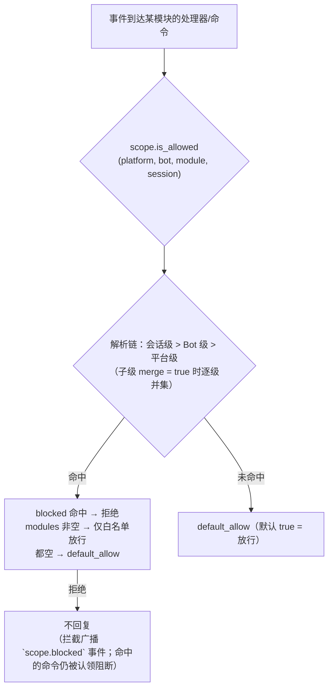
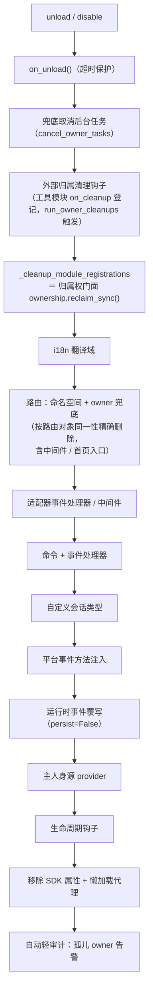
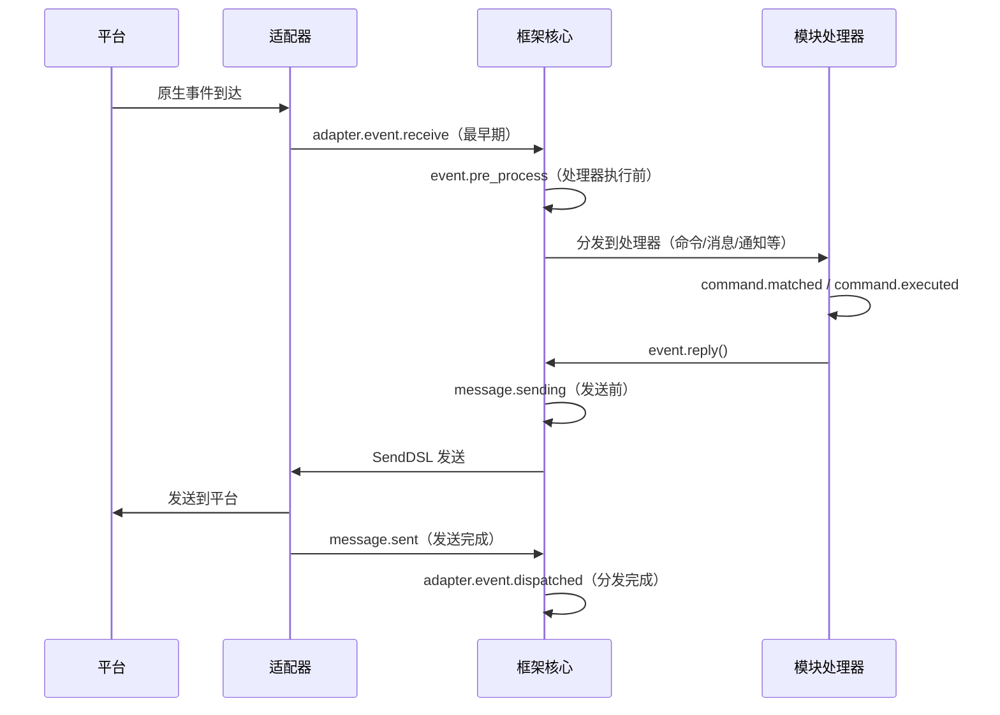

# ErisPulse 权限作用域与归属权

本技能由 ErisPulse 文档自动构建（generate-skills.py）。
仓库：https://github.com/ErisPulse/ErisPulse
各节末尾标注了来源文档路径，需要最新内容请以仓库 docs/zh-CN/ 为准。

## 作用域

> 来源: `docs/zh-CN/advanced/scope.md`（https://github.com/ErisPulse/ErisPulse/blob/main/docs/zh-CN/advanced/scope.md）

# 作用域（scope）

> [!TIP]
> **什么时候需要读这篇**：需要控制模块可用性、事件准入或出站动作限制时。不需要则跳过，不影响其它功能的使用。

> **读完你会知道**：三个作用域维度（模块可用性 / 事件准入 / 出站动作）各自的配置路径、
> 判定优先级与拒绝行为，运行时 API 的用法，以及拦截如何可观测（`scope.blocked` 事件）。
>
> **本篇不涉及**：资源的归属与卸载回收（见[归属权（owner）系统](ownership.md)）；
> 命令 ACL 与事件覆写（见[事件处理入门](../getting-started/event-handling.md)）。

> [!NOTE]
> 本特性需要 ErisPulse **2.8.0+**。

作用域回答四个问题：**哪些模块可用、谁的事件收不收、某模块处理什么文本、
模块能向外做什么**。
控制权完全交给用户：在模块 / 适配器 / 处理器 / 出站调用注册的**上层**（配置
`ErisPulse.scope` 或运行时 `sdk.scope`）统一声明，事件管线在入口、处理器过滤
与出站闸口自动读取并执行。

| 维度 | 控制什么 | 拒绝行为 | 配置路径 |
|------|---------|---------|---------|
| **① 模块** | 哪些模块可用（平台 / Bot / 会话三级） | 被过滤模块不触发、不回复（拦截广播 `scope.blocked` 事件；命中的命令仍被认领阻断） | `scope.platforms / bots / sessions` |
| **② 身份** | 事件收不收（适配器 / Bot / 会话 / 用户四级） | 入口完全丢弃（拦截广播 `scope.blocked` 事件） | `scope.identity.*` |
| **③ 出站** | 模块能发起哪些出站调用（消息 / API / 请求，方法级白黑名单） | 失败响应（`retcode=34601`） | `scope.actions` |

> **相关系统**：命令是特殊的消息事件处理器，其用户黑白名单（ACL）与
> 实现参数覆写由命令系统自持（`ErisPulse.event.command`），
> 见 [事件处理入门](../getting-started/event-handling.md) 与 [配置指南](../user-guide/configuration.md)。

{!--< tips >!--}
1. 通过 `from ErisPulse.Core import scope` 导入单例（`sdk.scope` 同对象）
2. 判定：`scope.is_allowed(...)` / `scope.is_identity_allowed(...)` /
   `scope.is_action_allowed(...)` 对应 ①②③ 三个闸口
3. 读写：维度化参数方法（IDE 可补全）——
   `scope.set_module(...)` / `scope.set_identity(...)` / `scope.set_action(...)`；
   另有字典式兜底 `scope.get(path)` / `scope.set(path, v)` / `scope.delete(path)`
4. 事件处理器文本条件覆写见
   [事件处理入门 · 事件覆写](../getting-started/event-handling.md#事件覆写不改模块代码覆写任意事件类型的行为)；
   命令 ACL / 参数覆写见[事件处理入门](../getting-started/event-handling.md)
{!--< /tips >!--}

## 匹配条目语法（全系统统一）

作用域所有"名字列表"（模块名、身份键、出站条目）共用同一套匹配语法
（`ErisPulse.Core.text_match`）：

| 语法 | 示例 | 说明 |
|------|------|------|
| 精确名 | `"Chat"` | 全值比较，**大小写不敏感** |
| glob | `"Tool*"`、`"spam_*"` | `*` 任意串 / `?` 单字符 / `[seq]` 字符集，大小写不敏感 |
| 正则 | `"re:^Danger.*"` | 以 `re:` 前缀声明，正则 `search` 匹配，默认大小写不敏感 |

- 非法正则**静默降级**为"不匹配"（不抛错、不崩溃）
- 装饰器参数（`pattern=` / `regex=`）为固定语义：`pattern` 是 glob、`regex` 是正则源码
  （不加 `re:` 前缀）；作用域配置里的正则条目**必须**带 `re:` 前缀

## 全局兜底：`default_allow`

`default_allow` 是**全局唯一**的兜底开关（默认 `true`），
对两个判定维度统一生效：

- **模块维度**：未命中任何绑定 → `default_allow` 决定放行 / 拒绝
- **身份维度**：未命中任何策略 → `default_allow` 决定放行 / 拒绝

设为 `false` 即开启"隐式拒绝"严格模式：白名单式管理，
**没显式允许的一律拒绝**。

> **例外**：③ 出站维度**不受** `default_allow` 影响——它是独立的收紧开关，
> 默认全允许，仅显式规则才限制（框架层 owner 为空的调用恒放行）。
> 这样严格的全局模式不会意外掐断所有模块的消息回复。
> 命令 ACL 有独立的 `ErisPulse.event.command.default_allow` 兜底，互不影响。

## 配置文件

```toml
[ErisPulse.scope]
default_allow = true        # 全局兜底（false = 隐式拒绝严格模式）
cache_size = 1024           # LRU 缓存大小

# ── ① 模块维度（优先级：会话 > Bot > 平台）──
[ErisPulse.scope.platforms.onebot11]
modules = ["Chat", "Tool*"]   # 白名单：精确名 / glob / re: 正则
blocked = ["re:^Danger"]
[ErisPulse.scope.bots.onebot11."123456"]
modules = ["Chat"]
merge = true                  # 在平台级绑定基础上追加（默认整体覆盖）
[ErisPulse.scope.sessions.onebot11."789012345"]
modules = ["Chat"]

# ── ② 身份维度（优先级：用户 > 会话 > Bot > 适配器）──
[ErisPulse.scope.identity.adapters.onebot11]
deny = true                   # 整个适配器的事件全部丢弃
[ErisPulse.scope.identity.bots.onebot11."123456"]
deny = true
[ErisPulse.scope.identity.sessions.onebot11."g_blocked"]
deny = true
[ErisPulse.scope.identity.users.onebot11]
allow = ["u_admin"]           # 用户键支持 glob / re: 正则
deny = ["u_bad", "spam_*"]

# ── ③ 出站维度（默认全允许，显式收紧才禁）──
[ErisPulse.scope.actions.MyModule]
send = { deny = true }                                    # 全禁发送
api = { allow = ["get_*"] }                               # 仅允许查询类标准 API
request = { deny = true }                                 # 禁止处理请求
```

## ① 模块维度

**一句话**：按平台 / Bot / 会话三级绑定控制"这个上下文里哪些模块可用"，被过滤模块不触发、不回复（命中的命令仍被认领阻断）。

回答"某个上下文里，哪些模块可用"。默认全部开放；配置绑定后才开始过滤，
**模块与适配器无需任何改动**。



- **解析优先级：会话级 > Bot 级 > 平台级**，高优先级绑定**整体覆盖**低优先级；
  子级绑定写 `merge = true` 时改为与低优先级**逐条目并集**（modules / blocked 各自合并，
  `merge` 本身是控制键，不算条目）
- **默认语义**：被过滤模块的命令与处理器不触发、不回复，TRACE 级日志可见
  （`core.scope.denied`）；拦截同时广播 `scope.blocked` 生命周期事件（订阅
  即可观测谁被拦、为何被拦）；命中的**命令**仍会被认领阻断——命令文本不再漏给
  低优先级消息处理器，消除"命令被拒后消息处理器又响应一次"的双重响应歧义
- **框架级处理器**（`scope_exempt=True` 或 owner 为空）不受影响；模块名为空（框架层资源）始终放行
- **会话感知帮助与命令查询**：命令查询 API（`command.help` /
  `get_command` / `get_commands` / `get_group_commands` / `get_visible_commands`，
  以及 `module.get_commands_overview`）均支持可选 `event=` 或显式
  `platform=` / `bot_id=` / `session_id=` 关键字——当前会话不可用模块的命令
  不再出现在结果中（`get_command` 返回 None、单命令帮助按"未注册"处理，
  与默认语义一致）；不传上下文则保持全量行为

### 绑定继承（merge）

默认整体覆盖的语义清晰可预测；需要在上级基础上**追加**时，在子级写 `merge = true`：

```toml
[ErisPulse.scope.platforms.onebot11]
modules = ["Chat", "Tool"]      # 平台级：允许 Chat、Tool

[ErisPulse.scope.bots.onebot11."123456"]
modules = ["Music"]
merge = true                    # 该 Bot 实际生效 = ["Chat", "Tool", "Music"]
```

- 合并规则：`modules` 与 `blocked` 各自取**并集**；绑定内 `blocked` 仍优先于 `modules`
- 链式合并：平台 → Bot → 会话逐级叠加，每一级独立决定 `merge` 或覆盖

## ② 身份维度（事件准入）

**一句话**：按用户 / 会话 / Bot / 适配器四级策略在分发入口完全丢弃"不该收的事件"，deny 优先于 allow。

回答"谁的事件收不收"。被拒绝的事件在**分发入口完全丢弃**——
不进入中间件与任何处理器（含框架级），仅 TRACE 级日志可见（`core.scope.identity_denied`）。

- **解析优先级：用户 > 会话 > Bot > 适配器**，取最具体的已配置策略；deny 优先于 allow
- 每级绑定是二元策略：`{ allow = true }` 或 `{ deny = true }`
- 用户键支持 glob / 正则（如 `"spam_*"` 拉黑一批垃圾用户）
- 典型用法——上级 deny、个人 allow 做"例外放行"：

```toml
[ErisPulse.scope.identity.adapters.onebot11]
deny = true
[ErisPulse.scope.identity.users.onebot11]
allow = ["u_admin"]   # 即使适配器级拒绝，u_admin 的事件仍然放行
```

## ③ 出站维度（限制模块发起出站调用）

**一句话**：以方法级白黑名单约束模块发起的消息 / API / 请求调用，被拒调用不发起任何网络请求、直接返回 `retcode=34601`。

约束模块**发起的出站动作**：消息发送 / 标准 API 动作 / 请求操作。
三类动作对应底层 DSL：`Event.reply` 与 `Send`（send）、`Api` / `call_api`（api）、
`Request` 的 accept/reject（request）。模块在事件 handler 执行期发起的出站调用
携带模块 owner，由本维度统一判定。

### 规则形态（内联表）

每个动作的规则是一张内联表：`{ allow = [...], deny = true|[...] }`。
同一动作只能有一种规则（TOML 键不可重复，全禁与细粒度二选一）：

```toml
[ErisPulse.scope.actions.MyModule]
send = { deny = true }                                  # 全禁发送（Event.reply / Send DSL）
# 或方法级细粒度：send = { allow = ["Text", "Image*"], deny = ["File"] }
api = { allow = ["get_*"] }                             # 仅放行查询类标准 API
# 或动作级黑名单：api = { deny = ["set_*", "leave_*"] }
request = { deny = true }                               # 禁止处理请求 accept/reject
```

- `send` 的条目匹配**发送方法名**（`Text` / `Image` / `File` ...），
  `api` 的条目匹配**标准动作名**（`get_group_info` / `set_group_name` ...）
- 条目支持精确名 / glob / `re:` 正则（与全系统统一语法一致，大小写不敏感）
- `allow` 写单个字符串等价于单条目列表：`send = { allow = "Text" }`

### 判定语义

**默认全允许**——未配置、或 owner 为空（框架层内部调用）均放行。
配置规则后按以下顺序判定：

1. `deny = true` → 拒绝
2. `deny` 列表命中调用名 → 拒绝
3. `allow` 列表非空且调用名未命中（或调用无名称）→ 拒绝
4. 其余放行

被拒调用不发起任何网络请求，直接返回标准失败响应
（`retcode = 34601`，见 [api-response §5.3](../standards/api-response.md#53-框架扩展返回码34xxx-平台错误段的低三位自定义)）。
三个动作互相独立，可只限其一。

```python
# 运行时 API
sdk.scope.set_action("MyModule", "send", deny=True)              # 全禁发消息
sdk.scope.set_action("MyModule", "send", allow=["Text"])         # 仅允许发文本
sdk.scope.is_action_allowed("MyModule", "send", name="Image")    # False
sdk.scope.is_action_allowed("MyModule", "api", name="get_user_info")  # 按规则判定
sdk.scope.delete_action("MyModule", "send")                      # 恢复允许
sdk.scope.get_action("MyModule", "send")                         # 该动作当前规则
```

## 运行时 API

作用域运行时 API 分三层：**判定**（三问）、**维度化读写**（每维 `set` / `get` / `delete`
参数化方法，签名全类型标注，IDE 可补全）、**字典式兜底**（点分路径直达任意节）。

```python
from ErisPulse import sdk

scope = sdk.scope
```

### 判定（三问）

```python
scope.is_allowed("onebot11", "123456", "Chat")                 # ① 模块维度
scope.is_allowed("onebot11", "123456", "Chat", "789012345")    # 含会话级
scope.is_allowed("onebot11", "123456", None)                   # 框架层资源 -> True

scope.is_identity_allowed("onebot11", "123456", "group_9", "u1")   # ② 身份维度

scope.is_action_allowed("MyModule", "send")                    # ④ 出站维度
scope.is_action_allowed("MyModule", "send", name="Image")      # 方法级细粒度
```

### ① 模块维度

```python
# 绑定（层级由参数决定：session_id > bot_id > 平台级）
scope.set_module("onebot11", bot_id="123456", modules=["Chat", "Tool*"])
scope.set_module("onebot11", blocked=["re:^Danger"])                       # 平台级
scope.set_module("onebot11", bot_id="123456", session_id="g9", modules=["Chat"])  # 会话级
scope.set_module("onebot11", bot_id="123456", modules=["Music"], merge=True)      # 与现有条目并集
scope.set_module("onebot11", bot_id="123456", modules=["Chat"], persist=False)    # 仅运行时

# 读 / 删
scope.get_module("onebot11", bot_id="123456")   # {"modules": ["Chat"], "blocked": []}
scope.delete_module("onebot11", bot_id="123456")
```

> `merge=True` 是**写时并集**（与该级现有绑定合并条目）；跨级解析期的
> `merge = true` 配置键见上文[绑定继承](#绑定继承merge)——两者是独立机制。

> **运行时绑定（`persist=False`）语义**：运行时绑定保存在独立的覆盖层中，
> **任意后续配置写入 / 配置文件热更新都不会冲掉它们**（配置树重建后按写入顺序
> 自动重放，含运行时删除）。它们不落盘，进程重启后丢失；模块卸载时该模块写入的
> 运行时绑定会被兜底清理。随后对同一路径执行 `persist=True` 写入（用户持久化语义）
> 将取代运行时规则。

### ② 身份维度

```python
# 绑定策略（层级由参数决定：user > session > bot > adapter；allow / deny 二选一）
scope.set_identity("onebot11", user_id="u_bad", deny=True)
scope.set_identity("onebot11", user_id="spam_*", deny=True)    # 键支持 glob / re: 正则
scope.set_identity("onebot11", bot_id="123456", session_id="g9", allow=True)

# 读 / 删
scope.get_identity("onebot11", user_id="u_bad")   # {"deny": True}
scope.delete_identity("onebot11", user_id="u_bad")
```

### ③ 出站维度

```python
# 设置限制规则（allow: str|list；deny: bool|str|list；整规则替换语义）
scope.set_action("MyModule", "send", deny=True)                    # 全禁发送
scope.set_action("MyModule", "send", allow=["Text"])               # 仅允许发文本
scope.set_action("MyModule", "api", deny=["set_*", "leave_*"])     # 禁管理类 API

# 读 / 删
scope.get_action("MyModule", "send")       # {"allow": ["Text"]} 原始规则
scope.delete_action("MyModule", "send")    # 移除单动作
scope.delete_action("MyModule")            # 移除该模块全部动作限制
```

### 通用

```python
scope.get("platforms")   # 字典式兜底：点分路径读任意节
scope.topology()         # 全量配置树（供 Dashboard）
scope.stats()
# {"module_calls": .., "module_filtered": .., "identity_checks": .., "identity_denied": ..,
#  "action_checks": .., "action_denied": .., "cache_hits": .., "cache_misses": ..}
scope.reset_stats()
scope.clear()           # 清空全部配置（仅内存生效）
```

### 高级：字典式点分路径兜底

维度化方法覆盖日常场景；需要直达任意节点（或未来新增的维度）时，
可用字典式 API——`get` / `set` / `delete` 接受点分路径（dict 深合并、写后立读），
并提供 `scope[path]` / `scope[path] = v` / `del scope[path]` / `path in scope` 协议：

```python
scope.set("bots.onebot11.123456", {"modules": ["Chat"], "blocked": []})
scope.set("identity.users.onebot11.u_bad", {"deny": True})
scope.get("actions.MyModule.send")

scope["platforms.onebot11"]        # 读（不存在抛 KeyError）
scope["platforms.onebot11"] = {...}  # 写
del scope["platforms.onebot11"]      # 删
"actions.MyModule" in scope          # 存在性
```

## 拦截可观测：`scope.blocked` 事件

作用域拦截（模块过滤 / 身份拒绝）发生时会广播生命周期事件 **`scope.blocked`**，
让"谁被拦、在哪一层被拦"可订阅、可统计、可在 Dashboard 呈现——拦截默认
不回复，但不再是不可知的黑盒。

| 字段 | 说明 |
|------|------|
| `dimension` | `"module"`（模块维度过滤）/ `"identity"`（身份准入拒绝） |
| `module` | 被过滤的模块名（仅模块维度） |
| `platform` / `bot_id` / `session_id` / `user_id` | 拦截发生的来源上下文 |

```python
from ErisPulse.Core.lifecycle import lifecycle

@lifecycle.on("scope.blocked")
def on_blocked(data):
    print(f"已拦截：{data['dimension']} {data.get('module') or data.get('user_id')}")
```

- 事件经 `fire` 后台广播（无监听者时零开销，不拖热路径）
- 缓存命中的重复拦截**不**重复广播——同一组合只在缓存失效时广播一次
- 与 `adapter.event.blocked`（中间件否决）相区分：那个是事件级丢弃，本
  事件是作用域准入门的模块 / 身份过滤

## 缓存与热更新

- `is_allowed` / `is_identity_allowed` / `is_action_allowed` 结果带 **LRU 缓存**
  （`scope.cache_size` 可调），`set` / `delete` /
  配置热更新（`config.updated` / `config.set`）自动失效
- 所有维度配置改了**立即生效**，无需重启
- 作用域是"逐事件"判断，不跨事件记忆：配置变了，下一条事件即按新规则

## 配置格式校验

加载 / 热更新时逐节校验配置格式：类型错误的节（如 `platforms` 写成了字符串）、
非法的出站规则（如 `allow` 写成数字）、未知动作名、未知的顶层键（如 `alow` 拼写错误）
会输出 **WARNING** 并忽略对应节 / 条目，其余合法配置照常生效——写错不再静默失效。

## 常见问题与注意事项

### 1. 配置层级与覆盖

- 模块维度：会话级 > Bot 级 > 平台级，**整体覆盖**（子级 `merge = true` 时逐条目并集）。
  想"平台允许 Chat，Bot 再加 Music"，可在 Bot 级写 `merge = true`，或同时列出两者
- 身份维度：用户 > 会话 > Bot > 适配器，取**最具体**的已配置策略（可做例外放行）
- 命令用户黑白名单：精确命令名优先于 glob 键（见 `event.command.acl`）

### 2. 模块/命令没反应

先怀疑作用域而不是模块本身：

```python
from ErisPulse import sdk

print(sdk.scope.is_allowed(event.get_platform(), bot_id, "MyModule", session_id))
print(sdk.scope.is_identity_allowed(event.get_platform(), bot_id, session_id, user_id))
print(sdk.scope.stats())   # module_filtered / identity_denied > 0 说明有拦截记录
```

被过滤默认不回复（模块维度与身份维度，避免暴露规则），但会广播 `scope.blocked` 生命周期事件、统计持续累计；
命令维度被 ACL 拒绝会显式回复"权限不足"。

### 3. 出站动作被拒时排查

```python
from ErisPulse import sdk

print(sdk.scope.get("actions.MyModule"))
print(sdk.scope.stats())   # action_denied > 0 说明有调用被拦截
```

拦截是**显式**的：被拒调用返回 `retcode = 34601` 的标准失败响应（不发起网络请求）。

### 4. 会话标识跨平台隔离

`(platform, session_id)` 组合才是唯一标识。`scope.sessions.onebot11."789"`
只作用于 onebot11，不影响 telegram 上同为 `789` 的会话。身份维度的用户键同理。

## 拓扑树 API

`ModuleManager.get_topology()` 与 `AdapterManager.get_topology()` 提供模块/适配器归属关系数据，
`sdk.get_topology()` 一键聚合（含作用域 `scope`）：

```python
from ErisPulse import sdk

topology = sdk.get_topology()
# {
#   "modules": {                                   # 模块 → 拥有的资源
#     "Chat": {
#       "loaded": True, "enabled": True,
#       "commands": ["chat", "translate"],
#       "handlers": {"message": 2, "notice": 1},
#       "routes": {"http": ["/Chat/api"], "ws": [], "sse": []},
#       "lifecycle_hooks": 3,
#     }
#   },
#   "adapters": {                                  # 适配器 → Bot → 作用域
#     "onebot11": {
#       "status": "started", "enabled": True,
#       "bots": {"123456": {"status": "online", "scope": {...}}},
#       "scope": {"modules": [...], "blocked": [...]},
#     }
#   },
#   "scope": {                                     # 作用域（模块 / 身份 / 出站动作）
#     "platforms": {...}, "bots": {...}, "sessions": {...},
#     "identity": {"adapters": {...}, "bots": {...}, "sessions": {...}, "users": {...}},
#     "actions": {...},
#   },
# }
```

- 模块拓扑聚合了该模块注册的命令、事件处理器、HTTP/WS/SSE 路由与生命周期钩子，便于绘制模块资源树。
- 适配器拓扑聚合了各适配器状态、下属 Bot 状态及平台级/Bot 级作用域绑定（模块维度）。
- **JSON 安全输出**：`get_topology(json_safe=...)` 默认 `True`，返回的结构可直接 `json.dumps`——模块 `info` 仅保留纯数据的 `meta` 子表（丢弃 `module_class` / `strategy` 等运行时对象），并对其余节点（含适配器作者塞入 Bot `info` 的任意对象）做兜底净化（类对象取 `__name__`、不可序列化对象退化 `str()`）。Dashboard / WebUI 可直接序列化返回；需要原始对象时传 `json_safe=False`。

## 归属权

> 来源: `docs/zh-CN/advanced/ownership.md`（https://github.com/ErisPulse/ErisPulse/blob/main/docs/zh-CN/advanced/ownership.md）

# 归属权（owner）系统

> [!TIP]
> **什么时候需要读这篇**：排查资源泄漏、理解卸载清理链路或声明归属资源时。不需要则跳过，不影响其它功能的使用。

> **读完你会知道**：owner 上下文如何自动归属资源、归属资源全景表、卸载/禁用时
> 清理链的完整时序，以及哪些资源不随卸载清理（设计边界）。
>
> **本篇不涉及**：资源"何时生效"的权限判定（见[作用域（scope）](scope.md)）；
> 后台任务的推荐写法与强制取消边界（见[生命周期管理 · 后台任务归属与自动取消](lifecycle.md#后台任务归属与自动取消)）。


归属权是模块"即插即用"的基石：模块在加载期间注册的一切框架资源自动记名，
卸载/禁用时按记名一键回收——模块作者只需声明资源，无需手写清理逻辑。

> **相关系统**：作用域（scope）在事件分发时决定"资源是否生效"，
> 归属权在生命周期中决定"资源归谁、谁卸载时被回收"。
> 作用域详见[统一控制面（scope）](scope.md)，后台任务详见
> [生命周期管理](lifecycle.md#后台任务归属与自动取消)。

{!--< tips >!--}
1. 归属在**注册瞬间**按 `current_owner` 自动记录，模块代码零改动
2. 卸载/禁用共用同一条清理链（`_cleanup_module_registrations`），每步失败仅告警不中断
3. 用户配置语义的资源（持久化覆写 / scope 规则 / 命令 ACL）**不**随模块卸载清理
4. 工具模块托管的外部句柄可用 `on_cleanup(cb)` 挂入清理链，对方模块卸载时自动回调（见[工具模块指南](#工具模块指南托管其它模块的句柄)）
{!--< /tips >!--}

## owner 上下文机制

owner 通过上下文变量 `current_owner` 传递（`ErisPulse.runtime.context`）：

```python
from ErisPulse.runtime import owner_scope, get_current_owner

with owner_scope("MyModule"):
    # 此区间内注册的一切资源自动归属 MyModule
    assert get_current_owner() == "MyModule"
```

框架在以下时机自动注入 owner（模块/适配器代码无需手动包裹）：

| 时机 | owner 值 | 位置 |
|------|----------|------|
| 模块 `load()` | 模块名 | 实例化 + `on_load` 全程 |
| 适配器 `start()` / `restart()` | 平台名 | 适配器启动全程 |
| `activate_on` 懒加载 stub 注册 | 模块名 | 占位命令/处理器注册 |
| 事件处理器执行期 | 处理器归属模块名 | handler / 命令入口重注入 |

执行期重注入意味着：模块在 `on_load` 里声明的命令处理器**运行中**调用
注册型 API（如 `sdk.adapter.on()`、`overrides.*.set(persist=False)`），
同样会自动归属本模块。

## 归属资源全景

模块在加载上下文内注册的以下资源均记录归属，卸载/禁用时自动回收：

| 资源 | 注册方式 | 清理调用 |
|------|----------|----------|
| 命令 | `@command()` / 命令 dict 声明 | `command.unregister_by_owner()` |
| 事件处理器 | `@message` / `@notice` / `@request` / `@meta` | `handler.unregister_by_owner()` |
| 适配器事件监听 | `sdk.adapter.on()` / `raw=True` | `adapter.unregister_handlers_by_owner()` |
| 适配器中间件 | `@sdk.adapter.middleware` | 同上 |
| 路由（HTTP/WS/SSE） | `router.http()` / `websocket()` / `sse()` | 按命名空间 + 按 owner 双重兜底 |
| 路由中间件 | `@router.middleware()` / `add_middleware()` | `router.unregister_all_by_owner()` |
| Dashboard 首页入口 | `router.register_home_entry()` | `unregister_home_entries_by_owner()` |
| 自定义会话类型 | `register_custom_type()` | `unregister_custom_types_by_owner()` |
| 平台事件方法注入 | `register_event_method()` / `register_event_mixin()` | `unregister_event_methods_by_owner()`（模块卸载自动回收，旧闭包不再泄漏） |
| 后台任务 | `self.spawn()` | `cancel_owner_tasks()` |
| 外部归属清理钩子（工具模块托管） | `runtime.on_cleanup(cb)` | `run_owner_cleanups()`（卸载/禁用/适配器关闭链内触发） |
| 生命周期钩子 | `lifecycle.register()` | `lifecycle.unregister_by_owner()` |
| 主人身源 provider | `master.provider` | `master.unregister_by_owner()` |
| i18n 翻译键 | `I18nClass` 声明（domain=模块名） | `i18n.unregister_domain()` |
| 事件覆写（运行时） | `overrides.*.set(persist=False)` | `overrides.unregister_by_owner()` |
| 交互会话（wait_reply 等待 / 租约） | `event.wait_reply()` / `sdk.interaction.acquire()` | `interaction.cancel_by_owner()`（等待方立即收到取消） |
| 上下文数据 | `runtime/context` 按 owner 记录 | 按模块精确清理 |

适配器侧的对应资源（以平台名为 owner）在适配器 `shutdown()` / `restart()`
时由 `_cleanup_adapter_resources` 回收，另含：

| 资源 | 清理调用 |
|------|----------|
| 适配器自有的 `on()` 处理器与中间件 | `adapter.unregister_handlers_by_owner(platform)` |
| 平台事件方法扩展（`EventMixin`） | `unregister_platform_event_methods(platform)` |
| 自定义会话类型 | `unregister_custom_types_by_owner(platform)` |
| 交互会话（该平台挂起的 wait_reply / 租约） | `interaction.cancel_by_platform(platform)` |
| i18n 翻译域（domain=配置键） | `i18n.unregister_domain(配置键)` |
| 细颗粒命名空间路由 | `router.unregister_all_by_owner(platform)` |

## 卸载/禁用清理序列

`unload()` 与 `disable()` 共用同一条清理链（每步独立 try/except，
失败仅记日志，**不中断后续清理**）：



`sdk.uninit()` 退出时另有全局兜底：全部适配器 shutdown → 全部模块 unload →
`router.stop()`（清空路由/中间件/首页入口）→ `cancel_all_background_tasks()` →
清空事件处理器与钩子。

## 归属权统一门面（ownership）

清理链的十六个步骤收敛在归属权统一门面 `ErisPulse.Core.ownership` 下，
四个动词覆盖"注销、计数、扫描、审计"——子系统各自的 `*_by_owner` 注销
函数保持不变，作为门面的内部实现：

| 动词 | 用途 |
|------|------|
| `ownership.reclaim(owner)` | 统一注销 owner 名下全部资源（任务取消 → 清理钩子 → 注册类资源；异步完整版） |
| `ownership.reclaim_sync(owner)` | 注册类资源注销（同步版，供同步卸载路径） |
| `ownership.counts(owner=None)` | 只读统计 owner 在册资源（None 为全部 owner） |
| `ownership.orphans()` | 孤儿扫描：资源在册而 owner 已注销（泄漏实锤清单） |
| `ownership.audit(owner, deep=)` | 泄漏审计报告（计数 + 孤儿 + 可选 gc 实例普查） |

```python
from ErisPulse.Core import ownership

ownership.reclaim_sync("MyModule")       # {'commands': 1, 'routes_http': 2, ...}
ownership.counts("MyModule")             # 在册资源计数
ownership.orphans()                      # [{"owner": "ghost", "total": 2, ...}]
```

**审计入口**：

- 卸载 / 重载后**自动轻审计**：发现孤儿 owner 资源即 WARNING 告警（零开销计数扫描）
- `sdk.module.audit(name, deep=True)`：模块实例 gc 普查——实例不可回收时
  给出引用方类型（定位"谁攥着旧实例"）；有全局暂停开销，仅显式排障使用
- 深普查属显式操作，不设配置键、不做自动修复

## 热重载失败回滚

热重载改为"**卸载前快照 → 失败自动恢复**"：新版本语法错误、依赖缺失、
加载失败时，旧实例与注册状态（注册表条目、sdk 属性、sys.modules 条目）
自动还原，服务不中断，日志提示"已回滚到旧实例继续服务"。

尽力而为语义（文档化的边界）：

- `on_unload` 已执行的副作用（断开的连接、取消的任务）不可撤销——
  恢复后旧实例处于"已收尾"状态，需再次触发加载才能完全可用
- 第三方在运行期手动缓存的对旧实例的引用不在恢复范围
- 目标包已被卸载（entry-point 消失）视作卸载成功，不做回滚

## 设计边界：哪些资源不随卸载清理

归属权只回收**模块代码注册的运行时资源**。以下资源属**用户配置语义**
（控制权在用户，可能刻意配置），模块卸载后随配置持久保留：

| 资源 | 语义 | 说明 |
|------|------|------|
| `overrides.*.set(persist=True)` | 持久化覆写 | 写入配置文件，跨重启生效；模块卸载不删（用户显式配置） |
| `scope.set_action()` 等作用域规则 | 权限控制面 | 由用户/Dashboard 管理，卸载模块不回收规则 |
| `overrides.acl.set(persist=True)` | 命令 ACL | 同上 |
| Conversation `save()` 持久化 | 多轮对话存档 | 数据资产不清理 |

运行时临时写入（`persist=False`）则随 owner 回收——**持久化与否即
"用户资产"与"模块运行时状态"的分界线**。

## 内部实现：归属如何工作

**一句话**：归因链（contextvar 传播）决定"记在谁头上"，取消链（任务登记表）决定"卸载时能否被取消"——两条链路独立运作，资源被正确清理需二者兼备。

归属系统由**两条独立链路**构成，理解它们的分工是排查归属问题的前提：

### 归因链（contextvar 传播）

`runtime/context.py` 的 `current_owner` 等 ContextVar 负责**归因**——
"此刻这段代码注册的资源/发起的调用记在谁头上"。传播规则遵循 Python
contextvars 语义：

| 执行路径 | context 是否传播 | 归因结果 |
|---------|----------------|---------|
| 同步调用链 / `await` 链 | ✅ 传播 | 正确归因 |
| `owner_scope` 内 `asyncio.create_task` | ✅ 传播（task 拷贝创建时刻的 context） | 任务**内部**的框架调用正确归因 |
| `run_in_executor` / 裸线程 | ❌ 不传播 | 归因丢失 |
| 自建事件循环 | ❌ 不传播 | 归因丢失 |

> 归因 ≠ 登记：context 传播只影响"记在谁头上"，资源能否被清理
> 取决于是否进入了下述取消链。

### 取消链（任务登记表）

`runtime/tasks.py` 的 `_owner_tasks` 登记表负责**生命周期**——
"owner 名下有哪些未完成任务，卸载时统一取消"。任务进入登记表的途径：

1. **显式调度**：`spawn_background()` / `self.spawn()` → 创建时捕获
   `current_owner`（或显式 `owner=` 参数）→ 登记入表；
2. **Task Factory 自动登记**（2.8.3）：`install_owner_task_factory()`
   在框架启动时安装到主事件循环——**任何**任务创建（含第三方库内部的
   `create_task`）经过工厂时读取 `current_owner`，非 None 即登记。

登记表自清理：每个任务带 `done_callback`，完成即从表中移除，无泄漏。

### 取消时序（模块卸载）

```
module.unload()
  → on_unload(event)                    # 模块自行清理（兜底超时保护）
  → 框架注销该 owner 的命令/事件/钩子/路由
  → cancel_owner_tasks(owner)           # 任务登记表兜底取消
      → 逐个 task.cancel()              # 排除当前执行取消逻辑的任务自身
      → await gather(pending, timeout)  # 等待回收（超时不再阻塞）
```

### 排查思路

- **资源没被清理** → 查登记表：`get_owner_tasks("MyModule")` 是否含该任务；
  不含即注册路径未经过归属链（import 期 / 线程 / 独立循环），对照上表定位。
- **归因错误** → 查 `get_current_owner()` 在出错时刻的值；异步延迟执行
  （回调/任务）的归因取自创建时刻 context，而非执行时刻。

## 模块作者指南

### 推荐写法

```python
from ErisPulse import sdk
from ErisPulse.Core.Event import command
from ErisPulse.runtime import owner_scope, spawn_background

class MyModule(BaseModule):
    async def on_load(self, event):
        # 框架资源：自动归属，无需手动清理
        self.task = self.spawn(self.polling())      # 后台任务
        sdk.router.register_home_entry("我的模块", "/my")  # 首页入口

        # 模块自有资源：包进 owner_scope 即纳入归属体系
        with owner_scope("MyModule"):
            self.client.on_event(self._handle)      # 假想的自定义注册

    async def on_unload(self, event):
        # 框架资源已被自动回收，只需清理 owner_scope 覆盖不到的自有资源
        await self.client.close()
```

### 注意事项

- **import 期注册无归属**：模块顶层（import 时）注册的钩子/处理器发生在
  `owner_scope` 之前，会被视为框架级资源（owner=None）而**不被清理**。
  一律放到 `on_load()` 内注册。
- **自定义 domain 的 i18n 注册**：`i18n.register(domain=...)` 的 domain
  不等于模块名时不会被自动回收，请保持 domain=模块名。
- **后台任务推荐 `self.spawn()`**：2.8.3 起裸 `asyncio.create_task` 也会**自动隐式归属**
  （Task Factory 自动登记，卸载时兜底取消）；但 `self.spawn()` 仍是推荐写法——
  支持非主循环线程调度回主循环、显式 `owner=` 指定与 fire-and-forget 防 GC。
  **2.8.3 之前**的版本裸任务不归属，必须用 `self.spawn()`。
- 清理链"失败仅告警"：单步清理异常不会阻断其余资源回收，日志 DEBUG/WARNING
  级别可见，排障时可开启 TRACE。

### 注册时机 → 归属结果对照表

| 注册场景 | 归属结果 | 说明 |
|---------|---------|------|
| `on_load()` 内经框架 API（命令/事件/lifecycle/路由装饰器）注册 | 归属模块 | 卸载时自动注销 |
| 模块顶层（import 期）注册 | **无归属**（owner=None） | 不被清理，请勿使用 |
| `self.spawn()` 创建的后台任务 | 归属模块 | 卸载时自动取消 |
| `owner_scope("Name")` 内经第三方 API 注册 | 归属模块 | 依赖第三方回调在 scope 内同步执行 |
| 裸 `asyncio.create_task`（含 `loop.create_task` / `ensure_future`） | **自动归属**（Task Factory，2.8.3+） | 创建瞬间读取 `current_owner`，owner 上下文内自动登记、卸载兜底取消；见下文[内部实现](#内部实现归属如何工作) |
| 第三方库异步回调（aiohttp / APScheduler 等）内部创建的任务 | **自动归属**（Task Factory，2.8.3+） | 回调执行时若 `current_owner` 已注入（如框架处理器执行期间），任务自动登记 |
| `run_in_executor`（线程池） | **无归属**（非 asyncio.Task） | 线程不受任务工厂管辖，须自行管理生命周期 |
| 独立事件循环（自建 loop）中的注册 | **无归属** | Task Factory 仅安装于主循环；contextvars 也不跨事件循环传播 |

> 原则：**归属跟随注册瞬间的 `current_owner` 上下文**；任何异步延迟、
> 线程池、独立循环都会脱离该上下文——需要归属时请显式进入 `owner_scope`。

## 工具模块指南：托管其它模块的句柄

**场景**：定时任务、注册表、连接池这类"工具模块"会替其它模块保管东西——
对方在 `on_load` 里调用 `sdk.Cron.on_trigger(handler)`，你的容器里就存下了
一个指向对方实例的回调。框架会自动清理对方注册的一切框架资源，但清理不了
你**私有容器里的引用**：对方卸载后你的容器还拉着它的实例，它就无法被
GC 回收（内存泄漏，`purge` 泄漏诊断报"不可回收"）。

**解法**：在登记对方东西的同一个函数里调用 `on_cleanup()`，
框架会在对方卸载 / 禁用时自动回调你的清理函数：

```python
from ErisPulse.Core.Bases import BaseModule
from ErisPulse.runtime import off_cleanup, on_cleanup

class CronModule(BaseModule):
    def __init__(self):
        self._entries = {}  # {模块名: 该模块托管的回调列表}

    def on_trigger(self, handler):
        # 自动识别调用方模块名（on_load 直接调用 / module.call 均正确），
        # 返回值是解析出的 owner，可直接用作记名键
        owner = on_cleanup(self._drop)
        self._entries.setdefault(owner, []).append(handler)

    def _drop(self, owner: str):
        """对方模块被卸载/禁用时由框架自动调用：抛弃它的句柄即可"""
        self._entries.pop(owner, None)

    async def on_unload(self, event):
        off_cleanup(self._drop)  # ③ 自己卸载前注销钩子，避免钩子表持有 self
```

框架保证的行为：

| 关注点 | 行为 |
|--------|------|
| 触发时机 | 对方模块 unload / disable，或适配器关闭——均在框架清理链内触发，早于 purge 泄漏诊断 |
| 调用方识别 | 直接调用取 `current_owner`；经 `module.call()` 被调用取调用方（`current_caller`）；也可 `on_cleanup(cb, owner="模块名")` 显式指定。**强制校验**：owner 无法解析（三种来源均缺失）时抛 `ValueError`——私有工具模块应在自身加载上下文内登记钩子 |
| 回调签名 | `cb(owner: str)`，同步 / 异步均可；异步带超时保护（`CLEANUP_CALLBACK_TIMEOUT_SECS`，默认 10 秒） |
| 容错 | 单个回调异常 / 超时只记日志，不影响其余钩子与清理链 |
| 重复登记 | 同一 `(owner, callback)` 幂等去重 |

**什么时候不需要**：如果对方注册的是框架资源（命令、事件处理器、路由、
后台任务……），框架已全自动清理（见上文[归属资源全景](#归属资源全景)）。
只有你私有容器里持有的对方句柄才需要 `on_cleanup`。
模块开发视角的速查版见
[最佳实践 · 工具模块](../developer-guide/modules/best-practices.md#工具模块托管别人东西时要接住卸载通知)。

## 生命周期

> 来源: `docs/zh-CN/advanced/lifecycle.md`（https://github.com/ErisPulse/ErisPulse/blob/main/docs/zh-CN/advanced/lifecycle.md）

# 生命周期管理

> [!TIP]
> **什么时候需要读这篇**：需要订阅框架生命周期事件（启动 / 加载 / 状态变化）时。不需要则跳过，不影响其它功能的使用。

> **读完你会知道**：生命周期事件的注册 / 触发 / 定向传播机制，四套触发 API 的
> 差异与选用，以及框架预埋的全部钩子断点（core / module / adapter / server / message
> 等）各自的数据格式。
>
> **本篇不涉及**：模块自身要实现的生命周期方法（`on_load` / `on_unload`，见
> [模块开发指南](../developer-guide/modules/getting-started.md)）；启动链路各阶段的
> 来龙去脉（见[启动流程与手动控制](startup.md)）。


想在模块加载失败、配置被修改、消息发出、命令执行这些节点上收到通知并执行自己的
逻辑（审计、统计、告警、联动），订阅框架生命周期事件即可——框架在每个关键节点
预埋了钩子断点，`@sdk.lifecycle.on("事件名")` 一行接入，本文末尾附全部断点一览。

系统支持三种触发方式：
- `await lifecycle.emit("event", data)` — 精简版，传递任意数据（`to="Owner"` 时定向投递）
- `lifecycle.emit_sync("event", data)` — 同步版（用于非异步上下文）
- `await lifecycle.submit_event("event", ...)` — 兼容旧版，自动构建标准事件格式

## 事件处理机制

### 注册处理器

```python
from ErisPulse import sdk

# 装饰器模式
@sdk.lifecycle.on("module.load")
async def on_module_load(data):
    print(f"模块加载: {data}")

# 编程式注册
sdk.lifecycle.register("module.load", on_module_load, priority=10)

# 取消注册
sdk.lifecycle.unregister("module.load", on_module_load)

# 按所有者批量取消注册（模块/适配器卸载时框架自动调用）
removed = sdk.lifecycle.unregister_by_owner("MyModule")
print(f"清理了 {removed} 个生命周期钩子")
```

### 优先级

处理器支持 `priority` 参数，数值越大越先执行（与模块加载器一致）：

```python
@sdk.lifecycle.on("adapter.event.receive", priority=10)  # 最先执行
async def first_handler(data):
    pass

@sdk.lifecycle.on("adapter.event.receive", priority=0)  # 后执行
async def second_handler(data):
    pass
```

### 点式结构事件

触发具体事件时，也会触发其父级事件：
- 触发 `module.load` 时，也会触发 `module`
- 触发 `adapter.event.receive` 时，也会触发 `adapter.event` 和 `adapter`

### 通配符

注册 `*` 捕获所有事件：

```python
@sdk.lifecycle.on("*")
async def on_anything(data):
    print(f"收到事件: {data}")
```

### 定向传播（emit to=）

> [!NOTE]
> 本特性需要 ErisPulse **2.8.0+**。

`emit()` 指定 `to` 参数后进入定向传播：事件只分发给以该拥有者（owner）身份注册的
处理器（模块在 `on_load` 内注册的钩子自动归属本模块），其它模块与通配符 `*`
处理器不感知。

```python
# 投递方：事件只投给 Chat 模块注册的钩子
await sdk.lifecycle.emit("message_received", {"text": "hi"}, to="Chat")

# 订阅方（Chat 模块内）：注册同名钩子，owner 在注册时自动记录
@sdk.lifecycle.on("message_received")
async def on_message_received(data): ...

@sdk.lifecycle.on("message")   # 点式父级前缀同样生效（按 owner 过滤）
async def on_any(data): ...
```

- 目标 owner 无已注册钩子 → 事件**不被消费**（可用 `has_handlers()` 提前探测）
- `data` 为 dict 时自动携带 `_trace_id`（不覆盖已有值）
- `emit_sync` / `submit_event` 同样支持 `to=` 参数
- 模块间通信的三层模型（RPC / 定向 / 广播）见
  [模块间通信](module-communication.md)

### 一次性注册（once）

从 2.7.0 起，`lifecycle.once()` 注册的处理器在**触发一次后自动注销**，适合"首次就绪"这类一次性钩子：

```python
@sdk.lifecycle.once("core.init.complete")
async def on_first_ready(data):
    print("首次就绪，后续不再触发")
```

- 与 `on()` 同优先级参数语义（`priority` 数值越大越先执行）
- 自动注销，无需手动 `unregister`
- 同步/异步处理器均支持

### 监听者查询（has_handlers）

热路径短路场景可先用 `has_handlers()` 判断是否有监听者，避免无谓的事件遍历与任务调度：

```python
if sdk.lifecycle.has_handlers("message.sending"):
    await sdk.lifecycle.emit("message.sending", send_ctx)
```

- 覆盖**精确事件名、通配符 `*`、父级事件**三种匹配
- 无任何监听者时返回 `False`，可安全跳过 `emit`

## 钩子断点一览

一条消息从平台进入框架到处理完成的典型生命周期事件时序：



框架内置了以下钩子断点，用户可以通过 `@sdk.lifecycle.on()` 监听任意断点实现自定义逻辑。

### 核心初始化

| 钩子名称 | 触发时机 | 数据 |
|---------|---------|------|
| `core.init.start` | SDK 初始化开始 | `{}` |
| `core.init.stage` | 初始化各阶段开始（后台发射） | `{"stage": str}`，取值 `discovery` / `adapter_register` / `adapter_start` / `module_register` / `module_init` / `adapter_start_deferred` / `router_start` |
| `core.init.complete` | SDK 初始化完成 | `{"duration": float, "success": bool, "stages": {stage: float}, "adapters": {"enabled": [str], "disabled": [str]}, "modules": {"enabled": [str], "disabled": [str]}, "error": str(仅失败时)}` |
| `core.uninit.complete` | SDK 反初始化完成 | `{"duration": float, "success": bool, "adapters_closed": int, "modules_unloaded": int, "module_properties_cleared": int, "module_properties_to_clear": [str], "error": str(仅失败时)}` |

**示例：启动进度展示**

```python
@sdk.lifecycle.on("core.init.stage")
def show_stage(data):
    print(f"[启动] 进入阶段: {data['stage']}")
```

### 配置变更

| 钩子名称 | 触发时机 | 数据 |
|---------|---------|------|
| `config.set` | 配置项被修改 | `{"key": str, "old_value": Any, "new_value": Any}` |
| `config.updated` | 外部编辑 config.toml 后检测到整树变更 | `{"old_config": dict, "new_config": dict, "config_file": str}` |

**示例：配置审计**

```python
@sdk.lifecycle.on("config.set")
def audit_config(data):
    print(f"[审计] {data['key']}: {data['old_value']} -> {data['new_value']}")
```

### 模块生命周期

| 钩子名称 | 触发时机 | 数据 |
|---------|---------|------|
| `module.register` | 模块类注册到管理器 | `{"module_name": str, "success": bool}` |
| `module.load` | 模块加载完成（实例化成功）；失败时 payload 额外携带 `"error": str, "traceback": str`（失败现场亦可经 `module.last_error(名字)` 查询） | `{"module_name": str, "success": bool}` |
| `module.init` | 模块初始化完毕（含懒加载） | `{"module_name": str, "success": bool}` |
| `module.before_unload` | 卸载流水线第一步（先于 `on_unload` 与资源回收；模块实例钩子 `on_before_unload` 同步触发） | `{"module_name": str, "reason": str}`；`reason` 取值：`unload` / `reload` / `disable` / `cascade` / `dormant` |
| `module.sleep` | 模块归眠完成（懒加载休眠：资源已释放，访问时自动唤醒） | `{"module_name": str, "success": bool}` |
| `module.unload` | 模块卸载或禁用（`disable` 与 `unload` 对等通知依赖方，`on_dependency_lost` 契约含"禁用"） | `{"module_name": str, "success": bool}` |
| `module.reload` | 模块热重载完成（含级联重载依赖者） | `{"module_name": str, "success": bool, "full": bool, "duration_ms": int}`；单模块额外携带 `"identity_changed": bool`（False = 进程内可能仍运行旧代码，如 C 扩展缓存）与 `"version_old": str, "version_new": str`；全量重载（`reload_all`）时 `module_name` 为 `"All"`，payload 额外携带 `"results": dict[str, bool]` |

> **模块实例钩子 `on_before_unload`**：与 `module.before_unload` 事件对应的可选生命周期方法——`event["reason"]` 标注来意，适合在资源释放前把状态保存到 `sdk.storage`，唤醒 / 重载后在 `on_load` 中恢复（懒加载休眠的状态接续即基于此）。钩子失败仅告警，不阻塞卸载流程。

### 适配器生命周期

| 钩子名称 | 触发时机 | 数据 |
|---------|---------|------|
| `adapter.load` | 适配器注册完成 | `{"platform": str, "success": bool}` |
| `adapter.reload` | 适配器代码级热重载完成 | `{"adapter_name": str, "success": bool, "full": bool, "duration_ms": int, "identity_changed": bool, "version_old": str, "version_new": str, "was_started": bool, "source": str}`；`identity_changed=False` = 进程内可能仍运行旧代码 |
| `adapter.start` | 适配器启动 | `{"platforms": [str]}` |
| `adapter.status.change` | 适配器状态变化 | `{"platform": str, "status": str, "retry_count": int, "error": str(仅失败时)}`；status 完整取值：`starting` / `started` / `start_failed` / `stopping` / `stopped` / `stop_failed` / `skipped-dependency` / `disabled` |
| `adapter.stop` | 适配器关闭 | `{"platforms": [str]}` |
| `adapter.stopped` | 适配器关闭完成 | `{"platforms": [str]}` |
| `adapter.bot.online` | Bot 上线 | `{"platform": str, "bot_id": str, "info": dict, "status": str}` |
| `adapter.bot.offline` | Bot 下线 | `{"platform": str, "bot_id": str, "status": str}` |

### 事件接收与处理

| 钩子名称 | 触发时机 | 数据 |
|---------|---------|------|
| `adapter.event.receive` | 收到外部平台事件（最早期） | `{"platform": str, "event_type": str, "raw_event_type": str}` |
| `adapter.event.blocked` | 中间件否决事件（返回 `False`，事件被丢弃不进入任何处理器） | `{"middleware": str, "platform": str, "event_type": str, "detail_type": str, "event": dict, "_trace_id": str}` |
| `adapter.event.dispatched` | 事件分发完成 | `{"platform": str, "event_type": str, "raw_event_type": str, "onebot_handlers_count": int}` |
| `event.pre_process` | 事件处理器开始执行前 | `{"event_type": str, "platform": str, "detail_type": str}` |

**示例：事件统计**

```python
event_counter = {}

@sdk.lifecycle.on("adapter.event.receive")
def count_events(data):
    platform = data["platform"]
    event_counter[platform] = event_counter.get(platform, 0) + 1

@sdk.lifecycle.on("adapter.event.dispatched")
def log_unhandled(data):
    if data["onebot_handlers_count"] == 0:
        print(f"[未处理] {data['platform']}/{data['event_type']}")
```

### 消息发送

| 钩子名称 | 触发时机 | 数据 |
|---------|---------|------|
| `message.sending` | 消息即将发送 | `{"platform": str, "method": str, "detail_type": str, "target_id": str, "bot_id": str}` |
| `message.sent` | 消息发送完成 | `{"platform": str, "method": str, "detail_type": str, "target_id": str, "bot_id": str}` |

**示例：消息发送审计**

```python
@sdk.lifecycle.on("message.sending")
def log_sending(data):
    print(f"[发送] -> {data['platform']}/{data['detail_type']}/{data['target_id']} via {data['method']}")
```

### 命令系统

| 钩子名称 | 触发时机 | 数据 |
|---------|---------|------|
| `command.matched` | 命令被匹配并即将执行 | `{"command": str, "args": list[str], "platform": str, "user_id": str}` |
| `command.executed` | 命令执行完成 | `{"command": str, "args": list[str], "platform": str, "user_id": str, "success": bool, "error": str(仅失败时)}` |

**示例：命令统计**

```python
@sdk.lifecycle.on("command.matched")
def count_commands(data):
    print(f"[命令] /{data['command']} from {data['user_id']}@{data['platform']}")
```

### HTTP 路由

| 钩子名称 | 触发时机 | 数据 |
|---------|---------|------|
| `server.request` | HTTP 请求接收 | `{"method": str, "path": str, "client_ip": str, "request_id": str}` |
| `server.response` | HTTP 响应发送 | `{"method": str, "path": str, "status_code": int, "client_ip": str, "request_id": str}` |

> `request_id` 即 [X-Request-ID 请求关联 ID](router.md#请求关联-idx-request-id)：优先沿用客户端请求头，否则自动生成 UUID，可用它把请求与响应两条事件串联。

**示例：请求日志**

```python
@sdk.lifecycle.on("server.response")
def log_http(data):
    print(f"[HTTP] {data['method']} {data['path']} -> {data['status_code']}")
```

### WebSocket

| 钩子名称 | 触发时机 | 数据 |
|---------|---------|------|
| `server.start` | 路由服务器启动 | `{"base_url": str, "host": str, "port": int, "success": bool, "error": str(仅失败时)}` |
| `server.stop` | 路由服务器停止 | `{}` |
| `server.websocket.connect` | WebSocket 连接建立 | `{"path": str, "module_name": str, "client_ip": str}` |
| `server.websocket.disconnect` | WebSocket 连接断开 | `{"path": str, "module_name": str, "reason": str, "error": str(仅异常时)}` |

**示例：WebSocket 连接监控**

```python
@sdk.lifecycle.on("server.websocket.connect")
def on_ws_connect(data):
    print(f"[WS] 连接: {data['path']} from {data['client_ip']}")

@sdk.lifecycle.on("server.websocket.disconnect")
def on_ws_disconnect(data):
    print(f"[WS] 断开: {data['path']} ({data['reason']})")
```

### 存储连接状态

存储后端连接池的建立、故障与恢复（均后台发射，不阻塞存储操作）：

| 钩子名称 | 触发时机 | 数据 |
|---------|---------|------|
| `storage.ready` | 存储后端连接池就绪（每事件循环首次建池成功） | `{"backend": str}` |
| `storage.unreachable` | 连接重试耗尽进入冷却期（期间操作快速失败） | `{"backend": str, "error": str, "cooldown": float}` |
| `storage.recovered` | 冷却结束重连成功，存储恢复可用 | `{"backend": str}` |

**示例：存储故障告警**

```python
@sdk.lifecycle.on("storage.unreachable")
def alert_storage_down(data):
    print(f"[告警] 存储后端 {data['backend']} 不可达: {data['error']}，{data['cooldown']}s 后自动重连")

@sdk.lifecycle.on("storage.recovered")
def notify_storage_back(data):
    print(f"[恢复] 存储后端 {data['backend']} 已恢复可用")
```

### HTTP 客户端

`sdk.client` 的请求与连接事件（均后台发射）：

| 钩子名称 | 触发时机 | 数据 |
|---------|---------|------|
| `client.request.success` | HTTP 请求成功 | `{"method": str, "url": str, "status": int, "elapsed": float}` |
| `client.request.failed` | HTTP 请求重试耗尽最终失败 | `{"method": str, "url": str, "error": str, "attempts": int, "elapsed": float}` |
| `client.ws.connect` | WebSocket 连接建立 | `{"url": str}` |

### 国际化

| 钩子名称 | 触发时机 | 数据 |
|---------|---------|------|
| `i18n.language.changed` | 框架语言切换（`i18n.set_language`） | `{"language": str, "previous": str}` |

## 标准事件定义

```python
STANDARD_EVENTS = {
    "core": ["init.start", "init.stage", "init.complete", "uninit.complete"],
    "module": ["load", "before_unload", "init", "sleep", "unload", "register", "reload"],
    "adapter": [
        "load", "start", "status.change", "reload", "stop", "stopped",
        "event.receive", "event.blocked", "event.dispatched",
        "bot.online", "bot.offline",
    ],
    "server": [
        "start", "stop",
        "request", "response",
        "websocket.connect", "websocket.disconnect",
    ],
    "event": ["pre_process"],
    "message": ["sending", "sent"],
    "command": ["matched", "executed"],
    "config": ["set", "updated"],
    "storage": ["ready", "unreachable", "recovered"],
    "client": ["request.success", "request.failed", "ws.connect"],
    "i18n": ["language.changed"],
}
```

## 完整 API 参考

### 注册与取消

| 方法 | 说明 |
|------|------|
| `@lifecycle.on(event, *, priority=0)` | 装饰器注册处理器 |
| `lifecycle.register(event, handler, *, priority=0)` | 编程式注册 |
| `lifecycle.unregister(event, handler=None)` | 取消注册（handler=None 时取消该事件全部处理器） |

### 触发

| 方法 | 说明 |
|------|------|
| `await lifecycle.emit(event, data=None, *, to=None)` | 异步触发，处理器**并行执行**（互不阻塞，返回时全部完成），返回非 None 值按优先级顺序回放链式替换 data；`to` 指定 owner 时定向投递 |
| `lifecycle.fire(event, data=None, *, to=None)` | **后台发射（扔桶即走）**：处理器在后台任务中并行执行、不等待、无返回值；无监听者时零开销。适用于高频热路径与纯观测事件；关停序列与顺序敏感消费（如 `config.set`）请用 `emit` |
| `lifecycle.emit_sync(event, data=None, *, to=None)` | 同步触发，异步处理器以 create_task 调度 |
| `await lifecycle.submit_event(event_type, *, source, msg, data, to=None, background=False)` | 兼容旧版，自动构建标准事件格式；`background=True` 时走 `fire` 后台发射 |

**四套触发 API 对照**：

| 方法 | 调用形态 | 是否等待处理器完成 | 典型场景 |
|------|---------|------------------|---------|
| `emit` | `await`（异步） | **等待**——处理器并行执行，返回时全部完成，返回值链式回放 | 常规触发；顺序敏感消费（`config.set`）与关停序列必须用它 |
| `fire` | 直接调用（同步返回） | **不等待**——后台任务并行执行，无返回值；无监听者时零开销 | 高频热路径与纯观测事件（`server.request` / `storage.ready`） |
| `emit_sync` | 直接调用（同步） | 同步处理器立即完成；异步处理器以 `create_task` 调度（返回值无法回传） | 非异步上下文（同步代码）中触发事件 |
| `submit_event` | `await`（异步） | 等待（`background=True` 时同 `fire` 不等待） | 兼容旧版：自动构建标准事件格式（`source` / `msg` / `timestamp`） |

### 工具

| 方法 | 说明 |
|------|------|
| `lifecycle.start_timer(timer_id)` | 开始计时 |
| `lifecycle.get_duration(timer_id)` | 获取已持续时间（秒） |
| `lifecycle.stop_timer(timer_id)` | 停止计时并返回持续时间 |
| `lifecycle.list_hooks()` | 列出所有已注册钩子及处理器数量 |
| `lifecycle.clear()` | 清除所有处理器和计时器 |

## 模块中使用示例

```python
from ErisPulse.Core.Bases import BaseModule
from ErisPulse import sdk

class Main(BaseModule):
    async def on_load(self, event):
        # 实现简单的消息统计
        self.msg_count = 0
        
        @sdk.lifecycle.on("adapter.event.receive")
        async def count(data):
            if data["event_type"] == "message":
                self.msg_count += 1
        
        # 监控所有命令
        @sdk.lifecycle.on("command.matched")
        async def log_cmd(data):
            sdk.logger.info(f"命令执行: /{data['command']} by {data['user_id']}")
        
        # 配置变更审计
        @sdk.lifecycle.on("config.set")
        def audit(data):
            sdk.logger.info(f"配置变更: {data['key']} = {data['new_value']}")
```

## 后台任务归属与自动取消

> [!NOTE]
> 本特性需要 ErisPulse **2.8.0+**。

模块创建的 asyncio 后台任务若未在 `on_unload` 中取消，会持有 `self` 引用导致模块实例无法被回收（热重载后旧实例残留）。框架提供以下兜底机制：

- **`self.spawn(coro)`**（模块内推荐）：任务自动归属模块名，模块卸载时框架在 `on_unload` **之后**兜底取消未结束的任务并记录警告
- **`spawn_background(coro)`**（`ErisPulse.runtime`）：自动捕获当前 `owner_scope` 上下文；`cancel_owner_tasks(owner)` 按归属取消，`cancel_all_background_tasks()` 供 `sdk.uninit()` 兜底
- **适配器**：关闭时对平台名下的后台任务同样兜底取消

```python
async def on_load(self, event):
    # 推荐：后台任务用 self.spawn()，卸载时框架自动兜底取消
    self.spawn(self._poll())

async def on_unload(self, event):
    # 精细控制的场景仍建议自行取消并等待收尾
    if self._poll_task:
        self._poll_task.cancel()
        await asyncio.gather(self._poll_task, return_exceptions=True)

async def _poll(self):
    while True:
        await asyncio.sleep(60)
        ...
```

> [!IMPORTANT]
> 框架兜底是**强制 cancel**（`cancel_owner_tasks`），它发生在 `on_unload` 返回之后。因此需要优雅收尾的任务（flush 缓冲、持久化状态、关闭连接）**必须**在 `on_unload` 里自行 `cancel()` + `await` 完成——别指望兜底能保留收尾逻辑。框架只保证「不残留持有 `self` 的任务」，不保证「优雅」。需要 `await` 结果的任务请直接 `await`，不要丢给后台任务。

## 注意事项

1. **处理器可以是同步或异步**：系统自动识别并正确调用
2. **数据传递**：`emit()` 模式下，处理器返回非 None 值会修改传递给后续处理器的 data
3. **事件命名规范**：建议使用点式结构命名事件，便于使用父级监听
4. **错误隔离**：单个处理器异常不会影响其他处理器执行
5. **同步触发限制**：`emit_sync()` 中异步处理器以 fire-and-forget 方式调度，返回值无法回传
6. **生命周期清理**：调用 `sdk.uninit()` 时，所有已注册的处理器和计时器会被清理
7. **加载优先性**：如需在框架初始化阶段就监听事件，建议设置高优先级并禁用懒加载
