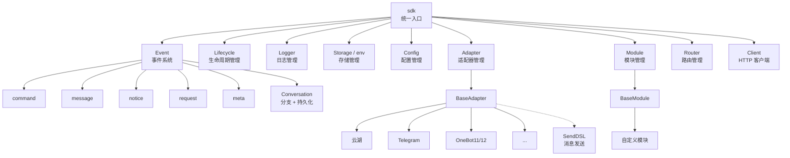
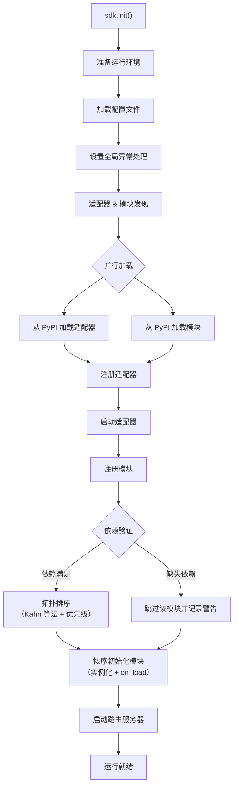
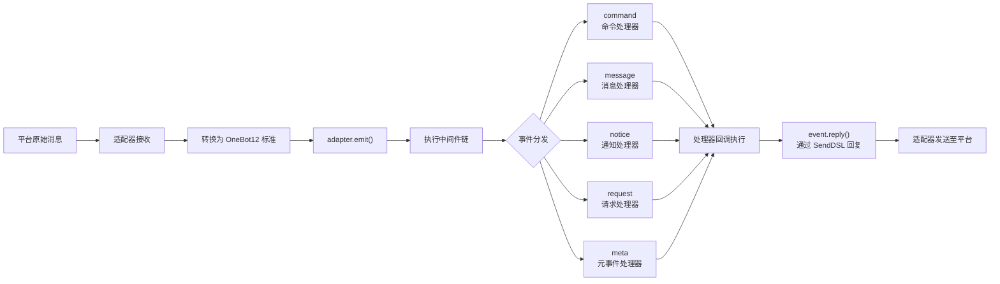
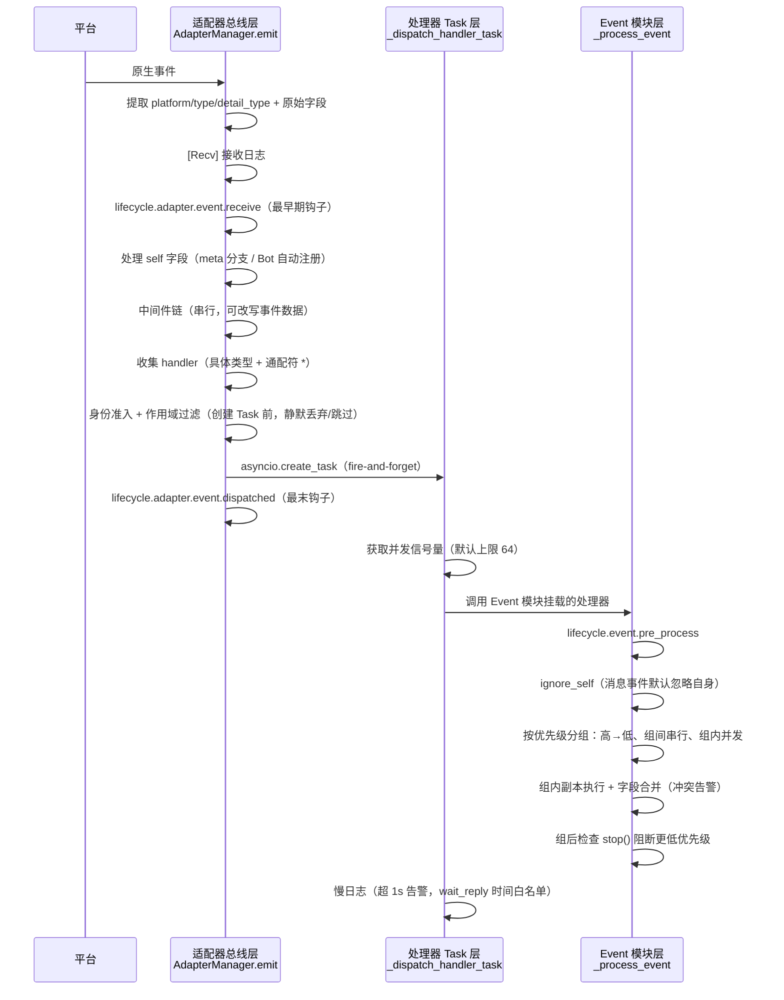
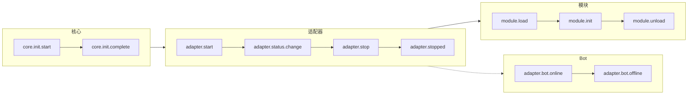
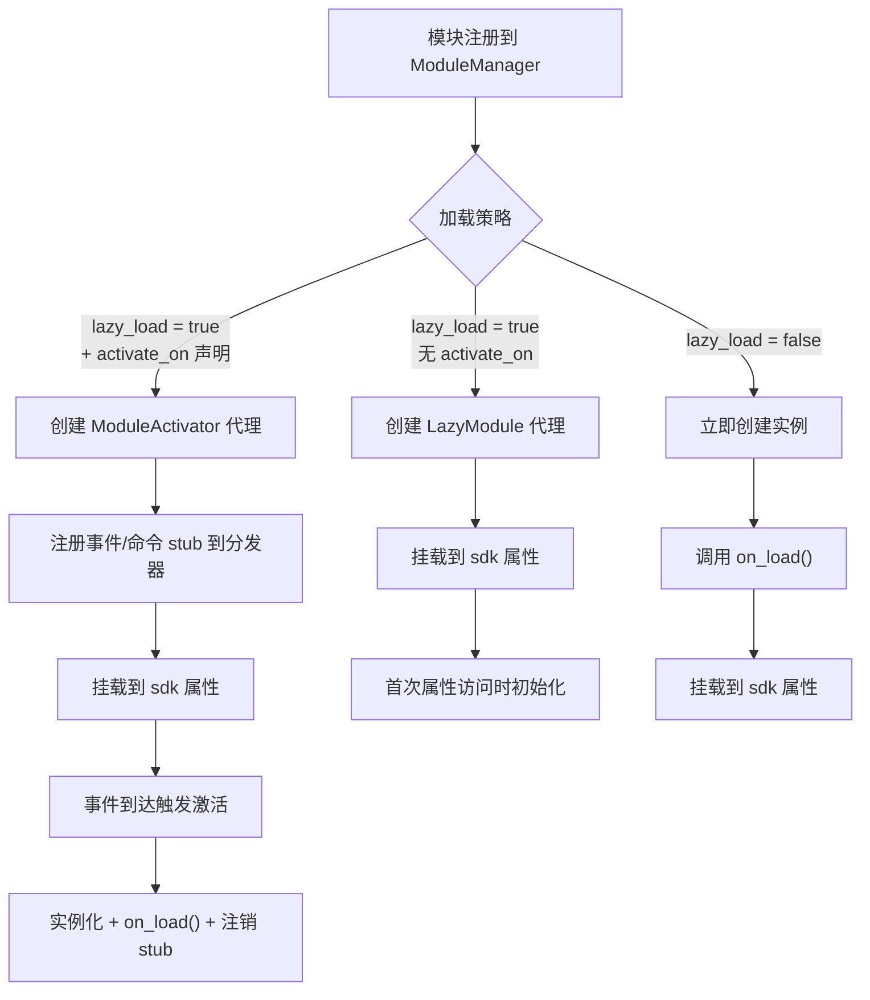
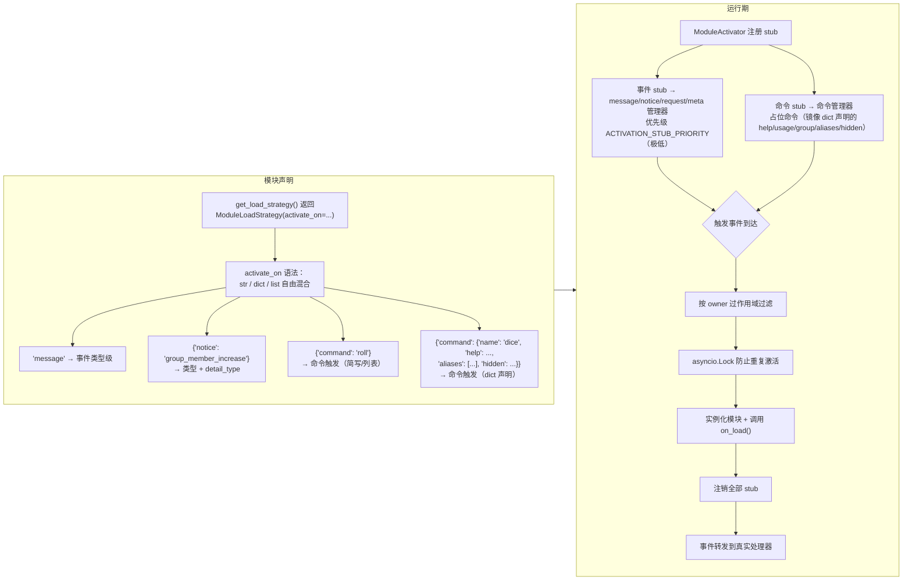
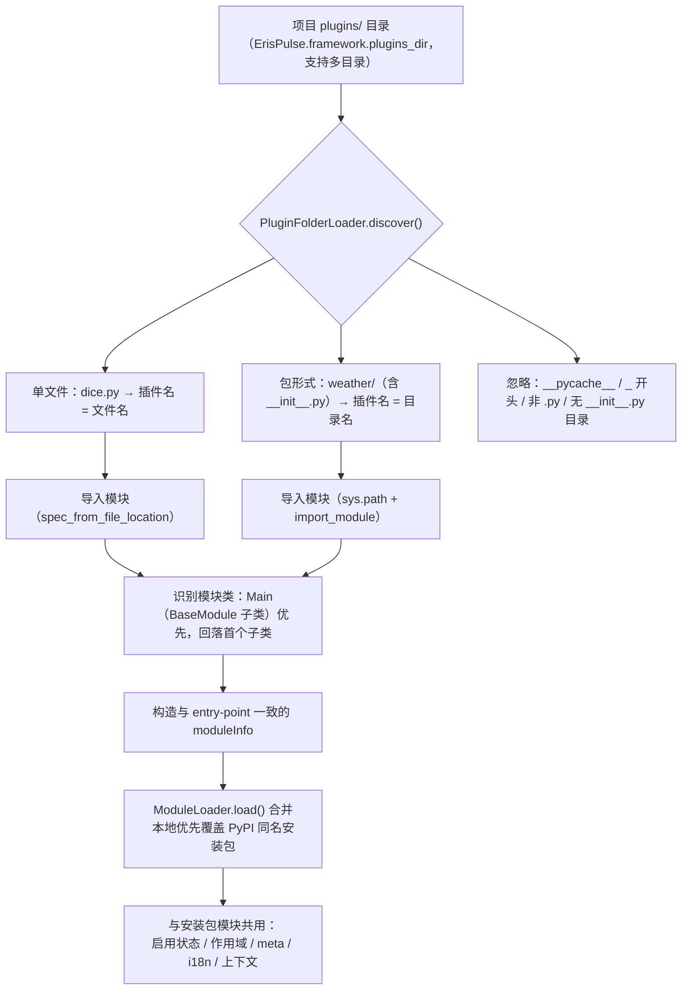
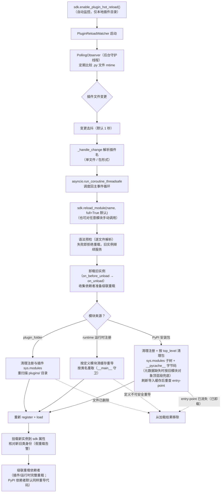
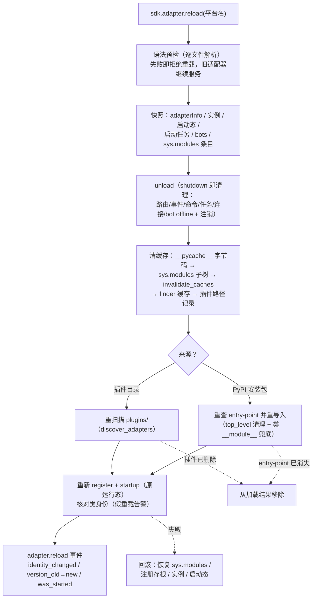

# 架构概览

> [!TIP]
> **什么时候需要读这篇**：想搞懂框架在背后做了什么——一条消息如何流转、模块按什么顺序初始化、热重载时发生了什么，或排查"框架为什么这样表现"时读。只想写处理器的话，看 [事件处理入门](getting-started/event-handling.md) 就够；不需要则跳过。

一条消息从用户发出到机器人回复，要经过适配器转换、中间件、作用域过滤、优先级调度好几道环节；模块也不是启动时就全部加载。这篇用图表把这条链路画清楚，并说明每个环节你能干预什么。

## SDK 核心架构

下图展示了 SDK 的核心模块组成及其关系：

### 核心模块说明

| 模块 | 说明 |
|------|------|
| **Event** | 事件系统，提供 command / message / notice / request / meta 五类事件处理，以及 Conversation 多轮对话 |
| **Adapter** | 适配器管理器，管理多平台适配器的注册、启动和关闭 |
| **Module** | 模块管理器，管理插件的注册、加载和卸载，支持依赖声明和拓扑排序 |
| **Lifecycle** | 生命周期管理器，提供事件驱动的生命周期钩子 |
| **Storage** | 基于 SQLite 的键值存储系统，支持通用 SQL 链式查询 |
| **Config** | TOML 格式的配置文件管理 |
| **Logger** | 模块化日志系统，支持子日志器 |
| **Router** | HTTP/WebSocket 路由管理，通过抽象层封装底层后端（当前为 FastAPI + Uvicorn），支持装饰器路由、中间件、分组、限流、CORS |
| **Client** | 统一 HTTP/WS 客户端（2.8.0 前为 `HttpClient`，保留兼容别名），通过抽象层封装底层请求库（当前为 aiohttp），提供请求统计、重试、日志、WebSocket 客户端、ErisPulse 异常体系等功能。客户端和服务端 WebSocket 共享 `WebSocketConnectionBase` 基类 |

## 初始化流程

下图展示了 `sdk.init()` 的完整初始化过程：

### 初始化阶段详解

> 完整的初始化链路拆解（Finder / Loader / Manager / Router）、底层入口（`init()` / `init_task()` / `init_sync()`）与手动完整启动见 [启动流程与手动控制](advanced/startup.md)。

## 事件处理流程

下图展示了消息从平台到处理器的完整流转路径：

### 事件处理链路详解

上面这张图是「结果」；下面拆开 `adapter.emit()` 之后框架**在背后做了什么**——这是一条三层分发的链路：

**每一步框架做了什么、你能干预什么：**

| 阶段 | 框架做了什么 | 你能干预的 |
|------|-------------|-----------|
| 接收 | 提取标准字段，保留 `{platform}_raw` 原始数据；写 `[Recv]` 日志 | 监听 `adapter.event.receive` 拿到最早期事件 |
| self 字段 | meta 事件走 connect/disconnect/heartbeat 分支；普通事件自动注册 Bot 并触发 `adapter.bot.online` | 监听 `adapter.bot.online` / `bot.offline` |
| 中间件 | **串行**执行，返回值非 None 则替换事件数据 | 注册中间件改写/拦截事件 |
| 分发收集 | 先取具体类型 handler，再取 `*` 通配符 handler | — |
| 身份维度 | 分发入口按 用户>会话>Bot>适配器 判定事件收不收（`scope.is_identity_allowed`），**拒绝则整个事件丢弃** | `ErisPulse.scope.identity` 绑定 |
| 作用域过滤 | 按模块 owner 判定 `scope.is_allowed`（会话级>Bot级>平台级），**不通过则静默跳过** | 配置作用域白名单/黑名单 |
| 调度 | 每个匹配 handler 独立 `asyncio.Task`，`emit()` **不等待** handler 完成即返回 | — |
| 优先级 | 高优先级组先执行；**组间串行、组内并发**（组内各自持有事件副本，改字段合并回原事件，冲突打 WARNING） | `@command(..., priority=N)` / 注册时指定 priority |
| 阻断 | 每处理完一组检查 `event.is_stopped()`，命中则**不再执行更低优先级** | `event.mark_processed(stop=True)` / `event.done()` |

> **常见误区**：
> 1. **作用域过滤是静默的**——被屏蔽的 handler 不报错不响应，只在 TRACE 级日志可见（`core.scope.denied`）。「我的模块没收到消息」优先排查作用域绑定。
> 2. **handler 天然并发**——框架已为每个 handler 建独立 Task，你**不需要**再自己 `asyncio.create_task` 包一层。
> 3. **同优先级组内不阻断**——`mark_processed(stop=True)` 只阻止更低优先级组，同组内已并发的 handler 不会中途被打断。
> 4. **慢日志阈值固定 1 秒**——处理器耗时超 1s 会在日志打 WARNING（`wait_reply` 等待时间已从耗时中剔除），但不中断执行。

> 作用域（scope）的模块维度三级绑定、身份维度准入与出站动作限制细节见 [作用域（scope）](advanced/scope.md)；事件作用域文本过滤与命令用户 ACL 见 [事件处理入门](getting-started/event-handling.md)；并发上限配置见 [配置指南](user-guide/configuration.md#框架配置)。

## 生命周期事件

下图展示了框架各组件的生命周期事件触发顺序：

### 监听生命周期事件

> 完整的事件监听方法（`lifecycle.on()` / `once()` / `has_handlers()`）、全部生命周期事件列表与数据格式见 [生命周期管理](advanced/lifecycle.md)。

## 模块加载策略

ErisPulse 支持三种模块加载策略，由 `get_load_strategy()` 返回的 `ModuleLoadStrategy` 声明：

> 更多详情请参考 [懒加载系统](advanced/lazy-loading.md)、[生命周期管理](advanced/lifecycle.md) 与模块文档。

### 事件驱动懒激活（`activate_on`）触发架构

> [!NOTE]
> 本特性需要 ErisPulse **2.8.0+**。

`activate_on` 允许模块在**首个匹配事件/命令到达时**才加载，避免常驻内存，同时保证事件不丢失：

**触发语义要点：**

> 完整的 `activate_on` 语法（str / dict / list）、命令 dict 声明、占位命令 help 回退链、作用域过滤与失败语义见 [懒加载系统](advanced/lazy-loading.md#事件驱动懒激活activate_on)。

## 本地插件文件夹架构

> [!NOTE]
> 本特性需要 ErisPulse **2.8.0+**。

本地插件（`plugins/` 目录）无需打包发布，框架启动时自动发现并加载：

**约定与特性：**

- 插件名来源：单文件取文件名，包形式取目录名
- 本地插件 `moduleInfo.meta.source == "plugin_folder"`，与 PyPI 安装包模块无缝共存
- 同名时本地优先（便于本地覆盖调试），被禁用时同时移除同名 entry-point 条目

## 模块热重载架构

热重载对**全部模块来源**一致：本地插件（`plugins/` 目录）、运行时注册（`sdk.module.register()`）、PyPI 安装包模块均可通过 `sdk.reload_module()` / `sdk.module.reload()` 热重载——**默认即全量重载**（按顶层包名清理 import 缓存并重导依赖者代码，`full=False` 为轻量逃生门）；`sdk.reload_all_modules()` / `sdk.module.reload_all()` 可一次全量重载所有已注册模块（pip 批量升级后调用即可全部生效）：

**三种来源的差异仅在发现阶段**，预检、卸载、级联重载完全一致：

- **本地插件**（`moduleInfo.meta.source == "plugin_folder"`）：清理插件名对应 `sys.modules` 后重扫描 `plugins/` 目录；文件已删除则从加载结果移除
- **运行时注册**（`source == "runtime"`）：按定义模块重导、按类名重取并重建注册；定义于 `__main__` / 无源文件的类拒绝重导（守卫告警，避免重执行入口脚本）
- **PyPI 安装包**：按 `meta.top_level` 清理包的 `sys.modules` 子树，刷新导入缓存（突破 entry-point 60 秒缓存）后重查并重新导入；entry-point 已消失（pip 卸载）则从加载结果移除

**默认语义与可靠性保障（2.11）：**

- **reload 即全量重载**：默认按顶层包名清理 `sys.modules` 并重导依赖者代码；`full=False` 仅按元数据清理、PyPI 依赖者直接重新实例化（超大依赖树的性能逃生门）
- **语法预检闸门**：进入卸载流程之前逐文件语法解析，失败即拒绝重载——旧实例未卸载、继续服务，语法错误永远不会把模块推进"半死状态"（超大包超过文件数上限时跳过预检）
- **缓存兜底**：`top_level` 元数据缺失时按「旧模块对象 `__name__` 前缀 → 模块类 `__module__` 前缀」两级推导清理范围；重载同时清除源文件字节码缓存（`__pycache__`），同秒同长度的小改写也能生效
- **身份核对**：重载成功后断言新旧类身份变化，未变化（C 扩展等清不掉的缓存）显式告警并随 `module.reload` 事件携带 `identity_changed: false`；`module.get_info()` 以 `running_identity` / `stale` 字段暴露"注册版本 ≠ 运行版本"
- **失败可查**：load 失败现场（异常 + traceback）可经 `module.last_error(名字)` / `get_info()["last_error"]` 直接查询，失败路径同时清洗该模块 import 缓存——"改完代码再 reload 一次"必定读到新代码
- 重载会把原本懒加载的模块强制激活（显式日志）；`reload_all_modules()` 则保持懒加载策略、仅将重载前处于已加载态的模块重新激活，归眠（休眠）中的模块保持归眠
- `reload_all_modules()` 按依赖拓扑序重新加载，单模块失败仅记录诊断并跳过（无整体回滚——on_unload 副作用不可撤销，与单模块热重载的尽力而为语义一致）；重载失败已回滚的场景同样如此，日志会明确提示旧实例处于已收尾状态

## 适配器热重载架构

适配器代码级热重载（2.11）与模块管线同构：`sdk.adapter.reload(平台名)` / `sdk.reload_adapter(平台名)` 对**本地插件**与 **PyPI 安装包**两种来源执行——

**与模块管线的差异：**

- 适配器无懒加载与依赖级联：重载**不级联**依赖它的其它适配器（仅告警——依赖方经注册表间接消费，无实例级联语义）
- 启动是异步链（`startup` 经 `_run_adapter` 派发，含依赖跳过与指数退避重试）：启动暂时失败**不判重载失败**（代码已换新），结果经 `adapter.status.change` 播报
- `register()` 的实例重用陷阱（类同对象则旧实例被复用）由「pyc 清理 + sys.modules 清除 + 身份核对」三件套兜底
- 生命周期事件：`adapter.reload`（payload 携带 `adapter_name` / `success` / `full` / `duration_ms` / `identity_changed` / `version_old→new` / `was_started` / `source`）

## 下一步

- **想手动控制启动 / 关闭**：看 [启动流程与手动控制](advanced/startup.md)，初始化链路逐环节拆解、可单独启停适配器与路由
- **想弄清懒加载与休眠**：看 [懒加载系统](advanced/lazy-loading.md)，含 `activate_on` 事件驱动懒激活的完整语法
- **写模块要用好生命周期**：看 [生命周期管理](advanced/lifecycle.md)，全部生命周期事件与监听方法