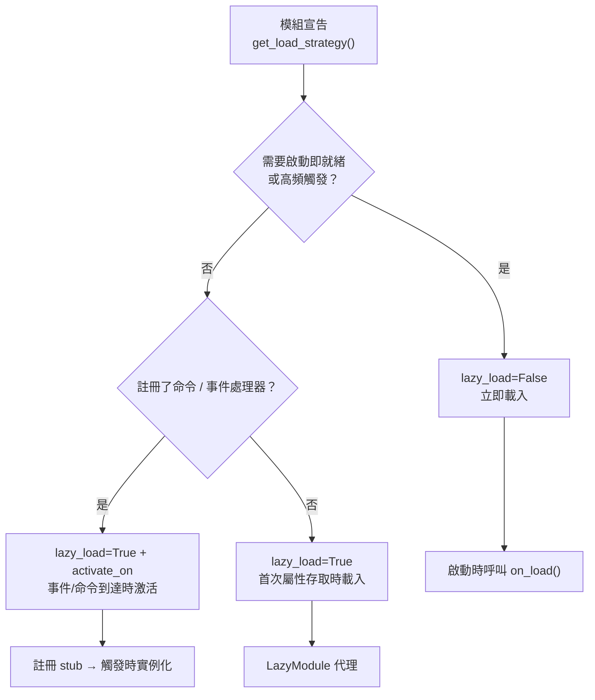

# 慢載模組系統

> [!TIP]  
> **何時需要閱讀本文**：使用慢載模組或 activate_on 事件驅動激活時。若不需要則可跳過，這不會影響其他功能的使用。

ErisPulse SDK 的慢載模組系統讓模組延遲到**實際被存取時**才初始化——啟動階段只註冊占位代理，未被使用的模組不會占用啟動時間與記憶體。

## 概述

懶加載模組系統是 ErisPulse 的核心特性之一，它透過以下方式運作：

- **延遲初始化**：模組只有在第一次被存取時才會實際載入和初始化
- **透明使用**：對於開發者而言，懶加載模組與一般模組在使用上幾乎沒有差別
- **自動依賴管理**：模組依賴會在被使用時自動初始化
- **生命週期支援**：對於繼承自 `BaseModule` 的模組，會自動呼叫生命週期方法

## 工作原理

### LazyModule 類

懶加載系統的核心是 `LazyModule` 類，它是一個封裝器，在首次存取時才實際初始化模組。

### 初始化過程

當模組首次被存取時，`LazyModule` 會執行以下操作：

1. 獲取模組類的 `__init__` 參數資訊
2. 根據參數決定是否傳入 `sdk` 引用
3. 設定模組的 `moduleInfo` 屬性
4. 對於繼承自 `BaseModule` 的模組，呼叫 `on_load` 方法
5. 觸發 `module.init` 生命週期事件

## 事件驅動懶激活（activate_on）

> [!NOTE]  
> 此功能需要 ErisPulse **2.8.0+**。

`lazy_load=True` 的模組預設只在**首次屬性存取**時載入。若模組註冊了命令/事件處理器，  
傳統做法只能 `lazy_load=False` 立即載入。`activate_on` 提供了第三種選擇：**宣告觸發器，  
首個匹配事件/命令到達時自動激活模組**——既不常駐記憶體，又不遺失觸發入口。

```python
from ErisPulse.loaders import ModuleLoadStrategy

class MyModule(BaseModule):
    @staticmethod
    def get_load_strategy():
        return ModuleLoadStrategy(
            lazy_load=True,
            activate_on=[
                # ---- 事件觸發（被動到達，無需使用者感知）----
                "message",                                    # 類型級：任何訊息事件
                {"notice": "group_member_increase"},          # 類型 + 單個 detail_type
                {"message": ["private", "group"]},            # 類型 + 多個 detail_type

                # ---- 命令觸發（主動輸入，占位命令對 Help 可見）----
                {"command": "roll"},                          # 簡寫：命令名
                {"command": ["roll", "dice"]},                # 命令名列表
                {"command": {                                 # dict 聲明（name 必填）
                    "name": "dice",
                    "help": "擲一個骰子",
                    "usage": "/dice",
                    "group": "娛樂",
                    "aliases": ["d"],
                    "hidden": False,
                }},
            ],
        )
```

### 命令 dict 聲明參數

dict 形式鏡像 `@command()` 裝飾器的使用者級參數，用於在模組載入前就註冊占位命令：

| 參數 | 類型 | 預設 | 說明 |
|------|------|------|------|
| `name` | `str` | **必填** | 命令名；須與 `on_load` 中 `@command(name)` 一致，否則激活後占位註銷、命令不存在 |
| `help` | `str` | 回退鏈 | Help 中顯示的介紹；未聲明時按回退鏈取值（見下） |
| `usage` | `str` | 自動生成 | 用法行，預設 `{prefix}{name}` |
| `group` | `str` | `None` | 命令分組 |
| `aliases` | `list[str]` | `[]` | 別名同時註冊，**輸入別名同樣觸發激活** |
| `hidden` | `bool` | `False` | `True` 時占位命令同樣隱藏（與激活後真實命令的隱藏語義對齊）；知道命令名的使用者輸入仍可觸發 |

**不支援** `priority` / `permission` / `master`：占位命令的使命只是觸發激活，  
權限檢查由激活後的真實命令執行（占位階段攔截權限反而會讓「輸入命令激活」失效）。

### 占位命令 help 回退鏈

模組未載入時 Help 顯示的命令介紹，按以下順序取值（取到即止）：

1. dict 聲明的命令級 `help`（最精確）  
2. 模組 `get_meta()` 的 `description`  
3. 模組 `__description__` 屬性  
4. 包元數據的 `Summary`（PyPI 包簡介）  
5. 通用提示：「此命令來自懶載入模組 X，首次使用將自動載入該模組」

### 觸發語義

- **事件 stub**：以極低優先級（`ACTIVATION_STUB_PRIORITY`）註冊到對應事件管理器，  
  在所有普通處理器之後兜底觸發；激活後將當前事件轉發給模組的真實處理器  
- **命令 stub**：註冊占位命令；激活後占位註銷、真實命令接管當次觸發  
- **防重入**：`asyncio.Lock` 保證併發觸發下只激活一次  
- **作用域過濾**：stub 帶模組 owner 身份，模組未對該 Bot / 會話 / 平台啟用時不觸發  
- **失敗語義**：激活失敗進入冷卻期（`ACTIVATE_RETRY_COOLDOWN_SECS`，30 秒），  
  冷卻內事件短路避免重複嘗試；冷卻結束後再次觸發自動重試，stub 全程保留  
- **去重**：同名命令以簡寫 + dict 混合聲明時去重（dict 优先）；dict 缺 `name`  
  或事件 `detail_type` 误寫 dict 時告警並忽略  

> 架構圖與完整語義詳見 [架構概覽](../architecture.md#事件驅動懶激活activate_on觸發架構)。

## 懶加載休眠（dormant_after）

> [!NOTE]  
> 此功能需要 ErisPulse **2.11.0+**。

當懶加載的模組長期閒置時，框架可將其**歸眠**：釋放運行時資源（包括任務、連接、事件註冊等），  
但保留懶加載代理與註冊存根——模組回到「已註冊未加載」狀態。下次透過屬性存取、  
`module.call` 或 `activate_on` 事件將**透明地喚醒**（重新實例化並執行 `on_load`），  
無需任何額外的喚醒 API。歸眠後的系統狀態與「從未激活」完全一致。

### 聲明方式

```python
@staticmethod
def get_load_strategy():
    return ModuleLoadStrategy(
        lazy_load=True,
        dormant_after="30m",   # 閒置 30 分鐘自動歸眠；不聲明則永不休眠（預設）
    )
```

時間長度語法與命令治理的 `cooldown` 完全一致（例如：`90s`、`1h30m`、`1d`）。  
掃描器會以固定間隔（60 秒）進行掃描，實際歸眠時間 = 閾值 + 最多一個掃描間隔；  
也可隨時手動歸眠：`await sdk.module.sleep("模組名")`。顯式呼叫 `unload` 仍是徹底卸載（懶代理一併移除）。

### 狀態接續

歸眠前框架會觸發 `on_before_unload(reason="dormant")`（卸載流程的第一步，資源仍完好），  
模組將狀態儲存到 `sdk.storage`；喚醒後在 `on_load` 中恢復：

```python
async def on_before_unload(self, event):
    if event["reason"] in ("dormant", "reload", "disable"):
        await self.sdk.storage.aset(f"{self._module_name}:counter", self._count)

async def on_load(self, event):
    self._count = await self.sdk.storage.aget(f"{self._module_name}:counter") or 0
```

### 語意與限制

- **依賴方安全**：懶模組的依賴方透過持久代理（`sdk.<Name>`）或 `module.call` 訪問，  
  歸眠前後行為一致；直接持有真實實例引用屬反模式（會被泄漏審計器檢測到）
- **事件不達**：歸眠模組不再接收事件——需要事件喚醒的模組請同時聲明 `activate_on`  
  （事件先喚醒再轉發）；排查「命令沒反應」時，請確認模組是否處於歸眠狀態
- **喚醒失敗可自愈**：喚醒（重新初始化）失敗將進入 30 秒冷卻，冷卻後再次訪問會自動重試，  
  不會永久失效

## 配置懶加載

### 全局配置

在配置文件中啟用/禁用全局懶加載：

```toml
[ErisPulse.framework]
enable_lazy_loading = true  # true=啟用懶加載(預設)，false=禁用懶加載
```

### 模組層級控制

模組可以透過實作 `get_load_strategy()` 靜態方法來控制加載策略：

```python
from ErisPulse.Core.Bases import BaseModule
from ErisPulse.loaders import ModuleLoadStrategy

class MyModule(BaseModule):
    @staticmethod
    def get_load_strategy():
        """返回模組加載策略"""
        return ModuleLoadStrategy(
            lazy_load=False,  # 返回 False 表示立即加載
            priority=100      # 加載優先級，數值越大優先級越高
        )
```

## 使用懶加載模組

### 基本使用

對於開發者來說，懶加載模組與普通模組在使用上幾乎沒有區別：

```python
# 透過 SDK 訪問懶加載模組
from ErisPulse import sdk

# 以下訪問會觸發模組懶加載
result = await sdk.my_module.my_method()
```

### 統一的模組獲取入口

無論是透過 SDK 屬性、模組管理器屬性訪問，還是透過 `module.get()` 查詢，
對於「已註冊但尚未加載」的懶加載模組，都會返回同一個懶加載代理，訪問其屬性才會真正觸發初始化：

```python
# 三種方式拿到的都是懶加載代理（在模組未加載時），行為一致、對使用者透明
sdk.my_module          # 觸發加載的入口
sdk.module.my_module   # 同樣返回懶加載代理
sdk.module.get("my_module")  # 也返回懶加載代理，本身不會觸發加載

# 訪問代理的任意屬性才會真正初始化模組
result = await sdk.my_module.my_method()
```

`module.get()` 是**查詢**介面，本身不觸發加載：
- 模組已加載 → 返回真實實例
- 模組已註冊但未加載 → 返回懶加載代理（訪問屬性才初始化）
- 模組未註冊 → 返回 `None`

如需顯式觸發加載，請使用 `await sdk.load_module("my_module")`。

### 異步初始化

對於需要異步初始化的模組，建議先顯式加載：

```python
# 先顯式加載模組
await sdk.load_module("my_module")

# 然後使用模組
result = await sdk.my_module.my_method()
```

### 同步初始化

對於不需要異步初始化的模組，可以直接訪問：

```python
# 直接訪問會自動同步初始化
result = sdk.my_module.some_sync_method()
```

## 最佳實踐

選擇載入策略時，可參考以下決策流程：



### 推薦使用懶載入的場景（lazy_load=True）

- 被動呼叫的工具類（如資料查詢模組、格式轉換器等，僅在其他模組呼叫時才需要）
- 註冊命令/事件處理器但非高頻使用的模組——配合 `activate_on` 聲明觸發器，首個匹配事件/命令到達時自動激活，無需放棄懶載入

### 推薦禁用懶載入的場景（lazy_load=False）

- 需要在啟動時立即就緒的模組（如為其它模組提供基礎服務的核心模組）
- 高頻觸發的監聽器（每條訊息都要處理）——`activate_on` 轉發有一次激活開銷，高頻場景立即載入更直接
- 定時任務模組
- 需要在應用啟動時就初始化的模組

> `priority` 參數控制立即載入模組間的初始化順序，數值越大越先初始化。同優先級的模組按註冊順序載入。

## 注意事項

1. 如果您的模組使用了懶加載，如果其他模組從未在 ErisPulse 內進行過呼叫，則您的模組永遠不會被初始化。
2. 如果您的模組中包含了例如監聽事件的模組，或其它主動監聽類似模組，有兩種選擇：聲明 `activate_on` 觸發器（保持懶加載，事件到達時自動激活），或聲明需要立即被加載（`lazy_load=False`），否則會影響您模組的正常業務。
3. 我們不建議您禁用懶加載，除非有特殊需求，否則它可能為您帶來例如依賴管理和生命週期事件等的問題。
4. `activate_on` 的命令 dict 聲明中，`name` 必須與模組 `on_load` 中 `@command()` 註冊的真實命令名一致——否則模組激活後占位命令註銷，聲明與實現不一致的命令將不存在。

## 相關文件

請依下一步意圖選擇：

- **不清楚該選哪種載入策略（立即載入 / 懶載入 / activate_on）** → [模組最佳實踐](../developer-guide/modules/best-practices.md)
- **休眠與卸載時，背景任務、連線等資源的回收鏈路** → [所有權（owner）系統](ownership.md)
- **從頭開發一個模組** → [模組開發指南](../developer-guide/modules/getting-started.md)