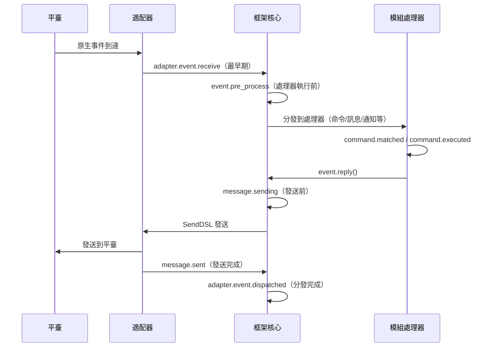

# 生命週期管理

> [!TIP]
> **什麼時候需要讀這篇**：需要訂閱框架生命週期事件（啟動 / 載入 / 狀態變化）時。不需要則跳過，不影響其它功能的使用。

> **讀完你會知道**：生命週期事件的註冊 / 觸發 / 定向傳播機制，四套觸發 API 的
> 差異與選用，以及框架預埋的全部鉤子斷點（core / module / adapter / server / message
> 等）各自的資料格式。
>
> **本篇不涉及**：模組自身要實作的生命週期方法（`on_load` / `on_unload`，見
> [模組開發指南](../developer-guide/modules/getting-started.md)）；啟動鏈路各階段的
> 來龍去脈（見[啟動流程與手動控制](startup.md)）。


想在模組載入失敗、配置被修改、訊息發出、命令執行這些節點上收到通知並執行自己的
邏輯（審計、統計、告警、聯動），訂閱框架生命週期事件即可——框架在每個關鍵節點
預埋了鉤子斷點，`@sdk.lifecycle.on("事件名")` 一行接入，本文末尾附全部斷點一覽。

系統支援三種觸發方式：
- `await lifecycle.emit("event", data)` — 精簡版，傳遞任意資料（`to="Owner"` 時定向投遞）
- `lifecycle.emit_sync("event", data)` — 同步版（用於非非同步上下文）
- `await lifecycle.submit_event("event", ...)` — 相容舊版，自動建構標準事件格式

## 事件處理機制

### 註冊處理器

```python
from ErisPulse import sdk

# 裝飾器模式
@sdk.lifecycle.on("module.load")
async def on_module_load(data):
    print(f"模組加載: {data}")

# 編程式註冊
sdk.lifecycle.register("module.load", on_module_load, priority=10)

# 取消註冊
sdk.lifecycle.unregister("module.load", on_module_load)

# 按所有者批量取消註冊（模組/適配器卸載時框架自動調用）
removed = sdk.lifecycle.unregister_by_owner("MyModule")
print(f"清理了 {removed} 個生命週期鉤子")
```

### 優先級

處理器支援 `priority` 參數，數值越大越先執行（與模組加載器一致）：

```python
@sdk.lifecycle.on("adapter.event.receive", priority=10)  # 最先執行
async def first_handler(data):
    pass

@sdk.lifecycle.on("adapter.event.receive", priority=0)  # 後執行
async def second_handler(data):
    pass
```

### 點式結構事件

觸發具體事件時，也會觸發其父級事件：
- 觸發 `module.load` 時，也會觸發 `module`
- 觸發 `adapter.event.receive` 時，也會觸發 `adapter.event` 和 `adapter`

### 通配符

註冊 `*` 捕獲所有事件：

```python
@sdk.lifecycle.on("*")
async def on_anything(data):
    print(f"收到事件: {data}")
```

### 定向傳播（emit to=）

> [!NOTE]
> 本特性需要 ErisPulse **2.8.0+**。

`emit()` 指定 `to` 參數後進入定向傳播：事件只分發給以該擁有者（owner）身份註冊的
處理器（模組在 `on_load` 內註冊的鉤子自動歸屬本模組），其它模組與通配符 `*`
處理器不感知。

```python
# 投遞方：事件只投給 Chat 模組註冊的鉤子
await sdk.lifecycle.emit("message_received", {"text": "hi"}, to="Chat")

# 訂閱方（Chat 模組內）：註冊同名鉤子，owner 在註冊時自動記錄
@sdk.lifecycle.on("message_received")
async def on_message_received(data): ...

@sdk.lifecycle.on("message")   # 點式父級前綴同樣生效（按 owner 過濾）
async def on_any(data): ...
```

- 目標 owner 無已註冊鉤子 → 事件**不被消費**（可用 `has_handlers()` 提前探測）
- `data` 為 dict 時自動攜帶 `_trace_id`（不覆蓋已有值）
- `emit_sync` / `submit_event` 同樣支援 `to=` 參數
- 模組間通訊的三層模型（RPC / 定向 / 廣播）見
  [模組間通訊](module-communication.md)

### 一次性註冊（once）

從 2.7.0 起，`lifecycle.once()` 註冊的處理器在**觸發一次後自動註銷**，適合"首次就緒"這類一次性鉤子：

```python
@sdk.lifecycle.once("core.init.complete")
async def on_first_ready(data):
    print("首次就緒，後續不再觸發")
```

- 與 `on()` 同優先級參數語義（`priority` 數值越大越先執行）
- 自動註銷，無需手動 `unregister`
- 同步/異步處理器均支援

### 監聽者查詢（has_handlers）

熱路徑短路場景可先用 `has_handlers()` 判斷是否有監聽者，避免無謂的事件遍歷與任務調度：

```python
if sdk.lifecycle.has_handlers("message.sending"):
    await sdk.lifecycle.emit("message.sending", send_ctx)
```

- 覆蓋**精確事件名、通配符 `*`、父級事件**三種匹配
- 無任何監聽者時返回 `False`，可安全跳過 `emit`

## 鉤子斷點一覽

一條訊息從平臺進入框架到處理完成的典型生命週期事件時序：



框架內建了以下鉤子斷點，使用者可以透過 `@sdk.lifecycle.on()` 監聽任意斷點實現自訂邏輯。

### 核心初始化

| 鉤子名稱 | 觸發時機 | 資料 |
|---------|---------|------|
| `core.init.start` | SDK 初始化開始 | `{}` |
| `core.init.stage` | 初始化各階段開始（背景發出） | `{"stage": str}`，取值 `discovery` / `adapter_register` / `adapter_start` / `module_register` / `module_init` / `adapter_start_deferred` / `router_start` |
| `core.init.complete` | SDK 初始化完成 | `{"duration": float, "success": bool, "stages": {stage: float}, "adapters": {"enabled": [str], "disabled": [str]}, "modules": {"enabled": [str], "disabled": [str]}, "error": str(僅失敗時)}` |
| `core.uninit.complete` | SDK 反初始化完成 | `{"duration": float, "success": bool, "adapters_closed": int, "modules_unloaded": int, "module_properties_cleared": int, "module_properties_to_clear": [str], "error": str(僅失敗時)}` |

**範例：啟動進度展示**

```python
@sdk.lifecycle.on("core.init.stage")
def show_stage(data):
    print(f"[啟動] 進入階段: {data['stage']}")
```

### 設定變更

| 鉤子名稱 | 觸發時機 | 資料 |
|---------|---------|------|
| `config.set` | 設定項被修改 | `{"key": str, "old_value": Any, "new_value": Any}` |
| `config.updated` | 外部編輯 config.toml 後偵測到整樹變更 | `{"old_config": dict, "new_config": dict, "config_file": str}` |

**範例：設定稽核**

```python
@sdk.lifecycle.on("config.set")
def audit_config(data):
    print(f"[稽核] {data['key']}: {data['old_value']} -> {data['new_value']}")
```

### 模組生命週期

| 鉤子名稱 | 觸發時機 | 資料 |
|---------|---------|------|
| `module.register` | 模組類別註冊到管理器 | `{"module_name": str, "success": bool}` |
| `module.load` | 模組載入完成（實例化成功）；失敗時 payload 額外攜帶 `"error": str, "traceback": str`（失敗現場亦可經 `module.last_error(名字)` 查詢） | `{"module_name": str, "success": bool}` |
| `module.init` | 模組初始化完畢（含懶載入） | `{"module_name": str, "success": bool}` |
| `module.before_unload` | 卸載流水線第一步（先於 `on_unload` 與資源回收；模組實例鉤子 `on_before_unload` 同步觸發） | `{"module_name": str, "reason": str}`；`reason` 取值：`unload` / `reload` / `disable` / `cascade` / `dormant` |
| `module.sleep` | 模組歸眠完成（懶載入休眠：資源已釋放，存取時自動喚醒） | `{"module_name": str, "success": bool}` |
| `module.unload` | 模組卸載或停用（`disable` 與 `unload` 對等通知依賴方，`on_dependency_lost` 契約含「停用」） | `{"module_name": str, "success": bool}` |
| `module.reload` | 模組熱重載完成（含級聯重載依賴者） | `{"module_name": str, "success": bool, "full": bool, "duration_ms": int}`；單模組額外攜帶 `"identity_changed": bool`（False = 行程內可能仍執行舊程式碼，如 C 擴充套件快取）與 `"version_old": str, "version_new": str`；全量重載（`reload_all`）時 `module_name` 為 `"All"`，payload 額外攜帶 `"results": dict[str, bool]` |

> **模組實例鉤子 `on_before_unload`**：與 `module.before_unload` 事件對應的可選生命週期方法——`event["reason"]` 標註來意，適合在資源釋放前把狀態儲存到 `sdk.storage`，喚醒 / 重載後在 `on_load` 中恢復（懶載入休眠的狀態接續即基於此）。鉤子失敗僅告警，不阻塞卸載流程。

### 適配器生命週期

| 鉤子名稱 | 觸發時機 | 資料 |
|---------|---------|------|
| `adapter.load` | 適配器註冊完成 | `{"platform": str, "success": bool}` |
| `adapter.reload` | 適配器程式碼級熱重載完成 | `{"adapter_name": str, "success": bool, "full": bool, "duration_ms": int, "identity_changed": bool, "version_old": str, "version_new": str, "was_started": bool, "source": str}`；`identity_changed=False` = 行程內可能仍執行舊程式碼 |
| `adapter.start` | 適配器啟動 | `{"platforms": [str]}` |
| `adapter.status.change` | 適配器狀態變化 | `{"platform": str, "status": str, "retry_count": int, "error": str(僅失敗時)}`；status 完整取值：`starting` / `started` / `start_failed` / `stopping` / `stopped` / `stop_failed` / `skipped-dependency` / `disabled` |
| `adapter.stop` | 適配器關閉 | `{"platforms": [str]}` |
| `adapter.stopped` | 適配器關閉完成 | `{"platforms": [str]}` |
| `adapter.bot.online` | Bot 上線 | `{"platform": str, "bot_id": str, "info": dict, "status": str}` |
| `adapter.bot.offline` | Bot 下線 | `{"platform": str, "bot_id": str, "status": str}` |

### 事件接收與處理

| 鉤子名稱 | 觸發時機 | 資料 |
|---------|---------|------|
| `adapter.event.receive` | 收到外部平臺事件（最早期） | `{"platform": str, "event_type": str, "raw_event_type": str}` |
| `adapter.event.blocked` | 中介軟體否決事件（回傳 `False`，事件被丟棄不進入任何處理器） | `{"middleware": str, "platform": str, "event_type": str, "detail_type": str, "event": dict, "_trace_id": str}` |
| `adapter.event.dispatched` | 事件分發完成 | `{"platform": str, "event_type": str, "raw_event_type": str, "onebot_handlers_count": int}` |
| `event.pre_process` | 事件處理器開始執行前 | `{"event_type": str, "platform": str, "detail_type": str}` |

**範例：事件統計**

```python
event_counter = {}

@sdk.lifecycle.on("adapter.event.receive")
def count_events(data):
    platform = data["platform"]
    event_counter[platform] = event_counter.get(platform, 0) + 1

@sdk.lifecycle.on("adapter.event.dispatched")
def log_unhandled(data):
    if data["onebot_handlers_count"] == 0:
        print(f"[未處理] {data['platform']}/{data['event_type']}")
```

### 訊息發送

| 鉤子名稱 | 觸發時機 | 資料 |
|---------|---------|------|
| `message.sending` | 訊息即將發送 | `{"platform": str, "method": str, "detail_type": str, "target_id": str, "bot_id": str}` |
| `message.sent` | 訊息發送完成 | `{"platform": str, "method": str, "detail_type": str, "target_id": str, "bot_id": str}` |

**範例：訊息發送稽核**

```python
@sdk.lifecycle.on("message.sending")
def log_sending(data):
    print(f"[發送] -> {data['platform']}/{data['detail_type']}/{data['target_id']} via {data['method']}")
```

### 命令系統

| 鉤子名稱 | 觸發時機 | 資料 |
|---------|---------|------|
| `command.matched` | 命令被匹配並即將執行 | `{"command": str, "args": list[str], "platform": str, "user_id": str}` |
| `command.executed` | 命令執行完成 | `{"command": str, "args": list[str], "platform": str, "user_id": str, "success": bool, "error": str(僅失敗時)}` |

**範例：命令統計**

```python
@sdk.lifecycle.on("command.matched")
def count_commands(data):
    print(f"[命令] /{data['command']} from {data['user_id']}@{data['platform']}")
```

### HTTP 路由

| 鉤子名稱 | 觸發時機 | 資料 |
|---------|---------|------|
| `server.request` | HTTP 請求接收 | `{"method": str, "path": str, "client_ip": str, "request_id": str}` |
| `server.response` | HTTP 回應發送 | `{"method": str, "path": str, "status_code": int, "client_ip": str, "request_id": str}` |

> `request_id` 即 [X-Request-ID 請求關聯 ID](router.md#請求關聯-idx-request-id)：優先沿用用戶端請求標頭，否則自動產生 UUID，可用它把請求與回應兩條事件串聯。

**範例：請求日誌**

```python
@sdk.lifecycle.on("server.response")
def log_http(data):
    print(f"[HTTP] {data['method']} {data['path']} -> {data['status_code']}")
```

### WebSocket

| 鉤子名稱 | 觸發時機 | 資料 |
|---------|---------|------|
| `server.start` | 路由伺服器啟動 | `{"base_url": str, "host": str, "port": int, "success": bool, "error": str(僅失敗時)}` |
| `server.stop` | 路由伺服器停止 | `{}` |
| `server.websocket.connect` | WebSocket 連線建立 | `{"path": str, "module_name": str, "client_ip": str}` |
| `server.websocket.disconnect` | WebSocket 連線中斷 | `{"path": str, "module_name": str, "reason": str, "error": str(僅異常時)}` |

**範例：WebSocket 連線監控**

```python
@sdk.lifecycle.on("server.websocket.connect")
def on_ws_connect(data):
    print(f"[WS] 連線: {data['path']} from {data['client_ip']}")

@sdk.lifecycle.on("server.websocket.disconnect")
def on_ws_disconnect(data):
    print(f"[WS] 中斷: {data['path']} ({data['reason']})")
```

### 儲存連線狀態

儲存後端連線池的建立、故障與恢復（均於背景發出，不阻塞儲存操作）：

| 鉤子名稱 | 觸發時機 | 資料 |
|---------|---------|------|
| `storage.ready` | 儲存後端連線池就緒（每事件迴圈首次建池成功） | `{"backend": str}` |
| `storage.unreachable` | 連線重試耗盡進入冷卻期（期間操作快速失敗） | `{"backend": str, "error": str, "cooldown": float}` |
| `storage.recovered` | 冷卻結束重連成功，儲存恢復可用 | `{"backend": str}` |

**範例：儲存故障告警**

```python
@sdk.lifecycle.on("storage.unreachable")
def alert_storage_down(data):
    print(f"[告警] 儲存後端 {data['backend']} 不可達: {data['error']}，{data['cooldown']}s 後自動重連")

@sdk.lifecycle.on("storage.recovered")
def notify_storage_back(data):
    print(f"[恢復] 儲存後端 {data['backend']} 已恢復可用")
```

### HTTP 用戶端

`sdk.client` 的請求與連線事件（均於背景發出）：

| 鉤子名稱 | 觸發時機 | 資料 |
|---------|---------|------|
| `client.request.success` | HTTP 請求成功 | `{"method": str, "url": str, "status": int, "elapsed": float}` |
| `client.request.failed` | HTTP 請求重試耗盡最終失敗 | `{"method": str, "url": str, "error": str, "attempts": int, "elapsed": float}` |
| `client.ws.connect` | WebSocket 連線建立 | `{"url": str}` |

### 國際化

| 鉤子名稱 | 觸發時機 | 資料 |
|---------|---------|------|
| `i18n.language.changed` | 框架語言切換（`i18n.set_language`） | `{"language": str, "previous": str}` |

## 標準事件定義

```python
STANDARD_EVENTS = {
    "core": ["init.start", "init.stage", "init.complete", "uninit.complete"],
    "module": ["load", "before_unload", "init", "sleep", "unload", "register", "reload"],
    "adapter": [
        "load", "start", "status.change", "reload", "stop", "stopped",
        "event.receive", "event.blocked", "event.dispatched",
        "bot.online", "bot.offline",
    ],
    "server": [
        "start", "stop",
        "request", "response",
        "websocket.connect", "websocket.disconnect",
    ],
    "event": ["pre_process"],
    "message": ["sending", "sent"],
    "command": ["matched", "executed"],
    "config": ["set", "updated"],
    "storage": ["ready", "unreachable", "recovered"],
    "client": ["request.success", "request.failed", "ws.connect"],
    "i18n": ["language.changed"],
}
```

## 完整 API 參考

### 註冊與取消

| 方法 | 說明 |
|------|------|
| `@lifecycle.on(event, *, priority=0)` | 裝飾器註冊處理器 |
| `lifecycle.register(event, handler, *, priority=0)` | 程式化註冊 |
| `lifecycle.unregister(event, handler=None)` | 取消註冊（handler=None 時取消該事件全部處理器） |

### 觸發

| 方法 | 說明 |
|------|------|
| `await lifecycle.emit(event, data=None, *, to=None)` | 非同步觸發，處理器**並行執行**（互不阻塞，回傳時全部完成），回傳非 None 值按優先順序回放鏈式替換 data；`to` 指定 owner 時定向投遞 |
| `lifecycle.fire(event, data=None, *, to=None)` | **背景發射（扔桶即走）**：處理器在背景任務中並行執行、不等待、無回傳值；無監聽者時零開銷。適用於高頻熱路徑與純觀測事件；關停序列與順序敏感消費（如 `config.set`）請用 `emit` |
| `lifecycle.emit_sync(event, data=None, *, to=None)` | 同步觸發，非同步處理器以 create_task 排程 |
| `await lifecycle.submit_event(event_type, *, source, msg, data, to=None, background=False)` | 相容舊版，自動建構標準事件格式；`background=True` 時走 `fire` 背景發射 |

**四套觸發 API 對照**：

| 方法 | 呼叫形態 | 是否等待處理器完成 | 典型場景 |
|------|---------|------------------|---------|
| `emit` | `await`（非同步） | **等待**——處理器並行執行，回傳時全部完成，回傳值鏈式回放 | 常規觸發；順序敏感消費（`config.set`）與關停序列必須用它 |
| `fire` | 直接呼叫（同步回傳） | **不等待**——背景任務並行執行，無回傳值；無監聽者時零開銷 | 高頻熱路徑與純觀測事件（`server.request` / `storage.ready`） |
| `emit_sync` | 直接呼叫（同步） | 同步處理器立即完成；非同步處理器以 `create_task` 排程（回傳值無法回傳） | 非非同步情境（同步程式碼）中觸發事件 |
| `submit_event` | `await`（非同步） | 等待（`background=True` 時同 `fire` 不等待） | 相容舊版：自動建構標準事件格式（`source` / `msg` / `timestamp`） |

### 工具

| 方法 | 說明 |
|------|------|
| `lifecycle.start_timer(timer_id)` | 開始計時 |
| `lifecycle.get_duration(timer_id)` | 取得已持續時間（秒） |
| `lifecycle.stop_timer(timer_id)` | 停止計時並回傳持續時間 |
| `lifecycle.list_hooks()` | 列出所有已註冊鉤子及處理器數量 |
| `lifecycle.clear()` | 清除所有處理器和計時器 |

## 模組中使用示例

```python
from ErisPulse.Core.Bases import BaseModule
from ErisPulse import sdk

class Main(BaseModule):
    async def on_load(self, event):
        # 實現簡單的訊息統計
        self.msg_count = 0
        
        @sdk.lifecycle.on("adapter.event.receive")
        async def count(data):
            if data["event_type"] == "message":
                self.msg_count += 1
        
        # 監控所有命令
        @sdk.lifecycle.on("command.matched")
        async def log_cmd(data):
            sdk.logger.info(f"命令執行: /{data['command']} by {data['user_id']}")
        
        # 配置變更審計
        @sdk.lifecycle.on("config.set")
        def audit(data):
            sdk.logger.info(f"配置變更: {data['key']} = {data['new_value']}")
```

## 背景任務歸屬與自動取消

> [!NOTE]
> 本特性需要 ErisPulse **2.8.0+**。

模組創建的 asyncio 背景任務若未在 `on_unload` 中取消，會持有 `self` 引用導致模組實例無法被回收（熱重載後舊實例殘留）。框架提供以下兜底機制：

- **`self.spawn(coro)`**（模組內推薦）：任務自動歸屬模組名，模組卸載時框架在 `on_unload` **之後**兜底取消未結束的任務並記錄警告
- **`spawn_background(coro)`**（`ErisPulse.runtime`）：自動捕獲當前 `owner_scope` 上下文；`cancel_owner_tasks(owner)` 按歸屬取消，`cancel_all_background_tasks()` 供 `sdk.uninit()` 兜底
- **適配器**：關閉時對平台名下的背景任務同樣兜底取消

```python
async def on_load(self, event):
    # 推薦：背景任務用 self.spawn()，卸載時框架自動兜底取消
    self.spawn(self._poll())

async def on_unload(self, event):
    # 精細控制的場景仍建議自行取消並等待收尾
    if self._poll_task:
        self._poll_task.cancel()
        await asyncio.gather(self._poll_task, return_exceptions=True)

async def _poll(self):
    while True:
        await asyncio.sleep(60)
        ...
```

> [!IMPORTANT]
> 框架兜底是**強制 cancel**（`cancel_owner_tasks`），它發生在 `on_unload` 返回之後。因此需要優雅收尾的任務（flush 緩衝、持久化狀態、關閉連接）**必須**在 `on_unload` 裡自行 `cancel()` + `await` 完成——別指望兜底能保留收尾邏輯。框架只保證「不殘留持有 `self` 的任務」，不保證「優雅」。需要 `await` 結果的任務請直接 `await`，不要丟給背景任務。

## 注意事項

1. **處理器可以是同步或異步**：系統自動識別並正確調用
2. **數據傳遞**：`emit()` 模式下，處理器返回非 None 值會修改傳遞給後續處理器的 data
3. **事件命名規範**：建議使用點式結構命名事件，便於使用父級監聽
4. **錯誤隔離**：單個處理器異常不會影響其他處理器執行
5. **同步觸發限制**：`emit_sync()` 中異步處理器以 fire-and-forget 方式調度，返回值無法回傳
6. **生命週期清理**：調用 `sdk.uninit()` 時，所有已註冊的處理器和計時器會被清理
7. **加載優先性**：如需在框架初始化階段就監聽事件，建議設置高優先級並禁用懶加載

## 相關文件

依下一步意圖選擇：

- **想看事件從配接器到處理器的全鏈路怎麼流動** → [架構概覽](../architecture.md)
- **寫模組時該實作哪些生命週期方法（on_load / on_unload）** → [模組開發指南](../developer-guide/modules/getting-started.md)
- **想兜底背景任務與資源回收** → [歸屬權（owner）系統](ownership.md)
- **啟動鏈路各階段（`core.init.*` 事件的來源）** → [啟動流程與手動控制](startup.md)
- **生命週期事件的使用建議** → [模組最佳實務](../developer-guide/modules/best-practices.md)