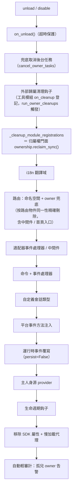

# 归屬權（owner）系統

> [!TIP]
> **什麼時候需要讀這篇**：排查資源泄漏、理解卸載清理鏈路或聲明歸屬資源時。不需要則跳過，不影響其它功能的使用。

> **讀完你會知道**：owner 上下文如何自動歸屬資源、歸屬資源全景表、卸載/禁用時
> 清理鏈的完整時序，以及哪些資源不隨卸載清理（設計邊界）。
>
> **本篇不涉及**：資源"何時生效"的權限判定（見[作用域（scope）](scope.md)）；
> 後台任務的推薦寫法與強制取消邊界（見[生命週期管理 · 後台任務歸屬與自動取消](lifecycle.md#後台任務歸屬與自動取消)）。

歸屬權是模組"即插即用"的基石：模組在加載期間註冊的一切框架資源自動記名，
卸載/禁用時按記名一鍵回收——模組作者只需聲明資源，無需手寫清理邏輯。

> **相關系統**：作用域（scope）在事件分發時決定"資源是否生效"，
> 归屬權在生命週期中決定"資源歸誰、誰卸載時被回收"。
> 作用域詳見[統一控制面（scope）](scope.md)，後台任務詳見
> [生命週期管理](lifecycle.md#後台任務歸屬與自動取消)。

{!--< tips >!--}
1. 归屬在**註冊瞬間**按 `current_owner` 自動記錄，模組代碼零改動
2. 卸載/禁用共用同一條清理鏈（`_cleanup_module_registrations`），每步失敗僅告警不中斷
3. 用戶配置語義的資源（持久化覆寫 / scope 規則 / 命令 ACL）**不**隨模組卸載清理
4. 工具模組托管的外部句柄可用 `on_cleanup(cb)` 掛入清理鏈，對方模組卸載時自動回調（見[工具模組指南](#工具模組指南托管其它模組的句柄)）
{!--< /tips >!--}

## owner 上下文機制

owner 透過上下文變數 `current_owner` 傳遞（`ErisPulse.runtime.context`）：

```python
from ErisPulse.runtime import owner_scope, get_current_owner

with owner_scope("MyModule"):
    # 此區間內註冊的一切資源自動歸屬 MyModule
    assert get_current_owner() == "MyModule"
```

框架在以下時機自動注入 owner（模組/適配器代碼無需手動包裝）：

| 時機 | owner 值 | 位置 |
|------|----------|------|
| 模組 `load()` | 模組名 | 實例化 + `on_load` 全程 |
| 適配器 `start()` / `restart()` | 平台名 | 適配器啟動全程 |
| `activate_on` 慢加載 stub 註冊 | 模組名 | 占位命令/處理器註冊 |
| 事件處理器執行期 | 處理器歸屬模組名 | handler / 命令入口重注入 |

執行期重注入意味著：模組在 `on_load` 裡聲明的命令處理器**運行中**調用
註冊型 API（如 `sdk.adapter.on()`、`overrides.*.set(persist=False)`），
同樣會自動歸屬本模組。

### bind_owner：把歸屬縫進回調與線程入口

`owner_scope` 作用於代碼塊；`bind_owner(fn)` 把上下文"縫進"函數本身——
包裝瞬間捕獲 `current_owner`，此後無論誰、從哪個線程或事件迴圈調用，都以
原 owner 身份執行。新線程預設空上下文（Timer / watcher / 第三方線程池的
觸發路徑 `current_owner` 為 None），其內創建的任務不進歸屬表、模組卸載時
取消不掉（跨 loop 殘留的來源之一），經包裝後歸屬隨身攜帶：

```python
from ErisPulse.runtime import bind_owner

class MyModule(BaseModule):
    async def on_load(self, event):
        # 交給第三方調度器 / 線程池前先包裝：
        external_scheduler.submit(bind_owner(self._poll))

    async def _poll(self):
        # 運行期間 current_owner == "MyModule"，卸載時可被正確回收
        ...
```

- `async` 函數保持 `async`，owner 跨全部 `await` 生效；普通函數僅在同步
  執行期間生效
- 框架自有入口（`self.spawn()` / 命令處理器）已自動帶著歸屬，本函數只用於
  **框架之外的觸發路徑**（外部調度器、`threading.Timer`、回調註冊表等）

## 歸屬資源全景

模組在加載上下文內註冊的以下資源均記錄歸屬，卸載/禁用時自動回收：

| 資源 | 註冊方式 | 清理調用 |
|------|----------|----------|
| 命令 | `@command()` / 命令 dict 聲明 | `command.unregister_by_owner()` |
| 事件處理器 | `@message` / `@notice` / `@request` / `@meta` | `handler.unregister_by_owner()` |
| 適配器事件監聽 | `sdk.adapter.on()` / `raw=True` | `adapter.unregister_handlers_by_owner()` |
| 適配器中間件 | `@sdk.adapter.middleware` | 同上 |
| 路由（HTTP/WS/SSE） | `router.http()` / `websocket()` / `sse()` | 按命名空間 + 按 owner 雙重兜底 |
| 路由中間件 | `@router.middleware()` / `add_middleware()` | `router.unregister_all_by_owner()` |
| Dashboard 首頁入口 | `router.register_home_entry()` | `unregister_home_entries_by_owner()` |
| 自定義會話類型 | `register_custom_type()` | `unregister_custom_types_by_owner()` |
| 平台事件方法注入 | `register_event_method()` / `register_event_mixin()` | `unregister_event_methods_by_owner()`（模組卸載自動回收，舊閉包不再泄漏） |
| 後台任務 | `self.spawn()` | `cancel_owner_tasks()` |
| 外部歸屬清理鈎子（工具模組托管） | `runtime.on_cleanup(cb)` | `run_owner_cleanups()`（卸載/禁用/適配器關閉鏈內觸發） |
| 生命週期鈎子 | `lifecycle.register()` | `lifecycle.unregister_by_owner()` |
| 主人身源 provider | `master.provider` | `master.unregister_by_owner()` |
| i18n 翻譯鍵 | `I18nClass` 聲明（domain=模組名） | `i18n.unregister_domain()` |
| 事件覆寫（運行時） | `overrides.*.set(persist=False)` | `overrides.unregister_by_owner()` |
| 互動會話（wait_reply 等待 / 租約） | `event.wait_reply()` / `sdk.interaction.acquire()` | `interaction.cancel_by_owner()`（等待方立即收到取消） |
| 上下文數據 | `runtime/context` 按 owner 記錄 | 按模組精確清理 |

適配器側的對應資源（以平台名為 owner）在適配器 `shutdown()` / `restart()`
時由 `_cleanup_adapter_resources` 回收，另含：

| 資源 | 清理調用 |
|------|----------|
| 適配器自有的 `on()` 處理器與中間件 | `adapter.unregister_handlers_by_owner(platform)` |
| 平台事件方法擴展（`EventMixin`） | `unregister_platform_event_methods(platform)` |
| 自定義會話類型 | `unregister_custom_types_by_owner(platform)` |
| 互動會話（該平台掛起的 wait_reply / 租約） | `interaction.cancel_by_platform(platform)` |
| i18n 翻譯域（domain=配置鍵） | `i18n.unregister_domain(配置鍵)` |
| 細顆粒命名空間路由 | `router.unregister_all_by_owner(platform)` |

## 卸載/禁用清理序列

`unload()` 與 `disable()` 共用同一條清理鏈（每步獨立 try/except，
失敗僅記日誌，**不中斷後續清理**）：



`sdk.uninit()` 退出時另有全局兜底：全部適配器 shutdown → 全部模組 unload →
`router.stop()`（清空路由/中間件/首頁入口）→ `cancel_all_background_tasks()` →
清空事件處理器與鈎子。

## 归属权统一门面（ownership）

清理链的十六个步骤收敛在归属权统一门面 `ErisPulse.Core.ownership` 下，
四个动词覆盖"注销、计数、扫描、审计"——子系统各自的 `*_by_owner` 注销
函数保持不变，作为门面的内部实现：

| 动词 | 用途 |
|------|------|
| `ownership.reclaim(owner)` | 统一注销 owner 名下全部资源（任务取消 → 清理钩子 → 注册类资源；异步完整版） |
| `ownership.reclaim_sync(owner)` | 注册类资源注销（同步版，供同步卸载路径） |
| `ownership.counts(owner=None)` | 只读统计 owner 在册资源（None 为全部 owner） |
| `ownership.orphans()` | 孤儿扫描：资源在册而 owner 已注销（泄漏实锤清单） |
| `ownership.audit(owner, deep=)` | 泄漏审计报告（计数 + 孤儿 + 可选 gc 实例普查） |

```python
from ErisPulse.Core import ownership

ownership.reclaim_sync("MyModule")       # {'commands': 1, 'routes_http': 2, ...}
ownership.counts("MyModule")             # 在册资源计数
ownership.orphans()                      # [{"owner": "ghost", "total": 2, ...}]
```

**审计入口**：

- 卸载 / 重载后**自动轻审计**：发现孤儿 owner 资源即 WARNING 告警（零开销计数扫描）
- `sdk.module.audit(name, deep=True)`：模组实例 gc 普查——实例不可回收时
  给出引用方类型（定位"谁攥着旧实例"）；有全局暂停开销，仅显式排障使用
- 深普查属显式操作，不设配置键、不做自动修复

## 嵌套生命週期（ownership.nest）

> 本节特性需要 ErisPulse **2.12+**。

允许一个模组（父）托管另一批 owner（子），父被回收时子整体回收。典型场景：
脚本引擎模组内跑子插件、Dashboard 托管面板扩展、工具模组代管外部注册表条目。

```python
from ErisPulse.Core import ownership

ownership.nest("ScriptEngine", "ScriptEngine.plugin_a")
ownership.nest("ScriptEngine", "ScriptEngine.plugin_b")

ownership.nested_children("ScriptEngine")
# frozenset({"ScriptEngine.plugin_a", "ScriptEngine.plugin_b"})

ownership.unnest("ScriptEngine", "ScriptEngine.plugin_a")
```

| 项 | 约定 |
|----|------|
| 回收顺序 | 子先于父；同级按注册逆序（后注册的先回收） |
| 回收范围 | 资源级（任务 / 连接 / 路由 / 命令 / tracked 资源 / 清理钩子），**不触发子的模组级 `on_unload`** |
| 环检测 | `nest` 拒绝自环与已存在的反向链，返回 `False` 并告警 |
| 子先亡 | 子被独立回收（`reclaim` / `reclaim_sync`）时自动 `unnest`，父侧不保留悬挂关系 |
| 超时 | 单个子回收受 `CLEANUP_CALLBACK_TIMEOUT_SECS` 约束；超时告警、移除父子关系并继续 |
| 可观测 | `ownership.counts(parent)` 增加 `nested` 计数；`ownership.orphans()` 对嵌套关系做传递闭包，父已消失的残留关系仍会暴露 |

**为什么不触发子的 `on_unload`**：模组完整卸载需要走管理器级流程（慢代理、
sdk 属性、事件广播），而 `ownership` 门面只负责资源回收，跨层调用会引入
卸载锁重入风险。需要子的 `on_unload` 时，由父在自己的 `on_unload` 里显式调用：

```python
await self.sdk.module.unload(child, reason="cascade")
```

同步入口（如 `sdk.module.disable`）会先标记异步级联，后台任务回收子资源；
`reclaim_sync` 只在没有异步级联进行时自行级联子的注册类资源。

## 热重载失败回滚

热重载为"**卸载前快照 → 失败自动恢复 → 重放 on_load**"：新版本语法错误、
依赖缺失、加载失败时，旧实例与注册状态（注册表条目、sdk 属性、sys.modules
条目）自动还原，随后在归属上下文内**重放旧实例的 `on_load`**（`reason`
为 `"rollback"`），让卸载阶段断开的外部资源重新建立；结束后发射
`module.rollback` 事件（载荷 `{module_name, success}`）。

适配器热重载失败同样恢复旧注册态；旧实例原处于运行态且旧启动任务已结束时，
回滚后会重放 `start()`，并发射 `adapter.rollback` 事件（载荷
`{adapter_name, replayed, success}`）。断连 / bot offline 等 unload 副作用
仍不可撤销。重放与 `adapter.rollback` 事件需要 ErisPulse **2.12+**。

边界说明：

- 重放失败或超时**只告警**，不回滚回滚——旧实例停留在"已收尾"状态
  （与 2.11.2 及更早行为一致），日志会明确提示
- 第三方在运行期手动缓存的对旧实例的引用不在恢复范围
- 目标包已被卸载（entry-point 消失）视作卸载成功，不做回滚
- `on_unload` 载荷携带 `reason`（`unload` / `reload` / `disable` /
  `cascade` / `dormant` / `load-failed`），模组可在 `reload` 时推迟关闭
  需要跨重载存活的资源

热重载的完整能力边界、跨迴圈语义与模组侧守则见下节。

## 热重载边界

热重载能替换代码、重建注册、回滚失败的重载——但它**不是进程重启**。
回收的是**归属权系统登记在册的运行时资源**；不属任何 owner 的资源、用户
配置语义的数据、第三方库内部缓存的引用，都不会随重载消失。

### 能力边界

| 对象 | 重载后行为 | 说明 |
|------|-----------|------|
| 模组代码 / 类定义 | 支持，重新导入 | 旧 `sys.modules` 条目被清理 |
| `on_unload` / `on_load` | 支持，按序触发 | 失败回滚时重放 `on_load`（见上节） |
| 命令 / 处理器 / 路由 / 生命周期钩子 | 支持，自动注销再注册 | 经归属回收链清理 |
| `spawn_background` / `spawn_later` / `spawn_thread` | 支持，按 owner 取消 | 线程只登记观测、无法强杀 |
| 主迴圈上任何 `asyncio.create_task` | 支持，自动归属取消 | 任务工厂拦截（含第三方库内部创建） |
| 存储桥接迴圈上派生的任务 | 支持，自动归属取消 | 桥接迴圈同样装了任务工厂 |
| `ownership.track()` 登记的资源 | 支持，调用 `release()` | 任务工厂够不着的 Loop-bound 资源 |
| `on_cleanup` 钩子 | 支持，触发 | 工具模组借此抛弃托管的句柄 |
| 持久化覆写（`persist=True`）/ 配置文件 | 不处理，保留 | 用户资产 |
| 第三方库内部缓存的对象引用 | 不处理 | 框架看不到，需模组自行解引用 |
| 模组自己 `new` 的事件迴圈 / 裸线程 | 不回收 | 见下方守则 |

### 三层资源治理

1. **无感拦截层**——事件迴圈级任务工厂。owner 上下文内任何任务创建自动归属，
   覆盖主迴圈与存储桥接迴圈。
2. **归属化调度层**——`spawn_background` / `spawn_later` / `spawn_thread`。
3. **合作式登记层**——`ownership.track()` / `on_cleanup()`，用于结构性
   夠不着的资源（Loop-bound 连接池、第三方 client）。

### 事件迴圈边界

| 迴圈 | 谁创建 | 装任务工厂 | 用途 |
|------|--------|-----------|------|
| 主迴圈 | `sdk.run()` / `sdk.init()` | 已安装 | 全部业务代码 |
| 存储桥接迴圈 | `AsyncBridge`（首次同步存储调用） | 已安装 | 同步存储 API 的后台执行 |
| 临时迴圈 | `spawn_background` 兜底 | 未安装，用完即关 | 主迴圈未就绪时的最后手段 |

**临时迴圈是最后手段**：它会同步阻塞调用线程，且迴圈关闭后协程内部再派生的
子任务会丢失（日志有 `temp_loop_fallback` 警告）。看到该警告说明模组在错误
的时机调度了后台任务。

**跨迴圈取消是尽力而为**：`cancel_owner_tasks` 发现任务在其它仍在运行的迴圈
上时，用 `call_soon_threadsafe` 投递取消并打 `cross_loop_task_residual`
警告，但**不等待**其结束（跨迴圈等待不安全）。看到该警告应检查是否自建了
事件迴圈。

### 模组侧守则

```python
# 推荐
spawn_background(self._poll())            # 归属化后台任务
spawn_later(30, lambda: self._cleanup())  # 归属化延迟任务
spawn_thread("poller", self._loop_body)   # 归属化线程（入口自动带 owner）
ownership.track(pool)                     # 显式登记 Loop-bound 资源
await sdk.storage.aget(key)               # 异步上下文直接用异步 API

# 避免
asyncio.create_task(self._poll())         # 裸调用：无引用易被 GC
asyncio.new_event_loop()                  # 自建迴圈：归属体系完全够不着
threading.Thread(target=self._loop_body)  # 裸线程：入口无 owner 上下文
self._storage.get(key)                    # 异步上下文里同步调存储：阻塞主迴圈
```

### 排查清单

1. 日志有 `cross_loop_task_residual`？→ 有资源落在自建迴圈上
2. 日志有 `temp_loop_fallback`？→ 后台任务在主迴圈就绪前被调度
3. 报 `attached to a different loop`？→ 检查是否自建迴圈或跨迴圈复用连接对象
4. `ownership.orphans()` 有输出？→ 有 owner 名下资源在卸载后仍存活

## 设计边界：哪些资源不随卸载清理

归属权只回收**模组代码注册的运行时资源**。以下资源属**用户配置语义**
（控制权在用户，可能刻意配置），模组卸载后随配置持久保留：

| 资源 | 语义 | 说明 |
|------|------|------|
| `overrides.*.set(persist=True)` | 持久化覆写 | 写入配置文件，跨重启生效；模组卸载不删（用户显式配置） |
| `scope.set_action()` 等作用域规则 | 权限控制面 | 由用户/Dashboard 管理，卸载模组不回收规则 |
| `overrides.acl.set(persist=True)` | 命令 ACL | 同上 |
| Conversation `save()` 持久化 | 多轮对话存档 | 数据资产不清理 |

运行时临时写入（`persist=False`）则随 owner 回收——**持久化与否即
"用户资产"与"模组运行时状态"的分界线**。

## 内部实现：归属如何工作

**一句话**：归因链（contextvar 传播）决定"记在谁头上"，取消链（任务登记表）决定"卸载时能否被取消"——两条链路独立运作，资源被正确清理需二者兼备。

归属系统由**两条独立链路**构成，理解它们的分工是排查归属问题的前提：

### 归因链（contextvar 传播）

`runtime/context.py` 的 `current_owner` 等 ContextVar 负责**归因**——
"此刻这段代码注册的资源/发起的调用记在谁头上"。传播规则遵循 Python
contextvars 语义：

| 执行路径 | context 是否传播 | 归因结果 |
|---------|----------------|---------|
| 同步调用链 / `await` 链 | ✅ 传播 | 正确归因 |
| `owner_scope` 内 `asyncio.create_task` | ✅ 传播（task 拷贝创建时刻的 context） | 任务**内部**的框架调用正确归因 |
| `run_in_executor` / 裸线程 | ❌ 不传播 | 归因丢失 |
| 自建事件迴圈 | ❌ 不传播 | 归因丢失 |

> 归因 ≠ 登记：context 传播只影响"记在谁头上"，资源能否被清理
> 取决于是否进入了下述取消链。

### 取消链（任务登记表）

`runtime/tasks.py` 的 `_owner_tasks` 登记表负责**生命週期**——
"owner 名下有哪些未完成任务，卸载时统一取消"。任务进入登记表的途径：

1. **显式调度**：`spawn_background()` / `self.spawn()` → 创建时捕获
   `current_owner`（或显式 `owner=` 参数）→ 登记入表；
2. **Task Factory 自动登记**（2.8.3）：`install_owner_task_factory()`
   在框架启动时安装到主事件迴圈——**任何**任务创建（含第三方库内部的
   `create_task`）经过工厂时读取 `current_owner`，非 None 即登记。

登记表自清理：每个任务带 `done_callback`，完成即从表中移除，无泄漏。

### 取消时序（模组卸载）

```
module.unload()
  → on_unload(event)                    # 模组自行清理（兜底超时保护）
  → 框架注销该 owner 的命令/事件/钩子/路由
  → cancel_owner_tasks(owner)           # 任务登记表兜底取消
      → 逐个 task.cancel()              # 排除当前执行取消逻辑的任务自身
      → await gather(pending, timeout)  # 等待回收（超时不再阻塞）
```

### 排查思路

- **资源没被清理** → 查登记表：`get_owner_tasks("MyModule")` 是否含该任务；
  不含即注册路径未经过归属链（import 期 / 线程 / 独立迴圈），对照上表定位。
- **归因错误** → 查 `get_current_owner()` 在出错时刻的值；异步延迟执行
  （回调/任务）的归因取自创建时刻 context，而非执行时刻。

## 模组作者指南

### 推荐写法

```python
from ErisPulse import sdk
from ErisPulse.Core.Event import command
from ErisPulse.runtime import owner_scope, spawn_background

class MyModule(BaseModule):
    async def on_load(self, event):
        # 框架资源：自动归属，无需手动清理
        self.task = self.spawn(self.polling())      # 后台任务
        sdk.router.register_home_entry("我的模組", "/my")  # 首頁入口

        # 模组自有资源：包进 owner_scope 即纳入归属体系
        with owner_scope("MyModule"):
            self.client.on_event(self._handle)      # 假想的自定义注册

    async def on_unload(self, event):
        # 框架资源已被自动回收，只需清理 owner_scope 覆盖不到的自有资源
        await self.client.close()
```

### 注意事项

- **import 期注册无归属**：模组顶层（import 时）注册的鈎子/處理器發生在
  `owner_scope` 之前，會被視為框架級資源（owner=None）而**不被清理**。
  一律放到 `on_load()` 內註冊。
- **自定义 domain 的 i18n 注册**：`i18n.register(domain=...)` 的 domain
  不等于模组名时不会被自动回收，请保持 domain=模组名。
- **后台任务推荐 `self.spawn()`**：2.8.3 起裸 `asyncio.create_task` 也会**自动隐式归属**
  （Task Factory 自动登记，卸载时兜底取消）；但 `self.spawn()` 仍是推荐写法——
  支持非主迴圈线程调度回主迴圈、显式 `owner=` 指定与 fire-and-forget 防 GC。
  **2.8.3 之前**的版本裸任务不归属，必须用 `self.spawn()`。
- 清理链"失败仅告警"：单步清理异常不会阻断其余资源回收，日誌 DEBUG/WARNING
  級別可見，排障時可開啟 TRACE。

### 注册时机 → 归属结果对照表

| 注册场景 | 归属结果 | 说明 |
|---------|---------|------|
| `on_load()` 内经框架 API（命令/事件/lifecycle/路由装饰器）注册 | 归属模组 | 卸载时自动注销 |
| 模组顶层（import 期）注册 | **无归属**（owner=None） | 不被清理，请勿使用 |
| `self.spawn()` 创建的后台任务 | 归属模组 | 卸载时自动取消 |
| `owner_scope("Name")` 内经第三方 API 注册 | 归属模组 | 依赖第三方回调在 scope 内同步执行 |
| 裸 `asyncio.create_task`（含 `loop.create_task` / `ensure_future`） | **自动归属**（Task Factory，2.8.3+） | 创建瞬间读取 `current_owner`，owner 上下文内自动登记、卸载兜底取消；见下文[内部实现](#内部实现归属如何工作) |
| 第三方库异步回调（aiohttp / APScheduler 等）内部创建的任务 | **自动归属**（Task Factory，2.8.3+） | 回调执行时若 `current_owner` 已注入（如框架处理器执行期间），任务自动登记 |
| `run_in_executor`（线程池） | **无归属**（非 asyncio.Task） | 线程不受任务工厂管辖，须自行管理生命週期 |
| 独立事件迴圈（自建 loop）中的注册 | **无归属** | Task Factory 仅安装于主迴圈；contextvars 也不跨事件迴圈传播 |

> 原则：**归属跟随注册瞬间的 `current_owner` 上下文**；任何异步延迟、
> 线程池、独立迴圈都会脱离该上下文——需要归属时请显式进入 `owner_scope`。

## 工具模组指南：托管其它模组的句柄

**场景**：定时任务、注册表、连接池这类"工具模组"会替其它模组保管东西——
对方在 `on_load` 里调用 `sdk.Cron.on_trigger(handler)`，你的容器里就存下了
一个指向对方实例的回调。框架会自动清理对方注册的一切框架资源，但清理不了
你**私有容器里的引用**：对方卸载后你的容器还拉着它的实例，它就无法被
GC 回收（内存泄漏，`purge` 泄漏诊断报"不可回收"）。

**解法**：在登记对方东西的同一个函数里调用 `on_cleanup()`，
框架会在对方卸载 / 禁用时自动回调你的清理函数：

```python
from ErisPulse.Core.Bases import BaseModule
from ErisPulse.runtime import off_cleanup, on_cleanup

class CronModule(BaseModule):
    def __init__(self):
        self._entries = {}  # {模组名: 该模组托管的回调列表}

    def on_trigger(self, handler):
        # 自动识别调用方模组名（on_load 直接调用 / module.call 均正确），
        # 返回值是解析出的 owner，可直接用作记名键
        owner = on_cleanup(self._drop)
        self._entries.setdefault(owner, []).append(handler)

    def _drop(self, owner: str):
        """对方模组被卸载/禁用时由框架自动调用：抛弃它的句柄即可"""
        self._entries.pop(owner, None)

    async def on_unload(self, event):
        off_cleanup(self._drop)  # ③ 自己卸载前注销鈎子，避免鈎子表持有 self
```

框架保证的行为：

| 关注点 | 行为 |
|--------|------|
| 触发时机 | 对方模组 unload / disable，或适配器关闭——均在框架清理链内触发，早于 purge 泄漏诊断 |
| 调用方识别 | 直接调用取 `current_owner`；经 `module.call()` 被调用取调用方（`current_caller`）；也可 `on_cleanup(cb, owner="模组名")` 显式指定。**强制校验**：owner 无法解析（三种来源均缺失）时抛 `ValueError`——私有工具模组应在自身加载上下文内登记鈎子 |
| 回调签名 | `cb(owner: str)`，同步 / 异步均可；异步带超时保护（`CLEANUP_CALLBACK_TIMEOUT_SECS`，默认 10 秒） |
| 容错 | 单个回调异常 / 超时只记日誌，不影响其余鈎子与清理链 |
| 重复登记 | 同一 `(owner, callback)` 幂等去重 |

**什么时候不需要**：如果对方注册的是框架资源（命令、事件处理器、路由、
后台任务……），框架已全自动清理（见上文[归属资源全景](#归属资源全景)）。
只有你私有容器里持有的对方句柄才需要 `on_cleanup`。
模组开发视角的速查版见
[最佳实践 · 工具模组](../developer-guide/modules/best-practices.md#工具模组托管别人东西时要接住卸载通知)。

## 相关文件

按下一步意圖選擇：

- **想控制"資源是否生效"（權限面）** → [作用域（scope）](scope.md)——归属权管"资源归谁、卸载谁回收"，作用域管"资源何时生效"
- **后台任务 / 定时器的兜底取消** → [生命週期管理 · 后台任务归属与自动取消](lifecycle.md#后台任务归属与自动取消)
- **以独立 owner 隔离做灰度发布** → [影子模组与灰度转正](shadow.md)
- **模组开发视角的速查与推荐写法** → [模组最佳实践](../developer-guide/modules/best-practices.md)