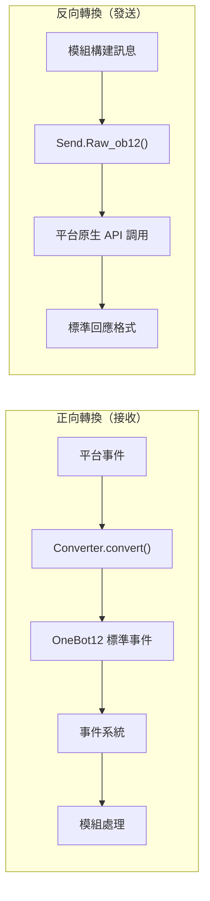
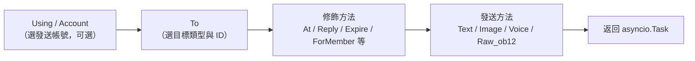
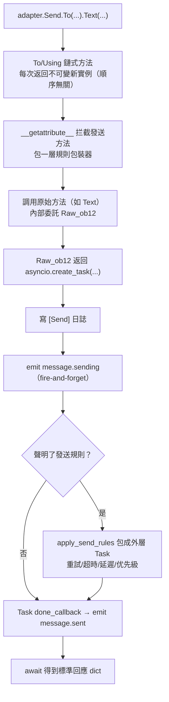

# ErisPulse 适配器开发

This skill is auto-built from the ErisPulse documentation.
Repository: https://github.com/ErisPulse/ErisPulse
Source paths are annotated per section; see docs/ in the repository for the latest content.

## 内容大纲

AI 按需读取：只读需要的章节即可，不必全文加载。

- 适配器开发入门: 86-95 行
- 適配器簡介: 97-120 行
- 目錄結構: 122-135 行
- 快速開始: 137-467 行
- 本地開發（免打包）: 469-501 行
- 依賴聲明（可選，2.8.0+）: 503-537 行
- `__init__` 注意事項: 539-747 行
- 适配器核心概念: 749-758 行
- 適配器架構: 760-799 行
- AdapterManager 適配器管理器: 801-1034 行
- BaseAdapter 基類: 1036-1425 行
- Send 消息发送 DSL: 1427-1498 行
- 事件转换器: 1500-1571 行
- 連線管理: 1573-1761 行
- API 响应标准: 1763-1795 行
- 多账户支持: 1797-1868 行
- 错误处理: 1870-1922 行
- Bot 狀態管理: 1924-1975 行
- 相關文檔: 1977-1986 行
- 发送 DSL: 1988-1998 行
- 基本呼叫方式: 2000-2024 行
- 方法鏈: 2026-2034 行
- 發送方法: 2036-2084 行
- 修飾方法: 2086-2150 行
- 在 Event 包裝類中使用修飾方法: 2152-2214 行
- 帳戶管理: 2216-2241 行
- 異步處理: 2243-2266 行
- 發送規則系統: 2268-2391 行
- 批量建構模式（Build）: 2393-2516 行
- 命名規範: 2518-2563 行
- 發送鏈路內部拆解: 2565-2623 行
- 返回值: 2625-2680 行
- 完整示例: 2682-2718 行
- 相關文件: 2720-2730 行
- 转换器: 2732-2741 行
- Converter 職責: 2743-2755 行
- BaseConverter 基類（推薦）: 2757-2803 行
- convert() 方法: 2805-2845 行
- 必填字段映射: 2847-2873 行
- 消息段轉換: 2875-2905 行
- 平台擴展欄位: 2907-2928 行
- 完整示例: 2930-3010 行
- 富媒體訊息轉換示例: 3012-3059 行
- 常見陷阱: 3061-3103 行
- 最佳實踐: 3105-3111 行
- 相關文件: 3113-3123 行
- 适配器最佳实践: 3125-3135 行
- Bot 狀態管理與 Meta 事件: 3137-3234 行
- 連接管理: 3236-3351 行
- 事件轉換: 3353-3405 行
- SendDSL 實現: 3407-3468 行
- API 回應: 3470-3519 行
- 多帳戶支援: 3521-3581 行
- 錯誤處理: 3583-3635 行
- 測試: 3637-3681 行
- 反向轉換與訊息建構: 3683-3691 行
- 平台事件方法擴展: 3693-3745 行
- 文件維護: 3747-3754 行
- 基本資訊: 3756-3758 行
- 支援的消息傳送類型: 3760-3761 行
- 特有事件類型: 3763-3764 行
- 配置選項: 3766-3777 行
- 相關文件: 3779-3789 行
- 平台接入指南索引: 3791-3808 行
- 平台特定功能: 3810-3833 行
- 通用介面: 3835-4013 行
- 標準格式: 4015-4071 行
- 參考連結: 4073-4083 行
- 參與貢獻: 4085-4095 行

## 适配器开发入门

> 来源: `docs/zh-TW/developer-guide/adapters/getting-started.md`（https://github.com/ErisPulse/ErisPulse/blob/main/docs/zh-TW/developer-guide/adapters/getting-started.md）

# 適配器開發入門

> [!TIP]
> **何時需要閱讀這篇**：適配器開發路徑的入門篇（必讀）。從零寫一個適配器、了解適配器的職責邊界與專案結構都在這裡；讀完後再按需進入 [事件轉換器](converter.md) 與 [SendDSL 詳解](send-dsl.md)。

跟著這篇走完，你會得到一個能收事件、發訊息的最小可用適配器（主類 + 轉換器 + Send），並清楚每個部件的職責邊界——接入一個新平台的所有工作都從這裡展開。

## 適配器簡介

### 什麼是適配器

適配器是 ErisPulse 與各個訊息平台之間的橋樑，負責：

1. **正向轉換**：接收平台事件並轉換為 OneBot12 標準格式（Converter）
2. **反向轉換**：將 OneBot12 訊息段轉換為平台 API 調用（`Raw_ob12`）
3. 管理與平台的連接（WebSocket/WebHook）
4. 提供統一的 SendDSL 訊息發送介面

### 適配器架構



## 目錄結構

標準的適配器包結構：

```
MyAdapter/
├── pyproject.toml          # 專案配置
├── README.md               # 專案說明
├── LICENSE                 # 許可證
└── MyAdapter/
    ├── __init__.py          # 包入口
    ├── Core.py               # 適配器主類
    └── Converter.py          # 事件轉換器
```

## 快速開始

### 1. 建立專案

建議直接用鷹架生成完整骨架（含 pyproject、主類別、轉換器）：

```bash
# 標準專案（打包發佈用）
epsdk create adapter -n MyAdapter

# 本地適配器外掛（免打包，放入 plugins/ 目錄即可被自動載入，見下方「本地開發」）
epsdk create adapter -n MyAdapter --local
```

鷹架預設生成 WebSocket 伺服器端骨架；平台連接方式不同時可經 `--template`
選擇通訊模式模板（生成即用對應的半成品基類，`start`/`shutdown` 都不需要自己寫）：

```bash
epsdk create adapter -n MyAdapter --template polling   # HTTP 輪詢型（getUpdates 拉取）
epsdk create adapter -n MyAdapter --template webhook   # HTTP 回呼型（平台推送）
```

> 三種連接模式的差異與半成品基類的最小實作面見
> [適配器核心概念 - 連接模式半成品基類](core-concepts.md#連接模式半成品基類)。
> 完整可執行範例參考儲存庫 `examples/example-adapter-polling/` 與 `examples/example-adapter-webhook/`。

也可以手動建立：

```bash
mkdir MyAdapter && cd MyAdapter
```

### 2. 建立 pyproject.toml

```toml
[project]
name = "ErisPulse-MyAdapter"
version = "1.0.0"
description = "MyAdapter平台適配器"
readme = "README.md"
requires-python = ">=3.10"
license = { file = "LICENSE" }
authors = [ { name = "yourname", email = "your@mail.com" } ]

dependencies = [
    "ErisPulse>=2.4.0"  # ErisPulse 已內建 aiohttp，通常無需單獨依賴
]

[project.urls]
"homepage" = "https://github.com/yourname/MyAdapter"

[project.entry-points."erispulse.adapter"]
"MyAdapter" = "MyAdapter:MyAdapter"
```

### 3. 建立適配器主類別

框架提供了 `ConfigClass` / `AccountConfigClass` 宣告式設定管理，適配器只需宣告設定類別即可自動載入、驗證和產生設定模板。

```python
# MyAdapter/Core.py
from dataclasses import dataclass, field
# 建議根匯入（2.10+）：常用符號直接從根套件匯入，深路徑仍相容
from ErisPulse import BaseAdapter, BaseConfig

@dataclass
class MyAdapterConfig(BaseConfig):
    """MyAdapter 設定"""
    api_endpoint: str = field(
        default="https://api.example.com",
        metadata={
            "description": {"i18n": "my_adapter.api_endpoint", "default": "API 位址"},
            "required": False,
            "ui": {"widget": "text", "group": "connection", "order": 1},
        },
    )
    token: str = field(
        default="",
        metadata={
            "description": {"i18n": "my_adapter.token", "default": "平台 Token"},
            "required": True,
            "secret": True,
            "ui": {"widget": "password", "group": "basic", "order": 2},
        },
    )

class MyAdapter(BaseAdapter):
    ConfigClass = MyAdapterConfig  # 宣告設定類別，框架自動管理
    
    # 不需要覆寫 __init__！框架自動處理：
    # - self.sdk / self.logger 自動設定
    # - self.cfg 即時讀取設定
    # - self.Send / self.Request 自動初始化
    
    def _setup_converter(self):
        from .Converter import MyPlatformConverter
        return MyPlatformConverter()
```

> ⚠️ **關於 `__init__`**：新版本中 `BaseAdapter.__init__(self, sdk=None)` 會自動處理 SDK 引用、日誌初始化和設定載入。大多數適配器**不再需要覆寫 `__init__`**。詳見 [__init__ 注意事項](#init-注意事項)。

> ⚠️ **關於 `super().__init__()`**：`BaseAdapter.__init__()` 負責建立 `Send` 和 `Request` 工廠實例。如果忘記呼叫，所有訊息傳送和請求操作都會報 `AttributeError`。詳見 [__init__ 注意事項](#init-注意事項)。

### 4. 實作必需方法

```python
class MyAdapter(BaseAdapter):
    # ... __init__ 程式碼 ...
    
    async def start(self):
        """啟動適配器（必須實作）"""
        # 註冊 WebSocket 或 WebHook 路由
        router.register_websocket(
            module_name="myplatform",
            path="/ws",
            handler=self._ws_handler
        )
        self.logger.info("適配器已啟動")
    
    async def shutdown(self):
        """關閉適配器（必須實作）"""
        router.unregister_websocket(
            module_name="myplatform",
            path="/ws"
        )
        # 清理連接和資源
        self.logger.info("適配器已關閉")
    
    async def call_api(self, endpoint: str, **params):
        """呼叫平台 API（必須實作）"""
        raise NotImplementedError("需要實作 call_api")
```

#### 主動發送 Meta 事件

適配器應主動發送 meta 事件，讓框架追蹤 Bot 的線上狀態。使用 `emit_meta()` 一行即可完成：

```python
class MyAdapter(BaseAdapter):
    async def _ws_handler(self, websocket):
        bot_id = self._get_bot_id()

        # Bot 上線
        await self.emit_meta("connect", bot_id, user_name="MyBot")

        try:
            while True:
                data = await websocket.receive_text()
                event = self.convert(data)
                if event:
                    await self.adapter.emit(event)
        except WebSocketDisconnect:
            pass
        finally:
            # Bot 離線
            await self.emit_meta("disconnect", bot_id)
```

> 詳細的 Bot 狀態管理和 Meta 事件說明請參閱 [適配器最佳實踐 - Bot 狀態管理](best-practices.md#bot-狀態管理與-meta-事件)。

### 5. 實作 Send 類別

`At`/`AtAll`/`Reply` 修飾器已由框架 SendDSL 基類內建實作，適配器只需實作 `Raw_ob12` 和具體的發送方法即可。

框架提供兩個關鍵輔助方法：
- `self._apply_modifiers(message)` — 自動合併 At/AtAll/Reply 修飾器到訊息段
- `self.send_context` — 取得發送上下文字典（`target_type`、`target_id`、`account_id`）

```python
import asyncio

class MyAdapter(BaseAdapter):
    # ... 其他程式碼 ...

    class Send(BaseAdapter.Send):

        def Raw_ob12(self, message, **kwargs):
            """
            發送 OneBot12 格式訊息（必須實作）

            使用 _apply_modifiers 自動合併修飾器狀態，
            使用 send_context 取得發送上下文。
            """
            async def _do_send():
                segments = self._apply_modifiers(message)
                return await self._adapter.call_api(
                    endpoint="/send_message",
                    message=segments,
                    **self.send_context,
                    **kwargs
                )
            return asyncio.create_task(_do_send())

        # Text/Image/Voice/Video/File 已從 SendDSL 基類繼承，
        # 預設委託給 Raw_ob12，無需重複實作。
        # 如需平台特定邏輯，可覆寫單個方法：
        # def Text(self, text: str):
        #     return self.Raw_ob12([{"type": "text", "data": {"text": text}}])
```

**媒體類發送方法（Image/Video/File）實作要點：**

- 基類的預設實作會將 `file` 參數封裝為 OneBot12 訊息段傳給 `Raw_ob12`，適配器需在 `Raw_ob12` 中處理下載/上傳
- `file` 參數應同時支援 `bytes` 二進位資料和 `str` URL 兩種類型
- 當傳入 URL 時，需先下載檔案再上傳到平台
- 平台通常需要先呼叫上傳介面取得檔案識別碼，再呼叫發送介面

**`__getattr__` 魔術方法：**

- 實作方法名稱大小寫不敏感（`Text`、`text`、`TEXT` 都能呼叫）
- 未定義的方法應回傳提示訊息而非報錯

**`Raw_ob12` 方法：**

- 將 OneBot12 標準訊息格式轉換為平台格式發送
- 使用 `self._apply_modifiers(message)` 自動處理 At/AtAll/Reply 修飾器
- 使用 `**self.send_context` 傳遞發送目標資訊和帳號資訊

### 6. 實作轉換器

```python
# MyAdapter/Converter.py
import time
import uuid

class MyPlatformConverter:
    def convert(self, raw_event):
        """將平台原生事件轉換為 OneBot12 標準格式"""
        if not isinstance(raw_event, dict):
            return None
        
        onebot_event = {
            "id": str(raw_event.get("event_id", uuid.uuid4())),
            "time": int(time.time()),
            "type": self._convert_event_type(raw_event.get("type")),
            "detail_type": self._convert_detail_type(raw_event),
            "platform": "myplatform",
            "self": {
                "platform": "myplatform",
                "user_id": str(raw_event.get("bot_id", ""))
            },
            "myplatform_raw": raw_event,
            "myplatform_raw_type": raw_event.get("type", "")
        }
        
        return onebot_event
    
    def _convert_event_type(self, event_type):
        """轉換事件類型"""
        type_map = {
            "message": "message",
            "notice": "notice"
        }
        return type_map.get(event_type, "unknown")
    
    def _convert_detail_type(self, raw_event):
        """轉換詳細類型"""
        return "private"  # 簡化範例
```

### 7. 實作 Request 類別（請求操作）

如果你的平台支援好友請求、群組邀請等需要 Bot 做出決策的請求，可以實作 `Request` 內部類別：

```python
from ErisPulse import BaseAdapter, RequestDSL

class MyAdapter(BaseAdapter):
    # ... Send 和其他程式碼 ...

    class Request(RequestDSL):
        """請求操作實作（好友請求、群組邀請等）"""

        def accept(self, **kwargs):
            """同意請求"""
            async def _do():
                result = await self._adapter.call_api(
                    endpoint="/set_request",
                    request_id=self._request_id,
                    approve=True,
                    **kwargs,
                )
                return {
                    "status": "ok" if result.get("code") == 0 else "failed",
                    "retcode": result.get("code", 0),
                    "data": None,
                    "message_id": "",
                    "message": result.get("message", ""),
                }
            return self._create_task(_do())

        def reject(self, **kwargs):
            """拒絕請求"""
            async def _do():
                result = await self._adapter.call_api(
                    endpoint="/set_request",
                    request_id=self._request_id,
                    approve=False,
                    **kwargs,
                )
                return {
                    "status": "ok" if result.get("code") == 0 else "failed",
                    "retcode": result.get("code", 0),
                    "data": None,
                    "message_id": "",
                    "message": result.get("message", ""),
                }
            return self._create_task(_do())
```

模組開發者使用方式：

```python
from ErisPulse import request

@request.on_friend_request()
async def handle_friend_request(event):
    # 透過 Event 便利方法
    await event.approve()
    # 或透過適配器直接操作
    await adapter.myplatform.Request("req_id").accept()
```

> 如果平台不支援請求操作，可以不實作 `Request` 內部類別。基類預設回傳 `retcode=10002`（不支援的操作）。詳見 [請求操作規範](../../standards/request-action-spec.md)。

### 8. 建立套件進入點

```python
# MyAdapter/__init__.py
from .Core import MyAdapter
```

## 本地開發（免打包）

與模組一致，適配器也可以放入項目的本地插件目錄（預設 `plugins/`，可透過 `ErisPulse.framework.plugins_dir` 配置）直接開發，**無需 `pip install -e .`**：

```bash
# 產生本地適配器插件
epsdk create adapter -n MyAdapter --local
# 產生結構：
# plugins/
# └── MyAdapter/
#     ├── __init__.py
#     ├── Core.py
#     └── Converter.py
```

框架啟動時自動掃描插件目錄並加載其中的模組與適配器（與 entry-point 安裝包同等待遇：啟用狀態、配置聲明、熱更新、卸載清理全部一致）：

- **識別規則**：套件目錄（含 `__init__.py`）或單個 `.py` 檔均可；優先識別 `Main` 命名類，否則取插件內首個 `BaseAdapter` / `BaseModule` 子類
- **同名覆蓋**：本地插件與 PyPI 安裝的適配器同名時，本地插件優先（便於覆蓋調試）
- **熱重載**：`sdk.enable_plugin_hot_reload()` 開啟的插件目錄監控同樣覆蓋適配器；適配器程式碼級熱重載自 2.11 提供——`await sdk.adapter.reload("平台名")` 或 `await sdk.reload_adapter("平台名")`（語法預檢 → 卸載清理 → 清快取重導 → 重新註冊拉起，失敗自動回滾；詳見[架構概覽](../../architecture.md)）

### 從本地插件到發布

本地驗證完成後，用 `pack` 子命令把插件一鍵轉換為可發布的標準專案（互動式選擇插件、補全元資訊，產生含 entry-point 的 pyproject）：

```bash
epsdk create pack
# 選擇插件目錄中的插件 → 輸入專案名/描述/作者 → 產生 MyAdapter/ 專案目錄
cd MyAdapter
pip install -e .   # 轉為標準安裝；隨後按發布流程上傳 PyPI
```

> **提示**：轉換完成後建議移除 `plugins/` 中的原件，避免本地插件與安裝包重複加載（兩者同名時本地優先，會讓你誤以為安裝包生效）。

## 依賴聲明（可選，2.8.0+）


適配器可以聲明對其它適配器或模組的依賴，實現適配器間聯動與可選功能：

```python
from typing import ClassVar

class MyAdapter(BaseAdapter):
    # 硬依賴：缺失時跳過啟動（警告 + status=skipped-dependency 事件）
    depends: ClassVar[dict] = {
        "adapters": ["onebot11"],   # 依賴的適配器（按平台名）
        "modules": ["TranslateEngine"],  # 依賴的模組（按註冊名）
    }
    # 軟依賴：缺失不影響啟動；模組加載/卸載時收到回調（可選功能模式）
    optional_modules: ClassVar[list] = ["TranslateEngine"]
```

- **啟動順序**：聲明了模組硬依賴的適配器會**延遲到模組初始化完成後**再啟動
- **軟依賴通知**：`optional_modules`（或模組硬依賴）中的模組被加載時呼叫 `on_dependency_ready(module_name)`；被卸載時呼叫 `on_dependency_lost(module_name)`（預設空實作，可覆寫）——覆寫晚加載與熱重載場景：

```python
async def on_dependency_ready(self, module_name):
    """軟依賴模組就緒：啟用對應可選功能"""
    if module_name == "TranslateEngine":
        self._translate = self.sdk.TranslateEngine

async def on_dependency_lost(self, module_name):
    """軟依賴模組丟失：降級功能"""
    if module_name == "TranslateEngine":
        self._translate = None
```

> [!NOTE]
> 本特性需要 ErisPulse **2.8.0+**。

## `__init__` 注意事項

適配器開發中有三個層面可能涉及 `__init__` 重寫。以下是每個層面的正確做法。

### 1. BaseAdapter 層（大多數情況不需要重寫）

`BaseAdapter.__init__(self, sdk=None)` 負責建立 `Send` / `Request` 工廠實例，並自動完成以下工作：

- 接受 `sdk` 參數並設定 `self.sdk`、`self.logger`
- 如果聲明了 `ConfigClass`，可透過 `self.cfg` 實時讀取全域配置
- 如果聲明了 `AccountConfigClass`，可透過 `self.accounts` 實時讀取多帳號配置

**大多數情況下不需要覆寫 `__init__`**，只需聲明 `ConfigClass` 即可：

```python
class MyAdapter(BaseAdapter):
    ConfigClass = MyAdapterConfig  # 聲明後框架自動管理配置
    
    async def start(self):
        cfg = self.cfg  # 類型安全，實時讀取
        ...
```

如果確實需要自訂初始化，呼叫 `super().__init__(sdk)` 即可：

```python
class MyAdapter(BaseAdapter):
    ConfigClass = MyAdapterConfig
    
    def __init__(self, sdk=None):
        super().__init__(sdk)  # 傳入 sdk
        self.converter = self._setup_converter()
        self.convert = self.converter.convert
```

### 2. Send 內部類（大多數情況不需要重寫）

`SendDSL.__init__` 負責鏈式呼叫的狀態傳遞（目標類型、目標ID、帳號等）。**大多數情況下，你只需要重寫方法**（`Raw_ob12`、`Text` 等），不需要重寫 `__init__`。

如果確實需要（比如初始化平台特有的狀態），**必須透傳所有參數**：

```python
class MyAdapter(BaseAdapter):
    class Send(BaseAdapter.Send):
        # 參數：adapter, target_type, target_id, account_id
        def __init__(self, adapter, target_type=None, target_id=None, account_id=None):
            super().__init__(adapter, target_type, target_id, account_id)  # ← 必須透傳
            self._my_state = None  # 平台特有初始化
```

**為什麼必須透傳？** 鏈式呼叫的每一步都透過 `self.__class__(...)` 建立新實例：

```python
adapter.Send.To("user", "123")               # → Send(adapter, "user", "123", None)
adapter.Send.To("user", "123").Using("bot1")  # → Send(adapter, "user", "123", "bot1")
```

如果 `__init__` 簽名不匹配或沒呼叫 `super()`，鏈式呼叫就會中斷。

### 3. Request 內部類（大多數情況不需要重寫）

與 Send 同理。參數為 `adapter`, `request_id`, `account_id`：

```python
class MyAdapter(BaseAdapter):
    class Request(RequestDSL):
        # 參數：adapter, request_id, account_id
        def __init__(self, adapter, request_id=None, account_id=None):
            super().__init__(adapter, request_id, account_id)  # ← 必須透傳
            self._my_state = None  # 平台特有初始化
```

### 總結

| 層面 | 什麼時候重寫 | 必須做的事 |
|------|------------|-----------|
| **BaseAdapter** | 需要自訂初始化邏輯時 | `super().__init__(sdk)` （傳入 sdk 參數） |
| **Send 內部類** | 需要初始化發送相關狀態時 | `super().__init__(adapter, target_type, target_id, account_id)` |
| **Request 內部類** | 需要初始化請求相關狀態時 | `super().__init__(adapter, request_id, account_id)` |
| 三個層面 | 大多數情況 | **聲明 ConfigClass 即可，不碰 `__init__`** |

### 9. 連接資訊與路由發現

適配器註冊路由後，框架會記錄所有路由資訊。使用者可以透過以下 API 查看適配器的連接位址：

```python
from ErisPulse import sdk

# 獲取適配器完整連接資訊
info = sdk.adapter.get_connection_info("myplatform")
# {
#   "platform": "myplatform",
#   "status": "started",
#   "connection": {
#     "base_url": "http://localhost:8080",
#     "http_routes": [
#       {"path": "/myplatform/webhook", "method": "POST",
#        "url": "http://localhost:8080/myplatform/webhook"}
#     ],
#     "websocket_routes": [
#       {"path": "/myplatform/ws",
#        "url": "ws://localhost:8080/myplatform/ws"}
#     ]
#   }
# }

# 列出所有命名空間（適配器/模組）的路由
namespaces = sdk.router.list_namespaces()
# {"myplatform": {"http": ["/myplatform/webhook"], "websocket": ["/myplatform/ws"]}}

# 獲取命名空間的完整連接 URL
urls = sdk.router.get_module_urls("myplatform")
# {"base_url": "http://localhost:8080", "http": [...], "websocket": [...]}

# 獲取命名空間的詳細路由資訊
routes = sdk.router.get_module_routes("myplatform")
# {"http": [{"path": "/myplatform/webhook", "methods": ["POST"]}],
#  "websocket": [{"path": "/myplatform/ws", "auth": false}]}
```

> **提示**：`get_connection_info()` 回傳的資訊適合展示給使用者（如 WebUI），幫助使用者配置平台側的回調位址或 WebSocket 連接位址。路由註冊時的 `module_name` 必須與適配器在 ErisPulse 中註冊的 `platform` 名稱完全一致，否則路由發現將無法正確關聯。

### 10. SSE (Server-Sent Events) 支援

ErisPulse 內建了伺服器無關的 SSE 支援，模組和適配器可以透過 `@sdk.router.sse()` 註冊 SSE 端點。

#### 基本使用

```python
import asyncio
from ErisPulse import sdk

@sdk.router.sse("MyModule", "/events")
async def event_stream(sse):
    """推送 SSE 事件"""
    count = 0
    while not sse.closed:
        await sse.send({"count": count}, event="update")
        count += 1
        await asyncio.sleep(1)
```

#### 使用請求參數

處理器可以聲明 `request` 參數來存取客戶端請求資訊：

```python
@sdk.router.sse("MyModule", "/events")
async def event_stream(request, sse):
    token = request.query_params.get("token")
    if not validate_token(token):
        await sse.close()
        return

    while not sse.closed:
        data = await fetch_data(token)
        await sse.send(data)
        await asyncio.sleep(5)
```

#### SseEmitter API

| 方法 | 說明 |
|------|------|
| `sse.send(data, event=None, id=None, retry=None)` | 發送 SSE 事件。非 str 的 data 自動 JSON 序列化 |
| `sse.close()` | 優雅關閉 SSE 連接（安全呼叫，可多次） |
| `sse.closed` | 連接是否已關閉 |
| `sse.request` | 底層請求物件（可用於讀取 query params、headers） |

#### 在 RouteGroup 中使用

```python
api = sdk.router.group("MyModule", "/api", version="1")

@api.sse("/events")
async def events(sse):
    await sse.send({"msg": "hello"})
```

#### 路由發現

SSE 路由會自動出現在路由發現 API 中：

```python
# list_namespaces 會包含 "sse" 鍵
sdk.router.list_namespaces()
# {"MyModule": {"http": [...], "websocket": [...], "sse": ["/MyModule/events"]}}

# get_module_routes 會標記 streaming: true
sdk.router.get_module_routes("MyModule")
# {"http": [...], "websocket": [...], "sse": [{"path": "/MyModule/events", "streaming": true}]}

# get_module_urls 會產生完整 URL
sdk.router.get_module_urls("MyModule")
# {"sse": [{"path": "/MyModule/events", "url": "http://localhost:8080/MyModule/events"}]}
```

> **伺服器無關設計**：`SseEmitter` 透過回呼與底層 HTTP 框架解耦。框架提供了 `register_sse()` 和 `@sse` 裝飾器作為統一的註冊入口，適配器無需直接依賴任何底層 HTTP 框架即可實現 SSE 端點。

### 補齊適配器的三大件

- [事件轉換器](converter.md) - 平台事件 → OneBot12 的實現細節與常見陷阱
- [SendDSL 詳解](send-dsl.md) - 訊息發送鏈、修飾方法與發送規則
- [適配器核心概念](core-concepts.md) - BaseAdapter / 生命週期 / 多帳號的機制說明

### 骨架跑通之後

- [適配器最佳實踐](best-practices.md) - 連接重試、心跳、錯誤處理的工程化收尾
- [發布與模組商店指南](../publishing.md) - 發布到 PyPI 與模組商店

## 适配器核心概念

> 来源: `docs/zh-TW/developer-guide/adapters/core-concepts.md`（https://github.com/ErisPulse/ErisPulse/blob/main/docs/zh-TW/developer-guide/adapters/core-concepts.md）

# 適配器核心概念

> [!TIP]
> **什麼時候需要讀這篇**：適配器開發路徑內必讀（BaseAdapter / SendDSL / 生命週期等核心機制的完整說明）。只想起步可先讀 [適配器開發入門](getting-started.md)，遇到「為什麼」層面的疑問再回到本篇查閱。

這篇解釋適配器的運作機制：AdapterManager 如何註冊與分發事件、`BaseAdapter` 在初始化時替你做了什麼、設定與多帳號怎麼宣告——寫適配器時遇到「為什麼要這樣寫」的疑問，來這裡查。

## 適配器架構

### 組件關係

```
正向轉換（接收方向）                           反向轉換（發送方向）
─────────────────                           ─────────────────
                                             
┌──────────────────┐                        ┌──────────────────┐
│ 平台原生事件     │                        │ 模組建構訊息     │
└────────┬─────────┘                        └────────┬─────────┘
         │                                           │
         ↓                                           ↓
┌──────────────────┐   ┌──────────────────┐   ┌──────────────────┐
│                  │   │ 適配器 (MyAdapter) │   │ Send.Raw_ob12()  │
│  Converter       │   │ ┌──────────────┐ │   │ (反向轉換入口)   │
│  (事件轉換器)    │──→│ │              │ │   │                  │
│                  │   │ │              │ │   │                  │
└──────────────────┘   │ └──────────────┘ │   └────────┬─────────┘
                       └──────────────────┘            │
                                │                      ↓
                                ↓              ┌──────────────────┐
                       ┌──────────────────┐    │ 平台 API 調用    │
                       │ OneBot12 標準事件 │    └────────┬─────────┘
                       └────────┬─────────┘             │
                                │                      ↓
                                ↓              ┌──────────────────┐
                       ┌──────────────────┐    │ 標準回應格式     │
                       │ 事件系統         │    └──────────────────┘
                       └────────┬─────────┘
                                │
                                ↓
                       ┌──────────────────┐
                       │ 模組 (處理事件)  │
                       └──────────────────┘
```

**核心對稱性**：
- **正向轉換**（Converter）：平台原生事件 → OneBot12 標準事件，原始資料保留在 `{platform}_raw`
- **反向轉換**（Raw_ob12）：OneBot12 訊息段 → 平台 API 調用，回傳標準回應格式

## AdapterManager 適配器管理器

`AdapterManager` 是 ErisPulse 適配器系統的核心組件，負責管理所有平台適配器的註冊、啟動、關閉和事件分發。

### 核心功能

- **適配器註冊**：註冊和管理多個平台適配器
- **生命週期管理**：控制適配器的啟動和關閉
- **事件分發**：分發 OneBot12 標準事件和平台原生事件
- **配置管理**：管理適配器的啟用/禁用狀態
- **中間件支援**：支援 OneBot12 事件中間件

### 基本使用

```python
from ErisPulse import sdk

# 註冊適配器（通常由 Loader 自動完成）
sdk.adapter.register("myplatform", MyPlatformAdapter)

# 啟動所有適配器
await sdk.adapter.startup()

# 啟動指定適配器
await sdk.adapter.startup(["myplatform"])
# 啟動全部適配器
await sdk.adapter.startup()

# 獲取適配器實例
my_adapter = sdk.adapter.get("myplatform")
# 或透過屬性存取
my_adapter = sdk.adapter.myplatform

# 關閉所有適配器
await sdk.adapter.shutdown()
```

### 啟動和關閉

#### 啟動適配器

```python
# 啟動所有已註冊的適配器
await sdk.adapter.startup()

# 啟動指定平台
await sdk.adapter.startup(["platform1", "platform2"])
```

**啟動流程：**

1. 提交 `adapter.start` 生命週期事件
2. 提交 `adapter.status.change` 事件（starting）
3. 並行啟動各個適配器
4. 如果啟動失敗，自動重試（指數退避策略）
5. 啟動成功後提交 `adapter.status.change` 事件（started）

**重試機制：**

- 前 4 次重試：60秒、10分鐘、30分鐘、60分鐘
- 第 5 次及以後：3 小時固定間隔

#### 關閉適配器

```python
# 關閉所有適配器
await sdk.adapter.shutdown()
```

**關閉流程：**

1. 提交 `adapter.stop` 生命週期事件
2. 呼叫所有適配器的 `shutdown()` 方法
3. 關閉路由伺服器
4. 清空事件處理器
5. 提交 `adapter.stopped` 生命週期事件

### 配置管理

#### 檢查平台狀態

```python
# 檢查平台是否已註冊
exists = sdk.adapter.exists("myplatform")

# 檢查平台是否啟用
enabled = sdk.adapter.is_enabled("myplatform")

# 使用 in 操作符
if "myplatform" in sdk.adapter:
    print("平台存在且已啟用")
```

#### 列出平台

```python
# 列出所有已註冊的平台
platforms = sdk.adapter.list_registered()

# 列出所有平台及其狀態
status_dict = sdk.adapter.list_items()
# 回傳: {"platform1": true, "platform2": false, ...}

# 獲取已啟用的平台列表
enabled_platforms = [p for p, enabled in status_dict.items() if enabled]
```

### 事件監聽

#### OneBot12 標準事件

```python
from ErisPulse import sdk

# 監聽所有平台的標準訊息事件
@sdk.adapter.on("message")
async def handle_message(data):
    print(f"收到OneBot12訊息: {data}")

# 監聽特定平台的標準訊息事件
@sdk.adapter.on("message", platform="myplatform")
async def handle_platform_message(data):
    print(f"收到 myplatform 訊息: {data}")

# 監聽所有事件
@sdk.adapter.on("*")
async def handle_any_event(data):
    print(f"收到事件: {data.get('type')}")
```

#### 平台原生事件

```python
# 監聽特定平台的原生事件
@sdk.adapter.on("raw_event_type", raw=True, platform="myplatform")
async def handle_raw_event(data):
    print(f"收到原生事件: {data}")

# 監聽所有平台的原生事件（通配符）
@sdk.adapter.on("*", raw=True)
async def handle_all_raw_events(data):
    print(f"收到原生事件: {data}")
```

#### 事件分發機制

當呼叫 `adapter.emit(event_data)` 時：

1. **中間件處理**：先執行所有 OneBot12 中間件
2. **標準事件分發**：分發到匹配的 OneBot12 事件處理器
3. **原生事件分發**：如果存在原始資料，分發到原生事件處理器

**匹配規則：**

- 精確匹配：`@sdk.adapter.on("message")` 只匹配 `message` 事件
- 通配符：`@sdk.adapter.on("*")` 匹配所有事件
- 平台過濾：`platform="myplatform"` 只分發指定平台的事件

### 中間件

#### 添加中間件

```python
@sdk.adapter.middleware
async def logging_middleware(data):
    """日誌記錄中間件"""
    print(f"處理事件: {data.get('type')}")
    return data  # 必須回傳資料

@sdk.adapter.middleware
async def filter_middleware(data):
    """事件過濾中間件"""
    # 過濾不需要的事件
    if data.get("type") == "notice":
        return None  # 回傳 None 時中間件鏈會忽略該回傳值，保留原資料繼續傳遞
    return data  # 必須回傳資料以繼續傳遞
```

#### 中間件回傳契約

| 回傳值 | 行為 |
|--------|------|
| `dict` | 改寫事件載荷（後續處理器收到改寫後的事件） |
| `None` | 放行，載荷不變（輸出 WARNING 提示——建議顯式 `return data`） |
| `False` | **否決**：事件被丟棄，不進入任何處理器、無任何出站副作用 |

否決適用於防火牆、限流、黑名單等"在事件層面直接丟棄"的場景（此前只能用高優先級事件處理器繞行實現）。否決時框架輸出 TRACE 日誌並觸發 `adapter.event.blocked` 生命週期鉤子（攜帶 `middleware` 中間件名、完整 `event`、`platform` / `event_type` / `detail_type`），便於排查"事件為什麼沒回應"：

```python
@sdk.adapter.middleware
async def rate_limit_middleware(data):
    """限流中間件"""
    if _is_rate_limited(data):
        return False  # 否決：事件被丟棄
    data["rate_marked"] = True
    return data

@sdk.lifecycle.on("adapter.event.blocked")
async def on_event_blocked(data):
    print(f"事件被 {data['middleware']} 否決: {data['event_type']}")
```

#### 中間件執行順序

中間件按照註冊順序執行，後註冊的中間件先執行。

> **注意**：如果中間件回傳 `None`（例如忘記 `return data`），框架會忽略該回傳值並保留原資料繼續傳遞，同時輸出 warning 級別日誌。這確保了單個中間件的失誤不會導致整個事件鏈中斷。

```python
# 註冊順序
sdk.adapter.middleware(middleware1)  # 最後執行
sdk.adapter.middleware(middleware2)  # 中間執行
sdk.adapter.middleware(middleware3)  # 最先執行

# 執行順序：middleware3 -> middleware2 -> middleware1
```

### 獲取適配器實例

#### get() 方法

```python
adapter = sdk.adapter.get("myplatform")
if adapter:
    await adapter.Send.To("user", "123").Text("Hello")
```

#### 屬性存取

```python
# 透過屬性名存取（不區分大小寫）
adapter = sdk.adapter.myplatform
await adapter.Send.To("user", "123").Text("Hello")
```

## BaseAdapter 基類

### 基本結構

```python
from dataclasses import dataclass, field
from ErisPulse.Core import BaseAdapter
from ErisPulse.Core.Bases import BaseConfig, BotAccountConfig

@dataclass
class MyConfig(BaseConfig):
    """適配器配置（宣告後框架自動管理）"""
    token: str = field(
        default="",
        metadata={
            "description": {"i18n": "my_adapter.token", "default": "Bot Token"},
            "required": True,
            "secret": True,
            "ui": {"widget": "password", "group": "basic", "order": 1},
        },
    )

class MyAdapter(BaseAdapter):
    ConfigClass = MyConfig  # 宣聲明配置類
    
    # 無需覆寫 __init__，框架自動處理：
    # - self.sdk, self.logger
    # - self.cfg（類型安全的配置實例，即時讀取）
    # - self.Send, self.Request
    
    async def start(self):
        """啟動適配器（必須實現）"""
        cfg = self.cfg  # 自動載入的類型安全配置
        pass
    
    async def shutdown(self):
        """關閉適配器（必須實現）"""
        pass
    
    async def call_api(self, endpoint: str, **params):
        """呼叫平台 API（必須實現）"""
        pass
```

### 配置管理

框架提供了宣告式配置管理，透過 dataclass 定義配置結構，框架自動處理載入、驗證和樣板生成。

#### 單帳戶配置

```python
from dataclasses import dataclass, field
from ErisPulse.Core.Bases import BaseConfig

@dataclass
class TelegramConfig(BaseConfig):
    token: str = field(default="", metadata={
        "description": {"i18n": "telegram.token", "default": "Bot Token"},
        "required": True,
        "secret": True,
        "ui": {"widget": "password", "group": "basic", "order": 1},
    })
    proxy: str = field(default="", metadata={
        "description": {"i18n": "telegram.proxy", "default": "代理地址"},
        "ui": {"widget": "text", "group": "advanced", "order": 10},
    })

class TelegramAdapter(BaseAdapter):
    ConfigClass = TelegramConfig
    
    async def start(self):
        cfg = self.cfg  # 類型安全，即時讀取
        if not cfg.token:
            raise ValueError("未配置 Token")
        await self._connect(cfg.token, proxy=cfg.proxy)
```

#### 多帳戶配置

`BotAccountConfig` 基類提供 `enabled` 和 `name` 字段。絕大多數適配器能從平台協定或登入回應中自動獲取 bot_id，在事件轉換時注入到帳戶配置中。：

```python
from dataclasses import dataclass, field
from ErisPulse.Core.Bases import BotAccountConfig

# 大多數適配器：bot_id 運行時自動獲取，無需配置
@dataclass
class MyBotConfig(BotAccountConfig):
    token: str = field(default="", metadata={
        "description": {"i18n": "my_adapter.bot_token", "default": "Token"},
        "required": True,
    })

# 如果登入時無法獲取 bot_id，可以讓使用者在配置中填寫
@dataclass
class YunhuBotConfig(BotAccountConfig):
    bot_id: str = field(default="", metadata={
        "description": {"i18n": "yunhu.bot_id", "default": "機器人ID"},
        "required": True,
    })
    token: str = field(default="", metadata={
        "description": {"i18n": "yunhu.token", "default": "Token"},
        "required": True,
    })

class MyAdapter(BaseAdapter):
    AccountConfigClass = MyBotConfig
    
    async def start(self):
        for name, account in self.enabled_accounts.items():
            user_id = await self._login(name, account)
            await self.emit_meta("connect", user_id)
```

#### metadata 約定

字段 metadata 同時服務於 TOML 注釋生成和 WebUI 表單渲染：

```python
metadata = {
    "description": str | dict,  # 字段描述（支援 i18n）
    "required": bool,         # 是否必填（驗證 + WebUI 必填標記）
    "secret": bool,           # 是否敏感（WebUI 顯示為 ***，日誌中脫敏）
    "example": bool,          # 不落盤標誌：不寫入 config.toml（預設值/樣板均排除），
                              # 僅渲染進 config.full.example；schema 帶 "example": true 標記，
                              # CLI 配置向導預設跳過；使用者手動設定後正常持久化
    "min": number, "max": number,  # 數值範圍驗證
    "ui": {                   # WebUI 控件配置（舊名 "webui" 仍兼容）
        "widget": str,        # 控件類型: "text" | "switch" | "select" | "number" | "password"
        "group": str,         # 分組: "basic" | "advanced" | "connection" 等
        "order": int,         # 排序權重（越小越靠前）
        "options": list,      # select 控件的可選項 [{label, value}]，label 支援 i18n
        "placeholder": str | dict,  # 輸入框佔位符（支援 i18n）
    },
    "extra": dict,            # 額外擴展字段（透傳到 schema）
}
```

所有使用者可見的文本字段均支援 i18n，統一採用 `{"i18n": "key", "default": "文本"}` 格式，
純字串則原樣透傳（向後相容）。支援的 i18n 字段：

| 字段 | 位置 | 說明 |
|------|------|------|
| `description` | field metadata | 字段描述 |
| `options[].label` | `ui.options` | select 控件選項標籤 |
| `placeholder` | `ui.placeholder` | 輸入框佔位符 |
| `group_labels` | `_schema_meta` | 分組顯示名（Dashboard 分區標題） |

使用 i18n 時，需提前將翻譯鍵註冊到 i18n 系統（詳見 [i18n 文檔](../../advanced/i18n.md#配置字段多語言)）。

**description / placeholder / options label** 示例：

```python
token: str = field(
    default="",
    metadata={
        "description": {"i18n": "my_adapter.token", "default": "Bot Token"},
        "ui": {
            "widget": "text",
            "placeholder": {"i18n": "my_adapter.token.ph", "default": "請輸入 Token"},
        },
    },
)
mode: str = field(
    default="a",
    metadata={
        "description": {"i18n": "my_adapter.mode", "default": "模式"},
        "ui": {
            "widget": "select",
            "options": [
                {"label": {"i18n": "my_adapter.mode.a", "default": "選項A"}, "value": "a"},
                {"label": "純字串標籤", "value": "b"},  # 純字串原樣透傳
            ],
        },
    },
)
```

**group_labels** 示例（在配置類定義後宣告）：

```python
MyConfig._schema_meta = {
    "group_labels": {
        "basic": {"i18n": "my_adapter.group.basic", "default": "基本設定"},
        "advanced": {"i18n": "my_adapter.group.advanced", "default": "高級設定"},
    }
}
```

框架的 `resolve_config_schema()` 會根據當前語言自動解析上述所有字段的 i18n 鍵；
`get_config_schema()` 則原樣透傳 i18n 字典，由前端自行解析。

#### docstring 自动生成字段描述（v2.8.0+）

未在 metadata 中宣告 `description` 的字段，框架會自動從配置類 docstring 中
提取字段說明作為兜底，支援兩種常見風格（可混用）：

```python
@dataclass
class MyConfig(BaseConfig):
    """
    MyAdapter 配置

    :ivar endpoint: 平台 API 地址        # reST 風格
    :ivar timeout: 請求超時秒數
    """

    endpoint: str = "https://api.example.com"   # 無 metadata description → 注釋/描述取 docstring
    timeout: int = 30

    # Google 風格同樣支援（Attributes: 段）：
    # Attributes:
    #     endpoint: 平台 API 地址
```

優先級：**metadata description > docstring 字段說明 > 空**。
i18n 字典形式的 description 不受影響（始終優先）。

#### 嵌套配置（v2.8.0+）

字段類型為嵌套 dataclass 時，框架遞迴處理：schema 以 `"type": "table"` +
`"fields"` 子樹承載（WebUI 渲染為可摺疊嵌套分組），TOML 樣板渲染為 `[子表]` 節，
預設值 / 填充 / 驗證 / i18n 解析均遞迴生效。

```python
@dataclass
class RetryConfig(BaseConfig):
    """重試策略

    :ivar max_retries: 最大重試次數
    """
    max_retries: int = 3
    backoff: float = 0.5

@dataclass
class MyConfig(BaseConfig):
    """MyAdapter 配置"""
    endpoint: str = "https://api.example.com"
    retry: RetryConfig = field(default_factory=RetryConfig)   # 嵌套配置段
```

生成的 TOML 樣板：

```toml
endpoint = "https://api.example.com"

[retry]
# 最大重試次數
max_retries = 3
backoff = 0.5
```

> 嵌套類型建議使用直接類型註解；字串註解（如延遲求值場景）需保證
> 類型可從配置類所在模組全域、`__qualname__` 外層類命名空間或類屬性中按名解析。

#### 不落盤的 example 字段（v2.8.0+）

```python
gc_interval: int = field(default=300, metadata={"example": True})
```

帶 `example: True` 的字段：

- 不寫入 config.toml（適配器/模組配置樣板與預設值均排除，運行時走代碼預設值）
- 僅渲染進專案內 `config.full.example`（供使用者參考，按需手動複製到 config.toml）
- schema 中帶 `"example": true` 標記（面板可自行決定展示策略），CLI 配置向導預設跳過
- 使用者手動設定該鍵後正常持久化、正常熱更新（使用者顯式意圖優先）

適合"繁雜又很少觸碰"的高級配置項，保持使用者的 config.toml 最小化。

> ⚠️ `_schema_meta` 是類級元資料（非配置字段）。若在 dataclass 類體內部宣告，
> 必須加 `ClassVar` 註解（`_schema_meta: ClassVar[dict] = {...}`），否則會被
> dataclass 視為普通字段。框架對下劃線前綴字段已做防禦性排除（不進入任何
> schema / 樣板 / 預設值 / 驗證輸出），但仍建議規範宣告。

### 声明式翻译键（v2.7.0+）

适配器可以像声明 `ConfigClass` 一样，通过嵌套类 `I18nClass` 集中声明翻译键。
框架会在 `__init__` 阶段（配置样版生成之前）自动注册所有声明的翻译键，
确保配置描述中引用的 i18n 键在生成样版时已可用。

```python
from ErisPulse.Core.Bases import BaseAdapter, BaseI18n, I18nKey

class MyAdapter(BaseAdapter):
    class I18nClass(BaseI18n):
        endpoint: I18nKey = I18nKey(
            default="API Endpoint",
            zh_CN="API 地址",
            zh_TW="API 位址",
            en="API Endpoint",
            ja="APIアドレス",
            ru="API адрес",
        )
        token: I18nKey = I18nKey(
            default="Platform Token",
            zh_CN="平台 Token",
            zh_TW="平台權杖",
            en="Platform Token",
            ja="プラットフォームトークン",
            ru="Токен платформы",
        )
```

> ``I18nKey.default`` 是**语言无关的兜底文本**，不会注册到任何语言。
> 要让翻译生效，必须显式传入至少一个语言参数。

详细用法（键路径规则、显式 key 参数等）见 [i18n 文档](../../advanced/i18n.md#推荐写法通过-i18nclass-声明翻译键-v270)。

### 声明式事件扩展方法（v2.7.0+）

适配器可以通过 `EventMixin` 集中声明平台特有的事件扩展方法，框架自动注册到当前平台。

```python
from ErisPulse.Core import BaseAdapter

class MyAdapter(BaseAdapter):
    class EventMixin:
        def get_chat_name(self):
            """获取聊天名称"""
            return self.get("myplatform_raw", {}).get("chat", {}).get("name", "")

        def is_official_message(self):
            """判断是否为官方消息"""
            raw = self.get("myplatform_raw", {})
            return raw.get("sender", {}).get("is_official", False)
```

注册后，事件对象直接调用这些方法：

```python
@message.on_group_message()
async def handler(event):
    if event.is_official_message():
        chat_name = event.get_chat_name()
        await event.reply(f"[{chat_name}] 官方消息已收到")
```

> 适配器的事件扩展方法注册到自身平台（``self._platform``）。
> 模块如需跨平台事件扩展，请使用原有的 ``register_event_mixin()`` API。

#### 账户解析

多账户适配器可使用 `_resolve_account()` 自动解析目标账户：

```python
async def call_api(self, endpoint: str, **params):
    account_id = params.pop("account_id", None)
    name, account = self._resolve_account(account_id)
    # name: 账户名, account: 配置实例
```

解析策略：账户名匹配 → `bot_id` 字段匹配 → 其他 str 字段匹配 → 第一个启用账户。

#### 配置热更新

子类可覆写 `on_config_update()` 响应配置变更：

```python
class MyAdapter(BaseAdapter):
    ConfigClass = MyConfig
    
    def on_config_update(self, old_config, new_config):
        if old_config.token != new_config.token:
            self.logger.info("Token 已更新，将重新连接")
```

### 初始化过程

框架在 `BaseAdapter.__init__(self, sdk=None)` 中自动完成以下工作：

1. **SDK 引用**：设置 `self.sdk`、`self.logger`
2. **Send/Request 工厂**：创建 `self.Send` 和 `self.Request`
3. **配置样版**：如果声明了 `ConfigClass`，自动生成默认配置样版（首次）
4. **账户样版**：如果声明了 `AccountConfigClass`，自动生成默认账户样版（首次）
5. **EventMixin 注册**：如果声明了 `EventMixin`，在 `AdapterManager` 注入平台名后自动注册

配置通过 `self.cfg` / `self.accounts` 实时读取（每次访问都从配置存储读取最新值）。`self.config` 作为 `self.cfg` 的兼容别名仍可使用。

大多数适配器无需覆写 `__init__`。如需自定义初始化：

```python
class MyAdapter(BaseAdapter):
    ConfigClass = MyConfig
    
    def __init__(self, sdk=None):
        super().__init__(sdk)  # 传入 sdk
        self.converter = self._setup_converter()
        self.convert = self.converter.convert
```

## Send 消息发送 DSL

### 继承关系

```python
class MyAdapter(BaseAdapter):
    class Send(BaseAdapter.Send):
        """Send 嵌套类，继承自 BaseAdapter.Send"""
        pass
```

### 可用属性

`Send` 类在调用时会自动设置以下属性：

| 属性 | 说明 | 设置方式 |
|-----|------|---------|
| `_target_id` | 目标ID | `To(id)` 或 `To(type, id)` |
| `_target_type` | 目标类型 | `To(type, id)` |
| `_target_to` | 简化目标ID | `To(id)` |
| `_account_id` | 发送账号ID | `Using(account_id)` |
| `_adapter` | 适配器实例 | 自动设置 |
| `_at_user_ids` | @用户列表 | `At(user_id)` |
| `_reply_message_id` | 回复的消息ID | `Reply(message_id)` |
| `_at_all` | 是否@全体 | `AtAll()` |

> **推荐**：使用 `self.send_context` 属性一次性获取 `target_type`、`target_id`、`account_id`，比直接访问实例变量更清晰。

### 框架辅助方法

| 方法/属性 | 说明 |
|-----------|------|
| `self._apply_modifiers(message)` | 将 At/AtAll/Reply 修饰器状态合并到消息段列表 |
| `self.send_context` | 返回 `{target_type, target_id, account_id}` 字典 |

### 基本方法

适配器只需实现 `Raw_ob12`，标准方法（Text/Image/Voice/Video/File）已从 `SendDSL` 基类继承并默认委托给它：

```python
class Send(BaseAdapter.Send):
    def Raw_ob12(self, message, **kwargs):
        """必须实现：OneBot12 消息段 → 平台 API"""
        async def _do_send():
            segments = self._apply_modifiers(message)
            return await self._adapter.call_api(
                endpoint="/send_message",
                message=segments,
                **self.send_context,
                **kwargs
            )
        return asyncio.create_task(_do_send())

    # Text/Image/Voice/Video/File 已从基类继承，自动委托 Raw_ob12，无需重复实现
    # 如需平台特定逻辑，可覆盖单个方法：
    # def Text(self, text: str):
    #     return self.Raw_ob12([{"type": "text", "data": {"text": text}}])
```

### 链式修饰方法

```python
class Send(BaseAdapter.Send):

    def __init__(self, adapter, target_type=None, target_id=None, account_id=None):
        super().__init__(adapter, target_type, target_id, account_id)
        self.buttons = []

    def Button(self, content: list) -> 'Send':
        self.buttons.append(content)
        return self
```

## 事件转换器

### 转换流程

```
平台原始事件
    ↓
Converter.convert()
    ↓
OneBot12 标准事件
```

### 必需字段

所有转换后的事件必须包含：

```python
{
    "id": "事件唯一标识",
    "time": 1234567890,           # 10位 Unix 时间戳
    "type": "message/notice/request/meta",
    "detail_type": "事件详细类型",
    "platform": "平台名称",
    "self": {
        "platform": "平台名称",
        "user_id": "机器人ID"     # 必须与 bot_id 一致
    },
    "{platform}_raw": {...},       # 原始数据（必须）
    "{platform}_raw_type": "..."    # 原始类型（必须）
}
```

### 转换器示例

```python
class MyPlatformConverter:
    def convert(self, raw_event):
        """将平台原生事件转换为 OneBot12 标准格式"""
        if not isinstance(raw_event, dict):
            return None
        
        # 生成事件 ID
        event_id = raw_event.get("event_id") or str(uuid.uuid4())
        
        # 转换时间戳
        timestamp = raw_event.get("timestamp")
        if timestamp and timestamp > 10**12:
            timestamp = int(timestamp / 1000)
        else:
            timestamp = int(timestamp) if timestamp else int(time.time())
        
        # 转换事件类型
        event_type = self._convert_type(raw_event.get("type"))
        detail_type = self._convert_detail_type(raw_event)
        
        # 构建标准事件
        onebot_event = {
            "id": str(event_id),
            "time": timestamp,
            "type": event_type,
            "detail_type": detail_type,
            "platform": "myplatform",
            "self": {
                "platform": "myplatform",
                "user_id": str(raw_event.get("bot_id", ""))
            },
            "myplatform_raw": raw_event,
            "myplatform_raw_type": raw_event.get("type", "")
        }
        
        return onebot_event
```

## 連線管理

### start() 的兩種正確寫法

客戶端模式的轉接器（WebSocket 客戶端、HTTP 輪詢等）需要在 `start()` 裡拉起一個
常駐連線迴圈。框架支援兩種寫法，**都正確，但只能二選一**：

**寫法一：spawn-回傳式（推薦）**——經 `spawn_client_loop()` 把迴圈調度為歸屬本平台
的背景任務，`start()` 立即回傳：

```python
class MyAdapter(BaseAdapter):
    async def start(self):
        # 迴圈任務歸屬 self._platform：shutdown 時框架自動取消
        self.spawn_client_loop(self._connect_loop())
        # start 到這裡就結束——「啟動即成功」，連線失敗由迴圈內重試

    async def _connect_loop(self):
        while True:
            try:
                await self._connect_and_receive()   # 斷線拋出例外 → 下方退避
            except asyncio.CancelledError:
                raise
            except Exception:
                await asyncio.sleep(5)              # 迴圈內自行退避重連
```

**寫法二：常駐式**——`start()` 直接 `await` 連線迴圈，永不回傳：

```python
class MyAdapter(BaseAdapter):
    async def start(self):
        await self._connect_loop()   # 常駐不回傳；迴圈拋出例外 = start 失敗
```

兩種寫法的差異與共同點：

| | spawn-回傳式 | 常駐式 |
|---|---|---|
| `start()` 回傳時機 | 拉起迴圈後立即回傳 | 連線迴圈退出/失敗時（框架按退避策略重試） |
| 連線失敗處理 | 迴圈內自行捕捉退避 | 例外向上拋出，交給框架的重試鏈 |
| 適用情境 | 需要快速回傳啟動確認（多連線、註冊路由後還要拉起其他任務） | 「連線即啟動」語義的簡單實作 |

`spawn_client_loop(coro, *, name="client_loop")` 是寫法一的調度入口：任務按
`self._platform` 歸屬登記，轉接器 `shutdown()` 時框架按歸屬自動取消，無需自己
管理任務句柄；迴圈內未捕捉的例外會自動留痕（預期的斷線重連請在迴圈內自行捕捉）。

> **唯一錯誤寫法是混用**：spawn 之後又 `await` 同一個迴圈——這會讓 `start()`
> 失去立即回傳語義，任務取消路徑也會變得不可預測。

### 連線模式半成品基底類別

上一節的兩種寫法之外，最常見的兩類連線模式框架直接提供了「半成品」基底類別
（`ErisPulse.Core.Bases.adapter_patterns`，根套件可直接匯入）：`start` / `shutdown`
的生命週期編排全部由基底類別完成，子類別只實作業務鉤子。

#### PollingAdapter（HTTP 輪詢型）

適用於「客戶端定時拉取事件」的平台（Telegram getUpdates 型）。基底類別以
spawn-回傳式拉起常駐輪詢迴圈，拉取失敗自動留痕並指數退避（基數 1 秒、上限
60 秒，成功後歸零；常數 `POLLING_ADAPTER_BACKOFF_BASE_SECS` /
`POLLING_ADAPTER_BACKOFF_MAX_SECS` 可在 `Core/constants.py` 調整）：

```python
from ErisPulse import PollingAdapter

class MyAdapter(PollingAdapter):
    # 輪詢間隔預設 5 秒；ConfigClass 宣告 poll_interval 欄位後以設定值為準（熱更新生效）
    poll_interval = 5.0

    async def fetch_events(self):
        """拉一批平台原生事件（例外由基底類別統一退避，無需 try/except）"""
        resp = await self.sdk.client.get(f"{self.cfg.endpoint}/getUpdates")
        data = await resp.json()
        return data.get("result", [])

    def convert_one(self, raw):
        """單筆原生事件轉 OneBot12；回傳 None 則略過"""
        return self.converter.convert(raw)

    async def call_api(self, endpoint: str, **params):
        ...  # 與普通轉接器相同
```

最小實作面：`fetch_events` / `convert_one` / `call_api`。`start()` 拉起迴圈後立即
回傳；`shutdown()` 無需子類別處理（輪詢迴圈按 owner 歸屬自動取消）。

#### WebhookAdapter（HTTP 回呼型）

適用於「平台主動推送回呼」的平台。基底類別的 `start()` 在框架 router 上註冊接收路由
（最終路徑 `/{平台名}/webhook`，POST 方法），註冊包在 `owner_scope` 中——轉接器
卸載時按 owner 自動清理，無需手動註銷：

```python
from ErisPulse import WebhookAdapter

class MyAdapter(WebhookAdapter):
    def verify_request(self, request) -> bool:
        """可選鉤子：回呼驗證（預設放行；回傳 False 時基底類別以 403 回絕）"""
        cfg = self.cfg
        if not cfg.token:
            return True
        auth = request.headers.get("authorization", "")
        return auth == f"Bearer {cfg.token}"

    def convert(self, payload):
        """回呼酬載轉 OneBot12；回傳 None 則略過"""
        return self.converter.convert(payload)

    async def call_api(self, endpoint: str, **params):
        ...  # 與普通轉接器相同
```

最小實作面：`convert` / `call_api`（`verify_request` 可選）。回呼位址經
`sdk.adapter.get_connection_info(platform)` 查詢後填到平台後台；驗證失敗的請求
回傳 403、酬載解析失敗回傳 400、正常回傳 `{"status": "ok"}`。

#### 三種模式怎麼選

| 平台協定 | 繼承 | 腳手架 |
|---|---|---|
| 平台連過來（WebSocket 伺服器端） | `BaseAdapter` | `epsdk create adapter`（預設 ws-server） |
| 我們去拉（HTTP 輪詢） | `PollingAdapter` | `epsdk create adapter --template polling` |
| 平台推過來（HTTP 回呼） | `WebhookAdapter` | `epsdk create adapter --template webhook` |

完整可執行範例見儲存庫 `examples/example-adapter/`（ws-server）、
`examples/example-adapter-polling/`、`examples/example-adapter-webhook/`。

### WebSocket 連線

```python
class MyAdapter(BaseAdapter):
    async def start(self):
        """註冊 WebSocket 路由"""
        router.register_websocket(
            module_name="myplatform",
            path="/ws",
            handler=self._ws_handler,
            auth_handler=self._auth_handler
        )
    
    async def _ws_handler(self, websocket):
        """WebSocket 連線處理器"""
        self.connection = websocket
        
        try:
            while True:
                data = await websocket.receive_text()
                onebot_event = self.convert(data)
                if onebot_event:
                    await self.adapter.emit(onebot_event)
        except WebSocketDisconnect:
            self.logger.info("連線已中斷")
        finally:
            self.connection = None
    
    async def _auth_handler(self, websocket) -> bool:
        """WebSocket 驗證"""
        token = websocket.query_params.get("token")
        return token == "valid_token"
```

### WebHook 連線

```python
class MyAdapter(BaseAdapter):
    async def start(self):
        """註冊 WebHook 路由"""
        router.register_http_route(
            module_name="myplatform",
            path="/webhook",
            handler=self._webhook_handler,
            methods=["POST"]
        )
    
    async def _webhook_handler(self, request):
        """WebHook 請求處理器"""
        data = await request.json()
        onebot_event = self.convert(data)
        if onebot_event:
            await self.adapter.emit(onebot_event)
        return {"status": "ok"}
```

> 純回呼型平台不必手寫上面這套註冊/驗證/清理編排——直接繼承
> [`WebhookAdapter` 半成品基底類別](#連線模式半成品基底類別)，只實作 `convert`
> （可選覆寫 `verify_request`）即可。

> **路由資訊查詢**：轉接器註冊的路由（HTTP、WebSocket、SSE）可以透過 `sdk.adapter.get_connection_info(platform)` 和 `sdk.router.get_module_urls(module_name)` 查詢完整連線位址（包含 `base_url` + 路徑）。詳見 [轉接器開發入門 - 連線資訊與路由探索](getting-started.md#9-連線資訊與路由探索) 和 [SSE 支援](getting-started.md#10-sse-server-sent-events-支援)。

## API 响应标准

框架提供 `make_response()` 和 `make_error()` 方法构造标准化响应，无需手动构建响应字典。

### 成功响应

```python
async def call_api(self, endpoint: str, **params):
    try:
        raw_response = await self._platform_api_call(endpoint, **params)
        
        return self.make_response(
            data=raw_response.get("data"),
            message_id=raw_response.get("data", {}).get("message_id", ""),
            raw=raw_response,
        )
    except Exception as e:
        return self.make_error(message=str(e), raw=None)
```

### 手动构造响应（旧版方式仍然兼容）

```python
async def call_api(self, endpoint: str, **params):
    return {
        "status": "ok",
        "retcode": 0,
        "data": {...},
        "message_id": "msg_id",
        "message": "",
        "myplatform_raw": raw_response
    }
```

## 多账户支持

### 声明式配置（推荐）

使用 `AccountConfigClass` 声明配置类后，框架自动管理多账户加载、验证和样版生成：

```python
from dataclasses import dataclass, field
from ErisPulse.Core.Bases import BotAccountConfig

@dataclass
class MyBotConfig(BotAccountConfig):
    bot_id: str = field(default="", metadata={"description": "Bot ID", "required": True})
    token: str = field(default="", metadata={"description": "Token", "required": True, "secret": True})

class MyAdapter(BaseAdapter):
    AccountConfigClass = MyBotConfig
    
    async def start(self):
        for name, account in self.enabled_accounts.items():
            self.logger.info(f"启动账户 {name}: {account.bot_id}")
            await self._connect(name, account)
    
    async def call_api(self, endpoint: str, **params):
        account_id = params.pop("account_id", None)
        name, account = self._resolve_account(account_id)
        # 使用 account.token, account.bot_id 等字段
```

### 账户配置文件

```toml
[MyAdapter.accounts.account1]
bot_id = "bot_001"
token = "token1"
enabled = true

[MyAdapter.accounts.account2]
bot_id = "bot_002"
token = "token2"
enabled = true
```

### 指定账户发送

```python
# 使用 Using 方法指定账户
my_adapter = adapter.get("myplatform")

# 通过事件中的 self.user_id（推荐，最通用）
await my_adapter.Send.Using(event["self"]["user_id"]).To("user", "123").Text("Hello")

# 通过账户名
await my_adapter.Send.Using("account1").To("user", "123").Text("Hello")
```

### self.user_id 与 Using 的关系

框架的事件回复机制会自动从事件的 `self` 字段中提取 `account_id`（优先）或 `user_id`，作为 `Using` 参数传入。适配器开发者需要确保 Converter 中 `self.user_id` 的值与 `_resolve_account()` 能够正确匹配。

**框架内部行为**：

```python
# 框架提取 bot_id 的逻辑
bot_id = self.get("self", {}).get("account_id", "") or self.get("self", {}).get("user_id", "")

# 仅在 bot_id 非空时调用 Using
if bot_id:
    send_chain = send_chain.Using(bot_id)
```

> **关键点**：即使适配器只使用一个 Bot 配置，只要 Converter 正确设置了 `self.user_id`，框架就会将其作为 `Using` 参数传入。适配器需确保 `self.user_id` 与 `AccountConfigClass` 中的标识字段（如 `bot_id`）一致，使 `_resolve_account()` 能匹配到正确账户。如果 `self.user_id` 为空，框架不会调用 `Using`，此时 `call_api` 收到的 `account_id` 为 `None`，`_resolve_account(None)` 返回第一个启用的账户。

## 错误处理

### 连接重试

```python
import asyncio

class MyAdapter(BaseAdapter):
    async def start(self):
        retry_count = 0
        max_retries = 5
        
        while retry_count < max_retries:
            try:
                await self._connect_to_platform()
                break
            except Exception as e:
                retry_count += 1
                if retry_count < max_retries:
                    wait_time = min(60 * (2 ** retry_count), 600)
                    self.logger.warning(f"连接失败，{wait_time}秒后重试")
                    await asyncio.sleep(wait_time)
                else:
                    raise
```

### API 错误处理

```python
async def call_api(self, endpoint: str, **params):
    try:
        # 推荐使用 SDK 内置客户端
        from ErisPulse.Core import client
        from ErisPulse.Core.Bases.errors import ClientError, ClientTimeoutError
        resp = await client.post(
            f"https://api.platform.com/{endpoint}",
            json=params,
            max_retries=2,
        )
        response = await resp.json()
        return self._standardize_response(response)
    except ClientTimeoutError:
        self.logger.error(f"请求超时: {endpoint}")
        return self._error_response("请求超时", 32000)
    except ClientError as e:
        self.logger.error(f"网络错误: {e}")
        return self._error_response("网络请求失败", 33000)
    except Exception as e:
        self.logger.error(f"未知错误: {e}")
        return self._error_response(str(e), 34000)
```

> **向后兼容**：直接使用 `aiohttp.ClientSession` 的旧适配器代码不受影响，仍然可以捕获 `aiohttp.ClientError`。两种方式可以共存。推荐新代码使用 `sdk.client` + ErisPulse 异常体系。

## Bot 狀態管理

AdapterManager 內建了 Bot 狀態追蹤系統，自動維護所有已註冊 Bot 的線上狀態、活躍時間和元資訊。

### 自動發現機制

當適配器透過 `adapter.emit()` 傳送事件時，框架會自動檢查事件中的 `self` 欄位：

- **meta 事件**：根據 `detail_type` 執行對應操作（connect 註冊/斷線標記離線/heartbeat 更新活躍時間）
- **普通事件**（message/notice/request）：自動發現 Bot 並更新活躍時間

```python
# 所有包含 self 欄位的事件都會觸發自動發現
await self.adapter.emit({
    "type": "message",
    "platform": "myplatform",
    "self": {"platform": "myplatform", "user_id": "bot123"},
    # ...
})
# Bot "bot123" 已自動註冊（如果首次出現）並更新活躍時間
```

### Meta 事件類型

| `detail_type` | 說明 | 框架行為 |
|---|---|---|
| `connect` | Bot 連線 | 註冊 Bot 並觸發 `adapter.bot.online` 生命週期事件 |
| `disconnect` | Bot 斷線 | 標記 Bot 離線並觸發 `adapter.bot.offline` 生命週期事件 |
| `heartbeat` | Bot 心跳 | 更新 Bot 活躍時間和元資訊 |

### 適配器傳送 Meta 事件

傳送方式（`emit_meta()` 一行傳送、心跳事件與手動建構格式）見 [適配器最佳實踐 - Bot 狀態管理與 Meta 事件](best-practices.md#bot-狀態管理與-meta-事件)。

### `self` 欄位擴充資訊

`self` 欄位除必需的 `platform` 和 `user_id` 外，還支援以下可選欄位：

| 欄位 | 說明 |
|---|---|
| `user_name` | Bot 使用者名稱 |
| `nickname` | Bot 暱稱 |
| `avatar` | Bot 頭像 URL |
| `account_id` | 多帳戶識別碼 |

### Bot 狀態查詢

查詢 API（`get_bot_info()` / `list_bots()` / `is_bot_online()` / `get_status_summary()`）見 [適配器系統 API - Bot 狀態管理](../../api-reference/adapter-system.md#bot-狀態管理)。

### 監聽 Bot 生命週期

`adapter.bot.online` / `adapter.bot.offline` 生命週期事件表與監聽範例見 [適配器系統 API - Bot 狀態管理](../../api-reference/adapter-system.md#bot-狀態管理)。

## 相關文檔

### 實現層面深入

- [SendDSL 詳解](send-dsl.md) - 學習訊息發送
- [適配器最佳實踐](best-practices.md) - 開發高品質適配器

### 回看起步步驟

- [適配器開發入門](getting-started.md) - 建立第一個適配器

## 发送 DSL

> 来源: `docs/zh-TW/developer-guide/adapters/send-dsl.md`（https://github.com/ErisPulse/ErisPulse/blob/main/docs/zh-TW/developer-guide/adapters/send-dsl.md）

# SendDSL 詳解

> [!TIP]
> **什麼時候需要讀這篇**：配接器開發路徑內必讀（傳送 DSL）。不需要則跳過，不影響其他功能的使用。


SendDSL 讓訊息傳送串成一條鏈完成：指定目標、@ / 回覆、重試 / 逾時 / 延遲、批次傳送，一行鏈式呼叫搞定。本篇涵蓋傳送方法、修飾方法、傳送規則與傳送鏈路的內部機制。

## 基本呼叫方式

### 1. 指定類型和ID

```python
await adapter.Send.To("group", "123").Text("Hello")
```

### 2. 僅指定ID

```python
await adapter.Send.To("123").Text("Hello")
```

### 3. 指定發送帳號

```python
await adapter.Send.Using("bot1").Text("Hello")
```

### 4. 組合使用

```python
await adapter.Send.Using("bot1").To("group", "123").Text("Hello")
```

## 方法鏈



## 發送方法

所有發送方法返回 `asyncio.Task` 物件。

### 基本方法（基類內建）

以下標準方法已由 `SendDSL` 基類內建實現，**預設委派給 `Raw_ob12`**，適配器子類無需重複實現即可直接使用，且 IDE 能自動補全：

| 方法名 | 說明 | 返回值 |
|--------|------|---------|
| `Text(text: str)` | 發送文本訊息 | `asyncio.Task` |
| `Image(file: bytes \| str)` | 發送圖片 | `asyncio.Task` |
| `Voice(file: bytes \| str)` | 發送語音（OneBot12 `audio` 段） | `asyncio.Task` |
| `Video(file: bytes \| str)` | 發送影片 | `asyncio.Task` |
| `File(file: bytes \| str, filename: str = None)` | 發送檔案 | `asyncio.Task` |

適配器可覆蓋單個標準方法以提供平台特定邏輯：

```python
class Send(SendDSL):
    def Raw_ob12(self, message, **kwargs):
        # 必須實現
        ...

    # 可選：覆蓋 Text 以提供平台特定邏輯
    # def Text(self, text: str):
    #     return self.Raw_ob12([{"type": "text", "data": {"text": text}}])
```

### 協議方法

| 方法名 | 說明 | 返回值 | 是否必須 |
|--------|------|---------|---------|
| `Raw_ob12(message)` | 發送 OneBot12 格式訊息 | `asyncio.Task` | **必須實現** |

> **重要**：`Raw_ob12` 是適配器的核心方法，**必須實現**。它是反向轉換（OneBot12 → 平台）的統一入口。未實現時基類會記錄 error 日誌並返回標準錯誤回應（`status: "failed"`, `retcode: 10002`）。標準方法（`Text`、`Image` 等）預設委派給 `Raw_ob12`。

### 平台特有方法

適配器可在 `Send` 子類中新增平台特有的發送方法（會被 `event.supports()` / `event.available_methods()` 識別）：

```python
class Send(SendDSL):
    def Raw_ob12(self, message, **kwargs): ...

    # 平台特有方法
    def Sticker(self, sticker_id: str):
        return self.Raw_ob12([{"type": "sticker", "data": {"id": sticker_id}}])
```

## 修飾方法

修飾方法返回 `self` 以支援鏈式呼叫。

### At 方法

```python
# @單個使用者
await adapter.Send.To("group", "123").At("456").Text("你好")

# @多個使用者
await adapter.Send.To("group", "123").At("456").At("789").Text("你們好")
```

### AtAll 方法

```python
# @全體成員
await adapter.Send.To("group", "123").AtAll().Text("大家好")
```

### Reply 方法

```python
# 回覆訊息
await adapter.Send.To("group", "123").Reply("msg_id").Text("回覆內容")
```

### 組合修飾

```python
await adapter.Send.To("group", "123").At("456").Reply("msg_id").Text("回覆@的訊息")
```

### 平台專有修飾方法

除了內建的 `At`/`AtAll`/`Reply`，適配器可以定義**平台專有的修飾方法**。這類方法**只需返回 `self`**，無需任何裝飾器——框架會自動識別：

- 返回 `self`（SendDSL 實例）→ 修飾方法，不觸發發送包裝/生命週期事件，鏈式繼續
- 返回 `Task`/`Awaitable` → 發送方法

```python
class Send(SendDSL):
    def Raw_ob12(self, message, **kwargs): ...

    # 修飾方法：返回 self，不發送
    def Expire(self, seconds: int):
        self._expire = seconds
        return self

    def ForMember(self, user_id: str):
        self._member = user_id
        return self

    # 發送方法：返回 Task，依賴修飾方法設定的狀態
    def Board(self, content: str, **kwargs):
        return self.Raw_ob12([{"type": "board", "data": {"text": content}}])
```

使用：

```python
# 修飾方法可連續鏈式疊加
await adapter.Send.To("group", "big").Expire(3600).ForMember("114").Board("看板內容")
```

## 在 Event 包裝類中使用修飾方法

> [!NOTE]  
> `reply(via=)` 與 `event.send_chain()` 本特性需要 ErisPulse **2.7.0+**。

`event.reply()` 預設只暴露 `at_sender`/`at_users`/`at_all`/`quote` 等內建修飾參數。要使用平台專有修飾方法，有兩種方式：

### 方式一：reply() 的 via 參數

適合少量、已知的修飾方法：

```python
await event.reply("看板內容", method="Board",
                  via=[("Expire", 3600), ("ForMember", "114514")])
```

`via` 是一個列表，每個元素可為：

| 形式 | 等價鏈式呼叫 |
|------|-------------|
| `"Name"` | `.Name()` |
| `("Name", arg1, arg2)` | `.Name(arg1, arg2)` |
| `("Name", (arg1,), {kw: val})` | `.Name(arg1, kw=val)` |

### 方式二：event.send_chain()

適合**連續多個修飾方法**或**無內容參數的動作型方法**（如撤回、刪除）。`send_chain()` 返回已配置好 `To`/`Using` 的發送鏈，可自由追加任意修飾方法和發送方法：

```python
# 平台專有修飾方法 + 看板發送
await event.send_chain().Expire(3600).Board("一小時後過期")

# 連續多個修飾方法
await (event.send_chain()
       .Expire(3600)
       .ForMember("114514")
       .Board("看板內容", content_type="markdown"))

# 內建修飾方法同樣可用
await event.send_chain().At("123").Reply("msg_id").Text("hi")

# 無內容參數的動作型方法
await event.send_chain().DismissBoard()
```

> `send_chain()` 返回的是完整的 SendDSL 實例，因此**所有鏈式特性都可用**——不僅是修飾方法，還包括發送規則和批量建構：

```python
# 發送規則：重試 + 超時 + 成功回調
await (event.send_chain()
       .Retry(3).Timeout(10)
       .Hook(lambda r: print("發送成功"))
       .Text("可靠發送"))

# 延遲發送 + 平台修飾 + 看板
await event.send_chain().Defer(5).Expire(3600).Board("延遲看板")

# 批量建構模式
results = await (event.send_chain()
                 .Build()
                 .Text("第一句").Image("pic.jpg").Text("第二句")
                 .send_all())
```

## 帳戶管理

### Using 方法

`Using()` 用於指定發送訊息的帳戶。傳入的識別符會透過 `_resolve_account()` 按以下優先級進行匹配：

1. **帳戶名** — 配置中的鍵名（如 `"default"`、`"bot1"`）
2. **執行時注入的 bot_id** — 從事件轉換時自動注入的識別符
3. **任意 str 字段** — 配置中其他字串字段
4. **兜底** — 第一個啟用的帳戶

```python
# 使用帳戶名
await adapter.Send.Using("account1").To("user", "123").Text("Hello")

# 使用 bot_id（即事件中的 self.user_id）
await adapter.Send.Using("bot_123").To("user", "123").Text("Hello")
```

### Account 方法

`Account` 方法與 `Using` 等價：

```python
await adapter.Send.Account("account1").To("user", "123").Text("Hello")
```

## 異步處理

### 不等待結果

```python
# 消息在背景中發送
task = adapter.Send.To("user", "123").Text("Hello")

# 繼續執行其他操作
# ...
```

### 等待結果

```python
# 直接 await 獲取結果
result = await adapter.Send.To("user", "123").Text("Hello")
print(f"發送結果: {result}")

# 先保存 Task，稍後等待
task = adapter.Send.To("user", "123").Text("Hello")
# ... 其他操作 ...
result = await task
```

## 發送規則系統

SendDSL 內建了一套發送規則裝飾器，透過鏈式方法附加規則，在最終發送時統一應用。規則涵蓋常見的生產場景：超時控制、失敗重試、成功回調、延遲發送、優先級丟棄、進度監控。

規則方法**返回 self**（與 At/AtAll/Reply 一樣），必須放在發送方法（Text/Image 等）之前調用。規則會隨 `To`/`Using`/`Account` 創建的新實例傳播。

### 規則方法一覽

| 方法 | 說明 |
|--------|------|
| `.Hook(callback)` | 發送成功後執行的回調（可多次調用，按順序執行） |
| `.Retry(times=1)` | 失敗自動重試 N 次（含首次共 N+1 次） |
| `.Timeout(seconds)` | 單次發送超時，超時取消當前嘗試（可與 Retry 叠加） |
| `.Defer(seconds=1.0)` | 延遲發送（進程內定時，不持久化） |
| `.Priority(level, drop_if_busy=False)` | 設置優先級；積壓時可丟棄 |
| `.OnProgress(callback)` | 各階段進度回調（傳入 `SendContext`） |
| `.OnError(callback)` | 最終失敗時的錯誤回調（僅觸發一次） |

### 發送成功後執行邏輯（Hook）

```python
# 同步回調
await (adapter.Send.To("user", "123")
       .Hook(lambda r: print(f"發送成功，訊息ID: {r['message_id']}"))
       .Text("你好"))

# 異步回調
async def deduct_points(result):
    await db.update(user_id="123", points=-1)

await adapter.Send.To("user", "123").Hook(deduct_points).Text("扣積分")
```

Hook 僅在發送最終成功（含重試成功）時執行；失敗、超時、取消不觸發。

### 失敗自動重試（Retry）

```python
# 首次失敗後重試 2 次，共 3 次嘗試
result = await adapter.Send.To("user", "123").Retry(2).Text("帶重試")
```

重試觸發條件：發送拋出異常、發送超時、發送返回 `status == "failed"` 的回應。

### 超時自動取消（Timeout）

```python
# 單次發送超過 10 秒則取消
await adapter.Send.To("user", "123").Timeout(10).Text("帶超時")

# 超時 + 重試：每次嘗試 10 秒，最多 3 次
await adapter.Send.To("user", "123").Timeout(10).Retry(2).Text("超時重試")
```

### 進度監控（OnProgress / OnError）

```python
def on_progress(ctx):
    print(f"階段: {ctx.stage}, 嘗試: {ctx.attempt + 1}/{ctx.max_attempts}, 耗時: {ctx.elapsed:.2f}s")
    if ctx.stage == "failed":
        print(f"  錯誤: {ctx.error!r}")

async def on_error(ctx):
    await notify_admin(f"發送給 {ctx.target_id} 失敗: {ctx.error!r}")

await (adapter.Send.To("user", "123")
       .Retry(3).Timeout(10)
       .OnProgress(on_progress)
       .OnError(on_error)
       .Text("監控"))
```

`SendContext` 包含的欄位：`task_id`、`platform`、`method`、`target_type`、`target_id`、`bot_id`、`stage`、`attempt`、`max_attempts`、`started_at`、`finished_at`、`elapsed`、`error`、`result`、`extra`。

`stage` 可能的值：`pending`、`sending`、`retrying`、`success`、`failed`、`timeout`、`cancelled`、`dropped`。

### 延遲發送（Defer）

```python
# 5 秒後發送
await adapter.Send.To("user", "123").Defer(5).Text("遲到訊息")
```

> 注意：延遲為進程內定時，進程重啟會丟失，不提供持久化。

### 優先級與積壓丟棄（Priority）

```python
# 低優先級訊息，佇列積壓時自動丟棄
result = await (adapter.Send.To("user", "123")
               .Priority(-1, drop_if_busy=True)
               .Text("可放棄的通知"))
# 若被丟棄，result["status"] == "failed"
```

`drop_if_busy` 啟用後，當在途發送任務數超過閾值（預設 64）時直接放棄本次發送。可透過 `.PriorityThreshold(n)` 調整全域閾值。

### 規則組合與背景執行

```python
# 不阻塞主流程，規則照樣生效
task = (adapter.Send.To("user", "123")
        .Hook(lambda r: print("發送成功！"))
        .Retry(3)
        .Timeout(10)
        .OnProgress(on_progress)
        .Text("你好"))

# 繼續執行其他操作
await handle_next_action()
```

### 規則傳播

規則隨 `To`/`Using`/`Account` 創建的新實例傳播，避免鏈式調用中規則遺失：

```python
# 規則在 To 之前設置，也會傳播到 To 創建的實例
builder = adapter.Send.Retry(3).Timeout(10)
send = builder.To("user", "123")  # send 仍攜帶 Retry(3) 和 Timeout(10)
await send.Text("hi")
```

多個實例的規則相互獨立（hooks 列表深拷貝）。

## 批量建構模式（Build）

除了單發模式外，SendDSL 還支援批量建構模式：在一個鏈路中寫多個發送方法，最後統一執行。適用於「一次性發送多條訊息」的場景。

### 進入建構模式

在發送方法之前呼叫 `.Build()`，返回 `SendBuilder`。此後發送方法（Text/Image 等）不再立即執行，而是累積為發送意圖：

```python
results = await (adapter.Send.To("user", "123")
                 .Build()                    # 進入建構模式
                 .Text("第一句")
                 .Image("pic.jpg")
                 .Text("第二句")
                 .send_all())                 # 統一執行
# results = [Text結果, Image結果, Text結果]
```

`.send_all()` 返回 `asyncio.Task`，await 後得到結果列表（按意圖順序）。

### 並行與串行

預設**並行**執行（並發發送，總耗時約等於最慢的一條）。需要保證訊息到達順序時呼叫 `.Sequential()`：

```python
# 串行：按順序依次發送
await (adapter.Send.To("group", "456")
       .Build()
       .Sequential()
       .Text("先發這個").Text("再發這個")
       .send_all())

# 並行（預設，可顯式呼叫）
await (adapter.Send.To("group", "456")
       .Build()
       .Parallel()
       .Text("併發1").Text("併發2")
       .send_all())
```

### 失敗繼續與重試

批量執行採用**失敗繼續**策略：某條失敗不會中斷其他條的發送。配合 `.Retry()` 時，失敗的條目會自動重試（重試作用於單條，不是重試整批）：

```python
await (adapter.Send.To("user", "123")
       .Build()
       .Retry(2)                       # 每條各自重試 2 次
       .Text("可能失敗的").Image("也可能失敗的")
       .send_all())
```

### 整批規則與回調

規則統一作用於整批：

| 方法 | 說明 |
|--------|------|
| `.Timeout(seconds)` | 每條發送的單次超時 |
| `.Retry(times)` | 每條發送各自重試（失敗繼續） |
| `.Defer(seconds)` | 延遲整批發送 |
| `.Hook(callback)` | 整批全部成功後觸發，接收 `results` 列表 |
| `.OnError(callback)` | 批次存在失敗時觸發，接收 `BatchContext` |
| `.OnProgress(callback)` | 每條完成時觸發，接收 `BatchContext` |

```python
def on_progress(ctx):
    print(f"進度: {ctx.completed}/{ctx.total}, 成功 {ctx.succeeded}, 失敗 {ctx.failed}")

async def on_error(ctx):
    print(f"批次有 {ctx.failed} 條失敗")

results = await (adapter.Send.To("user", "123")
               .Build()
               .Retry(2).Timeout(10)
               .OnProgress(on_progress)
               .OnError(on_error)
               .Hook(lambda rs: print("整批完成"))
               .Text("a").Text("b").Text("c")
               .send_all())
```

`BatchContext` 包含：`task_id`、`total`、`completed`、`succeeded`、`failed`、`stage`、`results`、`errors`、`elapsed`、`extra`。

`stage` 可能的值：`pending`、`sending`、`success`（全部成功）、`partial`（部分成功）、`failed`（全部失敗）。

### 修飾器與規則的繼承

`.Build()` 之前的 At/AtAll/Reply 修飾器和規則會繼承到整批，作用於每條訊息：

```python
await (adapter.Send.To("group", "456")
       .At("789")                        # 繼承：每條訊息都 @789
       .Build()
       .Retry(2)                         # 繼承 + 追加：每條各自重試
       .Text("@你的通知")
       .Image("公告圖")
       .send_all())
```

進入 Build 後仍可追加修飾器（作用於整批）：

```python
await (adapter.Send.To("group", "456")
       .Build()
       .At("111").At("222")             # 追加 @，作用於整批
       .Text("@多人")
       .send_all())
```

### 後台執行

與單發一樣，`.send_all()` 返回 Task，可不 await 讓其在後台執行：

```python
task = (adapter.Send.To("user", "123")
        .Build()
        .Hook(lambda rs: print("批量發送完成"))
        .Text("a").Text("b")
        .send_all())

# 不阻塞主流程
await do_something_else()
```

## 命名規範

### PascalCase 命名

所有發送方法使用大駝峰命名法：

```python
# ✅ 正確
def Text(self, text: str):
    pass

def Image(self, file: bytes):
    pass

# ❌ 錯誤
def text(self, text: str):
    pass

def send_image(self, file: bytes):
    pass
```

### 平台特有方法

不推薦添加平台前綴方法：

```python
# ✅ 推薦
def Sticker(self, sticker_id: str):
    pass

# ❌ 不推薦
def TelegramSticker(self, sticker_id: str):
    pass
```

使用 `Raw` 方法替代：

```python
# ✅ 推薦
await adapter.Send.Raw_ob12([{"type": "sticker", ...}])

# ❌ 不推薦
def TelegramSticker(self, ...):
    pass
```

## 發送鏈路內部拆解

一次 `await adapter.Send.To("group", "123").Text("x")` 的背後，框架幫你完成了下面這一串事：



**每一步框架做了什麼：**

| 階段 | 框架做了什麼 |
|------|-------------|
| 鏈式合併 | `To`/`Using`/`Account` 每次呼叫都**新建不可變實例**並繼承已設欄位，因此 `To(...).Using(...)` 與 `Using(...).To(...)` **等價**、順序無關 |
| 方法包裝 | 發送方法（`Text` 等）被 `__getattribute__` 拦截包一層；修飾方法（`To`/`Using`/`At`/`Retry` 等）**不包裝**。嵌套的 `Raw_ob12` 調用靠 `_in_rule_wrap` 標記防重複包裝 |
| Task 建立 | `Raw_ob12` 內部 `asyncio.create_task()` 才是 Task 真正的建立點；`Text()` 只是同步返回這個 Task，**不阻塞** |
| 發送日誌 | 寫 `[Send] platform/method -> target` 事件日誌（`exclude_levels=["EVENT"]` 可屏蔽） |
| `message.sending` | 發送方法被呼叫時**立即**以 fire-and-forget 觸發（僅當存在監聽者，先 `has_handlers` 短路） |
| `message.sent` | 綁定在 Task 的 `done_callback` 上——**有規則時覆蓋整個重試流程的最終結果**，無規則時即原始 Task 完成 |

### 帳戶解析回退鏈

當適配器內部呼叫 `_resolve_account(account_id)` 時，按以下順序解析到具體帳戶：

1. 單帳戶適配器（無 `AccountConfigClass`）→ 直接返回
2. 帳戶名精確匹配 `account_id`
3. 各帳戶 `bot_id` 欄位匹配
4. 各帳戶任意 `str` 欄位值匹配（排除 `enabled`/`name`）
5. 兜底第一個啟用的帳戶
6. 全部失敗 → 抛 `ValueError`

> 你傳的 `account_id` 來自：`Using()` 明確指定 > 事件 `self` 欄位（`account_id` 优先於 `user_id`，由 `event.reply()` 自動注入）> 不指定（由適配器兜底第一個啟用帳戶）。

### 發送規則引擎（重試/超時/延遲）

規則在 `Raw_ob12` 返回 Task **之後**包裝成新的外層 Task，不影響主流程。關鍵事實：

| 規則 | 說明 |
|------|------|
| `Retry(n)` | 總嘗試 `n+1` 次；**失敗後立即重發，無指數退避** |
| `Timeout(s)` | 單次發送超時取消（`asyncio.wait_for`），未耗盡則重試 |
| `Defer(s)` | 發送前延遲 sleep |
| `Priority(level, drop_if_busy)` | 积壓超閾值時直接回傳 `{status:"failed", retcode:10002, message:"dropped_low_priority"}` |
| `Hook(fn)` | 僅最終成功時按序執行 |
| `on_progress` / `on_error` | 各階段 / 最終失敗回調 |

> **注意**：重試是「立即重發」，沒有退避間隔；若平台限流需要退避，請在 `on_error` 回調裡自行 sleep 後再手動重發。規則的成功判定以回傳 dict 的 `status == "ok"` 為準（`retcode == 0`）。

> 標準回應格式與 `retcode` 完整語義見 [API 回應規範](../../standards/api-response.md)。

## 返回值

### Task 對象

所有發送方法返回 `asyncio.Task`。適配器只需實現 `Raw_ob12`，標準方法（Text/Image 等）預設委派給它：

```python
import asyncio

def Raw_ob12(self, message, **kwargs):
    async def _do_send():
        segments = self._apply_modifiers(message)
        return await self._adapter.call_api(
            endpoint="/send_message",
            message=segments,
            **self.send_context,
            **kwargs,
        )
    return asyncio.create_task(_do_send())

# Text/Image/Voice/Video/File 已從基類繼承，自動委派給 Raw_ob12
# 如需覆蓋標準方法，返回 asyncio.Task 即可：
# def Text(self, text: str):
#     return self.Raw_ob12([{"type": "text", "data": {"text": text}}])
```

### 標準化回應

`call_api` 應返回標準化回應。推薦使用 `make_response()` / `make_error()` 方法：

```python
async def call_api(self, endpoint: str, **params):
    try:
        result = await self._do_api_call(endpoint, **params)
        return self.make_response(
            data=result.get("data"),
            message_id=result.get("message_id", ""),
            raw=result,
        )
    except Exception as e:
        return self.make_error(message=str(e))
```

也支援手動構造（舊版方式仍然相容）：

```python
async def call_api(self, endpoint: str, **params):
    return {
        "status": "ok" 或 "failed",
        "retcode": 0 或 error_code,
        "data": {...},
        "message_id": "msg_id" 或 "",
        "message": "",
        "{platform}_raw": raw_response
    }
```

## 完整示例

### 基本使用

```python
from ErisPulse.Core import adapter

my_adapter = adapter.get("myplatform")

# 發送文字
await my_adapter.Send.To("user", "123").Text("Hello World!")

# 發送圖片
await my_adapter.Send.To("group", "456").Image("https://example.com/image.jpg")

# 發送文件
with open("document.pdf", "rb") as f:
    await my_adapter.Send.To("user", "123").File(f.read())
```

### 鏈式呼叫

```python
# @用戶 + 回覆
await my_adapter.Send.To("group", "456").At("789").Reply("msg123").Text("回覆@的消息")

# @全體 + 多個修飾
await my_adapter.Send.Using("bot1").To("group", "456").AtAll().Text("公告消息")
```

### 原始訊息與訊息建構

`Raw_ob12` 是反向轉換的核心入口（接收 OB12 訊息段 → 平台 API 呼叫），`MessageBuilder` 是配合其使用的鏈式訊息段建構工具。

> 完整的 `Raw_ob12` 實現規範、`MessageBuilder` 用法及程式碼範例請參閱：
> - [發送方法規範 §6 反向轉換規範](../../standards/send-method-spec.md#6-反向轉換規範onebot12--平台)
> - [發送方法規範 §11 訊息建構器](../../standards/send-method-spec.md#11-訊息建構器-messagebuilder)

## 相關文件

### 繼續轉接器開發路徑

- [轉接器開發入門](getting-started.md) - 建立轉接器
- [轉接器核心概念](core-concepts.md) - 瞭解轉接器架構
- [轉接器最佳實踐](best-practices.md) - 開發高品質轉接器

### 遵循正式規範

- [傳送方法規範](../../standards/send-method-spec.md) - 傳送方法完整規範（`Raw_ob12` 實作與 `MessageBuilder`）

## 转换器

> 来源: `docs/zh-TW/developer-guide/adapters/converter.md`（https://github.com/ErisPulse/ErisPulse/blob/main/docs/zh-TW/developer-guide/adapters/converter.md）

# 事件轉換器實現指南

> [!TIP]
> **什麼時候需要閱讀這篇**：在開發適配器時必讀（事件轉換器）。不需要則可跳過，不會影響其他功能的使用。

當適配器收到平台原生事件後，由事件轉換器 (Converter) 將其轉換為 ErisPulse 統一的 OneBot12 標準格式——平台事件如何進入框架，就由這一個類來決定。

## Converter 職責

```
平台原生事件 ──→ Converter.convert() ──→ OneBot12 標準事件
```

Converter 只負責**正向轉換**（接收方向），即將平台的原生事件數據轉換為 OneBot12 標準格式。反向轉換（發送方向）由 `Send.Raw_ob12()` 方法處理。

### 核心原則

1. **無損轉換**：原始數據必須完整保留在 `{platform}_raw` 字段中
2. **標準兼容**：轉換後的事件必須符合 OneBot12 標準格式
3. **平台擴展**：平台特有數據使用 `{platform}_` 前綴字段存儲

## BaseConverter 基類（推薦）

從 2.7.0 起，框架提供 `BaseConverter` 基類（`ErisPulse.Core.Bases`），封裝 OneBot12 事件的**公共欄位構建**與**常用訊息段輔助**，讓轉換器只需專注於型別映射：

```python
from ErisPulse.Core.Bases import BaseConverter


class MyConverter(BaseConverter):
    def __init__(self):
        super().__init__(platform="myplatform")

    def convert(self, raw_event: dict) -> dict | None:
        if not isinstance(raw_event, dict):
            return None
        event_type = raw_event.get("type", "")
        base = self.build_base_event(raw_event, event_type)  # id/time/platform/self/raw
        if event_type == "message":
            base["type"] = "message"
            base["detail_type"] = "group" if raw_event.get("group_id") else "private"
            base["user_id"] = str(raw_event.get("sender_id", ""))
            base["message"] = [self.text(raw_event.get("content", ""))]
            base["alt_message"] = raw_event.get("content", "")
            return base
        return None
```

`build_base_event()` 已填入的公共欄位：

| 欄位 | 來源 |
|------|------|
| `id` | `raw_event["event_id"]`，缺省自动生成 UUID |
| `time` | `raw_event["timestamp"]`，缺省當前時間 |
| `platform` | 建構時傳入的 `platform` |
| `self` | `{"platform": ..., "user_id": raw_event["bot_id"]}` |
| `{platform}_raw` | 原始事件（滿足「無損轉換」原則） |
| `{platform}_raw_type` | 原始事件類型 |

常用訊息段輔助方法（均為靜態方法，可直接重用）：

```python
converter.text("hi")          # {"type": "text", "data": {"text": "hi"}}
converter.at("123456")        # {"type": "at", "data": {"user_id": "123456"}}
converter.image("file.png")   # {"type": "image", "data": {"file": "file.png"}}
```

> 手動實現時 `build_base_event` 的公共欄位構造是必須重複撰寫的樣板程式碼，使用 `BaseConverter` 可省去這部分，且天然滿足「無損轉換」（原始事件始終進入 `{platform}_raw`）。

## convert() 方法

### 方法簽名

```python
def convert(self, raw_event: dict) -> dict:
    """
    將平台原生事件轉換為 OneBot12 標準格式

    :param raw_event: 平台原生事件數據
    :return: OneBot12 標準格式事件字典
    """
    pass
```

### 返回值結構

轉換後的事件字典應包含以下標準字段：

```python
{
    "id": "事件唯一ID",
    "time": 1234567890,           # Unix 時間戳（秒）
    "type": "message",             # 事件類型
    "detail_type": "private",      # 詳細類型
    "platform": "myplatform",      # 平台名稱
    "self": {
        "platform": "myplatform",
        "user_id": "bot_user_id"
    },

    # 消息事件字段
    "user_id": "sender_id",
    "message": [...],              # OneBot12 消息段列表
    "alt_message": "純文字內容",

    # 必須保留原始數據
    "myplatform_raw": { ... },     # 平台原生事件完整數據
    "myplatform_raw_type": "原生事件類型名",
}
```

## 必填字段映射

### 通用字段（所有事件类型）

| OB12 字段 | 類型 | 說明 |
|-----------|------|------|
| `id` | str | 事件唯一標識符 |
| `time` | int | Unix 時間戳（秒） |
| `type` | str | 事件類型：`message` / `notice` / `request` / `meta` |
| `detail_type` | str | 詳細類型：`private` / `group` / `friend` 等 |
| `platform` | str | 平台名稱，與適配器註冊名一致 |
| `self` | dict | 機器人資訊：`{"platform": "...", "user_id": "..."}` |

### 消息事件額外字段

| OB12 字段 | 類型 | 說明 |
|-----------|------|------|
| `user_id` | str | 發送者 ID |
| `message` | list[dict] | OneBot12 消息段列表 |
| `alt_message` | str | 純文字備用內容 |

### 通知事件額外字段

| OB12 字段 | 類型 | 說明 |
|-----------|------|------|
| `user_id` | str | 相關使用者 ID |
| `operator_id` | str | 操作者 ID（如群成員變動） |

## 消息段轉換

OneBot12 標準定義了以下消息段類型：

```python
# 文本
{"type": "text", "data": {"text": "Hello"}}

# 圖片
{"type": "image", "data": {"file": "https://example.com/img.jpg"}}

# 音頻
{"type": "audio", "data": {"file": "https://example.com/audio.mp3"}}

# 視頻
{"type": "video", "data": {"file": "https://example.com/video.mp4"}}

# 文件
{"type": "file", "data": {"file": "https://example.com/doc.pdf"}}

# @提及
{"type": "mention", "data": {"user_id": "123"}}

# @全體
{"type": "mention_all", "data": {}}

# 回覆
{"type": "reply", "data": {"message_id": "msg_123"}}
```

如果平台有不支援的消息段類型，可以省略該段或轉換為最接近的標準類型。

## 平台擴展欄位

平台特有的資料應使用 `{platform}_` 前綴儲存，以避免與標準欄位衝突：

```python
{
    # 標準欄位
    "type": "message",
    "detail_type": "group",
    # ...

    # 平台擴展欄位
    "myplatform_raw": { ... },          # 原始事件資料（必須）
    "myplatform_raw_type": "chat",      # 原始事件類型（必須）

    # 其他平台特有欄位
    "myplatform_group_name": "群名稱",
    "myplatform_sender_role": "admin",
}
```

> **重要**：`{platform}_raw` 欄位是必須的，ErisPulse 的事件系統和模組可能依賴它來存取平台原始資料。

## 完整示例

以下是一個完整的 Converter 實現：

```python
class MyConverter:
    def __init__(self, platform: str):
        self.platform = platform

    def convert(self, raw_event: dict) -> dict:
        event_type = raw_event.get("type", "")

        base_event = {
            "id": raw_event.get("id", ""),
            "time": raw_event.get("timestamp", 0),
            "platform": self.platform,
            "self": {
                "platform": self.platform,
                "user_id": raw_event.get("self_id", ""),
            },
            "myplatform_raw": raw_event,
            "myplatform_raw_type": event_type,
        }

        if event_type == "chat":
            return self._convert_message(raw_event, base_event)
        elif event_type == "notification":
            return self._convert_notice(raw_event, base_event)
        elif event_type == "request":
            return self._convert_request(raw_event, base_event)

        return base_event

    def _convert_message(self, raw: dict, base: dict) -> dict:
        base["type"] = "message"
        base["detail_type"] = "group" if raw.get("group_id") else "private"
        base["user_id"] = raw.get("sender_id", "")
        base["message"] = self._convert_message_segments(raw.get("content", ""))
        base["alt_message"] = raw.get("content", "")

        if raw.get("group_id"):
            base["group_id"] = raw["group_id"]

        return base

    def _convert_message_segments(self, content: str) -> list:
        segments = []
        if content:
            segments.append({"type": "text", "data": {"text": content}})
        return segments

    def _convert_notice(self, raw: dict, base: dict) -> dict:
        base["type"] = "notice"
        notification_type = raw.get("notification_type", "")

        if notification_type == "member_join":
            base["detail_type"] = "group_member_increase"
            base["user_id"] = raw.get("user_id", "")
            base["group_id"] = raw.get("group_id", "")
            base["operator_id"] = raw.get("operator_id", "")
        elif notification_type == "friend_add":
            base["detail_type"] = "friend_increase"
            base["user_id"] = raw.get("user_id", "")

        return base

    def _convert_request(self, raw: dict, base: dict) -> dict:
        base["type"] = "request"
        request_type = raw.get("request_type", "")

        if request_type == "friend":
            base["detail_type"] = "friend"
            base["user_id"] = raw.get("user_id", "")
            base["comment"] = raw.get("message", "")
        elif request_type == "group_invite":
            base["detail_type"] = "group"
            base["group_id"] = raw.get("group_id", "")
            base["user_id"] = raw.get("inviter_id", "")

        return base
```

## 富媒體訊息轉換示例

實際平台的訊息通常包含圖片、@提及、回覆等富媒體內容。以下是 `_convert_message_segments` 處理多種訊息類型的示例：

```python
def _convert_message_segments(self, raw_content: list) -> list:
    """將平台原生訊息段列表轉換為 OneBot12 標準訊息段"""
    segments = []

    for item in raw_content:
        item_type = item.get("type", "")

        if item_type == "text":
            segments.append({
                "type": "text",
                "data": {"text": item.get("content", "")}
            })

        elif item_type == "image":
            file_url = item.get("url") or item.get("file_id", "")
            segments.append({
                "type": "image",
                "data": {"file": file_url}
            })

        elif item_type == "at":
            segments.append({
                "type": "mention",
                "data": {"user_id": item.get("target_id", "")}
            })

        elif item_type == "reply":
            segments.append({
                "type": "reply",
                "data": {"message_id": item.get("reply_to_id", "")}
            })

        elif item_type == "at_all":
            segments.append({"type": "mention_all", "data": {}})

        else:
            segments.append({
                "type": "text",
                "data": {"text": f"[不支援的訊息類型: {item_type}]"}
            })

    return segments
```

## 常見陷阱

### 1. 缺少 `{platform}_raw` 字段

這是常見的錯誤。缺少原始資料字段會導致模組無法存取平台特有的資訊。

```python
base_event["myplatform_raw"] = raw_event        # 必須！
base_event["myplatform_raw_type"] = event_type   # 必須！
```

### 2. 時間戳格式錯誤

OneBot12 標準要求 `time` 欄位為 Unix 秒級時間戳（整數）。如果你的平台回傳毫秒時間戳或 ISO 格式字串，需要進行轉換：

```python
import time

# 毫秒 → 秒
"time": raw_event.get("timestamp", 0) // 1000

# ISO 字串 → 秒
"time": int(time.mktime(time.strptime(raw_event["created_at"], "%Y-%m-%dT%H:%M:%S")))
```

### 3. 缺少 `self` 欄位

`self` 欄位包含機器人自身資訊，`user_id` 為機器人的帳號 ID。多 Bot 場景下此欄位至關重要：

```python
"self": {
    "platform": self.platform,
    "user_id": raw_event.get("bot_id", ""),   # 機器人自身的 ID
}
```

### 4. detail_type 使用了非標準值

`detail_type` 必須使用 OneBot12 標準定義的值，例如 `private`、`group`、`friend_increase`、`group_member_increase` 等。請勿使用平台特有的命名。

### 5. 往返一致性

確保 Converter 產生的消息段類型與 Send 端支援的方法對應。例如，如果 Converter 將平台的圖片訊息轉換為 `{"type": "image", ...}`，那麼 Send 端的 `Image()` 方法必須能處理圖片傳送。

## 最佳實踐

1. **始終保留原始資料**：`{platform}_raw` 欄位不能省略
2. **使用標準訊息段**：盡量將平台訊息轉換為 OneBot12 標準訊息段
3. **合理設定 detail_type**：使用標準類型（`private`/`group`/`channel` 等），不要自訂
4. **處理邊界情況**：原始事件可能缺少某些欄位，使用 `.get()` 並提供合理的預設值
5. **效能考量**：`convert()` 在每個事件上被呼叫，避免在其中執行耗時操作

## 相關文件

### 繼續適配器開發路徑

- [適配器核心概念](core-concepts.md) - 適配器整體架構
- [SendDSL 詳解](send-dsl.md) - 反向轉換（發送方向）

### 遵循正式規範

- [事件轉換標準](../../standards/event-conversion.md) - 正式的事件轉換規範
- [會話類型系統](../../standards/session-types.md) - 會話類型映射規則

## 适配器最佳实践

> 来源: `docs/zh-TW/developer-guide/adapters/best-practices.md`（https://github.com/ErisPulse/ErisPulse/blob/main/docs/zh-TW/developer-guide/adapters/best-practices.md）

# 配接器開發最佳實踐

> [!TIP]
> **什麼時候需要讀這篇**：配接器骨架跑通後建議閱讀（工程化最佳實踐）。不需要則跳過，不影響其它功能的使用。


這裡彙總配接器開發的工程約定：Bot 狀態上報、連線重試與心跳、多帳戶解析、標準化錯誤回應——照著做能避開斷線無感知、多帳戶傳錯目標、報錯難定位這類接入平台時的常見問題。

## Bot 狀態管理與 Meta 事件

轉接器應主動透過 `adapter.emit()` 發送 meta 事件，讓框架自動追蹤 Bot 的連線狀態、上下線與心跳資訊。

### 1. 何時發送 Meta 事件

| 事件 | `detail_type` | 觸發時機 | 框架行為 |
|------|--------------|---------|---------|
| 連線 | `"connect"` | Bot 與平台建立連線時 | 註冊 Bot，觸發 `adapter.bot.online` 生命週期事件 |
| 斷線 | `"disconnect"` | Bot 與平台斷開連線時 | 標記 Bot 離線，觸發 `adapter.bot.offline` 生命週期事件 |
| 心跳 | `"heartbeat"` | 定期發送（建議 30-60 秒） | 更新 Bot 活躍時間與元資訊 |

### 2. 發送 Meta 事件

框架提供 `emit_meta()` 方法，一行即可發送 meta 事件：

```python
class MyAdapter(BaseAdapter):
    async def _ws_handler(self, websocket):
        bot_id = self._get_bot_id()

        # Bot 上線：一行發送 connect 事件
        await self.emit_meta("connect", bot_id, user_name="MyBot", nickname="我的機器人")

        try:
            while True:
                data = await websocket.receive_text()
                event = self.convert(data)
                if event:
                    await self.adapter.emit(event)
        except WebSocketDisconnect:
            pass
        finally:
            # Bot 下線
            await self.emit_meta("disconnect", bot_id)
```

也可手動建構標準 meta 事件（舊版方式仍然相容）：

```python
await self.adapter.emit({
    "id": str(uuid4()),
    "time": int(time.time()),
    "type": "meta",
    "detail_type": "connect",
    "platform": "myplatform",
    "self": {
        "platform": "myplatform",
        "user_id": bot_id,
        "user_name": "MyBot",
        "avatar": "https://example.com/avatar.jpg",
    },
    "myplatform_raw": raw_data,
    "myplatform_raw_type": "connected",
})
```

### 3. 心跳事件

轉接器應在連線存活期間定期發送心跳事件，更新 Bot 的活躍時間：

```python
class MyAdapter(BaseAdapter):
    async def _heartbeat_loop(self, bot_id: str):
        while self._connected:
            # 向框架發送 meta heartbeat（一行完成）
            await self.emit_meta("heartbeat", bot_id)
            await asyncio.sleep(30)
```

### 4. `self` 欄位自動發現

框架的 `adapter.emit()` 會自動處理所有事件（不僅是 meta 事件）中的 `self` 欄位：

- **普通事件**（message/notice/request）中的 `self` 欄位會自動發現並註冊 Bot
- **`self` 欄位擴充資訊**：支援 `user_name`、`nickname`、`avatar`、`account_id` 可選欄位

```python
# 轉換器中包含 self 欄位即可自動註冊 Bot
onebot_event = {
    "type": "message",
    "detail_type": "private",
    "platform": "myplatform",
    "self": {
        "platform": "myplatform",
        "user_id": "bot123",
        "user_name": "MyBot",
        "nickname": "我的機器人",
    },
    # ... 其他欄位
}
await self.adapter.emit(onebot_event)
# Bot "bot123" 已自動註冊並更新活躍時間
```

### 5. Bot 狀態查詢

查詢 API（`get_bot_info()` / `list_bots()` / `is_bot_online()` / `get_status_summary()`）與 Bot 生命週期事件表見 [轉接器系統 API - Bot 狀態管理](../../api-reference/adapter-system.md#bot-狀態管理)。

## 連接管理

### 1. 實現連接重試

```python
import asyncio

class MyAdapter(BaseAdapter):
    async def start(self):
        retry_count = 0
        max_retries = 5
        
        while retry_count < max_retries:
            try:
                await self._connect_to_platform()
                self.logger.info("連接成功")
                break
            except Exception as e:
                retry_count += 1
                if retry_count < max_retries:
                    # 指數退避策略
                    wait_time = min(60 * (2 ** retry_count), 600)
                    self.logger.warning(
                        f"連接失敗，{wait_time}秒後重試 ({retry_count}/{max_retries}): {e}"
                    )
                    await asyncio.sleep(wait_time)
                else:
                    self.logger.error("連接失敗，已達到最大重試次數")
                    raise
```

### 2. 連接狀態管理

```python
class MyAdapter(BaseAdapter):
    async def start(self):
        self.connection = None
        self._connected = False
    
    async def _ws_handler(self, websocket: WebSocket):
        self.connection = websocket
        self._connected = True
        self.logger.info("連接已建立")
        
        try:
            while True:
                data = await websocket.receive_text()
                await self._process_event(data)
        except WebSocketDisconnect:
            self.logger.info("連接已斷開")
        finally:
            self.connection = None
            self._connected = False
```

### 3. 心跳保活與 Meta 心跳

適配器的心跳應同時完成兩個任務：向平台發送心跳保活，並向框架發送 meta heartbeat 事件。

```python
class MyAdapter(BaseAdapter):
    async def start(self):
        self.connection = await self._connect_to_platform()
        self._heartbeat_task = asyncio.create_task(self._heartbeat_loop())

    async def _heartbeat_loop(self):
        while self.connection:
            try:
                # 1. 向平台發送心跳保活
                await self.connection.send_json({"type": "ping"})

                # 2. 向框架發送 meta heartbeat（使用 emit_meta 一行完成）
                await self.emit_meta("heartbeat", self._bot_id)

                await asyncio.sleep(30)
            except Exception as e:
                self.logger.error(f"心跳失敗: {e}")
                break
```

### 4. 連接資訊暴露

適配器註冊的路由應對使用者可見，便於使用者配置平台側的回調位址。推薦在 `start()` 中主動輸出連接資訊：

```python
class MyAdapter(BaseAdapter):
    async def start(self):
        router.register_websocket(
            module_name=self.platform,
            path="/ws",
            handler=self._ws_handler
        )

        if self.sdk:
            info = self.sdk.adapter.get_connection_info(self.platform)
            if info:
                self.logger.info(f"WebSocket 位址: "
                    f"{info.get('connection', {}).get('base_url', '')}"
                    f"{info.get('connection', {}).get('websocket_routes', [])}")
```

使用者可以透過以下 API 查看適配器的所有路由和連接位址：

```python
from ErisPulse import sdk

# 適配器層級的連接資訊（推薦）
info = sdk.adapter.get_connection_info("myplatform")

# 路由管理器層級的查詢
sdk.router.list_namespaces()              # 列出所有命名空間
sdk.router.get_module_routes("myplatform")  # 詳細路由資訊
sdk.router.get_module_urls("myplatform")    # 完整連接 URL
```

> **注意**：路由註冊時的 `module_name` 必須與適配器在 ErisPulse 中註冊的 `platform` 名稱完全一致，否則 `get_connection_info()` 將無法關聯路由。多帳戶適配器應為每個帳戶註冊子路徑（如 `/account1/webhook`、`/account2/webhook`），而非使用不同的 `module_name`。

## 事件轉換

### 1. 嚴格遵循 OneBot12 標準

```python
class MyPlatformConverter:
    def convert(self, raw_event):
        """轉換事件"""
        onebot_event = {
            "id": str(raw_event.get("event_id", uuid.uuid4())),
            "time": int(time.time()),
            "type": self._convert_type(raw_event.get("type")),
            "detail_type": self._convert_detail_type(raw_event),
            "platform": "myplatform",
            "self": {
                "platform": "myplatform",
                "user_id": str(raw_event.get("bot_id", ""))
            },
            "myplatform_raw": raw_event,  # 保留原始數據（必須）
            "myplatform_raw_type": raw_event.get("type", "")  # 原始類型（必須）
        }
        return onebot_event
```

### 2. 時間戳標準化

```python
def _convert_timestamp(self, timestamp):
    """轉換為 10 位秒級時間戳"""
    if not timestamp:
        return int(time.time())
    
    # 如果是毫秒級時間戳
    if timestamp > 10**12:
        return int(timestamp / 1000)
    
    # 如果是秒級時間戳
    return int(timestamp)
```

### 3. 事件 ID 生成

```python
import uuid

def _generate_event_id(self, raw_event):
    """生成事件 ID"""
    event_id = raw_event.get("event_id")
    if event_id:
        return str(event_id)
    # 如果平台沒有提供 ID，生成 UUID
    return str(uuid.uuid4())
```

## SendDSL 實現

`At`/`AtAll`/`Reply` 修飾器已由框架 SendDSL 基類內建，適配器只需實現 `Raw_ob12` 和具體發送方法。使用 `self._apply_modifiers(message)` 和 `self.send_context` 簡化開發。

### 1. 必須返回 Task 對象

```python
class Send(BaseAdapter.Send):
    def Raw_ob12(self, message, **kwargs):
        """推薦實現：使用框架輔助方法"""
        async def _do_send():
            segments = self._apply_modifiers(message)
            return await self._adapter.call_api(
                endpoint="/send_message",
                message=segments,
                **self.send_context,
                **kwargs
            )
        return asyncio.create_task(_do_send())

    def Text(self, text: str):
        return self.Raw_ob12([{"type": "text", "data": {"text": text}}])
```

### 2. 鏈式修飾方法返回 self

```python
class Send(BaseAdapter.Send):

    def __init__(self, adapter, target_type=None, target_id=None, account_id=None):
        super().__init__(adapter, target_type, target_id, account_id)
        self.buttons = []

    def Button(self, content: list) -> 'Send':
        self.buttons.append(content)
        return self # 返回 self
```

### 3. 支持平台特有方法

```python
class Send(BaseAdapter.Send):
    def Sticker(self, sticker_id: str):
        """發送表情包"""
        return asyncio.create_task(
            self._adapter.call_api(
                endpoint="/send_sticker",
                message=[{"type": "sticker", "data": {"id": sticker_id}}],
                **self.send_context
            )
        )
    
    def Card(self, card_data: dict):
        """發送卡片訊息"""
        return asyncio.create_task(
            self._adapter.call_api(
                endpoint="/send_card",
                message=[{"type": "card", "data": card_data}],
                **self.send_context
            )
        )
```

## API 回應

### 1. 標準化回應格式

框架提供 `make_response()` 和 `make_error()` 方法來構造標準化的回應：

```python
async def call_api(self, endpoint: str, **params):
    try:
        raw_response = await self._platform_api_call(endpoint, **params)
        
        if raw_response.get("success"):
            return self.make_response(
                data=raw_response.get("data"),
                message_id=raw_response.get("data", {}).get("message_id", ""),
                raw=raw_response,
            )
        else:
            return self.make_error(
                retcode=raw_response.get("code", 10001),
                message=raw_response.get("message", ""),
                raw=raw_response,
            )
    except Exception as e:
        return self.make_error(message=str(e))
```

`make_response()` 會自動生成包含 `{platform}_raw` 鍵的回應字典。`make_error()` 預設使用 `retcode=34000`（Platform Error）。

### 2. 錯誤碼規範

遵循 OneBot12 標準錯誤碼：

```python
# 1xxxx - 動作請求錯誤
10001: Bad Request
10002: 不支援的動作
10003: 錯誤的參數

# 2xxxx - 動作處理器錯誤
20001: 錯誤的處理器
20002: 內部處理器錯誤

# 3xxxx - 動作執行錯誤
31000: 資料庫錯誤
32000: 檔案系統錯誤
33000: 網路錯誤
34000: 平台錯誤
35000: 邏輯錯誤
```

## 多帳戶支援

### 1. 聲明式配置（推薦）

使用 `AccountConfigClass` 聲明配置類後，框架會自動管理多帳戶的載入、驗證和模板生成。`BotAccountConfig` 基類提供 `enabled` 和 `name` 欄位，適配器無需聲明：

```python
from dataclasses import dataclass, field
from ErisPulse.Core.Bases import BotAccountConfig

@dataclass
class MyBotConfig(BotAccountConfig):
    token: str = field(default="", metadata={
        "description": {"i18n": "my_adapter.bot_token", "default": "Bot Token"},
        "required": True,
        "secret": True,
    })

class MyAdapter(BaseAdapter):
    AccountConfigClass = MyBotConfig
    
    async def start(self):
        for name, account in self.enabled_accounts.items():
            self.logger.info(f"啟動帳戶 {name}")
            await self._connect(name, account.token)
            # bot_id 由框架自動從平台協議/登入回應中獲取並回填
    
    async def call_api(self, endpoint: str, **params):
        account_id = params.pop("account_id", None)
        name, account = self._resolve_account(account_id)
        # name: 帳戶名, account: MyBotConfig 實例
```

配置文件會自動生成為：

```toml
[MyAdapter.accounts.default]
token = ""
enabled = true
name = ""
```

### 2. 帳戶選擇機制

框架內建 `_resolve_account()` 方法，匹配優先級如下：

1. **帳戶名** — 配置鍵名精確匹配
2. **`bot_id` 欄位** — 自動獲取的 bot_id（即 `event["self"]["user_id"]`）
3. **任意 str 欄位** — 配置中其他字串欄位
4. **兜底** — 第一個啟用的帳戶

```python
# 按帳戶名匹配
name, account = self._resolve_account("account1")

# 按 bot_id 匹配（最常用的方式，來自事件）
name, account = self._resolve_account("bot_123")

# 獲取第一個啟用的帳戶（傳入 None）
name, account = self._resolve_account(None)
```

## 錯誤處理

### 1. 分類異常處理

使用 `make_error()` 建立標準化的錯誤回應。透過 `sdk.client` 發起請求時，捕獲 ErisPulse 異常：

```python
from ErisPulse.Core.Bases.errors import ClientError, ClientTimeoutError

async def call_api(self, endpoint: str, **params):
    try:
        from ErisPulse.Core import client
        resp = await client.post(
            f"https://api.platform.com/{endpoint}",
            json=params,
            max_retries=2,
        )
        response = await resp.json()
        return self.make_response(data=response, raw=response)
    except ClientTimeoutError:
        self.logger.error(f"請求超時: {endpoint}")
        return self.make_error(retcode=32000, message="請求超時")
    except ClientError as e:
        self.logger.error(f"網路錯誤: {e}")
        return self.make_error(retcode=33000, message="網路請求失敗")
    except json.JSONDecodeError:
        self.logger.error("JSON 解析失敗")
        return self.make_error(retcode=10006, message="回應格式錯誤")
    except Exception as e:
        self.logger.error(f"未知錯誤: {e}", exc_info=True)
        return self.make_error(message=str(e))
```

> **向後相容**：直接使用 `aiohttp` 的舊適配器程式碼不受影響，仍可捕獲 `aiohttp.ClientError`。異常轉換僅在透過 `sdk.client` 發起請求時生效。

### 2. 日誌記錄

框架會自動為適配器建立子 logger（`sdk.logger.get_child("MyAdapter")`），無需手動初始化：

```python
class MyAdapter(BaseAdapter):
    # ConfigClass = ...  # 宣告配置類後 self.logger 自動可用
    
    async def start(self):
        self.logger.info("適配器啟動中...")
        # ...
        self.logger.info("適配器啟動完成")
    
    async def shutdown(self):
        self.logger.info("適配器關閉中...")
        # ...
        self.logger.info("適配器關閉完成")
```

## 測試

### 1. 單元測試

```python
import pytest
from ErisPulse.Core.Bases import BaseAdapter

class TestMyAdapter:
    def test_converter(self):
        """測試轉換器"""
        converter = MyPlatformConverter()
        raw_event = {"type": "message", "content": "Hello"}
        result = converter.convert(raw_event)
        assert result is not None
        assert result["platform"] == "myplatform"
        assert "myplatform_raw" in result
    
    def test_api_response(self):
        """測試 API 回應格式"""
        adapter = MyAdapter()
        response = adapter.call_api("/test", param="value")
        assert "status" in response
        assert "retcode" in response
```

### 2. 集成測試

```python
@pytest.mark.asyncio
async def test_adapter_start():
    """測試適配器啟動"""
    adapter = MyAdapter()
    await adapter.start()
    assert adapter._connected is True

@pytest.mark.asyncio
async def test_send_message():
    """測試傳送訊息"""
    adapter = MyAdapter()
    await adapter.start()
    
    result = await adapter.Send.To("user", "123").Text("Hello")
    assert result is not None
```

## 反向轉換與訊息建構

`Raw_ob12` 是適配器**必須實現**的方法，是反向轉換（OneBot12 → 平台）的統一入口。標準方法（`Text`、`Image` 等）應委派給 `Raw_ob12`，修飾器狀態（`At`/`Reply`/`AtAll`）需在 `Raw_ob12` 內合併為訊息段。

`MessageBuilder` 是配合 `Raw_ob12` 使用的訊息段建構工具，支援鏈式呼叫和快速建構。

> 完整的實現規範、程式碼範例和使用方法請參閱：
> - [發送方法規範 §6 反向轉換規範](../../standards/send-method-spec.md#6-反向轉換規範onebot12--平台)
> - [發送方法規範 §11 訊息建構器](../../standards/send-method-spec.md#11-訊息建構器-messagebuilder)

## 平台事件方法擴展

適配器可以為 Event 包裝類註冊平台專有方法，讓模組開發者能更方便地存取平台特有的資料。

### 1. 使用 Mixin 類批量註冊（推薦）

當平台有數個專有方法時，推薦使用 Mixin 類：

```python
# 在適配器的 start() 或模組層級註冊
from ErisPulse.Core.Event import register_event_mixin

class MyPlatformEventMixin:
    def get_chat_name(self):
        """獲取聊天名稱"""
        return self.get("myplatform_raw", {}).get("chat", {}).get("name", "")

    def is_official_message(self):
        """判斷是否為官方訊息"""
        raw = self.get("myplatform_raw", {})
        return raw.get("sender", {}).get("is_official", False)

    def get_message_type(self):
        """獲取平台訊息類型"""
        return self.get("myplatform_raw", {}).get("msg_type", "text")

# 批量註冊
register_event_mixin("myplatform", MyPlatformEventMixin)
```

### 2. 使用裝飾器註冊單個方法

```python
from ErisPulse.Core.Event import register_event_method

@register_event_method("myplatform")
def get_chat_name(self):
    return self.get("myplatform_raw", {}).get("chat", {}).get("name", "")
```

### 3. 適配器關閉時清理

```python
from ErisPulse.Core.Event import unregister_platform_event_methods

class MyAdapter(BaseAdapter):
    async def shutdown(self):
        # 清理平台事件方法註冊
        unregister_platform_event_methods("myplatform")
        # ... 其他清理
```

> 更詳細的註冊和註銷說明請參閱 [事件系統 API - 註冊平台擴展方法](../../api-reference/event-system.md#適配器註冊平台擴展方法)。

## 文件維護

### 1. 維護平台特性文件

在 `docs/zh-TW/platform-guide/` 下建立 `{platform}.md` 文件（其他語言版本會自動產生）：

```markdown
# 平台名稱適配器文件

## 基本資訊
- 對應模組版本: 1.0.0
- 維護者: Your Name

## 支援的消息傳送類型
...

## 特有事件類型
...

## 配置選項
...
```

### 2. 更新版本資訊

發布新版本時，更新文件中的版本資訊：

```toml
[project]
version = "2.0.0"  # 更新版本號
```

## 相關文件

### 回顧前置知識

- [適配器開發入門](getting-started.md) - 建立第一個適配器
- [適配器核心概念](core-concepts.md) - 了解適配器架構
- [SendDSL 詳解](send-dsl.md) - 學習訊息傳送

### 適配器完善之後

- [發布與模組商店指南](../publishing.md) - 發布到 PyPI 與模組商店

## 平台接入指南索引

> 来源: `docs/zh-TW/platform-guide/README.md`（https://github.com/ErisPulse/ErisPulse/blob/main/docs/zh-TW/platform-guide/README.md）

# ErisPulse PlatformFeatures 文件

> 基線協議：[OneBot12](https://12.onebot.dev/)  
> 
> 本文檔為**平台特定功能指南**，包含：
> - 各適配器支援的Send方法鏈式呼叫範例
> - 平台特有的事件/訊息格式說明
> 
> 通用使用方法請參考：
> - [基礎概念](../getting-started/basic-concepts.md)
> - [事件轉換標準](../standards/event-conversion.md)  
> - [API回應規範](../standards/api-response.md)

---

## 平台特定功能

此部分由各适配器開發者維護，用於說明該適配器與 OneBot12 標準的差異和擴展功能。請參考以下各平台的詳細文件：

- [維護說明](maintain-notes.md)

- [雲湖平台特性](yunhu.md)
- [雲湖使用者平台特性](yunhu_user.md)
- [Telegram平台特性](telegram.md)
- [OneBot11平台特性](onebot11.md)
- [OneBot12平台特性](onebot12.md)
- [SnowLuma平台特性](snowluma.md)
- [郵件平台特性](email.md)
- [Kook(開黑啦)平台特性](kook.md)
- [Matrix平台特性](matrix.md)
- [QQ官方機器人平台特性](qqbot.md)
- [花楓咖啡館](ideaura.md)
- [Discord](discord.md)
- [Webhook協議橋](webhook.md)
- [微信公眾號](wechatmp.md)

> 此外還有 `sandbox` 適配器，但此適配器無需維護平台特性文件

---

## 通用介面

### Send 鏈式呼叫
所有適配器都支援以下標準呼叫方式：

> **注意：** 文件中的 `{AdapterName}` 需替換為實際適配器名稱（如 `yunhu`、`telegram`、`onebot11`、`email` 等）。

1. 指定類型和ID: `To(type,id).Func()`
   ```python
   # 獲取適配器實例
   my_adapter = adapter.get("{AdapterName}")
   
   # 發送訊息
   await my_adapter.Send.To("user", "U1001").Text("Hello")
   
   # 例如：
   yunhu = adapter.get("yunhu")
   await yunhu.Send.To("user", "U1001").Text("Hello")
   ```
2. 僅指定ID: `To(id).Func()`
   ```python
   my_adapter = adapter.get("{AdapterName}")
   await my_adapter.Send.To("U1001").Text("Hello")
   
   # 例如：
   telegram = adapter.get("telegram")
   await telegram.Send.To("U1001").Text("Hello")
   ```
3. 指定發送帳號: `Using(account_id)`
   ```python
   my_adapter = adapter.get("{AdapterName}")
   await my_adapter.Send.Using("bot1").To("U1001").Text("Hello")
   
   # 例如：
   onebot11 = adapter.get("onebot11")
   await onebot11.Send.Using("bot1").To("U1001").Text("Hello")
   ```
4. 直接呼叫: `Func()`
   ```python
   my_adapter = adapter.get("{AdapterName}")
   await my_adapter.Send.Text("廣播訊息")
   
   # 例如：
   email = adapter.get("email")
   await email.Send.Text("廣播訊息")
   ```

#### 異步發送與結果處理

Send DSL 的方法返回 `asyncio.Task` 對象，這意味著您可以選擇是否立即等待結果：

```python
# 獲取適配器實例
my_adapter = adapter.get("{AdapterName}")

# 不等待結果，訊息在背景發送
task = my_adapter.Send.To("user", "123").Text("Hello")

# 如果需要獲取發送結果，稍後可以等待
result = await task
```

#### 發送規則裝飾器

在實際開發中，經常需要：發送成功後才執行後續邏輯、失敗自動重試、超時取消、發送進度監控等。Send DSL 內建了一套發送規則裝飾器，透過鏈式方法附加規則：

| 方法 | 說明 |
|--------|------|
| `.Hook(callback)` | 發送成功後執行的回調（可多次呼叫） |
| `.Retry(times=1)` | 失敗自動重試 N 次（含首次共 N+1 次） |
| `.Timeout(seconds)` | 單次發送超時，超時取消（可與 Retry 叠加） |
| `.Defer(seconds)` | 延遲發送（進程內定時，不持久化） |
| `.OnProgress(callback)` | 各階段進度回調，傳入 SendContext |
| `.OnError(callback)` | 最終失敗時的錯誤回調（僅觸發一次） |

```python
yunhu = adapter.get("yunhu")

# 發送成功後才扣積分
await (yunhu.Send.To("user", "123")
       .Hook(lambda r: deduct_points("123"))
       .Text("消費成功"))

# 失敗重試 + 超時取消 + 進度監控
def on_progress(ctx):
    print(f"階段: {ctx.stage}, 嘗試: {ctx.attempt + 1}/{ctx.max_attempts}")

task = (yunhu.Send.To("user", "123")
        .Retry(3)              # 最多重試 3 次
        .Timeout(10)           # 每次超時 10 秒
        .OnProgress(on_progress)
        .OnError(lambda ctx: notify_admin(ctx.error))
        .Text("重要通知"))
```

規則方法返回 `self`，必須放在發送方法（Text/Image 等）之前呼叫。`SendContext` 包含 `stage`（pending/sending/retrying/success/failed/timeout）、`attempt`、`elapsed`、`error`、`result` 等欄位，便於監控。

#### 批量建構模式（Build）

一條鏈路中建構多個發送方法，最後統一執行。適用於「一口氣發多條訊息」的場景：

```python
yunhu = adapter.get("yunhu")

# 建構多條訊息，統一發送
results = await (yunhu.Send.To("user", "123")
                .Build()                     # 進入建構模式
                .Text("通知一")
                .Image("pic.jpg")
                .Text("通知二")
                .send_all())                 # 統一執行
# results = [Text結果, Image結果, Text結果]
```

`.send_all()` 默認**並行**執行（併發發送，效率高）。需要保證訊息到達順序時呼叫 `.Sequential()` 串行執行：

```python
# 串行執行（保證順序）+ 失敗重試
await (yunhu.Send.To("group", "456")
       .Build()
       .Sequential()                # 按順序依次發送
       .Retry(2)                     # 失敗的條目各自重試
       .Text("第一條").Text("第二條")
       .send_all())
```

批量執行採用**失敗繼續**策略：某條失敗不會中斷其他條，失敗的條目自動重試。批量也支援整批的 `Hook`（全部成功後觸發）、`OnError`（有失敗時觸發）、`OnProgress`（進度回調）。

> 更詳細的規則與批量建構說明請參考 [SendDSL 詳解](../developer-guide/adapters/send-dsl.md)。

### 事件監聽
有三種事件監聽方式：

1. 平台原生事件監聽：
   ```python
   from ErisPulse.Core import adapter, logger
   
   @adapter.on("event_type", raw=True, platform="{AdapterName}")
   async def handler(data):
       logger.info(f"收到{AdapterName}原生事件: {data}")
   ```

2. OneBot12標準事件監聽：
   ```python
   from ErisPulse.Core import adapter, logger

   # 監聽OneBot12標準事件
   @adapter.on("event_type")
   async def handler(data):
       logger.info(f"收到標準事件: {data}")

   # 監聽特定平台的標準事件
   @adapter.on("event_type", platform="{AdapterName}")
   async def handler(data):
       logger.info(f"收到{AdapterName}標準事件: {data}")
   ```

3. Event模組監聽：
    `Event`的事件基於 `adapter.on()` 函數，因此`Event`提供的事件格式是一個OneBot12標準事件

    ```python
    from ErisPulse.Core.Event import message, notice, request, command

    message.on_message()(message_handler)
    notice.on_notice()(notice_handler)
    request.on_request()(request_handler)
    command("hello", help="發送問候訊息", usage="hello")(command_handler)

    async def message_handler(event):
        logger.info(f"收到訊息: {event}")
    async def notice_handler(event):
        logger.info(f"收到通知: {event}")
    async def request_handler(event):
        logger.info(f"收到請求: {event}")
    async def command_handler(event):
        logger.info(f"收到命令: {event}")
    ```

其中，最推薦的是使用 `Event` 模組進行事件處理，因為 `Event` 模組提供了豐富的事件類型，以及豐富的事件處理方法。

## 標準格式  
為方便參考，這裡給出了簡單的事件格式，如果需要詳細資訊，請參考上方的連結。  

> **注意：** 以下格式為基礎 OneBot12 標準格式，各適配器可能在此基礎上有擴展欄位。具體請參考各適配器的特定功能說明。  

### 標準事件格式  
所有適配器必須實現的事件轉換格式：  
```json
{
  "id": "event_123",
  "time": 1752241220,
  "type": "message",
  "detail_type": "group",
  "platform": "example_platform",
  "self": {"platform": "example_platform", "user_id": "bot_123"},
  "message_id": "msg_abc",
  "message": [
    {"type": "text", "data": {"text": "你好"}}
  ],
  "alt_message": "你好",
  "user_id": "user_456",
  "user_nickname": "ExampleUser",
  "group_id": "group_789"
}
```

### 標準回應格式  
#### 消息發送成功  
```json
{
  "status": "ok",
  "retcode": 0,
  "data": {
    "message_id": "1234",
    "time": 1632847927.599013
  },
  "message_id": "1234",
  "message": "",
  "echo": "1234",
  "{platform}_raw": {...}
}
```

#### 消息發送失敗  
```json
{
  "status": "failed",
  "retcode": 10003,
  "data": null,
  "message_id": "",
  "message": "缺少必要參數",
  "echo": "1234",
  "{platform}_raw": {...}
}
```  

---

## 參考連結
ErisPulse 項目：
- [主程式庫](https://github.com/ErisPulse/ErisPulse/)
- [Yunhu 適配器程式庫](https://github.com/ErisPulse/ErisPulse-YunhuAdapter)
- [Telegram 適配器程式庫](https://github.com/ErisPulse/ErisPulse-TelegramAdapter)
- [OneBot 適配器程式庫](https://github.com/ErisPulse/ErisPulse-OneBotAdapter)

相關官方文件：
- [OneBot V11 協定文件](https://github.com/botuniverse/onebot-11)
- [Telegram Bot API 官方文件](https://core.telegram.org/bots/api)
- [雲湖官方文件](https://www.yhchat.com/document/1-3)

## 參與貢獻

我們歡迎更多開發者參與編寫和維護適配器文件！請按照以下步驟提交貢獻：

1. Fork [ErisPuls](https://github.com/ErisPulse/ErisPulse) 倉庫。
2. 在 `docs/platform-features/` 目錄下建立一個 Markdown 檔案，並以 `<平台名稱>.md` 命名。
3. 在本 `README.md` 檔案中新增您貢獻的適配器連結以及相關官方文件。
4. 提交 Pull Request。

感謝您的支持！
