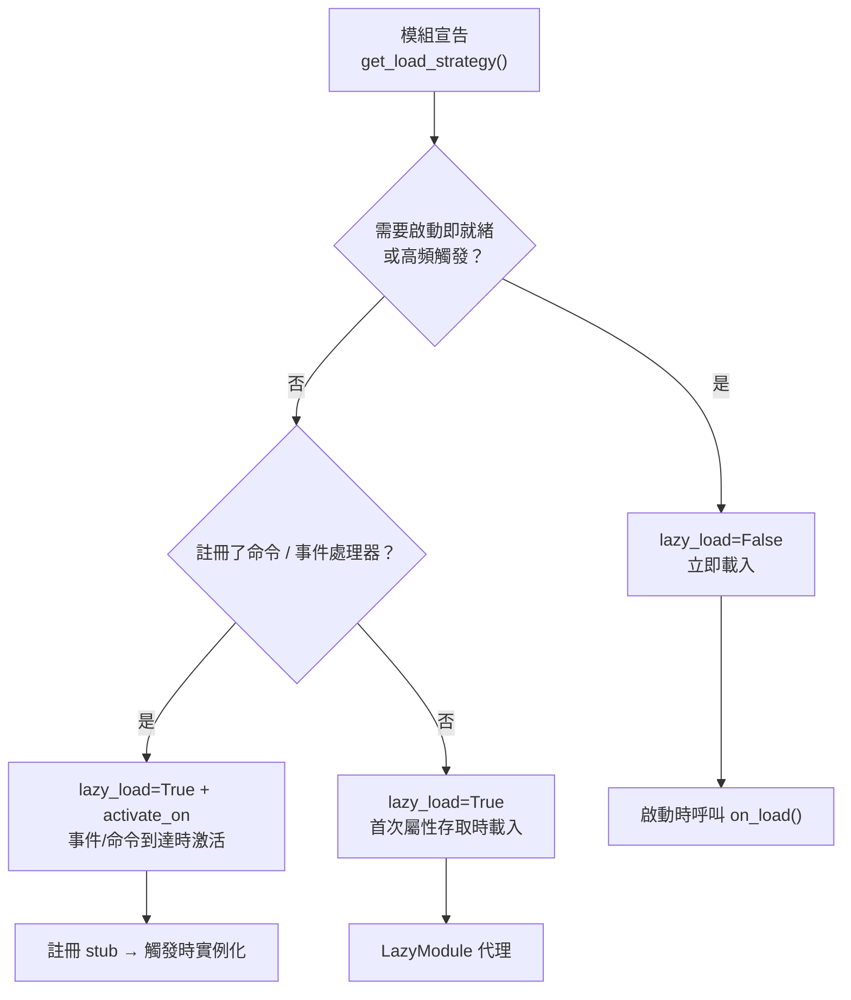
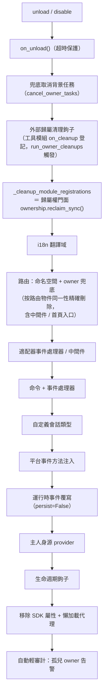

# ErisPulse 热重载与懒加载休眠

This skill is auto-built from the ErisPulse documentation.
Repository: https://github.com/ErisPulse/ErisPulse
Source paths are annotated per section; see docs/ in the repository for the latest content.

## 内容大纲

AI 按需读取：只读需要的章节即可，不必全文加载。

- 懒加载与休眠: 46-55 行
- 概述: 57-64 行
- 工作原理: 66-80 行
- 事件驅動懶激活（activate_on）: 82-158 行
- 懶加載休眠（dormant_after）: 160-206 行
- 配置懶加載: 208-235 行
- 使用懶加載模組: 237-292 行
- 最佳實踐: 294-322 行
- 注意事項: 324-329 行
- 相關文件: 331-337 行
- 归属权与热重载边界: 339-361 行
- owner 上下文機制: 363-386 行
- 歸屬資源全景: 388-422 行
- 卸載 / 禁用清理序列: 424-449 行
- 歸屬權統一門面（ownership）: 451-478 行
- 熱重載失敗回滾: 480-498 行
- 熱重載邊界: 500-570 行
- 設計邊界：哪些資源不隨卸載清理: 572-585 行
- 內部實現：歸屬如何運作: 587-638 行
- 模組作者指南: 640-692 行
- 工具模組指南：託管其他模組的句柄: 694-741 行
- 相關文件: 743-750 行
- 模块开发入门（加载策略）: 752-761 行
- 項目結構: 763-775 行
- pyproject.toml 配置: 777-795 行
- __init__.py: 797-801 行
- Core.py - 基礎模組: 803-842 行
- 測試模組: 844-862 行
- 核心概念: 864-967 行

## 懒加载与休眠

> 来源: `docs/zh-TW/advanced/lazy-loading.md`（https://github.com/ErisPulse/ErisPulse/blob/main/docs/zh-TW/advanced/lazy-loading.md）

# 慢載模組系統

> [!TIP]  
> **何時需要閱讀本文**：使用慢載模組或 activate_on 事件驅動激活時。若不需要則可跳過，這不會影響其他功能的使用。

ErisPulse SDK 的慢載模組系統讓模組延遲到**實際被存取時**才初始化——啟動階段只註冊占位代理，未被使用的模組不會占用啟動時間與記憶體。

## 概述

懶加載模組系統是 ErisPulse 的核心特性之一，它透過以下方式運作：

- **延遲初始化**：模組只有在第一次被存取時才會實際載入和初始化
- **透明使用**：對於開發者而言，懶加載模組與一般模組在使用上幾乎沒有差別
- **自動依賴管理**：模組依賴會在被使用時自動初始化
- **生命週期支援**：對於繼承自 `BaseModule` 的模組，會自動呼叫生命週期方法

## 工作原理

### LazyModule 類

懶加載系統的核心是 `LazyModule` 類，它是一個封裝器，在首次存取時才實際初始化模組。

### 初始化過程

當模組首次被存取時，`LazyModule` 會執行以下操作：

1. 獲取模組類的 `__init__` 參數資訊
2. 根據參數決定是否傳入 `sdk` 引用
3. 設定模組的 `moduleInfo` 屬性
4. 對於繼承自 `BaseModule` 的模組，呼叫 `on_load` 方法
5. 觸發 `module.init` 生命週期事件

## 事件驅動懶激活（activate_on）

> [!NOTE]  
> 此功能需要 ErisPulse **2.8.0+**。

`lazy_load=True` 的模組預設只在**首次屬性存取**時載入。若模組註冊了命令/事件處理器，  
傳統做法只能 `lazy_load=False` 立即載入。`activate_on` 提供了第三種選擇：**宣告觸發器，  
首個匹配事件/命令到達時自動激活模組**——既不常駐記憶體，又不遺失觸發入口。

```python
from ErisPulse.loaders import ModuleLoadStrategy

class MyModule(BaseModule):
    @staticmethod
    def get_load_strategy():
        return ModuleLoadStrategy(
            lazy_load=True,
            activate_on=[
                # ---- 事件觸發（被動到達，無需使用者感知）----
                "message",                                    # 類型級：任何訊息事件
                {"notice": "group_member_increase"},          # 類型 + 單個 detail_type
                {"message": ["private", "group"]},            # 類型 + 多個 detail_type

                # ---- 命令觸發（主動輸入，占位命令對 Help 可見）----
                {"command": "roll"},                          # 簡寫：命令名
                {"command": ["roll", "dice"]},                # 命令名列表
                {"command": {                                 # dict 聲明（name 必填）
                    "name": "dice",
                    "help": "擲一個骰子",
                    "usage": "/dice",
                    "group": "娛樂",
                    "aliases": ["d"],
                    "hidden": False,
                }},
            ],
        )
```

### 命令 dict 聲明參數

dict 形式鏡像 `@command()` 裝飾器的使用者級參數，用於在模組載入前就註冊占位命令：

| 參數 | 類型 | 預設 | 說明 |
|------|------|------|------|
| `name` | `str` | **必填** | 命令名；須與 `on_load` 中 `@command(name)` 一致，否則激活後占位註銷、命令不存在 |
| `help` | `str` | 回退鏈 | Help 中顯示的介紹；未聲明時按回退鏈取值（見下） |
| `usage` | `str` | 自動生成 | 用法行，預設 `{prefix}{name}` |
| `group` | `str` | `None` | 命令分組 |
| `aliases` | `list[str]` | `[]` | 別名同時註冊，**輸入別名同樣觸發激活** |
| `hidden` | `bool` | `False` | `True` 時占位命令同樣隱藏（與激活後真實命令的隱藏語義對齊）；知道命令名的使用者輸入仍可觸發 |

**不支援** `priority` / `permission` / `master`：占位命令的使命只是觸發激活，  
權限檢查由激活後的真實命令執行（占位階段攔截權限反而會讓「輸入命令激活」失效）。

### 占位命令 help 回退鏈

模組未載入時 Help 顯示的命令介紹，按以下順序取值（取到即止）：

1. dict 聲明的命令級 `help`（最精確）  
2. 模組 `get_meta()` 的 `description`  
3. 模組 `__description__` 屬性  
4. 包元數據的 `Summary`（PyPI 包簡介）  
5. 通用提示：「此命令來自懶載入模組 X，首次使用將自動載入該模組」

### 觸發語義

- **事件 stub**：以極低優先級（`ACTIVATION_STUB_PRIORITY`）註冊到對應事件管理器，  
  在所有普通處理器之後兜底觸發；激活後將當前事件轉發給模組的真實處理器  
- **命令 stub**：註冊占位命令；激活後占位註銷、真實命令接管當次觸發  
- **防重入**：`asyncio.Lock` 保證併發觸發下只激活一次  
- **作用域過濾**：stub 帶模組 owner 身份，模組未對該 Bot / 會話 / 平台啟用時不觸發  
- **失敗語義**：激活失敗進入冷卻期（`ACTIVATE_RETRY_COOLDOWN_SECS`，30 秒），  
  冷卻內事件短路避免重複嘗試；冷卻結束後再次觸發自動重試，stub 全程保留  
- **去重**：同名命令以簡寫 + dict 混合聲明時去重（dict 优先）；dict 缺 `name`  
  或事件 `detail_type` 误寫 dict 時告警並忽略  

> 架構圖與完整語義詳見 [架構概覽](../architecture.md#事件驅動懶激活activate_on觸發架構)。

## 懶加載休眠（dormant_after）

> [!NOTE]  
> 此功能需要 ErisPulse **2.11.0+**。

當懶加載的模組長期閒置時，框架可將其**歸眠**：釋放運行時資源（包括任務、連接、事件註冊等），  
但保留懶加載代理與註冊存根——模組回到「已註冊未加載」狀態。下次透過屬性存取、  
`module.call` 或 `activate_on` 事件將**透明地喚醒**（重新實例化並執行 `on_load`），  
無需任何額外的喚醒 API。歸眠後的系統狀態與「從未激活」完全一致。

### 聲明方式

```python
@staticmethod
def get_load_strategy():
    return ModuleLoadStrategy(
        lazy_load=True,
        dormant_after="30m",   # 閒置 30 分鐘自動歸眠；不聲明則永不休眠（預設）
    )
```

時間長度語法與命令治理的 `cooldown` 完全一致（例如：`90s`、`1h30m`、`1d`）。  
掃描器會以固定間隔（60 秒）進行掃描，實際歸眠時間 = 閾值 + 最多一個掃描間隔；  
也可隨時手動歸眠：`await sdk.module.sleep("模組名")`。顯式呼叫 `unload` 仍是徹底卸載（懶代理一併移除）。

### 狀態接續

歸眠前框架會觸發 `on_before_unload(reason="dormant")`（卸載流程的第一步，資源仍完好），  
模組將狀態儲存到 `sdk.storage`；喚醒後在 `on_load` 中恢復：

```python
async def on_before_unload(self, event):
    if event["reason"] in ("dormant", "reload", "disable"):
        await self.sdk.storage.aset(f"{self._module_name}:counter", self._count)

async def on_load(self, event):
    self._count = await self.sdk.storage.aget(f"{self._module_name}:counter") or 0
```

### 語意與限制

- **依賴方安全**：懶模組的依賴方透過持久代理（`sdk.<Name>`）或 `module.call` 訪問，  
  歸眠前後行為一致；直接持有真實實例引用屬反模式（會被泄漏審計器檢測到）
- **事件不達**：歸眠模組不再接收事件——需要事件喚醒的模組請同時聲明 `activate_on`  
  （事件先喚醒再轉發）；排查「命令沒反應」時，請確認模組是否處於歸眠狀態
- **喚醒失敗可自愈**：喚醒（重新初始化）失敗將進入 30 秒冷卻，冷卻後再次訪問會自動重試，  
  不會永久失效

## 配置懶加載

### 全局配置

在配置文件中啟用/禁用全局懶加載：

```toml
[ErisPulse.framework]
enable_lazy_loading = true  # true=啟用懶加載(預設)，false=禁用懶加載
```

### 模組層級控制

模組可以透過實作 `get_load_strategy()` 靜態方法來控制加載策略：

```python
from ErisPulse.Core.Bases import BaseModule
from ErisPulse.loaders import ModuleLoadStrategy

class MyModule(BaseModule):
    @staticmethod
    def get_load_strategy():
        """返回模組加載策略"""
        return ModuleLoadStrategy(
            lazy_load=False,  # 返回 False 表示立即加載
            priority=100      # 加載優先級，數值越大優先級越高
        )
```

## 使用懶加載模組

### 基本使用

對於開發者來說，懶加載模組與普通模組在使用上幾乎沒有區別：

```python
# 透過 SDK 訪問懶加載模組
from ErisPulse import sdk

# 以下訪問會觸發模組懶加載
result = await sdk.my_module.my_method()
```

### 統一的模組獲取入口

無論是透過 SDK 屬性、模組管理器屬性訪問，還是透過 `module.get()` 查詢，
對於「已註冊但尚未加載」的懶加載模組，都會返回同一個懶加載代理，訪問其屬性才會真正觸發初始化：

```python
# 三種方式拿到的都是懶加載代理（在模組未加載時），行為一致、對使用者透明
sdk.my_module          # 觸發加載的入口
sdk.module.my_module   # 同樣返回懶加載代理
sdk.module.get("my_module")  # 也返回懶加載代理，本身不會觸發加載

# 訪問代理的任意屬性才會真正初始化模組
result = await sdk.my_module.my_method()
```

`module.get()` 是**查詢**介面，本身不觸發加載：
- 模組已加載 → 返回真實實例
- 模組已註冊但未加載 → 返回懶加載代理（訪問屬性才初始化）
- 模組未註冊 → 返回 `None`

如需顯式觸發加載，請使用 `await sdk.load_module("my_module")`。

### 異步初始化

對於需要異步初始化的模組，建議先顯式加載：

```python
# 先顯式加載模組
await sdk.load_module("my_module")

# 然後使用模組
result = await sdk.my_module.my_method()
```

### 同步初始化

對於不需要異步初始化的模組，可以直接訪問：

```python
# 直接訪問會自動同步初始化
result = sdk.my_module.some_sync_method()
```

## 最佳實踐

選擇載入策略時，可參考以下決策流程：



### 推薦使用懶載入的場景（lazy_load=True）

- 被動呼叫的工具類（如資料查詢模組、格式轉換器等，僅在其他模組呼叫時才需要）
- 註冊命令/事件處理器但非高頻使用的模組——配合 `activate_on` 聲明觸發器，首個匹配事件/命令到達時自動激活，無需放棄懶載入

### 推薦禁用懶載入的場景（lazy_load=False）

- 需要在啟動時立即就緒的模組（如為其它模組提供基礎服務的核心模組）
- 高頻觸發的監聽器（每條訊息都要處理）——`activate_on` 轉發有一次激活開銷，高頻場景立即載入更直接
- 定時任務模組
- 需要在應用啟動時就初始化的模組

> `priority` 參數控制立即載入模組間的初始化順序，數值越大越先初始化。同優先級的模組按註冊順序載入。

## 注意事項

1. 如果您的模組使用了懶加載，如果其他模組從未在 ErisPulse 內進行過呼叫，則您的模組永遠不會被初始化。
2. 如果您的模組中包含了例如監聽事件的模組，或其它主動監聽類似模組，有兩種選擇：聲明 `activate_on` 觸發器（保持懶加載，事件到達時自動激活），或聲明需要立即被加載（`lazy_load=False`），否則會影響您模組的正常業務。
3. 我們不建議您禁用懶加載，除非有特殊需求，否則它可能為您帶來例如依賴管理和生命週期事件等的問題。
4. `activate_on` 的命令 dict 聲明中，`name` 必須與模組 `on_load` 中 `@command()` 註冊的真實命令名一致——否則模組激活後占位命令註銷，聲明與實現不一致的命令將不存在。

## 相關文件

請依下一步意圖選擇：

- **不清楚該選哪種載入策略（立即載入 / 懶載入 / activate_on）** → [模組最佳實踐](../developer-guide/modules/best-practices.md)
- **休眠與卸載時，背景任務、連線等資源的回收鏈路** → [所有權（owner）系統](ownership.md)
- **從頭開發一個模組** → [模組開發指南](../developer-guide/modules/getting-started.md)

## 归属权与热重载边界

> 来源: `docs/zh-TW/advanced/ownership.md`（https://github.com/ErisPulse/ErisPulse/blob/main/docs/zh-TW/advanced/ownership.md）

# 所屬權（owner）系統

> [!TIP]  
> **何時需要閱讀本文**：排查資源洩漏、理解卸載清理鏈路或宣告所屬資源時。不需要則跳過，不會影響其他功能的使用。

> **閱讀完你將知道**：owner 上下文如何自動歸屬資源、所屬資源全景表、卸載/禁用時清理鏈的完整時序，以及哪些資源不會隨卸載清理（設計邊界）。
>
> **本文不涉及**：資源「何時生效」的權限判定（見[作用域（scope）](scope.md)）；後台任務的推薦寫法與強制取消邊界（見[生命週期管理 · 後台任務歸屬與自動取消](lifecycle.md#後台任務歸屬與自動取消)）。

所屬權是模組「即插即用」的基石：模組在載入期間註冊的一切框架資源會自動記名，卸載/禁用時按記名一鍵回收——模組作者只需宣告資源，無需手寫清理邏輯。

> **相關系統**：作用域（scope）在事件分發時決定「資源是否生效」，所屬權在生命週期中決定「資源歸誰、誰卸載時被回收」。作用域詳見[統一控制面（scope）](scope.md)，後台任務詳見 [生命週期管理](lifecycle.md#後台任務歸屬與自動取消)。

{!--< tips >!--}
1. 所屬權在**註冊瞬間**按 `current_owner` 自動記錄，模組程式碼無需修改
2. 卸載/禁用共用同一條清理鏈（`_cleanup_module_registrations`），每一步失敗僅發出警告而不中斷
3. 用戶設定語意的資源（持久化覆寫 / scope 規則 / 命令 ACL）**不**會隨模組卸載清理
4. 工具模組托管的外部句柄可用 `on_cleanup(cb)` 掛入清理鏈，對方模組卸載時自動回呼（見[工具模組指南](#工具模組指南托管其它模組的句柄)）
{!--< /tips >!--}

## owner 上下文機制

owner 透過上下文變數 `current_owner` 傳遞（`ErisPulse.runtime.context`）：

```python
from ErisPulse.runtime import owner_scope, get_current_owner

with owner_scope("MyModule"):
    # 此區間內註冊的一切資源自動歸屬 MyModule
    assert get_current_owner() == "MyModule"
```

框架在以下時機自動注入 owner（模組/適配器程式碼無需手動包裝）：

| 時機 | owner 值 | 位置 |
|------|----------|------|
| 模組 `load()` | 模組名 | 實例化 + `on_load` 全程 |
| 適配器 `start()` / `restart()` | 平台名 | 適配器啟動全程 |
| `activate_on` 慢載入 stub 註冊 | 模組名 | 占位命令/處理器註冊 |
| 事件處理器執行期 | 處理器歸屬模組名 | handler / 命令入口重注入 |

執行期重注入意味著：模組在 `on_load` 裡宣告的命令處理器**執行中**呼叫
註冊型 API（如 `sdk.adapter.on()`、`overrides.*.set(persist=False)`），
同樣會自動歸屬本模組。

## 歸屬資源全景

模組在載入上下文內註冊的以下資源均記錄歸屬，卸載/禁用時自動回收：

| 資源 | 註冊方式 | 清理調用 |
|------|----------|----------|
| 命令 | `@command()` / 命令 dict 聲明 | `command.unregister_by_owner()` |
| 事件處理器 | `@message` / `@notice` / `@request` / `@meta` | `handler.unregister_by_owner()` |
| 適配器事件監聽 | `sdk.adapter.on()` / `raw=True` | `adapter.unregister_handlers_by_owner()` |
| 適配器中間件 | `@sdk.adapter.middleware` | 同上 |
| 路由（HTTP/WS/SSE） | `router.http()` / `websocket()` / `sse()` | 按命名空間 + 按 owner 雙重兜底 |
| 路由中間件 | `@router.middleware()` / `add_middleware()` | `router.unregister_all_by_owner()` |
| Dashboard 首頁入口 | `router.register_home_entry()` | `unregister_home_entries_by_owner()` |
| 自定義會話類型 | `register_custom_type()` | `unregister_custom_types_by_owner()` |
| 平台事件方法注入 | `register_event_method()` / `register_event_mixin()` | `unregister_event_methods_by_owner()`（模組卸載自動回收，舊閉包不再泄漏） |
| 後台任務 | `self.spawn()` | `cancel_owner_tasks()` |
| 外部歸屬清理鈎子（工具模組托管） | `runtime.on_cleanup(cb)` | `run_owner_cleanups()`（卸載/禁用/適配器關閉鏈內觸發） |
| 生命週期鈎子 | `lifecycle.register()` | `lifecycle.unregister_by_owner()` |
| 主人身源 provider | `master.provider` | `master.unregister_by_owner()` |
| i18n 翻譯鍵 | `I18nClass` 聲明（domain=模組名） | `i18n.unregister_domain()` |
| 事件覆寫（執行時） | `overrides.*.set(persist=False)` | `overrides.unregister_by_owner()` |
| 互動會話（wait_reply 等待 / 租約） | `event.wait_reply()` / `sdk.interaction.acquire()` | `interaction.cancel_by_owner()`（等待方立即收到取消） |
| 上下文數據 | `runtime/context` 按 owner 記錄 | 按模組精確清理 |

適配器側的對應資源（以平台名為 owner）在適配器 `shutdown()` / `restart()`
時由 `_cleanup_adapter_resources` 回收，另含：

| 資源 | 清理調用 |
|------|----------|
| 適配器自有的 `on()` 處理器與中間件 | `adapter.unregister_handlers_by_owner(platform)` |
| 平台事件方法擴展（`EventMixin`） | `unregister_platform_event_methods(platform)` |
| 自定義會話類型 | `unregister_custom_types_by_owner(platform)` |
| 互動會話（該平台掛起的 wait_reply / 租約） | `interaction.cancel_by_platform(platform)` |
| i18n 翻譯域（domain=配置鍵） | `i18n.unregister_domain(配置鍵)` |
| 細顆粒命名空間路由 | `router.unregister_all_by_owner(platform)` |

## 卸載 / 禁用清理序列

`unload()` 與 `disable()` 共用同一条清理鏈（每步獨立 try/except，失敗僅記日誌，**不中斷後續清理**）：



`sdk.uninit()` 退出時另有全局兜底：全部適配器 shutdown → 全部模組 unload →
`router.stop()`（清空路由 / 中間件 / 首頁入口）→ `cancel_all_background_tasks()` →
清空事件處理器與鉤子。

## 歸屬權統一門面（ownership）

清理鏈的十六個步驟收斂在歸屬權統一門面 `ErisPulse.Core.ownership` 下，  
四個動詞覆蓋「註銷、計數、掃描、審計」——子系統各自的 `*_by_owner` 註銷  
函數保持不變，作為門面的內部實現：

| 動詞 | 用途 |
|------|------|
| `ownership.reclaim(owner)` | 統一註銷 owner 名下全部資源（任務取消 → 清理鉤子 → 註冊類資源；異步完整版） |
| `ownership.reclaim_sync(owner)` | 註冊類資源註銷（同步版，供同步卸載路徑） |
| `ownership.counts(owner=None)` | 只讀統計 owner 在冊資源（None 為全部 owner） |
| `ownership.orphans()` | 孤兒掃描：資源在冊而 owner 已註銷（泄漏實錘清單） |
| `ownership.audit(owner, deep=)` | 泄漏審計報告（計數 + 孤兒 + 可選 gc 實例普查） |

```python
from ErisPulse.Core import ownership

ownership.reclaim_sync("MyModule")       # {'commands': 1, 'routes_http': 2, ...}
ownership.counts("MyModule")             # 在冊資源計數
ownership.orphans()                      # [{"owner": "ghost", "total": 2, ...}]
```

**審計入口**：

- 卸載 / 重載後**自動輕審計**：發現孤兒 owner 資源即 WARNING 告警（零開銷計數掃描）
- `sdk.module.audit(name, deep=True)`：模組實例 gc 普查——實例不可回收時  
  給出引用方類型（定位「誰攥著舊實例」）；有全局暫停開銷，僅顯式排障使用
- 深普查屬顯式操作，不設配置鍵、不做自動修復

## 熱重載失敗回滾

熱重載為 "**卸載前快照 → 失敗自動恢復 → 重放 on_load**"：當新版本發生語法錯誤、
依賴缺失、載入失敗時，舊實例與註冊狀態（註冊表條目、sdk 屬性、sys.modules
條目）會自動還原，隨後在歸屬上下文內**重放舊實例的 `on_load`**（`reason`
為 `"rollback"`），讓卸載階段斷開的外部資源重新建立；結束後發射
`module.rollback` 事件（載荷 `{module_name, success}`）。

邊界說明：

- 重放失敗或超時**只告警**，不回滾回滾——舊實例停留在"已收尾"狀態
  （與 2.11.2 及更早行為一致），日誌會明確提示
- 第三方在執行期手動緩存的對舊實例的引用不在恢復範圍
- 目標套件已被卸載（entry-point 消失）視作卸載成功，不做回滾
- `on_unload` 載荷攜帶 `reason`（`unload` / `reload` / `disable` /
  `cascade` / `dormant` / `load-failed`），模組可在 `reload` 時推遲關閉
  需要跨重載存活的資源

熱重載的完整能力邊界、跨循環語義與模組側守則見下節。

## 熱重載邊界

熱重載能替換代碼、重建註冊、回滾失敗的重載——但它**不是進程重啟**。  
回收的是**歸屬權系統登記在冊的運行時資源**；不屬任何 owner 的資源、用戶  
配置語義的數據、第三方庫內部緩存的引用，都不會隨重載消失。

### 能力邊界

| 對象 | 重載後行為 | 說明 |
|------|-----------|------|
| 模塊代碼 / 類定義 | 支持，重新導入 | 舊 `sys.modules` 條目被清理 |
| `on_unload` / `on_load` | 支持，按序觸發 | 失敗回滾時重放 `on_load`（見上節） |
| 命令 / 處理器 / 路由 / 生命週期鉤子 | 支持，自動註銷再註冊 | 經歸屬回收鏈清理 |
| `spawn_background` / `spawn_later` / `spawn_thread` | 支持，按 owner 取消 | 線程只登記觀測、無法強殺 |
| 主迴圈上任何 `asyncio.create_task` | 支持，自動歸屬取消 | 任務工廠拦截（含第三方庫內部創建） |
| 存儲橋接迴圈上派生的任務 | 支持，自動歸屬取消 | 橋接迴圈同樣裝了任務工廠 |
| `ownership.track()` 登記的資源 | 支持，調用 `release()` | 任務工廠夠不著的 Loop-bound 資源 |
| `on_cleanup` 鉤子 | 支持，觸發 | 工具模組藉此拋棄托管的句柄 |
| 持久化覆寫（`persist=True`）/ 配置文件 | 不處理，保留 | 用戶資產 |
| 第三方庫內部緩存的物件引用 | 不處理 | 框架看不到，需模組自行解引用 |
| 模組自己 `new` 的事件迴圈 / 裸線程 | 不回收 | 見下方守則 |
| 適配器回滾後的資源 | 未對齊 | 適配器側暫不重放 `start()` |

### 三層資源治理

1. **無感拦截層**——事件迴圈級任務工廠。owner 上下文內任何任務創建自動歸屬，  
   覆蓋主迴圈與存儲橋接迴圈。
2. **歸屬化調度層**——`spawn_background` / `spawn_later` / `spawn_thread`。
3. **合作式登記層**——`ownership.track()` / `on_cleanup()`，用於結構性  
   夠不著的資源（Loop-bound 連接池、第三方 client）。

### 事件迴圈邊界

| 迴圈 | 誰創建 | 裝任務工廠 | 用途 |
|------|--------|-----------|------|
| 主迴圈 | `sdk.run()` / `sdk.init()` | 已安裝 | 全部業務代碼 |
| 存儲橋接迴圈 | `AsyncBridge`（首次同步存儲調用） | 已安裝 | 同步存儲 API 的後台執行 |
| 臨時迴圈 | `spawn_background` 兜底 | 未安裝，用完即關 | 主迴圈未就緒時的最後手段 |

**臨時迴圈是最後手段**：它會同步阻塞調用線程，且迴圈關閉後協程內部再派生的  
子任務會丟失（日誌有 `temp_loop_fallback` 警告）。看到該警告說明模組在錯誤  
的時機調度了後台任務。

**跨迴圈取消是盡力而為**：`cancel_owner_tasks` 發現任務在其它仍在運行的迴圈  
上時，用 `call_soon_threadsafe` 投遞取消並打 `cross_loop_task_residual`  
警告，但**不等待**其結束（跨迴圈等待不安全）。看到該警告應檢查是否自建了  
事件迴圈。

### 模組側守則

```python
# 推薦
spawn_background(self._poll())            # 歸屬化後台任務
spawn_later(30, lambda: self._cleanup())  # 歸屬化延遲任務
spawn_thread("poller", self._loop_body)   # 歸屬化線程（入口自動帶 owner）
ownership.track(pool)                     # 显式登記 Loop-bound 資源
await sdk.storage.aget(key)               # 異步上下文直接用異步 API

# 避免
asyncio.create_task(self._poll())         # 裸調用：無引用易被 GC
asyncio.new_event_loop()                  # 自建迴圈：歸屬體系完全夠不著
threading.Thread(target=self._loop_body)  # 裸線程：入口無 owner 上下文
self._storage.get(key)                    # 異步上下文裡同步調存儲：阻塞主迴圈
```

### 排查清單

1. 日誌有 `cross_loop_task_residual`？→ 有資源落在自建迴圈上  
2. 日誌有 `temp_loop_fallback`？→ 後台任務在主迴圈就緒前被調度  
3. 報 `attached to a different loop`？→ 檢查是否自建迴圈或跨迴圈複用連接物件  
4. `ownership.orphans()` 有輸出？→ 有 owner 名下資源在卸載後仍存活

## 設計邊界：哪些資源不隨卸載清理

所有權只回收**模組程式碼註冊的執行時資源**。以下資源屬**用戶配置語意**
（控制權在用戶，可能刻意配置），模組卸載後隨配置持久保留：

| 資源 | 語意 | 說明 |
|------|------|------|
| `overrides.*.set(persist=True)` | 持久化覆寫 | 寫入配置檔案，跨重啟生效；模組卸載不刪（用戶顯式配置） |
| `scope.set_action()` 等作用域規則 | 權限控制面 | 由用戶/Dashboard 管理，卸載模組不回收規則 |
| `overrides.acl.set(persist=True)` | 命令 ACL | 同上 |
| Conversation `save()` 持久化 | 多輪對話存檔 | 數據資產不清理 |

執行時臨時寫入（`persist=False`）則隨 owner 回收——**持久化與否即**
"用戶資產"與"模組執行時狀態"的分界線。

## 內部實現：歸屬如何運作

**一句話**：歸因鏈（contextvar 传播）決定「記在誰頭上」，取消鏈（任務登記表）決定「卸載時能否被取消」——兩條鏈路獨立運作，資源被正確清理需二者兼備。

歸屬系統由**兩條獨立鏈路**構成，理解它們的分工是排查歸屬問題的前提：

### 歸因鏈（contextvar 传播）

`runtime/context.py` 的 `current_owner` 等 ContextVar 負責**歸因**——  
「此刻這段代碼註冊的資源 / 發起的調用記在誰頭上」。傳播規則遵循 Python  
contextvars 語義：

| 執行路徑 | context 是否傳播 | 歸因結果 |
|---------|----------------|---------|
| 同步調用鏈 / `await` 鏈 | ✅ 傳播 | 正確歸因 |
| `owner_scope` 內 `asyncio.create_task` | ✅ 傳播（task 拷貝創建時刻的 context） | 任務**內部**的框架調用正確歸因 |
| `run_in_executor` / 裸線程 | ❌ 不傳播 | 歸因丟失 |
| 自建事件循環 | ❌ 不傳播 | 歸因丟失 |

> 歸因 ≠ 登記：context 傳播只影響「記在誰頭上」，資源能否被清理  
> 取決於是否進入了下述取消鏈。

### 取消鏈（任務登記表）

`runtime/tasks.py` 的 `_owner_tasks` 登記表負責**生命週期**——  
「owner 名下有哪些未完成任務，卸載時統一取消」。任務進入登記表的途徑：

1. **顯式調度**：`spawn_background()` / `self.spawn()` → 創建時捕獲  
   `current_owner`（或顯式 `owner=` 參數）→ 登記入表；
2. **Task Factory 自動登記**（2.8.3）：`install_owner_task_factory()`  
   在框架啟動時安裝到主事件循環——**任何**任務創建（含第三方庫內部的  
   `create_task`）經過工廠時讀取 `current_owner`，非 None 即登記。

登記表自清理：每個任務帶 `done_callback`，完成即從表中移除，無泄漏。

### 取消時序（模組卸載）

```
module.unload()
  → on_unload(event)                    # 模組自行清理（兜底超時保護）
  → 框架註銷該 owner 的命令/事件/鉤子/路由
  → cancel_owner_tasks(owner)           # 任務登記表兜底取消
      → 逐個 task.cancel()              # 排除當前執行取消邏輯的任務自身
      → await gather(pending, timeout)  # 等待回收（超時不再阻塞）
```

### 排查思路

- **資源沒被清理** → 查登記表：`get_owner_tasks("MyModule")` 是否含該任務；  
  不含即註冊路徑未經過歸屬鏈（import 期 / 線程 / 獨立循環），對照上表定位。
- **歸因錯誤** → 查 `get_current_owner()` 在出錯時刻的值；異步延遲執行  
  （回調 / 任務）的歸因取自創建時刻 context，而非執行時刻。

## 模組作者指南

### 推薦寫法

```python
from ErisPulse import sdk
from ErisPulse.Core.Event import command
from ErisPulse.runtime import owner_scope, spawn_background

class MyModule(BaseModule):
    async def on_load(self, event):
        # 框架資源：自動歸屬，無需手動清理
        self.task = self.spawn(self.polling())      # 背景任務
        sdk.router.register_home_entry("我的模組", "/my")  # 首頁入口

        # 模組自有資源：包進 owner_scope 即納入所有權體系
        with owner_scope("MyModule"):
            self.client.on_event(self._handle)      # 假想的自定義註冊

    async def on_unload(self, event):
        # 框架資源已被自動回收，只需清理 owner_scope 覆蓋不到的自有資源
        await self.client.close()
```

### 注意事項

- **import 期註冊無所有權**：模組頂層（import 時）註冊的鈎子/處理器發生在
  `owner_scope` 之前，會被視為框架級資源（owner=None）而**不被清理**。
  一律放到 `on_load()` 內註冊。
- **自定義 domain 的 i18n 註冊**：`i18n.register(domain=...)` 的 domain
  不等於模組名時不會被自動回收，請保持 domain=模組名。
- **背景任務推薦 `self.spawn()`**：2.8.3 起裸 `asyncio.create_task` 也會**自動隱式所有權**
  （Task Factory 自動登記，卸載時兜底取消）；但 `self.spawn()` 仍是推薦寫法——
  支援非主迴圈執行緒調度回主迴圈、顯式 `owner=` 指定與 fire-and-forget 防 GC。
  **2.8.3 之前的版本**裸任務不所有權，必須用 `self.spawn()`。
- 清理鏈"失敗僅警告"：單步清理異常不會阻斷其餘資源回收，日誌 DEBUG/WARNING
  級別可見，排障時可開啟 TRACE。

### 註冊時機 → 所有權結果對照表

| 註冊場景 | 所有權結果 | 說明 |
|---------|---------|------|
| `on_load()` 內經框架 API（命令/事件/lifecycle/路由裝飾器）註冊 | 歸屬模組 | 卸載時自動註銷 |
| 模組頂層（import 期）註冊 | **無所有權**（owner=None） | 不被清理，請勿使用 |
| `self.spawn()` 建立的背景任務 | 歸屬模組 | 卸載時自動取消 |
| `owner_scope("Name")` 內經第三方 API 註冊 | 歸屬模組 | 依賴第三方回調在 scope 內同步執行 |
| 裸 `asyncio.create_task`（含 `loop.create_task` / `ensure_future`） | **自動所有權**（Task Factory，2.8.3+） | 建立瞬間讀取 `current_owner`，owner 上下文內自動登記、卸載兜底取消；見下文[內部實現](#內部實現所有權如何工作) |
| 第三方庫異步回調（aiohttp / APScheduler 等）內部建立的任務 | **自動所有權**（Task Factory，2.8.3+） | 回調執行時若 `current_owner` 已注入（如框架處理器執行期間），任務自動登記 |
| `run_in_executor`（執行緒池） | **無所有權**（非 asyncio.Task） | 執行緒不受任務工廠管轄，須自行管理生命週期 |
| 獨立事件迴圈（自建 loop）中的註冊 | **無所有權** | Task Factory 僅安裝於主迴圈；contextvars 也不跨事件迴圈傳播 |

> 原則：**所有權跟隨註冊瞬間的 `current_owner` 上下文**；任何異步延遲、
> 執行緒池、獨立迴圈都會脫離該上下文——需要所有權時請顯式進入 `owner_scope`。

## 工具模組指南：託管其他模組的句柄

**場景**：定時任務、註冊表、連接池之類的「工具模組」會替其他模組保管物件——
對方在 `on_load` 中呼叫 `sdk.Cron.on_trigger(handler)`，你的容器中就會儲存下
一個指向對方實例的回調。框架會自動清理對方註冊的所有框架資源，但無法清理
你**私有容器中的引用**：對方卸載後你的容器仍持有它的實例，它就無法被
GC 回收（記憶體洩漏，`purge` 泄漏診斷報告「不可回收」）。

**解法**：在登記對方物件的同一個函數中呼叫 `on_cleanup()`，
框架會在對方卸載 / 禁用時自動回呼你的清理函數：

```python
from ErisPulse.Core.Bases import BaseModule
from ErisPulse.runtime import off_cleanup, on_cleanup

class CronModule(BaseModule):
    def __init__(self):
        self._entries = {}  # {模組名: 該模組託管的回調列表}

    def on_trigger(self, handler):
        # 自動識別呼叫方模組名（on_load 直接呼叫 / module.call 均正確），
        # 返回值是解析出的 owner，可直接用作記名鍵
        owner = on_cleanup(self._drop)
        self._entries.setdefault(owner, []).append(handler)

    def _drop(self, owner: str):
        """對方模組被卸載/禁用時由框架自動呼叫：拋棄它的句柄即可"""
        self._entries.pop(owner, None)

    async def on_unload(self, event):
        off_cleanup(self._drop)  # ③ 自己卸載前註銷鉤子，避免鉤子表持有 self
```

框架保證的行為：

| 關注點 | 行為 |
|--------|------|
| 觸發時機 | 對方模組 unload / disable，或適配器關閉——均在框架清理鏈內觸發，早於 purge 泄漏診斷 |
| 呼叫方識別 | 直接呼叫取 `current_owner`；經 `module.call()` 被呼叫取呼叫方（`current_caller`）；也可 `on_cleanup(cb, owner="模組名")` 明確指定。**強制校驗**：owner 無法解析（三種來源均缺失）時拋 `ValueError`——私有工具模組應在自身載入上下文中登記鉤子 |
| 回呼簽名 | `cb(owner: str)`，同步 / 異步均可；異步帶超時保護（`CLEANUP_CALLBACK_TIMEOUT_SECS`，預設 10 秒） |
| 容錯 | 單個回呼異常 / 超時只記錄日誌，不影響其餘鉤子與清理鏈 |
| 重複登記 | 同一 `(owner, callback)` 幂等去重 |

**什麼時候不需要**：如果對方註冊的是框架資源（命令、事件處理器、路由、
後台任務……），框架已自動清理（見上文[歸屬資源全景](#歸屬資源全景)）。
只有你私有容器中持有的對方句柄才需要 `on_cleanup`。
模組開發視角的速查版見
[最佳實踐 · 工具模組](../developer-guide/modules/best-practices.md#工具模組託管別人東西時要接住卸載通知)。

## 相關文件

請依下一步意圖選擇：

- **想控制「資源是否生效」（權限面）** → [作用域（scope）](scope.md)——歸屬權管理「資源歸誰、卸載誰回收」，作用域管理「資源何時生效」
- **背景工作 / 定時器的兜底取消** → [生命週期管理 · 背景工作歸屬與自動取消](lifecycle.md#背景工作歸屬與自動取消)
- **以獨立 owner 隔離進行灰階發佈** → [影子模組與灰階轉正](shadow.md)
- **模組開發視角的速查與推薦寫法** → [模組最佳實踐](../developer-guide/modules/best-practices.md)

## 模块开发入门（加载策略）

> 来源: `docs/zh-TW/developer-guide/modules/getting-started.md`（https://github.com/ErisPulse/ErisPulse/blob/main/docs/zh-TW/developer-guide/modules/getting-started.md）

# 模組開發入門

> [!NOTE]
> **L1 核心必讀**——首頁「閱讀路徑」中的五篇核心文件之一，模組開發必備。

跟著這篇走完，你會得到一個能響應 `/hello` 命令的可執行模組，並了解模組的專案結構、註冊方式與載入 / 卸載鉤子——後續所有模組文件都建立在這套骨架上。

## 項目結構

一個標準的模組結構：

```
MyModule/
├── pyproject.toml
├── README.md
├── LICENSE
└── MyModule/
    ├── __init__.py
    └── Core.py
```

## pyproject.toml 配置

```toml
[project]
name = "ErisPulse-MyModule"
version = "1.0.0"
description = "模組功能描述"
readme = "README.md"
requires-python = ">=3.10"
license = { file = "LICENSE" }
authors = [ { name = "yourname", email = "your@mail.com" } ]
dependencies = []

[project.urls]
"homepage" = "https://github.com/yourname/MyModule"

[project.entry-points."erispulse.module"]
"MyModule" = "MyModule:Main"
```

## __init__.py

```python
from .Core import Main
```

## Core.py - 基礎模組

```python
from ErisPulse import sdk
# 推薦根導入（2.10+）：常用符號直接從根包導入，深路徑仍相容
from ErisPulse import BaseModule, command

class Main(BaseModule):
    def __init__(self, sdk):
        self.sdk = sdk
        self.logger = sdk.logger.get_child("MyModule")
        self.storage = sdk.storage
    
    @staticmethod
    def get_load_strategy():
        """返回模組加載策略"""
        from ErisPulse.loaders import ModuleLoadStrategy
        return ModuleLoadStrategy(
            lazy_load=True,
            priority=0,
            depends=[],  # 可選：依賴的其他模組列表
            # 可選：事件驅動懶激活——聲明觸發器，首個匹配事件/命令到達時自動加載
            # activate_on=[{"command": {"name": "hello", "help": "發送問候"}}],
        )
    
    async def on_load(self, event):
        """模組加載時調用"""
        @command("hello", help="發送問候")
        async def hello_command(event):
            name = event.get_user_nickname() or "朋友"
            await event.reply(f"你好，{name}！")
        
        self.logger.info("模組已加載")
    
    async def on_unload(self, event):
        """模組卸載時調用"""
        self.logger.info("模組已卸載")
```

> **配置讀取**：上面的基礎範例未使用配置。需要讀取配置時，推薦聲明嵌套的 `ConfigClass` 並透過 `self.cfg` 即時讀取（見 [模組核心概念](core-concepts.md#宣告式配置推薦)）。手動呼叫 `_load_config()` 的舊寫法已廢棄。

## 測試模組

### 本地測試

```bash
# 在專案目錄安裝模組
epsdk install ./MyModule

# 運行專案
epsdk run main.py --reload
```

### 測試命令

發送命令測試：

```
/hello
```

## 核心概念

### BaseModule 基類

所有模組必須繼承 `BaseModule`，提供以下方法：

| 方法 | 說明 | 必須 |
|------|------|------|
| `__init__(self, sdk)` | 建構函數（框架傳入 `sdk` 實例） | 否 |
| `get_load_strategy()` | 返回載入策略 | 否 |
| `get_meta()` | 返回模組介紹元資訊（可選） | 否 |
| `on_load(self, event)` | 模組載入時呼叫 | 是 |
| `on_unload(self, event)` | 模組卸載時呼叫 | 是 |

### 模組介紹 meta

> [!NOTE]
> 本特性需要 ErisPulse **2.8.0+**。

透過 `get_meta()` 聲明模組的介紹元資訊（這個模組是用來做什麼的、屬於哪一類等）。
元資訊是模組的**通用介紹資料**，供 help 模組、Dashboard 模組列表、模組商店等各類介面/生態模組消費。

與 `get_load_strategy()` 返回 `ModuleLoadStrategy` 一致，**推薦返回 `ModuleMeta` 配置類實例**（屬性類型、IDE 自動補全），也兼容直接返回 dict：

```python
class MyModule(BaseModule):
    @staticmethod
    def get_meta() -> ModuleMeta:
        return ModuleMeta(
            name="天氣",               # 顯示名（預設註冊名）
            description="查詢城市天氣",  # 模組簡介
            version="1.0.0",
            author="ErisDev",
            group="工具",               # 功能分組
            tags=["天氣", "查詢"],
        )
```

相容寫法（dict）：

```python
class MyModule(BaseModule):
    @staticmethod
    def get_meta() -> dict:
        return {
            "name": "天氣",
            "description": "查詢城市天氣",
            "version": "1.0.0",
            "author": "ErisDev",
            "group": "工具",
            "tags": ["天氣", "查詢"],
        }
```

- `module.get_meta("MyModule")` 讀取已解析的元資訊（類宣告 > 註冊 info，自動補全該模組的命令名）。
- `module.get_commands_overview()` 聚合「模組 meta + 其註冊的命令（別名/分組/幫助）」，按模組組織的命令總覽。
- 命令歸屬模組透過 `cmd_info["owner"]` 取得（註冊時由上下文系統自動注入）。

#### meta 字段的 i18n 支援

元資訊字段值可用純字串，或 i18n 字典 `{"i18n": "key.path", "default": "兜底文本"}`（與配置 `description` 約定一致）。
翻譯鍵透過 `I18nClass` 聲明註冊，`module.get_meta()` 讀取時自動解析為當前語言文本：

```python
class MyModule(BaseModule):
    class I18nClass(BaseI18n):
        meta_description: I18nKey = I18nKey(
            default="Weather lookup",
            zh_CN="查詢城市天氣",
            en="Weather lookup",
        )

    @staticmethod
    def get_meta() -> ModuleMeta:
        return ModuleMeta(
            name="天氣",
            description={"i18n": "MyModule.meta_description", "default": "Weather lookup"},
        )
```

### SDK 物件

透過 `sdk` 物件存取核心功能：

```python
from ErisPulse import sdk

sdk.storage    # 存儲系統
sdk.config     # 配置系統
sdk.logger     # 日誌系統
sdk.adapter    # 適配器系統
sdk.router     # 路由系統
sdk.lifecycle  # 生命週期系統
```

### 繼續學習路徑

- [模組核心概念](core-concepts.md) - 深入了解模組架構
- [Event 包裝類詳解](event-wrapper.md) - 學習 Event 物件

### 寫完之後

- [模組最佳實踐](best-practices.md) - 開發高品質模組
