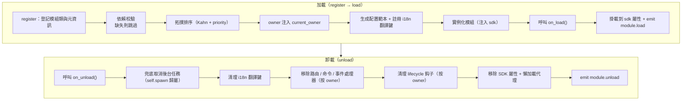
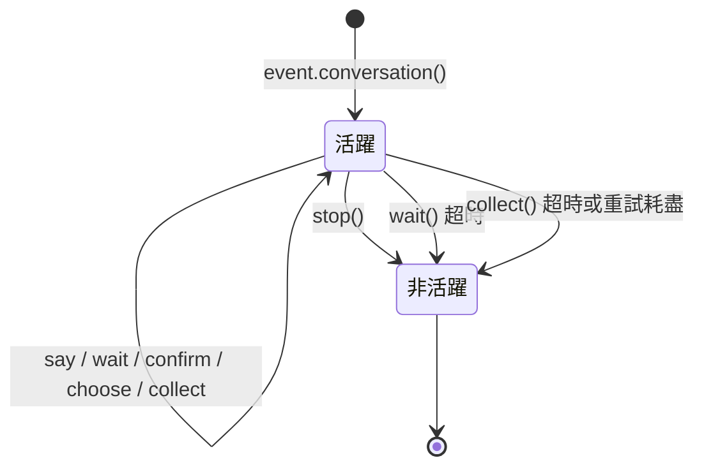

# ErisPulse 模块开发

This skill is auto-built from the ErisPulse documentation.
Repository: https://github.com/ErisPulse/ErisPulse
Source paths are annotated per section; see docs/ in the repository for the latest content.

## 模块开发入门

> 来源: `docs/zh-TW/developer-guide/modules/getting-started.md`（https://github.com/ErisPulse/ErisPulse/blob/main/docs/zh-TW/developer-guide/modules/getting-started.md）

# 模組開發入門

> [!NOTE]
> **L1 核心必讀**——首頁「閱讀路徑」中的五篇核心文件之一，模組開發必備。

跟著這篇走完，你會得到一個能響應 `/hello` 命令的可執行模組，並了解模組的專案結構、註冊方式與載入 / 卸載鉤子——後續所有模組文件都建立在這套骨架上。

## 項目結構

一個標準的模組結構：

```
MyModule/
├── pyproject.toml
├── README.md
├── LICENSE
└── MyModule/
    ├── __init__.py
    └── Core.py
```

## pyproject.toml 配置

```toml
[project]
name = "ErisPulse-MyModule"
version = "1.0.0"
description = "模組功能描述"
readme = "README.md"
requires-python = ">=3.10"
license = { file = "LICENSE" }
authors = [ { name = "yourname", email = "your@mail.com" } ]
dependencies = []

[project.urls]
"homepage" = "https://github.com/yourname/MyModule"

[project.entry-points."erispulse.module"]
"MyModule" = "MyModule:Main"
```

## __init__.py

```python
from .Core import Main
```

## Core.py - 基礎模組

```python
from ErisPulse import sdk
# 推薦根導入（2.10+）：常用符號直接從根包導入，深路徑仍相容
from ErisPulse import BaseModule, command

class Main(BaseModule):
    def __init__(self, sdk):
        self.sdk = sdk
        self.logger = sdk.logger.get_child("MyModule")
        self.storage = sdk.storage
    
    @staticmethod
    def get_load_strategy():
        """返回模組加載策略"""
        from ErisPulse.loaders import ModuleLoadStrategy
        return ModuleLoadStrategy(
            lazy_load=True,
            priority=0,
            depends=[],  # 可選：依賴的其他模組列表
            # 可選：事件驅動懶激活——聲明觸發器，首個匹配事件/命令到達時自動加載
            # activate_on=[{"command": {"name": "hello", "help": "發送問候"}}],
        )
    
    async def on_load(self, event):
        """模組加載時調用"""
        @command("hello", help="發送問候")
        async def hello_command(event):
            name = event.get_user_nickname() or "朋友"
            await event.reply(f"你好，{name}！")
        
        self.logger.info("模組已加載")
    
    async def on_unload(self, event):
        """模組卸載時調用"""
        self.logger.info("模組已卸載")
```

> **配置讀取**：上面的基礎範例未使用配置。需要讀取配置時，推薦聲明嵌套的 `ConfigClass` 並透過 `self.cfg` 即時讀取（見 [模組核心概念](core-concepts.md#宣告式配置推薦)）。手動呼叫 `_load_config()` 的舊寫法已廢棄。

## 測試模組

### 本地測試

```bash
# 在專案目錄安裝模組
epsdk install ./MyModule

# 運行專案
epsdk run main.py --reload
```

### 測試命令

發送命令測試：

```
/hello
```

## 核心概念

### BaseModule 基類

所有模組必須繼承 `BaseModule`，提供以下方法：

| 方法 | 說明 | 必須 |
|------|------|------|
| `__init__(self, sdk)` | 建構函數（框架傳入 `sdk` 實例） | 否 |
| `get_load_strategy()` | 返回載入策略 | 否 |
| `get_meta()` | 返回模組介紹元資訊（可選） | 否 |
| `on_load(self, event)` | 模組載入時呼叫 | 是 |
| `on_unload(self, event)` | 模組卸載時呼叫 | 是 |

### 模組介紹 meta

> [!NOTE]
> 本特性需要 ErisPulse **2.8.0+**。

透過 `get_meta()` 聲明模組的介紹元資訊（這個模組是用來做什麼的、屬於哪一類等）。
元資訊是模組的**通用介紹資料**，供 help 模組、Dashboard 模組列表、模組商店等各類介面/生態模組消費。

與 `get_load_strategy()` 返回 `ModuleLoadStrategy` 一致，**推薦返回 `ModuleMeta` 配置類實例**（屬性類型、IDE 自動補全），也兼容直接返回 dict：

```python
class MyModule(BaseModule):
    @staticmethod
    def get_meta() -> ModuleMeta:
        return ModuleMeta(
            name="天氣",               # 顯示名（預設註冊名）
            description="查詢城市天氣",  # 模組簡介
            version="1.0.0",
            author="ErisDev",
            group="工具",               # 功能分組
            tags=["天氣", "查詢"],
        )
```

相容寫法（dict）：

```python
class MyModule(BaseModule):
    @staticmethod
    def get_meta() -> dict:
        return {
            "name": "天氣",
            "description": "查詢城市天氣",
            "version": "1.0.0",
            "author": "ErisDev",
            "group": "工具",
            "tags": ["天氣", "查詢"],
        }
```

- `module.get_meta("MyModule")` 讀取已解析的元資訊（類宣告 > 註冊 info，自動補全該模組的命令名）。
- `module.get_commands_overview()` 聚合「模組 meta + 其註冊的命令（別名/分組/幫助）」，按模組組織的命令總覽。
- 命令歸屬模組透過 `cmd_info["owner"]` 取得（註冊時由上下文系統自動注入）。

#### meta 字段的 i18n 支援

元資訊字段值可用純字串，或 i18n 字典 `{"i18n": "key.path", "default": "兜底文本"}`（與配置 `description` 約定一致）。
翻譯鍵透過 `I18nClass` 聲明註冊，`module.get_meta()` 讀取時自動解析為當前語言文本：

```python
class MyModule(BaseModule):
    class I18nClass(BaseI18n):
        meta_description: I18nKey = I18nKey(
            default="Weather lookup",
            zh_CN="查詢城市天氣",
            en="Weather lookup",
        )

    @staticmethod
    def get_meta() -> ModuleMeta:
        return ModuleMeta(
            name="天氣",
            description={"i18n": "MyModule.meta_description", "default": "Weather lookup"},
        )
```

### SDK 物件

透過 `sdk` 物件存取核心功能：

```python
from ErisPulse import sdk

sdk.storage    # 存儲系統
sdk.config     # 配置系統
sdk.logger     # 日誌系統
sdk.adapter    # 適配器系統
sdk.router     # 路由系統
sdk.lifecycle  # 生命週期系統
```

### 繼續學習路徑

- [模組核心概念](core-concepts.md) - 深入了解模組架構
- [Event 包裝類詳解](event-wrapper.md) - 學習 Event 物件

### 寫完之後

- [模組最佳實踐](best-practices.md) - 開發高品質模組

## 模块核心概念

> 来源: `docs/zh-TW/developer-guide/modules/core-concepts.md`（https://github.com/ErisPulse/ErisPulse/blob/main/docs/zh-TW/developer-guide/modules/core-concepts.md）

# 模塊核心概念

> [!NOTE]
> **L1 核心必讀**——首頁「閱讀路徑」中的五篇核心文件之一，模組開發必備。

這篇講清模組從載入到卸載的完整生命週期、宣告式配置與儲存的用法——哪些事框架自動替你做、你只需要寫什麼，看完就有數。

## 模組生命週期

### 加載策略

```python
from ErisPulse.Core.Bases import BaseModule
from ErisPulse.loaders import ModuleLoadStrategy

class MyModule(BaseModule):
    @staticmethod
    def get_load_strategy():
        """返回模組加載策略"""
        return ModuleLoadStrategy(
            lazy_load=True,   # 懶加載還是立即加載
            priority=0,       # 加載優先級（數值越大越先加載）
            depends=["OtherModule"]  # 可選：宣告依賴的其他模組
        )
```

> `depends` 宣告的模組如果未註冊，當前模組將被跳過並記錄警告。加載順序由拓撲排序決定，同層級按 `priority` 降序。

> [!NOTE]
> **級聯卸載 / 級聯重載**（ErisPulse **2.8.0+**）：卸載被其它模組依賴的模組時，依賴它的模組會**先被級聯卸載**（日誌說明級聯鏈）；熱重載任意模組（本地插件 / 運行時註冊 / PyPI 安裝包）時，依賴它的模組同樣**級聯重載**，避免依賴者持有失效實例引用繼續運行。宣告循環依賴會在加載時以 `RuntimeError` 拒絕。
>
> **reload 即全量重載**（ErisPulse **2.11.0+**）：`reload()` 預設按頂層包名清理 import 緩存並重導依賴者代碼，卸載前自動語法預檢（失敗拒絕卸載、舊實例繼續服務），成功後核對代碼身份（假重載告警 / `stale` 標記）；load 失敗現場可經 `sdk.module.last_error(名字)` 直接查詢（含 traceback）。

### on_load 方法

模組加載時調用，用於初始化資源和註冊事件處理器：

```python
async def on_load(self, event):
    # 註冊事件處理器
    @command("hello", help="問候命令")
    async def hello_handler(event):
        await event.reply("你好！")
    
    # 使用 SDK 內建 HTTP 客戶端（自動管理連接池，無需手動建立 session）
    # 透過 sdk.client 即可發送請求
```

### on_unload 方法

模組卸載時調用，用於清理資源：

```python
async def on_unload(self, event):
    # 清理自定義資源
    # sdk.client 由框架管理，無需手動關閉
    
    # 取消事件處理器（框架會自動處理）
    self.logger.info("模組已卸載")
```

> 後台任務的建立與清理（`self.spawn()` / 框架兜底取消）詳見 [生命週期管理](../../advanced/lifecycle.md#後台任務歸屬與自動取消)。

### on_before_unload 方法

> [!NOTE]
> 本鈎子需要 ErisPulse **2.11.0+**。

卸載流程**第一步**（先於 `on_unload` 與資源回收）觸發的可選鈎子——此時模組的一切
資源仍然完好，適合在卸載 / 歸眠 / 重載前把狀態保存到 `sdk.storage`，下次 `on_load`
恢復（懶加載休眠的狀態接續即基於此）：

```python
async def on_before_unload(self, event):
    # event["reason"] 標註來意：unload / reload / disable / cascade / dormant
    if event["reason"] in ("reload", "dormant"):
        await self.sdk.storage.aset(f"{self._module_name}:state", self.collect_state())
```

鈎子失敗僅告警，不阻塞卸載流程；未宣告該鈎子的模組行為不變。歸眠 / 喚醒語義詳見
[懶加載休眠](../../advanced/lazy-loading.md#懶加載休眠dormant_after)。

### 卸載與徹底卸載（purge）

> [!NOTE]
> 本特性需要 ErisPulse **2.8.0+**。

`unload()` 預設只**取消加載**（卸載實例與資源），但保留註冊存根（模組類與元資訊）——模組仍可被 discover 重新發現、`load()` 重新實例化，無需重新 `register()`。

當需要**徹底卸載**（釋放模組類引用、清理 `sys.modules`，讓插件及其獨占依賴可被 GC 回收）時，傳入 `purge=True`：

```python
# 只取消加載：保留註冊存根，可隨時重新 load()
await sdk.module.unload("MyModule")

# 彻底卸載：刪除註冊存根 + 清理 sys.modules（僅插件資料夾來源）
await sdk.module.unload("MyModule", purge=True)
```

| 語義 | `unload()` 預設 | `unload(purge=True)` |
|------|-----------------|----------------------|
| 卸載實例與資源（事件/task/路由/lifecycle/i18n） | ✅ | ✅ |
| 保留註冊存根（模組類與元資訊） | ✅ | ❌ 刪除 |
| 清理 `sys.modules`（僅插件資料夾來源） | ❌ | ✅ |
| 模組類可被 GC 回收 | ❌ | ✅ |
| 重新加載 | `load()` 直接可用 | 需先 `register()` + `load()` |

> `purge=True` 時級聯卸載的依賴者同樣被 purge；卸載後框架會 `gc.collect()` 並檢查模組類/實例是否可回收，殘留引用會在日誌中告警（含引用方，DEBUG 級）。

### 生命週期全景

把上面的方法串起來，框架在加載與卸載一個模組時，**在背後為你做的全部事情**：



**加載時框架幫你做了什麼**（你只需寫 `on_load`，其餘自動完成）：

| 環節 | 框架自動做的 |
|------|-------------|
| owner 注入 | 實例化期間用 `owner_scope` 包住模組名——你 `on_load` 裡註冊的命令/事件/鈎子/後台任務**自動歸屬本模組**，卸載時按 owner 一鍵清理 |
| 配置範本 | 宣告了 `ConfigClass` 的模組，框架自动生成/填充 `ErisPulse.<ModuleName>` 配置段 |
| i18n 翻譯鍵 | 宣告了 `I18nClass` 的模組，翻譯鍵自動註冊（卸載時自動註銷） |
| 依賴拓撲 | 按 `depends` 宣告排序，確保被依賴模組先加載；循環依賴以 `RuntimeError` 拒絕 |
| SDK 掛載 | 實例化後掛到 `sdk.<ModuleName>`，你才能 `sdk.MyModule.xxx` 訪問 |

**卸載時框架幫你清理的**（對應上面的 U1→U7）：`on_unload` 跑完後再兜底清理——後台任務強制取消（`self.spawn` 建立的，優雅收尾請在 `on_unload` 自行做）、i18n 鍵、路由、命令/事件處理器、lifecycle 鈎子，最後移除 SDK 屬性。`purge=True` 預外刪除註冊存根 + 清理 `sys.modules`。

> 這些自動清理就是「你只需寫 `on_load`/`on_unload`，不用手動 unregister」的底氣——框架用 owner 歸屬把「誰註冊的誰清理」做成了一鍵式。

## SDK 物件

### 訪問核心模組

```python
from ErisPulse import sdk

# 透過 sdk 物件訪問所有核心模組
sdk.logger.info("日誌")
sdk.storage.set("key", "value")
config = sdk.config.getConfig("MyModule")
```

### 模組間通信

```python
# 訪問其他模組
other_module = sdk.OtherModule
result = await other_module.some_method()
```

## 適配器發送方法查詢

由於新的標準規範要求使用重寫 `__getattr__` 方法來實現兜底發送機制，導致無法使用 `hasattr` 方法來檢查方法是否存在。從 `2.3.5` 開始，新增了查詢發送方法的功能。

### 列出支援的發送方法

```python
# 列出平台支援的所有發送方法
methods = sdk.adapter.list_sends("onebot11")
# 返回: ["Text", "Image", "Voice", "Markdown", ...]
```

### 獲取方法詳細資訊

```python
# 獲取某個方法的詳細資訊
info = sdk.adapter.send_info("onebot11", "Text")
# 返回:
# {
#     "name": "Text",
#     "parameters": [
#         {"name": "text", "type": "str", "default": null, "annotation": "str"}
#     ],
#     "return_type": "Awaitable[Any]",
#     "docstring": "發送文本訊息..."
# }
```

## 配置管理

### 宣告式配置（推薦）

從 v2.5.2 起，模組可透過 `ConfigClass` 宣告配置類，與適配器使用同一套配置 Schema 系統。配置透過 `self.cfg` 實時讀取，修改後立即生效：

```python
from dataclasses import dataclass, field
from ErisPulse.Core.Bases import BaseModule
from ErisPulse.Core.Bases import BaseConfig

@dataclass
class MyModuleConfig(BaseConfig):
    api_key: str = field(
        default="",
        metadata={
            "description": {"i18n": "my_module.api_key", "default": "API 密鑰"},
            "required": True,
            "secret": True,
            "ui": {"widget": "password", "group": "basic", "order": 1},
        },
    )
    timeout: int = field(
        default=30,
        metadata={
            "description": {"i18n": "my_module.timeout", "default": "超時時間（秒）"},
            "ui": {"widget": "number", "group": "advanced", "order": 2},
        },
    )

class MyModule(BaseModule):
    ConfigClass = MyModuleConfig

    def __init__(self, sdk):
        self.sdk = sdk
        self.logger = sdk.logger.get_child("MyModule")

    async def on_load(self, event):
        self.logger.info("模組已加載")

    async def on_unload(self, event):
        pass

    async def do_something(self):
        cfg = self.cfg  # 實時讀取，類型安全
        api_key = cfg.api_key
        timeout = cfg.timeout
```

`BaseConfig` 是通用配置基類，適用於適配器、模組、外部專案等任何場景。配置欄位支援 i18n 多語言描述（詳見 [i18n 文件](../../advanced/i18n.md#配置欄位多語言)）。

> [!NOTE]
> 模組（含適配器）的加載、卸載、啟停等生命週期由框架統一管理（`module manager` / `scope` 提供查詢與控制 API）。`ConfigClass` 只應承載業務參數，模組無需在內部再次嵌套判斷"自己要不要啟動"的邏輯。

配置 Schema 系統還支援（v2.8.0+，詳見 [適配器 core-concepts](../adapters/core-concepts.md#metadata-約定)）：

- **docstring 自動生成欄位描述**：未宣告 metadata `description` 時，自動從 docstring 的 `:ivar 欄位: 說明` 或 `Attributes:` 段提取兜底
- **嵌套 dataclass 配置**：欄位類型為嵌套 dataclass 時，schema/範本/校驗遞迴處理，WebUI 渲染為嵌套分組
- **`example` 不落盤欄位**：`metadata={"example": True}` 的欄位不寫入 config.toml，僅記錄在 `config.full.example`（適合冗雜又很少觸碰的高級配置項），使用者手動設定後正常持久化

### 宣告式翻譯鍵（v2.7.0+）

從 v2.7.0 起，模組還可以像宣告 `ConfigClass` 一樣，透過嵌套類 `I18nClass` 集中宣告翻譯鍵。框架會在加載時**自動註冊**所有宣告的翻譯鍵，無需手動呼叫 `i18n.register()`，且註冊時機早於配置範本生成，確保配置描述中引用的 i18n 鍵已可用。

```python
from ErisPulse.Core.Bases import BaseConfig, BaseI18n, I18nKey

class MyModule(BaseModule):
    # 配置類（可選）
    @dataclass
    class ConfigClass(BaseConfig):
        welcome_msg: str = field(
            default="歡迎",
            metadata={
                "description": {"i18n": "mymodule.welcome_msg", "default": "歡迎訊息"},
            },
        )

    # 翻譯鍵集合類（可選）
    class I18nClass(BaseI18n):
        # 屬性名自動拼接為完整鍵路徑：<模組名>.<屬性名>
        welcome_msg: I18nKey = I18nKey(
            default="Welcome Message",   # 語言無關的兜底
            zh_CN="歡迎訊息",
            zh_TW="歡迎訊息",
            en="Welcome Message",
            ja="ウェルカムメッセージ",
            ru="Приветственное сообщение",
        )
        hello: I18nKey = I18nKey(
            default="Hello, {name}!",
            zh_CN="你好，{name}！",
            zh_TW="你好，{name}！",
            en="Hello, {name}!",
            ja="こんにちは、{name}！",
            ru="Привет, {name}!",
        )
```

詳情見 [i18n 推薦寫法](../../advanced/i18n.md#推薦寫法通過-i18nclass-宣告翻譯鍵-v270)。

### 手動讀取配置（已廢棄）

> **已廢棄**：請改用 [宣告式配置](#宣告式配置推薦) + `self.cfg` 實時讀取。

```python
class MyModule(BaseModule):
    def __init__(self, sdk):
        self.sdk = sdk

    def _load_config(self):
        config = self.sdk.config.getConfig("MyModule")
        if not config:
            self.sdk.config.setConfig("MyModule", {"api_key": "", "timeout": 30})
            return {"api_key": "", "timeout": 30}
        return config
```

## 儲存系統

### 基本使用

```python
# 儲存資料
sdk.storage.set("user:123", {"name": "張三"})

# 取得資料
user = sdk.storage.get("user:123", {})

# 刪除資料
sdk.storage.delete("user:123")
```

### 事務使用

```python
# 使用事務確保資料一致性
with sdk.storage.transaction():
    sdk.storage.set("key1", "value1")
    sdk.storage.set("key2", "value2")
    # 如果任何操作失敗，所有更改都會回滾
```

## 事件處理

### 事件處理器註冊

```python
from ErisPulse.Core.Event import command, message

# 註冊命令
@command("info", help="獲取資訊")
async def info_handler(event):
    await event.reply("這是資訊")

# 註冊訊息處理器
@message.on_group_message()
async def group_handler(event):
    sdk.logger.info(f"收到群訊息: {event.get_text()}")
```

### 事件處理器生命週期

框架會自動管理事件處理器的註冊和註銷，你只需要在 `on_load` 中註冊即可。

## 懶加載機制

### 工作原理

```python
# 模組首次被訪問時才會初始化
result = await sdk.my_module.some_method()
# ↑ 這裡會觸發模組初始化
```

### 立即加載

對於需要立即初始化的模組（如監聽器、定時器）：

```python
@staticmethod
def get_load_strategy():
    return ModuleLoadStrategy(
        lazy_load=False,  # 立即加載
        priority=100
    )
```

## 錯誤處理

### 異常捕獲

```python
async def handle_event(self, event):
    try:
        # 業務邏輯
        await self.process_event(event)
    except ValueError as e:
        self.logger.warning(f"參數錯誤: {e}")
        await event.reply(f"參數錯誤: {e}")
    except Exception as e:
        self.logger.error(f"處理失敗: {e}")
        raise
```

### 日誌記錄

```python
# 使用不同的日誌級別
self.logger.debug("調試資訊")    # 詳細調試資訊
self.logger.info("運行狀態")      # 正常運行資訊
self.logger.warning("警告資訊")  # 警告資訊
self.logger.error("錯誤資訊")    # 錯誤資訊
self.logger.critical("致命錯誤") # 致命錯誤
```

## 相關文件

### 繼續學習路徑

- [Event 包裝類](event-wrapper.md) - 事件處理詳解

### 深入與排查

- [模組最佳實踐](best-practices.md) - 開發高品質模組
- [模組開發入門](getting-started.md) - 回看第一個模組的搭建步驟

## Event 包装类

> 来源: `docs/zh-TW/developer-guide/modules/event-wrapper.md`（https://github.com/ErisPulse/ErisPulse/blob/main/docs/zh-TW/developer-guide/modules/event-wrapper.md）

# Event 包裝類詳解

> [!NOTE]
> **L1 核心必讀**——首頁「閱讀路徑」中的五篇核心文件之一，模組開發必備。

處理器中的 `event` 參數之所以能直接使用 `.get_text()` / `.reply()` / `.wait_reply()`，靠的就是 Event 包裝類。本篇是它的完整方法清單——寫事件處理器時按需查閱，方法簽名與行為都以這裡為準。

## 為 event 參數添加類型註解

事件處理器的 `event` 參數是 **Event 包裝類**（dict 子類）。強烈建議為它添加類型註解：

```python
from ErisPulse.Core.Event import Event

@message.on_private_message()
async def handler(event: Event):
    text = event.get_text()   # IDE 自動補全所有便捷方法
    await event.reply(text)   # 拼寫錯誤在靜態檢查時即可發現
```

不加註解時 IDE 無法識別 Event 上的方法（`get_text()` / `reply()` / `wait_reply()` / 平台擴展方法均不提示），只能靠記憶拼寫。

> **注意區分**：事件處理器回調的 `event` 是 **Event 包裝類**（註解為 `Event`）；模組生命週期方法 `on_load` / `on_unload` 的 `event` 是普通 **dict**（註解為 `dict`），二者不要混淆。

## 核心特性

- **完全相容字典**：Event 繼承自 dict
- **便捷方法**：提供大量便捷方法
- **點式存取**：支援使用點號存取事件欄位
- **向後相容**：所有方法都是可選的

## 核心字段方法

```python
from ErisPulse.Core.Event import command

@command("info")
async def info_command(event: Event):
    event_id = event.get_id()
    platform = event.get_platform()
    time = event.get_time()
    print(f"ID: {event_id}, 平台: {platform}, 時間: {time}")
```

## 消息事件方法

```python
from ErisPulse.Core.Event import message

@message.on_private_message()
async def private_handler(event: Event):
    text = event.get_text()
    user_id = event.get_user_id()
    nickname = event.get_user_nickname()
    await event.reply(f"你好，{nickname}！")
```

## 消息類型判斷

```python
from ErisPulse.Core.Event import message

@message.on_group_message()
async def group_handler(event: Event):
    is_private = event.is_private_message()
    is_group = event.is_group_message()
    is_at = event.is_at_message()
    await event.reply(f"類型: {'私聊' if is_private else '群聊'}")
```

## 回覆功能

```python
from ErisPulse.Core.Event import command

@command("ask")
async def ask_command(event: Event):
    await event.reply("請輸入你的名字:")
    reply = await event.wait_reply(timeout=30)
    if reply:
        name = reply.get_text()
        await event.reply(f"你好，{name}！")

@command("price")
async def price_command(event: Event):
    await event.reply("請輸入金額（如：5元）:")
    # 回覆必須符合正則，否則繼續等待直到超時
    reply = await event.wait_reply(timeout=30, regex=r"\d+\s*元")
    if reply:
        await event.reply(f"收到金額：{reply.get_text()}")
```

## 互動對話進階

> [!NOTE]
> 本節功能需要 ErisPulse **2.8.0+**。

```python
# 會話定時提醒：5 分鐘無回覆則提醒，用戶回覆後自動取消
reminder = event.remind(300, "還在嗎？不想聊了回覆「退出」")
reminder.cancel()  # 也可手動取消

# 超時升級：到點必達（不被回覆取消），如長時間未處理通知主人
event.escalate(1800, lambda e: notify_master("工單超時"))

# 多路等待：同時等"同意"與"拒絕"，先到先得
which, reply = await event.select(
    event.expect(pattern="同意*", user="10001"),
    event.expect(pattern="拒絕*", user="10002"),
    timeout=60,
)
if which is None:
    await event.reply("超時未收到審批")

# 會話級等待：同群任何人的回覆均可命中（群協作）
reply = await event.wait_reply(session=True, prompt="哪位大神幫忙答一下？")

# 會話收件箱：當前會話最近 20 條消息（含機器人，AI 上下文 / 防重複回覆底座）
messages = await event.history(20)

# 消息事務：異常時自動撤回事務內已發送的消息
async with event.message_tx():
    await event.reply("處理中，請稍候...")
    result = await do_something()
    await event.reply(f"完成：{result}")
```

## 命令資訊獲取

```python
from ErisPulse.Core.Event import command

@command("cmdinfo")
async def cmdinfo_command(event: Event):
    cmd_name = event.get_command_name()
    cmd_args = event.get_command_args()
    await event.reply(f"命令: {cmd_name}, 參數: {cmd_args}")
```

## 通知事件方法

```python
from ErisPulse.Core.Event import notice

@notice.on_friend_add()
async def friend_add_handler(event: Event):
    await event.reply("歡迎添加我為好友！")
```

## 方法速查表

### 核心方法

#### 事件基礎資訊
- `get_id()` - 獲取事件ID
- `get_time()` - 獲取事件時間戳（Unix秒級）
- `get_type()` - 獲取事件類型（message/notice/request/meta）
- `get_detail_type()` - 獲取事件詳細類型（private/group/friend等）
- `get_platform()` - 獲取平台名稱

#### 機器人資訊
- `get_self_platform()` - 獲取機器人平台名稱
- `get_self_user_id()` - 獲取機器人用戶ID
- `get_self_account_id()` - 獲取機器人帳號ID（多Bot模式）
- `get_self_info()` - 獲取機器人完整資訊字典

#### 會話標識
- `get_target_id()` - 獲取統一目標 ID（群聊返回 `group_id`，頻道返回 `channel_id`，私聊返回 `user_id`，按 group → channel → guild → thread → user 顺序取首个非空值）
- `get_session_id()` - 獲取會話唯一標識，格式為 `{platform}:{detail_type}:{target_id}`

### 消息事件方法

#### 消息內容
- `get_message()` - 獲取消息段數組（OneBot12格式）
- `get_alt_message()` - 獲取消息備用文本
- `get_text()` - 獲取純文本內容（`get_alt_message()` 的別名）
- `get_message_text()` - 獲取純文本內容（`get_alt_message()` 的別名）

#### 發送者資訊
- `get_user_id()` - 獲取發送者用戶ID
- `get_user_nickname()` - 獲取發送者暱稱
- `get_sender()` - 獲取發送者完整資訊字典

#### 群組/頻道資訊
- `get_group_id()` - 獲取群組ID（群聊消息）
- `get_channel_id()` - 獲取頻道ID（頻道消息）
- `get_guild_id()` - 獲取伺服器ID（伺服器消息）
- `get_thread_id()` - 獲取話題/子頻道ID（話題消息）

#### @消息相關
- `has_mention()` - 是否包含@機器人
- `get_mentions()` - 獲取所有被@的用戶ID列表

### 消息類型判斷

#### 基礎判斷
- `is_message()` - 是否為消息事件
- `is_private_message()` - 是否為私聊消息
- `is_group_message()` - 是否為群聊消息
- `is_at_message()` - 是否為@消息（`has_mention()` 的別名）

### 通知事件方法

#### 通知操作者
- `get_operator_id()` - 獲取操作者ID
- `get_operator_nickname()` - 獲取操作者暱稱

#### 通知類型判斷
- `is_notice()` - 是否為通知事件
- `is_group_member_increase()` - 群成員增加事件
- `is_group_member_decrease()` - 群成員減少事件
- `is_friend_add()` - 好友添加事件（匹配 `detail_type == "friend_increase"`）
- `is_friend_delete()` - 好友刪除事件（匹配 `detail_type == "friend_decrease"`）

### 請求事件方法

#### 請求資訊
- `get_comment()` - 獲取請求附言

#### 請求類型判斷
- `is_request()` - 是否為請求事件
- `is_friend_request()` - 是否為好友請求
- `is_group_request()` - 是否為群組請求

### 回覆功能

#### 基礎回覆
- `reply(content, method="Text", at_sender=False, quote=False, at_users=None, reply_to=None, at_all=False, via=None, **kwargs)` - 通用回覆方法
  - `content`: 發送內容（文本、URL等）
  - `method`: 發送方法，預設 "Text"，可選 "Image"/"Voice"/"Video"/"File" 等
  - `at_sender`: 是否@發送者（自動提取 user_id）
  - `quote`: 是否引用回覆當前消息（自動提取 message_id）
  - `at_users`: @用戶列表，如 `["user1", "user2"]`
  - `reply_to`: 手動指定回覆的消息 ID
  - `at_all`: 是否@全體成員
  - `**kwargs`: 額外參數（如 Mention 方法的 user_id）

- `reply_ob12(message)` - 使用 OneBot12 消息段回覆
  - `message`: OneBot12 消息段列表或字典，可配合 MessageBuilder 構建

#### 平台能力查詢
- `supports(method)` - 檢查當前平台是否支援某發送方法（如 `"Image"`、`"Voice"`），返回 `bool`
- `available_methods()` - 列出當前平台所有可用發送方法，返回方法名列表

#### 轉發功能

> **注意**：轉發功能需要透過適配器的 Send DSL 實現，Event 包裝類本身不提供直接的轉發方法。

```python
# 轉發消息到群組
adapter = sdk.adapter.get(event.get_platform())
target_id = event.get_group_id()  # 或指定其他群組ID
await adapter.Send.To("group", target_id).Text(event.get_text())
```

### 等待回覆功能

- `wait_reply(prompt=None, timeout=60.0, callback=None, validator=None, method="Text", pattern=None, regex=None)` - 等待用戶回覆
  - `prompt`: 提示消息，如果提供會發送給用戶
  - `timeout`: 等待超時時間（秒），預設60秒
  - `callback`: 回調函數，當收到回覆時執行
  - `validator`: 驗證函數，用於驗證回覆是否有效
  - `method`: 發送提示消息的方法，預設 "Text"
  - `pattern`: glob 通配符（`*` / `?` / `[seq]`），回覆文本必須匹配，不匹配則繼續等待
  - `regex`: 正則表達式，回覆文本必須匹配（`pattern` 與 `regex` 二選一），不匹配則繼續等待
  - 返回用戶回覆的 Event 對象，超時返回 None

#### 互動方法

- `confirm(prompt=None, timeout=60.0, yes_words=None, no_words=None, method="Text", hint=False)` - 確認對話
  - 返回 `True`（確認）/ `False`（否定）/ `None`（超時）
  - 內建中英文確認詞自動識別，可自定義詞集
  - `method`: 發送方法，預設 "Text"；支援 "Image"/"Markdown" 等非文本方式發送提示
  - `hint`: 是否在提示末尾自動追加確認詞提示（如 "（是/否）"），預設 False

- `choose(prompt, options, timeout=60.0, method="Text", options_format="auto", merge_prompt=False, placeholder="{options}")` - 選擇菜單
  - `options`: 選項文本列表
  - 返回選項索引（0-based），超時返回 `None`
  - `method`: 發送方法，預設 "Text"；文本類方法 (Text/Markdown/md/Html/h5) 預設合併選項到末尾
  - `options_format`: 選項格式（預設: "auto"，根據 method 自動選擇內建樣式）
    - `"auto"`：Markdown→無序列表（`- 1.選項`），Html→有序列表（`<ol>`），其他→純文本列表
    - `"list"`：每行一個，如 ``1. 選項A\n2. 選項B``
    - `"inline"`：單行展示，如 ``1.A | 2.B``
    - `"md"`：Markdown 無序列表
    - `"html"`：Html 有序列表
    - `callable`：自定義函數，接收 ``list[str]`` 返回 ``str``
  - `merge_prompt`: 是否強制合併為一條消息發送，預設 False
    - `False`（預設）：文本類方法自動合併；非文本方法先發 prompt 再發 Text 選項
    - `True`：無論什麼 method 都合併為一條消息，用用戶指定的 method 發送
  - `placeholder`: 選項插入占位符，預設 `{options}`；prompt 中出現該標記的位置替換為選項文本，設為空字串則始終追加到末尾

- `collect(fields, timeout_per_field=60.0)` - 表單收集
  - `fields`: 字段列表，每項包含 `key`、`prompt`、可選 `validator`、可選 `method`
  - 返回 `{key: value}` 字典，任一字段超時返回 `None`
  - 每個 field 支援 `method` 鍵指定發送方法，例如收集圖片時用 `{"key": "avatar", "prompt": "請發送頭像", "method": "Image"}`
  - 每個 field 可選 `options` 鍵（列表），提供時該字段變為選擇題（自動調用 choose 逻辑）
  - 每個 field 可選 `options_format`、`merge_prompt`、`placeholder` 鍵，控制選項格式、消息合併行為和占位符

- `wait_for(event_type="message", condition=None, timeout=60.0)` - 等待任意事件
  - `condition`: 過濾函數，返回 `True` 時匹配
  - 返回匹配的 Event 對象，超時返回 `None`

- `conversation(timeout=60.0)` - 創建多輪對話上下文
  - 返回 `Conversation` 對象，支援 `say()`/`wait()`/`confirm()`/`choose()`/`collect()`/`stop()`
  - `is_active` 屬性表示對話是否活躍

#### 互動方法示例

**confirm() - 確認對話：**

```python
@command("delete", help="刪除數據")
async def delete_handler(event: Event):
    if await event.confirm("確定要刪除所有數據嗎？"):
        sdk.storage.delete("all_data")
        await event.reply("數據已刪除")
    else:
        await event.reply("已取消")
```

**confirm() - 帶提示詞：**

```python
# hint=True 會在提示末尾追加 "（是/否）"
if await event.confirm("確定繼續？", hint=True):
    await event.reply("已繼續")
# 用戶看到：確定繼續？（是/否）
```

**choose() - 選擇菜單：**

```python
@command("color", help="選擇顏色")
async def color_handler(event: Event):
    choice = await event.choose("請選擇顏色：", ["紅色", "綠色", "藍色"])
    if choice is not None:
        colors = ["紅色", "綠色", "藍色"]
        await event.reply(f"你選擇了：{colors[choice]}")
```

**choose() - 選項格式化與消息合併：**

```python
# inline 格式：選項顯示在同一行
choice = await event.choose("請選擇：", ["A", "B", "C"], options_format="inline")
# 輸出：1.A | 2.B | 3.C

# 自定義格式
choice = await event.choose("請選擇：", ["貓", "狗"],
    options_format=lambda opts: " / ".join(opts))
# 輸出：貓 / 狗

# options_format="auto"（預設）：根據 method 自動選擇內建樣式
# Markdown → 無序列表
choice = await event.choose(
    "## 請選擇", ["貓", "狗"],
    method="Markdown",  # auto 自動識別為 md 列表
)
# 輸出：
# ## 請選擇
# - 1. 貓
# - 2. 狗

# Html → 有序列表
choice = await event.choose(
    "<h2>請選擇</h2>", ["貓", "狗"],
    method="Html", merge_prompt=True,  # auto 自動識別為 html 列表
)
# 輸出：
# <h2>請選擇</h2>
# <ol><li>1. 貓</li><li>2. 狗</li></ol>

# 合併模式 + 占位符
choice = await event.choose(
    "## 請選擇\n{options}\n請回覆編號",
    ["貓", "狗"],
    method="Markdown", merge_prompt=True,
)

# 自定義占位符
choice = await event.choose(
    "請選擇: [choices]",
    ["貓", "狗"],
    placeholder="[choices]",
)
```

**collect() - 表單收集：**

```python
@command("register", help="註冊")
async def register_handler(event: Event):
    data = await event.collect([
        {"key": "name", "prompt": "請輸入姓名："},
        {"key": "age", "prompt": "請輸入年齡：",
         "validator": lambda e: e.get_text().isdigit()},
    ])
    if data:
        await event.reply(f"註冊成功！{data['name']}，{data['age']}歲")
```

**非 Text 方法的 reply：**

```python
await event.reply("http://example.com/img.jpg", method="Image")
await event.reply("http://example.com/audio.mp3", method="Voice")

from ErisPulse.Core.Event import MessageBuilder
segments = MessageBuilder.text("看這張圖：").image("http://example.com/img.jpg").build()
await event.reply_ob12(segments)
```

> 完整的 Conversation 多輪對話用法請參考 [Conversation 多輪對話](../../advanced/conversation.md)。

### 命令資訊

#### 命令基礎
- `get_command_name()` - 獲取命令名稱
- `get_command_args()` - 獲取命令參數列表
- `get_command_raw()` - 獲取命令原始文本
- `get_command_info()` - 獲取完整命令資訊字典
- `is_command()` - 是否為命令

### 原始數據

- `get_raw()` - 獲取平台原始事件數據
- `get_raw_type()` - 獲取平台原始事件類型

### 平台擴展方法

適配器可以為 Event 包裝類註冊平台專有方法。方法僅在對應平台的 Event 實例上可用，其他平台訪問時拋出 `AttributeError`。

平台方法透過 `Event.__getattribute__` 優先於內置方法生效，因此可以覆寫 `confirm`、`choose`、`collect`、`wait_reply` 等內置互動方法，提供平台特色實現（如按鈕、卡片等）。內置實現作為 `_builtin_*` 函數導出供覆寫方調用。

```python
# 郵件事件 - 只有郵件方法
event = Event({"platform": "email", "email_raw": {"subject": "Hello"}})
event.get_subject()      # ✅ 返回 "Hello"
event.get_chat_type()    # ❌ AttributeError

# Telegram 事件 - 只有 Telegram 方法
event = Event({"platform": "telegram", "telegram_raw": {"chat": {"type": "private"}}})
event.get_chat_type()    # ✅ 返回 "private"
event.get_subject()      # ❌ AttributeError

# 內置方法始終可用
event.get_text()         # ✅ 任何平台
event.reply("hi")        # ✅ 任何平台
```

### 查詢已註冊方法

```python
from ErisPulse.Core.Event import get_platform_event_methods

methods = get_platform_event_methods("email")
# ["get_subject", "get_from", ...]
```

### `hasattr` 和 `dir` 支援

```python
hasattr(event, "get_subject")   # 僅當 platform="email" 時返回 True
"get_subject" in dir(event)     # 同上
```

### 跨平台擴展（通配符）

`register_event_method` 和 `register_event_mixin` 支援傳 `"*"` 作為平台名，註冊的方法在**所有平台**的 Event 實例上都可用。適合 AI 對話、上下文管理等需要跨平台複用的功能。

```python
from ErisPulse.Core.Event.wrapper import register_event_method

@register_event_method("*")
async def ai_chat(self, prompt: str):
    # self 為 Event 實例，可訪問事件數據和內置方法
    await self.reply(f"AI: {prompt}")
```

註冊後，任何平台的事件處理器都能調用 `event.ai_chat(...)`。

方法解析優先級（從高到低）：平台特定方法 → 通配符方法 → 內置方法 → 字典鍵訪問。

> 適配器開發者註冊擴展方法的方式請參閱 [事件系統 API - 跨平台擴展通配符](../../api-reference/event-system.md#跨平台擴展通配符)。

## 相關文件

### 繼續模組開發路徑

- [模組開發入門](getting-started.md) - 建立第一個模組
- [模組最佳實踐](best-practices.md) - 開發高品質模組

### 深入互動能力

- [Conversation 多輪對話](../../advanced/conversation.md) - `wait_reply` 之上的完整會話引擎（收集、驗證、分支跳轉）
- [模組排查指南](../module-troubleshooting.md) - 當事件沒有回應時對症排查

## 模块最佳实践

> 来源: `docs/zh-TW/developer-guide/modules/best-practices.md`（https://github.com/ErisPulse/ErisPulse/blob/main/docs/zh-TW/developer-guide/modules/best-practices.md）

# 模組開發最佳實踐

> [!TIP]
> **何時需要閱讀本文**：寫完第一個模組後建議閱讀（工程化最佳實踐）。若不需要則可跳過，這不會影響其他功能的使用。

這裡匯總了模組開發的工程寫法約定：異步操作不阻塞事件循環、配置使用宣告式、托管別人的資源要隨著卸載釋放——照著寫能避開記憶體洩漏、後台任務殘留、熱重載失效這些模組開發中最常見的坑。

## 模組設計

### 1. 單一職責原則

每個模組應該只負責一個核心功能：

```python
# 好的設計：每個模組只負責一個功能
class WeatherModule(BaseModule):
    """天氣查詢模組"""
    pass

class NewsModule(BaseModule):
    """新聞查詢模組"""
    pass

# 不好的設計：一個模組負責多個不相關的功能
class UtilityModule(BaseModule):
    """包含天氣、新聞、笑話等多個功能"""
    pass
```

### 2. 模組命名規範

```toml
[project]
name = "ErisPulse-ModuleName"  # 使用 ErisPulse- 前綴
```

### 3. 清晰的配置管理

推薦使用宣告式配置（`ConfigClass` + `BaseConfig`），獲得類型安全、自動模板生成、WebUI 表單支援等能力：

```python
from dataclasses import dataclass, field
from ErisPulse.Core.Bases import BaseConfig

@dataclass
class MyModuleConfig(BaseConfig):
    api_url: str = field(default="https://api.example.com", metadata={
        "description": {"i18n": "my_module.api_url", "default": "API 位址"},
    })
    timeout: int = field(default=30, metadata={
        "description": {"i18n": "my_module.timeout", "default": "超時時間（秒）"},
    })
    cache_ttl: int = field(default=3600, metadata={
        "description": {"i18n": "my_module.cache_ttl", "default": "快取存活時間（秒）"},
    })

class MyModule(BaseModule):
    ConfigClass = MyModuleConfig

    async def do_something(self):
        cfg = self.cfg  # 類型安全，即時讀取
        await self._fetch(cfg.api_url, timeout=cfg.timeout)
```

也可以繼續使用手動方式讀取和寫入配置儲存（見[模組核心概念](core-concepts.md#配置管理)）。

### 宣告式翻譯鍵（v2.7.0+）

模組可以透過 `I18nClass` 集中宣告翻譯鍵，框架自動註冊到 i18n 系統，無需手動呼叫 `i18n.register()`。

```python
from ErisPulse.Core.Bases import BaseI18n, I18nKey

class MyModule(BaseModule):
    class I18nClass(BaseI18n):
        # 帶占位符的業務翻譯鍵
        welcome: I18nKey = I18nKey(
            default="Welcome, {name}!",
            zh_CN="歡迎你，{name}！",
            zh_TW="歡迎你，{name}！",
            en="Welcome, {name}!",
            ja="ようこそ、{name}！",
            ru="Добро пожаловать, {name}!",
        )
        # 配置欄位描述的翻譯
        api_url: I18nKey = I18nKey(
            default="API URL",
            zh_CN="API 位址",
            zh_TW="API 位址",
            en="API URL",
            ja="API URL",
            ru="API URL",
        )
```

詳細用法見 [i18n 文檔](../../advanced/i18n.md#推薦寫法透過-i18nclass-宣告翻譯鍵-v270)。

## 異步編程

### 1. 使用異步庫

```python
# 推薦使用 SDK 內建 HTTP 客戶端（異步，自動日誌和統計）
from ErisPulse.Core import client

class MyModule(BaseModule):
    async def fetch_data(self, url):
        resp = await client.get(url)
        return await resp.json()

# 也可透過 sdk.client 使用（效果相同）
from ErisPulse import sdk

class MyModule(BaseModule):
    async def fetch_data(self, url):
        resp = await sdk.client.get(url)
        return await resp.json()

# 不要使用 aiohttp 直接導入（不便於框架統一管理）
import aiohttp

class MyModule(BaseModule):
    async def fetch_data(self, url):
        async with aiohttp.ClientSession() as session:
            async with session.get(url) as response:
                return await response.json()

# 不要使用 requests（同步，會阻塞事件循環）
import requests

class MyModule(BaseModule):
    def fetch_data(self, url):
        return requests.get(url).json()  # 會阻塞事件循環
```

### 2. 正確的異步操作

```python
from ErisPulse.Core.Event import Event  # event: Event 注解可獲得 IDE 補全

async def handle_command(self, event: Event):
    # 需要等待結果的耗時操作：直接 await（生命週期明確）
    result = await self._long_operation()

async def on_load(self, event: dict):
    # 後台任務（輪詢/定時/fire-and-forget）：用 self.spawn()，
    # 模組卸載時框架在 on_unload 之後兜底取消，避免持有 self 導致泄漏
    self.spawn(self._poll())
```

> [!NOTE]
> 後台任務推薦 `self.spawn()`（ErisPulse **2.8.0+**）。**2.8.3 起**裸 `asyncio.create_task`
> 也會自動隱式歸屬模組（Task Factory 自動登記，卸載時兜底取消，不再泄漏 `self` 引用）；
> `self.spawn()` 仍是推薦寫法——支援非主迴圈執行緒調度回主迴圈、顯式 `owner=` 指定。
> **2.8.3 之前**的版本裸任務不歸屬、會持有 `self` 引用導致模組實例無法被回收
> （熱重載泄漏），必須用 `self.spawn()`。詳見 [生命週期管理](../../advanced/lifecycle.md#後台任務歸屬與自動取消)。

### 3. 資源管理

```python
async def on_load(self, event):
    # SDK 客戶端已自動管理連接池，無需手動建立 session
    pass
    
async def on_unload(self, event):
    # 如需自訂客戶端，記得清理資源
    pass
```

## 事件處理

### 1. 使用 Event 包裝類

```python
# 使用 Event 包裝類的便捷方法
@command("info")
async def info_command(event: Event):
    user_id = event.get_user_id()
    nickname = event.get_user_nickname()
    await event.reply(f"你好，{nickname}！")

# 而非直接訪問字典
@command("info")
async def info_command(event: Event):
    user_id = event["user_id"]  # 不夠清晰，容易出錯
```

### 2. 合理使用懶加載

```python
# 低頻命令模組：宣告 activate_on 觸發器，首個匹配命令到達時自動激活（保持懶加載）
class CommandModule(BaseModule):
    @staticmethod
    def get_load_strategy():
        return ModuleLoadStrategy(lazy_load=True, activate_on=[
            {"command": {"name": "dice", "help": "擲一個骰子", "aliases": ["d"]}},
        ])

# 低頻監聽器模組：宣告事件觸發器，事件到達時自動激活
class ListenerModule(BaseModule):
    @staticmethod
    def get_load_strategy():
        return ModuleLoadStrategy(lazy_load=True, activate_on=[
            {"notice": "group_member_increase"},
        ])

# 高頻觸發（每條訊息都要處理）或啟動時必須就緒的模組：立即加載
class HotListenerModule(BaseModule):
    @staticmethod
    def get_load_strategy():
        return ModuleLoadStrategy(lazy_load=False)

# 工具模組適合懶加載
class UtilityModule(BaseModule):
    @staticmethod
    def get_load_strategy():
        return ModuleLoadStrategy(lazy_load=True)
```

> `activate_on` 的完整語法（事件三形式 / 命令簡寫與 dict 聲明 / help 回退鏈）見  
> [懶加載模組系統](../../advanced/lazy-loading.md#事件驅動懶激活activate_on)。

### 3. 事件處理器註冊

```python
async def on_load(self, event):
    # 在 on_load 中註冊事件處理器
    @command("hello")
    async def hello_handler(event: Event):
        await event.reply("你好！")
    
    @message.on_group_message()
    async def group_handler(event: Event):
        self.logger.info("收到群訊息")
    
    # 不需要手動註銷，框架會自動處理
```

## 工具模組：托管別人東西時要接住"卸載通知"

**何時需要**：你的模組替其他模組保管東西（定時回調、訂閱者、連接、快取條目……）。這些引用在對方模組卸載後如果一直不丟棄，對方實例就永遠無法被回收——這是工具模組最常見的記憶體洩漏來源。

```python
from ErisPulse.Core.Bases import BaseModule
from ErisPulse.runtime import off_cleanup, on_cleanup

class MyToolModule(BaseModule):
    def __init__(self):
        self._entries = {}  # {模組名: 托管的東西}

    def register(self, entry):
        owner = on_cleanup(self._drop)   # ① 登記時掛入清理鏈，自動識別呼叫方
        self._entries.setdefault(owner, []).append(entry)

    def _drop(self, owner: str):
        self._entries.pop(owner, None)   # ② 對方卸載時框架自動呼叫：丟棄它的东西

    async def on_unload(self, event):
        off_cleanup(self._drop)          # ③ 自己卸載前註銷鉤子
```

就這麼多，框架保證：

- 對方模組被**卸載 / 禁用**（或適配器關閉）時，`_drop("對方模組名")` 一定會被呼叫
- **呼叫方識別全自動**：對方在 `on_load` 裡直接調 `sdk.MyToolModule.register(...)`，或經 `sdk.module.call("MyToolModule", "register", ...)` 調用，都能正確識別是誰
- 不用操心時機——鉤子在框架清理鏈內觸發，早於洩漏診斷，不會誤報

不接入的後果：對方 `purge` 彻底卸載時實例無法回收（洩漏診斷報"不可回收"）；若對方自己也不在 `on_unload` 裡向你註銷，洩漏就是永久性的。

**普通模組（不托管別人東西）不需要關心這個**——框架資源（命令 / 處理器 / 路由 / 後台任務……）的卸載清理是全自動的。

> 觸發時機、呼叫方識別規則、超時與容錯等細節見  
> [歸屬權系統 · 工具模組指南](../../advanced/ownership.md#工具模組指南托管其它模組的句柄)。

## 錯誤處理

### 1. 分類異常處理

```python
from ErisPulse.Core.Bases.errors import ClientError

async def handle_event(self, event: Event):
    try:
        result = await self._process(event)
    except ValueError as e:
        # 預期的業務錯誤
        self.logger.warning(f"業務警告: {e}")
        await event.reply(f"參數錯誤: {e}")
    except ClientError as e:
        # 網路錯誤（sdk.client 的底層 aiohttp 異常已自動轉換）
        self.logger.error(f"網路錯誤 {e.method} {e.url}: {e}")
        await event.reply("網路請求失敗，請稍後重試")
    except Exception as e:
        # 未預期的錯誤
        self.logger.error(f"未知錯誤: {e}", exc_info=True)
        await event.reply("處理失敗，請聯絡管理員")
        raise
```

### 2. 超時處理

```python
# 推薦使用 SDK 內建客戶端（自帶超時和重試）
from ErisPulse.Core import client
from ErisPulse.Core.Bases.errors import ClientTimeoutError

async def fetch_with_timeout(self, url, timeout=30):
    try:
        resp = await client.get(url, timeout=timeout)
        return await resp.json()
    except ClientTimeoutError:
        self.logger.warning(f"請求超時: {url}")
        raise
```

## 儲存系統

### 1. 使用事務

```python
# 使用事務確保資料一致性
async def update_user(self, user_id, data):
    with self.sdk.storage.transaction():
        self.sdk.storage.set(f"user:{user_id}:profile", data["profile"])
        self.sdk.storage.set(f"user:{user_id}:settings", data["settings"])

# ❌ 不使用事務可能導致資料不一致
async def update_user(self, user_id, data):
    self.sdk.storage.set(f"user:{user_id}:profile", data["profile"])
    # 如果這裡出錯，上面的設定無法回滾
    self.sdk.storage.set(f"user:{user_id}:settings", data["settings"])
```

### 2. 批量操作

```python
# 使用批量操作提高效能
def cache_multiple_items(self, items):
    self.sdk.storage.set_multi({
        f"item:{k}": v for k, v in items.items()
    })

# ❌ 多次呼叫效率低
def cache_multiple_items(self, items):
    for k, v in items.items():
        self.sdk.storage.set(f"item:{k}", v)
```

## 日誌記錄

### 1. 合理使用日誌等級

```python
# DEBUG: 詳細的除錯資訊（僅開發時）
self.logger.debug(f"輸入參數: {params}")

# INFO: 正常運行資訊
self.logger.info("模組已加載")
self.logger.info(f"處理請求: {request_id}")

# WARNING: 警告資訊，不影響主要功能
self.logger.warning(f"配置項 {key} 未設定，使用預設值")
self.logger.warning("API 回應慢，可能需要優化")

# ERROR: 錯誤資訊
self.logger.error(f"API 請求失敗: {e}")
self.logger.error(f"處理事件失敗: {e}", exc_info=True)

# CRITICAL: 致命錯誤，需要立即處理
self.logger.critical("資料庫連線失敗，機器人無法正常運行")
```

### 2. 條件化日誌

```python
# 使用條件化日誌，便於解析
self.logger.info(f"處理請求: request_id={request_id}, user_id={user_id}, duration={duration}ms")

# ❌ 使用非條件化日誌
self.logger.info(f"處理請求了，來自用戶 {user_id}，用時 {duration} 毫秒")
```

## 性能優化

### 1. 使用快取

```python
class MyModule(BaseModule):
    def __init__(self):
        self._cache = {}
        self._cache_lock = asyncio.Lock()
    
    async def get_data(self, key):
        async with self._cache_lock:
            if key in self._cache:
                return self._cache[key]
            
            # 從資料庫獲取
            data = await self._fetch_from_db(key)
            
            # 快取資料
            self._cache[key] = data
            return data
```

### 2. 避免阻塞操作

```python
# 使用異步操作
async def process_message(self, event: Event):
    # 異步處理
    await self._async_process(event)

# ❌ 阻塞操作
async def process_message(self, event: Event):
    # 同步操作，阻塞事件循環
    result = self._sync_process(event)
```

## 安全性

### 1. 敏感資料保護

```python
# 敏感資料儲存在配置中（宣告式 ConfigClass，secret 欄位不進入日誌/導出）
from dataclasses import dataclass, field
from ErisPulse.Core.Bases import BaseModule, BaseConfig

@dataclass
class MyModuleConfig(BaseConfig):
    api_key: str = field(
        default="",
        metadata={"description": "API 密鑰", "secret": True},
    )

class MyModule(BaseModule):
    ConfigClass = MyModuleConfig

    def check_api_key(self):
        if not self.cfg.api_key or self.cfg.api_key == "YOUR_API_KEY_HERE":
            raise ValueError("請在 config.toml 中配置有效的 API 密鑰")

# ❌ 敏感資料硬編碼
class MyModule(BaseModule):
    API_KEY = "sk-1234567890"  # 不要這樣做！
```

### 2. 輸入驗證

```python
# 驗證使用者輸入
async def process_command(self, event: Event):
    user_input = event.get_text()
    
    # 驗證輸入長度
    if len(user_input) > 1000:
        await event.reply("輸入過長，請重新輸入")
        return
    
    # 驗證輸入格式
    if not re.match(r'^[a-zA-Z0-9]+$', user_input):
        await event.reply("輸入格式不正確")
        return
```

## 測試

### 1. 單元測試

```python
import pytest
from ErisPulse.Core.Bases import BaseModule

class TestMyModule:
    def test_config_defaults(self):
        """測試配置預設值"""
        config = MyModule.ConfigClass()
        assert config.timeout == 30
```

### 2. 集成測試

```python
@pytest.mark.asyncio
async def test_command_handling():
    """測試命令處理"""
    module = MyModule()
    await module.on_load({})
    
    # 模擬命令事件
    event = create_test_command_event("hello")
    await module.handle_command(event)
```

## 部署

### 1. 版本管理

```toml
[project]
name = "ErisPulse-MyModule"
version = "1.0.0"
```

遵循語意化版本：  
- MAJOR.MINOR.PATCH  
- 主版本：不相容的 API 變更  
- 次版本：向下兼容的功能新增  
- 修訂號：向下兼容的問題修正  

### 2. README 頭部

`epsdk create` 產生的 README 已內建 ErisPulse 頭部標識（Logo + 徽章行）。兩種推薦模式：

**模式 A — 僅 ErisPulse Logo（預設）：**

```markdown
<div align="center">


# MyModule

**一句話描述**

<p>
  <a href="https://pypi.org/project/ErisPulse-MyModule/"></a>
  <a href="https://pypi.org/project/ErisPulse-MyModule/"></a>
  <a href="./LICENSE"></a>
  <a href="https://github.com/ErisPulse/ErisPulse"></a>
</p>

</div>
```

**模式 B — 模組圖標 × ErisPulse Logo（有自訂圖標時）：**

```markdown
<div align="center">


<span style="font-size:44px;color:#c8c8c8;margin:0 18px;vertical-align:middle;">×</span>


# MyModule
（徽章行同上）
</div>
```

可按需追加 GitHub Stars、Downloads 等徽章。Logo 也可下載到專案本地（`.github/assets/ErisPulseLogo.png`）改為相對路徑引用。

## 相關文件

### 回到學習路徑

- [模組開發入門](getting-started.md) - 建立第一個模組
- [模組核心概念](core-concepts.md) - 理解模組架構

### 按場景深入

- [Event 包裝類](event-wrapper.md) - 事件處理詳解
- [發布與模組商店指南](../publishing.md) - 模組寫好後發布到 PyPI 與模組商店

## ORM 数据模型

> 来源: `docs/zh-TW/developer-guide/orm.md`（https://github.com/ErisPulse/ErisPulse/blob/main/docs/zh-TW/developer-guide/orm.md）

# 數據模型層（ORM）

> [!TIP]  
> **什麼時候需要閱讀這篇**：需要數據模型、自動建表或關係映射時。不需要則跳過，不會影響其他功能的使用。  

2.9.0 版本起框架內建聲明式數據模型層：繼承 `Model` 並使用 `Field` 聲明欄位，即可獲得自動建表與增刪改查能力。模型直接建立在內建儲存層之上——SQLite / MySQL / PostgreSQL 由 `ErisPulse.storage.backend` 配置決定，**切換後端無需修改模型代碼**。

## 聲明模型

```python
from ErisPulse.Core.Bases import Model, Field

class User(Model):
    id: int = Field(primary_key=True, autoincrement=True)
    name: str = Field(max_length=64)
    age: int = Field(default=0, ge=0, le=150)
    role: str = Field(default="user", choices=["user", "admin"])
    tags: list = Field(default_factory=list)          # JSON 列，讀寫自動序列化
    bio: str = Field(default="", description={"i18n": "user.bio", "default": "簡介"})
```

- 表名預設取類名 snake_case（`UserProfile → user_profile`），可用 `__tablename__ = "xxx"` 覆蓋
- `Field` 的約束詞表與宣告式配置類一致（`choices` / `ge` / `le` / `max_length`，`description` 同樣支援 i18n 字典）；校驗引擎與配置校驗同源

## 字段參數

| 參數 | 說明 |
|------|------|
| `default` | 預設值（未提供且非自增 → 必填 NOT NULL） |
| `default_factory` | 可變預設值工廠（如 `list`） |
| `primary_key` | 主鍵 |
| `autoincrement` | 自增主鍵（隱含主鍵，`create` 後自動回填） |
| `max_length` | 字串最大長度（生成 `VARCHAR(n)`，寫入驗證） |
| `nullable` | 是否允許 NULL（預設 False） |
| `index` | 生成普通索引 |
| `unique` | 唯一約束 |
| `choices` / `ge` / `le` | 列舉 / 數值範圍（寫入驗證） |
| `description` | 描述（i18n 字典，與配置類同格式） |
| `column_type` | 覆寫 SQL 列類型定義 |

## 建表與 CRUD

```python
await User.create_table()                      # 幂等（IF NOT EXISTS）

user = await User.create(name="Alice", age=20) # 插入（自增主鍵自動回填）
got = await User.get(id=user.id)               # 等值查詢首條

users = await User.where(User.age > 18).order_by("-age").limit(10).all()
first = await User.where(User.name == "Alice").first()
total = await User.count(User.age > 18)

user.age = 21
await user.save()                              # 按主鍵更新（先約束校驗）；主鍵缺失時退化為插入（自增主鍵同樣回填到實例）
await user.delete()                            # 按主鍵刪除

await User.update_all(User.age > 18, role="adult")  # 批量更新
await User.delete_all(User.age > 100)               # 批量刪除
```

查詢表達式支援 `> >= < <= == !=`、`in_([...])`，以及 `&`（與）/ `|`（或）組合：

```python
await User.where((User.age > 18) & User.name.in_(["Alice", "Bob"])).all()
```

## 事務

ORM 的讀寫與框架儲存層共用同一個事務路由：當處於 `storage.atransaction()` 環境的事務內時，`create` / `save` / `delete` 與查詢會自動複用事務連接，並隨事務統一提交或回滾，不會獨立提交。

```python
async with storage.atransaction():
    await User.create(name="Alice")
    ...  # 塊內拋異常時，上面的 INSERT 一併回滾
```

## 與宣告式配置類的關係

模型宣告與 `ConfigClass`（`@dataclass + field(metadata=...)`）**共享同一套底層**——約束詞表、校驗器引擎（`validate_field_constraints`）、類型類別註冊表（`python_type_category`）；但類基座有意分離：配置欄位是普通值（TOML 往返、一次載入熱更新），模型欄位是欄位描述符（類存取 = 查詢表達式、逐行實例）。一份宣告語法，兩個各司其職的基座。

### 兩種宣告何時用哪個

| 維度 | 配置類 `field(metadata=...)` | 模型欄位 `Field()` |
|------|------------------------------|---------------------|
| 適用場景 | 模組行為參數（少量、人工可讀、需熱更新） | 業務資料記錄（多行、程式讀寫、需查詢） |
| 存儲形態 | `config.toml`（註解保留、TOML 往返） | 資料庫表（自動建表、SQL 方言） |
| 值形態 | 普通值（`dataclass` 屬性直讀） | 描述符（類存取 = 欄位表達式，實例存取 = 行值） |
| 約束宣告 | `metadata={"choices": ..., "min": ..., "max": ...}` | `Field(choices=..., ge=..., le=..., max_length=...)` |
| 共享底層 | 校驗器引擎 + 約束詞表 + 類型類別註冊表（同一套） | 同左 |

經驗法則：**「模組如何運作」用配置類，「使用者產生了什麼資料」用模型**。

## 邊界與注意事項

- 後端由全域儲存配置決定；模型可用 `__storage__` 類屬性覆寫為自訂 `BaseStorage` 實例（用於測試注入）
- `list` / `dict` 欄位（含參數化泛型如 `list[int]`、`dict[str, int]`）按容器類別以 JSON 文本列儲存，讀寫自動序列化
- 寫入（`create` / `save`）前自動執行約束校驗，失敗拋 `ValueError`（本地化訊息）
- 自動遷移已交付**新增欄位**場景（見下文）；欄位類型變更與刪欄需手動處理
- 觸發儲存連線失敗時的行為與儲存層一致：不崩潰框架，冷卻後自動重連

## 自動遷移（階段二）

`create_table()` 在表已存在時自動對比現有列與模型欄位：**新增欄位**自動執行
`ALTER TABLE ADD COLUMN`（遷移欄位剔除 `NOT NULL` 約束，存量行回填 NULL），
宣告了 `index=True` 的新欄位同步建立索引。無需手動編寫遷移腳本。

```python
# v1 上線後模型演進：新增 email / bio 欄位
class User(Model):
    __tablename__ = "orm_users"

    id: int = Field(primary_key=True, autoincrement=True)
    name: str = Field(max_length=64)
    age: int = Field(default=0)
    email: str = Field(default="")     # 新增：下次 create_table() 自動 ADD COLUMN
    bio: str = Field(default="")

await User.create_table()              # 幂等：僅遷移新增欄位
```

**邊界**：僅支援新增欄位；主鍵變更、欄位類型變更、刪欄需手動處理（避免破壞性
ALTER 誤操作）。

## 外鍵（關係映射基礎）

`foreign_key="表.列"` 聲明欄位級外鍵約束，DDL 會生成 `REFERENCES` 子句：

```python
class Post(Model):
    __tablename__ = "posts"

    id: int = Field(primary_key=True, autoincrement=True)
    author: int = Field(foreign_key="orm_users.id")

    content: str = Field(max_length=255)
```

## 關係映射（relationship）

在模型類體中以類屬性宣告 `relationship()`，**方向依外鍵欄位宣告在哪張表自動判定**：

```python
from ErisPulse.Core.Bases import Model, Field, relationship

class User(Model):
    __tablename__ = "orm_users"

    id: int = Field(primary_key=True, autoincrement=True)
    name: str = Field(max_length=64)

    posts = relationship("Post", foreign_key="author")   # 外鍵在對方表 → has-many

class Post(Model):
    __tablename__ = "posts"

    id: int = Field(primary_key=True, autoincrement=True)
    author: int = Field(foreign_key="orm_users.id")
    content: str = Field(max_length=255)

    writer = relationship("User", foreign_key="author")  # 外鍵在本表 → belongs-to
```

**has-many**：實例屬性返回查詢集，`QuerySet` 全部鏈式能力可用，  
`create` 自動回填本表主鍵到對方外鍵欄位：

```python
alice = await User.get(name="Alice")

posts = await alice.posts.all()                          # 該用戶的全部文章
latest = await alice.posts.order_by("-id").first()
total = await alice.posts.count()
hot = await alice.posts.where(Post.content != "").all()  # 追加對方表欄位條件
await alice.posts.delete()                               # 只刪該用戶的

new_post = await alice.posts.create(content="hi")        # author 自動 = alice.id
```

**belongs-to**：直接 `await` 得到對方實例（無匹配或外鍵為 NULL 返回 `None`）：

```python
post = await Post.get(id=1)
writer = await post.writer          # User 實例或 None
await writer.posts.count()          # 雙向互通
```

**要點**：

- `related` 傳入類名字串（按模型類名註冊表惰性解析，兩側定義順序無關）或直接傳模型類
- 關係查詢與對方模型使用各自的儲存後端（不支援跨後端 JOIN——關係查詢是獨立的兩條 SQL）
- 關係查詢不快取，每次存取都是即時查詢；改用 `User.where(...)` 仍可做任意自訂查詢

### 需要換資料庫或部署到雲端資料庫

- [儲存後端](../advanced/storage-backends.md) — SQLite / MySQL / PostgreSQL 的設定與切換，模型程式碼零改動

### 不需要表結構、只存幾個鍵值

- [模組核心概念 - 儲存系統](modules/core-concepts.md#儲存系統) — 鍵值儲存的輕量用法，無需宣告模型

## 多轮对话

> 来源: `docs/zh-TW/advanced/conversation.md`（https://github.com/ErisPulse/ErisPulse/blob/main/docs/zh-TW/advanced/conversation.md）

# Conversation 多輪對話

> [!TIP]
> **何時需要閱讀本文**：當需要多輪對話狀態機與檢查點恢復時。若不需要則可跳過，這不會影響其他功能的使用。

當一條命令需要連續向用戶追問多步資訊（如註冊收集資料、問卷、設定嚮導），可使用 `Conversation` 在同一會話中串起「提問 → 等待回覆 → 校驗 → 下一步」的流程，並在超時或重新啟動後從檢查點恢復。

## 創建對話

透過 `Event` 對象的 `conversation()` 方法創建：

```python
from ErisPulse.Core.Event import command

@command("quiz")
async def quiz_handler(event):
    conv = event.conversation(timeout=30)

    await conv.say("🎮 歡迎參加知識問答！")

    answer = await conv.choose("第一題：Python 的創造者是誰？", [
        "Guido van Rossum",
        "James Gosling",
        "Dennis Ritchie",
    ])

    if answer is None:
        await conv.say("超時了，下次再來吧！")
        return

    if answer == 0:
        await conv.say("正確！")
    else:
        await conv.say("錯誤了，正確答案是 Guido van Rossum")

    conv.stop()
```

## 核心 API

### say(content, **kwargs)

發送訊息，返回 `self` 支持鏈式呼叫：

```python
await conv.say("第一行").say("第二行").say("第三行")
```

也可以指定發送方法：

```python
await conv.say("https://example.com/image.jpg", method="Image")
```

### wait(prompt=None, timeout=None)

等待使用者回覆，返回 `Event` 對象或 `None`（超時）：

```python
# 簡單等待
resp = await conv.wait()
if resp:
    text = resp.get_text()

# 發送提示後等待
resp = await conv.wait(prompt="請輸入你的名字：")

# 使用自訂超時（覆蓋對話預設超時）
resp = await conv.wait(prompt="請在10秒內回覆：", timeout=10)
```

### confirm(prompt=None, **kwargs)

等待使用者確認（是/否），返回 `True` / `False` / `None`（超時）：

```python
result = await conv.confirm("確定要刪除所有資料嗎？")
if result is True:
    await conv.say("已刪除")
elif result is False:
    await conv.say("已取消")
else:
    await conv.say("超時未回覆")
```

內建識別的確認詞：`是/yes/y/確認/確定/好/ok/true/對/嗯/行/同意/沒問題/可以/當然...`

內建識別的否定詞：`否/no/n/取消/不/不要/不行/cancel/false/錯/不對/別/拒絕...`

### choose(prompt, options, **kwargs)

等待使用者從選項中選擇，返回選項索引（0-based）或 `None`：

```python
choice = await conv.choose("請選擇顏色：", ["紅色", "綠色", "藍色"])
if choice is not None:
    colors = ["紅色", "綠色", "藍色"]
    await conv.say(f"你選擇了 {colors[choice]}")
```

使用者可以透過輸入編號（`1`/`2`/`3`）或選項文字（`紅色`）來選擇。

`options_format="auto"`（預設）根據 method 自動選擇內建樣式：Markdown→無序列表，Html→有序列表，其他→純文字列表。
也支援 `"list"`、`"inline"`、`"md"`、`"html"` 或自訂函數。

支援 `merge_prompt=True` 合併為一條訊息，以及占位符控制選項插入位置（預設 `{options}`，可透過 `placeholder` 自訂）：

```python
choice = await conv.choose(
    "## 請選擇\n{options}",
    ["選項A", "選項B"],
    method="Markdown",
    merge_prompt=True,
)

# 自訂占位符
choice = await conv.choose(
    "請選擇: [choices]",
    ["選項A", "選項B"],
    placeholder="[choices]",
)
```

### collect(fields, **kwargs)

多步驟收集資訊，返回資料字典或 `None`：

```python
data = await conv.collect([
    {"key": "name", "prompt": "請輸入姓名"},
    {"key": "age", "prompt": "請輸入年齡",
     "validator": lambda e: e.get("alt_message", "").strip().isdigit(),
     "retry_prompt": "年齡必須是數字，請重新輸入"},
    {"key": "city", "prompt": "請輸入城市"},
])

if data:
    await conv.say(f"註冊成功！\n姓名: {data['name']}\n年齡: {data['age']}\n城市: {data['city']}")
else:
    await conv.say("註冊過程中斷")
```

欄位配置：

| 參數 | 說明 | 預設值 |
|------|------|--------|
| `key` | 欄位鍵名（必須） | - |
| `prompt` | 提示訊息 | `"請輸入 {key}"` |
| `validator` | 驗證函數，接收 Event，回傳 bool | 無 |
| `retry_prompt` | 驗證失敗重試提示 | `"輸入無效，請重新輸入"` |
| `max_retries` | 最大重試次數 | 3 |
| `condition` | 條件函數，接收已收集資料 dict，回傳 bool | 無 |

**條件欄位**：使用 `condition` 可以實現動態表單，只有條件滿足時才收集該欄位：

```python
data = await conv.collect([
    {"key": "has_car", "prompt": "你有車嗎？（是/否）"},
    {"key": "car_brand", "prompt": "請輸入車型",
     "condition": lambda d: d.get("has_car", "").lower() in ("是", "yes", "y")},
])
```

### stop()

手動結束對話，設定 `is_active` 為 `False`：

```python
conv.stop()
```

### is_active

對話是否處於活躍狀態：

```python
if conv.is_active:
    await conv.say("對話還在進行中")
```

## 活躍狀態管理



對話在以下情況會自動變為非活躍狀態：

1. 調用 `stop()` 方法
2. `wait()` 超時回傳 `None`
3. `collect()` 因任何步驟超時或重試耗盡而回傳 `None`

非活躍後，所有互動方法（`wait`/`confirm`/`choose`/`collect`）會立即回傳 `None`，不會繼續等待使用者輸入。

## 分支與跳轉

### @conv.branch(name) 裝飾器

使用 `branch()` 註冊對話分支，透過 `goto()` 在分支間跳轉：

```python
@command("menu")
async def menu_handler(event):
    conv = event.conversation(timeout=60)

    @conv.branch("main")
    async def main_menu():
        await conv.say("=== 主菜單 ===\n1. 個人資訊\n2. 設定\n3. 退出")
        resp = await conv.wait()
        if resp is None:
            return
        text = resp.get_text().strip()
        if text == "1":
            await conv.goto("profile")
        elif text == "2":
            await conv.goto("settings")
        elif text == "3":
            await conv.say("再見！")
            conv.stop()

    @conv.branch("profile")
    async def profile():
        await conv.say("=== 個人資訊 ===\n姓名: Alice\n0. 返回")
        resp = await conv.wait()
        if resp and resp.get_text().strip() == "0":
            await conv.goto("main")

    @conv.branch("settings")
    async def settings():
        await conv.say("=== 設定 ===\n1. 通知開關\n0. 返回")
        resp = await conv.wait()
        if resp and resp.get_text().strip() == "0":
            await conv.goto("main")

    await conv.start()  # 從第一個註冊的分支開始
```

### conv.start(name=None)

啟動對話，預設從第一個註冊的分支開始：

```python
await conv.start()          # 從第一個分支開始
await conv.start("settings") # 從指定分支開始
```

## 上下文與持久化

### conv.context

每個對話實例內建 `context` 字典，用於在分支間共享狀態：

```python
@conv.branch("step1")
async def step1():
    conv.context["username"] = resp.get_text().strip()
    await conv.goto("step2")

@conv.branch("step2")
async def step2():
    name = conv.context.get("username", "未知")
    await conv.say(f"你好，{name}！")
```

### save() / resume() / clear_saved()

對話支援持久化，可在超時或中斷後恢復：

```python
# 保存對話狀態（通常無需手動呼叫，見下方"自動檢查點"）
await conv.save()

# ... 之後在同一會話中恢復 ...
conv2 = event.conversation()
if await conv2.resume():
    await conv2.say("歡迎回來！繼續之前的對話")
else:
    await conv2.say("沒有找到之前的對話")

# 清除保存的對話
await conv.clear_saved()
```

儲存鍵含 target 維度（`conversation:{platform}:{user_id}:{target_id}`），同一使用者在不同會話中的對話互不覆蓋；舊格式（不含 target）的存檔在 `resume()` 時自動遷移。

## 自動檢查點與重啟恢復

### 自動存檔

框架在以下時機自動維護檢查點，通常無需手動呼叫 `save()`：

| 時機 | 行為 |
|------|------|
| `goto()` / `start()` 跳轉分支 | 自動保存（當前分支 + context） |
| `stop()` / `wait()` 超時 / `collect()` 失敗 | 自動清除（對話終態） |

### 檢查點 TTL

存檔帶時間戳，超過 `ErisPulse.interaction.checkpoint_ttl`（預設 24 小時）的存檔會被清理：

- **惰性丟棄**：恢復時發現存檔已過期，自動丟棄
- **後台主動清理**：框架有周期 GC 任務（首次使用檢查點後惰性啟動）主動枚舉並刪除過期存檔，避免長期運行時 storage 中過期檢查點無限累積。被主動清理的存檔若之後收到會話訊息，按"無檢查點"處理

```toml
[ErisPulse.interaction]
checkpoint_ttl = 86400  # 秒
```

### 重啟自動恢復

框架重啟後，進行中的對話（記憶體中的等待協程）會丟失，但檢查點仍在。透過 `register_resume_handler` 註冊**恢復工廠**，框架即可在重啟後收到該會話首條訊息時自動續接對話：

```python
from ErisPulse.Core.Event.wrapper import Conversation

@Conversation.register_resume_handler()  # 可傳 platform="onebot11" 限定平台
def make_conversation(event) -> Conversation:
    # 工廠職責：重建對話並重新註冊所有分支
    conv = event.conversation(timeout=60)

    @conv.branch("menu")
    async def menu(conv, event):
        ...

    return conv
```

註冊後，重啟前處於 `menu` 分支的使用者發來首條訊息時，框架自動：恢復 context → 認領該訊息 → 從存檔分支繼續對話。未註冊工廠時此機制零開銷。

### 恢復即接管

`resume()` 成功時框架自動完成兩件事：

1. **會話接管**：自動 acquire 該會話的互斥租約——其他模組可透過 `sdk.interaction.get_owner_of(event)` 感知"這個使用者正被對話佔用"；會話已被其他模組佔用時放棄恢復（回傳 False），避免兩個對話打架
2. **歷史帶回**：從會話收件箱取最近 10 條訊息到 `conv.recent_history`（AI 模組恢復後 LLM 上下文不斷檔）；`resume(with_history=0)` 可關閉

```python
if await conv.resume(with_history=20):
    for m in conv.recent_history:
        print(m["role"], ":", m["text"])
```

### 手動恢復（不用自動機制時）

```python
@command("continue")
async def continue_handler(event):
    conv = event.conversation()
    # ... 註冊分支 ...
    if await conv.resume():
        conv.goto(conv.get_current_branch())
```

## 典型流程模式

### 引導式註冊

```python
@command("register")
async def register_handler(event):
    conv = event.conversation(timeout=60)

    await conv.say("歡迎註冊！")

    data = await conv.collect([
        {"key": "username", "prompt": "請輸入使用者名稱（3-20個字元）",
         "validator": lambda e: 3 <= len(e.get_text().strip()) <= 20},
        {"key": "email", "prompt": "請輸入電子信箱",
         "validator": lambda e: "@" in e.get_text() and "." in e.get_text(),
         "retry_prompt": "電子信箱格式不正確，請重新輸入"},
    ])

    if not data:
        await event.reply("註冊已取消")
        return

    confirmed = await conv.confirm(
        f"確認註冊資訊？\n使用者名稱: {data['username']}\n電子信箱: {data['email']}"
    )

    if confirmed:
        await conv.say("✅ 註冊成功！")
    else:
        await conv.say("❌ 已取消註冊")
```

### 循環對話

```python
@command("chat")
async def chat_handler(event):
    conv = event.conversation(timeout=120)
    await conv.say("進入對話模式，輸入「退出」結束")

    while conv.is_active:
        resp = await conv.wait()
        if resp is None:
            await conv.say("超時，對話結束")
            break

        text = resp.get_text().strip()

        if text == "退出":
            await conv.say("再見！")
            conv.stop()
        elif text == "幫助":
            await conv.say("可用命令：退出、幫助、狀態")
        elif text == "狀態":
            await conv.say("對話活躍中")
        else:
            await conv.say(f"你說的是：{text}")
```

## 相關文件

- [Event 包裝類](../developer-guide/modules/event-wrapper.md) - Event 對象的所有方法
- [事件處理入門](../getting-started/event-handling.md) - 事件處理基礎

## 交互会话

> 来源: `docs/zh-TW/advanced/interaction.md`（https://github.com/ErisPulse/ErisPulse/blob/main/docs/zh-TW/advanced/interaction.md）

# 互動會話系統

> [!TIP]
> **何時需要閱讀本文**：需要使用 `wait_reply`、多輪對話、定時提醒、會話互斥或鏈路追蹤時。若不需要則可跳過，這不會影響其他功能的使用。

> **閱讀本文後你將了解**：`wait_reply` 的完整參數用法與取消原因、`.got()` 聲明式多輪鏈、
> 會話定時器（remind / escalate）、多路等待（expect / select）與會話互斥租約。
>
> **本文未涵蓋**：多輪對話的分支狀態機與重啟恢復（請見[Conversation 多輪對話](conversation.md)）；
> 收件箱保留策略旋鈕與執行時覆蓋（請見[會話收件箱](transcript.md)）。

> [!NOTE]
> 本章內容需要 ErisPulse **2.8.0+**。

ErisPulse 將「與使用者的持續互動」建構為框架級基礎設施：從一條 `wait_reply`，
到定時提醒、多路等待、會話互斥、重啟恢復，全部由統一的
**互動會話管理器**（`Core/Event/interaction.py`，`sdk.interaction`）調度。

{!--< tips >!--}
本文涵蓋的每一項能力都附帶**歸屬（owner）**：互動等待、租約、定時器全部記錄
註冊時的模組名，模組卸載 / 适配器關閉時由框架自動清理，等待方立即得到通知
而非干等超時——這是歸屬權系統在互動維度的延伸（請見 [歸屬權系統](ownership.md)）。
{!--< /tips >!--}

## 等待回覆：wait_reply

**簡介**：掛起當前協程，等待目標用戶的下一個消息，命中則返回回覆事件，超時或被取消則返回 `None`，`pattern` / `regex` / `validator` 可過濾不合格的回覆。

`wait_reply` 是交互會話的基石——掛起當前協程，等待目標用戶在下一個消息中「回覆」。

```python
from ErisPulse.Core.Event import command

@command("ask")
async def ask_command(event):
    reply = await event.wait_reply(prompt="請輸入你的名字:", timeout=30)
    if reply is None:
        await event.reply("超時了")
        return
    await event.reply(f"你好，{reply.get_text()}！")
```

### 全參數一覽

| 參數 | 說明 | 預設值 |
|------|------|------|
| `prompt` | 掛起前發送的提示訊息 | None |
| `timeout` | 等待超時（秒） | 60 |
| `pattern` | glob 過濾（`*` / `?` / `[seq]`），不匹配則繼續等待 | None |
| `regex` | 正則過濾（與 pattern 同時設定時須都匹配），不匹配則繼續等待 | None |
| `validator` | 校驗函數（接收 Event，返回 bool），失敗則繼續等待 | None |
| `callback` | 收到回覆時的回調（替代回傳值式的一種寫法） | None |
| `method` | prompt 的發送方法 | "Text" |
| `session` | **會話級等待**：同會話（群 / 頻道）中任何人的回覆均可命中 | False |

```python
# 只接受數字金額，否則繼續等
reply = await event.wait_reply("請輸入金額:", regex=r"\d+\s*元", timeout=30)

# 會話級等待：群協作場景，任何群友回答均可
reply = await event.wait_reply(session=True, prompt="哪位大神幫忙答一下？")
```

### 等待與命令的邊界（命令穿透）

等待期間收到**已註冊命令**（如 `/cancel`）的訊息時，預設放行給命令分發器執行、
不作為回覆消費（設定項 `ErisPulse.event.wait_reply.cmdpass`，`True` 則反轉——
訊息一律作為回覆）。判定文字口徑與命令分發一致：`alt_message` 優先、
缺失時回退訊息段拼接（2.10.1 起純 message 段適配器同樣生效）。

### 等待何時會被取消

等待不再是「只能等超時」——以下情況會讓等待**立即終止**（`wait_reply` 返回 `None`），
而不是讓呼叫方一直等到超時：

| 觸發 | 取消原因（`InteractionCancelled.reason`） | 說明 |
|------|------|------|
| 歸屬模組被卸載 / 禁用 | `owner_unload` | 歸屬清理：誰註冊的等待，誰消失時一併回收 |
| 適配器關閉 / 重啟 | `platform_stop` | 該平台掛起的等待全部取消 |
| 同會話被新的等待 / 租約取代 | `conflict` | 見下方「會話仲裁」 |
| 回覆者被拉黑 / owner 模組被解綁 | `revoked` | 回覆命中的**權限复查**：scope 身份維度 + 模組維度 |
| 用戶回覆命中 | —— | 正常路徑，返回回覆事件 |

底層異常為 `InteractionCancelled`（掛在 `InteractionError` 異常體系下），
`wait_reply` 已將其轉換為返回 `None`；需要原因的呼叫方可直接使用
`sdk.interaction.register()` 低層 API。

### 回覆命中的完整判定鏈

一條回覆訊息到達時，交互管理器按以下順序判定（在命令匹配**之前**執行，
對話連續性優先——即使訊息已被其他高優先級處理器認領，掛起的對話也能完成）：

```
會話鍵命中（精確 user 維度 → 會話級回退）
  → pattern / regex 文本過濾（不匹配則繼續等）
  → validator 校驗（失敗則繼續等）
  → 權限复查（scope 身份維度 + owner 模組維度，失敗則終止等待）
  → 喚醒等待方 + 認領事件（mark_processed）
```

## 聲明式多輪：`.got()` 鏈（2.11+）

`@command` 返回**多輪流控代理**，用 `.got()` 逐步聲明收集步驟——步驟函數按
參數名接收已收集的值（含命令入口參數），類型跟隨 `type=` / 注解自動解析。
底層編譯到 Conversation：每步一個分支、跳轉自動保存檢查點，**重啟後使用者
回覆會從存檔步驟繼續**（恢復工廠在裝飾期自動註冊，隨模組卸載自動註銷）。

```python
@command("weather")
async def weather(event):
    pass  # 入口：首個 .got 的 prompt 會自動發送，無需手動提問

@weather.got("city", prompt="請直接回覆城市名")
async def weather_city(event, city: str):
    await event.reply(f"{city}：晴，25℃")

@weather.got("days", prompt="預報幾天？", type=int, retry_prompt="請輸入數字")
async def weather_days(event, city: str, days: int):
    await event.reply(f"{city} 未來 {days} 天……")
```

### 參數說明

| 參數 | 說明 |
|------|------|
| `name` | 收集值名稱（注入後續步驟函數的參數名；流程內唯一，重複聲明註冊期報錯） |
| `prompt` | 進入該步驟時自動發送的提問 |
| `timeout` | 單步等待超時（秒數或 `"90s"` / `"1h30m"` 時長串，預設 60s） |
| `type` | 值類型（`int` / `float` / `str`…；解析失敗自動重發 `retry_prompt`，最多 `max_retries` 次） |
| `validator` / `pattern` / `regex` | 回覆過濾與校驗（語義與 [`wait_reply`](#等待回覆wait_reply) 一致） |
| `session` | 會話級等待（同會話任何人可命中） |
| `cmdpass` | 命令放行三態（預設 `/cancel` 等命令在等待期間照常執行） |

### 語義與邊界

- **任一步超時 / 被打斷 → 整條流程結束**並清除檢查點（與 `wait_reply` 語義一致）；
  步驟函數內可隨時 `event.reply(...)` 輸出中間結果
- **同一使用者同時只能有一條掛起互動**——第二個流程的等待會頂掉前一個
  （`InteractionCancelled("conflict")`）；需要互斥提示請配合
  [會話租約](#會話互斥acquire--hold--get_owner_of)
- 收集值僅存在於流程內；需要跨重啟攜帶複雜狀態的編排請直接使用
  [Conversation](conversation.md)（`context` + `branch/goto` + 手動檢查點）
- `@command` 返回的是代理物件：呼叫行為、`__name__`、docstring、自定義屬性
  與原函數完全一致；`command.unregister(代理)` 自動解包

## 會話定時器：remind / escalate

把「超時」從回傳值變成可編排的原語。定時器掛在互動會話上，
隨模組卸載 / 適配器關閉自動取消，單會話活躍 remind 上限 5 個。

### remind：沒回覆就提醒

```python
@command("ticket")
async def ticket_command(event):
    await event.reply("工單已提交，處理結果會在這裡通知")
    # 5 分鐘無回覆則溫和催一次；使用者任何回覆都會自動取消它
    event.remind(300, "還在嗎？有結果了會第一時間告訴你")
    reply = await event.wait_reply(timeout=3600)
    ...
```

- `event.remind(delay, text=None, *, callback=None)`：到期向當前會話發送 `text`
  （或執行 `callback(event)`，支援同步 / 異步）。**強制校驗**：`text` 與
  `callback` 必須二選一（都不給拋 `ValueError`）
- 返回 `Reminder` 句柄：`reminder.cancel()` 手動取消、`reminder.expired` 查詢狀態
- 使用者在該會話**回覆後自動取消**——這正是「提醒」語義：
  提醒只在使用者沉默時出現
- `Conversation` 內同樣可用：`conv.remind(120, "還在考慮嗎？")`

### escalate：到點必達的升級

```python
event.escalate(1800, lambda e: notify_master(f"工單 30 分鐘未處理：{event.get_command_args()}"))
```

與 `remind` 的唯一區別：**不被使用者回覆取消**——升級動作（通知主人、轉人工）
是「超時必達」承諾，僅手動 `cancel()` / 模組卸載 / 適配器關閉才取消。

| | `remind` | `escalate` |
|---|---|---|
| 到期行為 | 發文字 / 執行 callback | 執行 callback |
| 使用者回覆 | **自動取消** | 不受影響 |
| 歸屬清理（卸載 / 關平台） | 取消 | 取消 |
| 單會話上限 | 5 | 不限（隨歸屬清理兜底） |

## 多路等待：expect + select

**一句話**：`expect` 只描述期望而不註冊等待，`select` 綜合掛起多條期望，任一先命中即返回 `(下標, 回覆事件)`，未命中的自動清理。

同時掛起多條期望，**先到先得**——典型場景：等待管理員審批的同時等待使用者撤回、多人協作投票。

```python
which, reply = await event.select(
    event.expect(pattern="同意*", user="10001"),
    event.expect(pattern="拒絕*", user="10002"),
    event.expect(validator=lambda e: e.get_text() == "擱置", session=True),
    timeout=60,
)
if which is None:
    await event.reply("60 秒內未收到任何審批結果")
elif which == 0:
    await event.reply("已同意")
elif which == 1:
    await event.reply("已拒絕")
```

- `event.expect(...)` 構造**期望描述**（不註冊任何等待）：支援
  `pattern` / `regex` / `validator` / `user`（限定回覆者）/ `session`（任何人可答）
- `event.select(*expectations, timeout=60)`：統一註冊 → 任一命中即返回
  `(下標, 回覆事件)` → 未命中的等待自動取消；全部超時返回 `(None, None)`。
  **強制校驗**：至少傳入一條 expectation，否則拋 `ValueError`
- 命中的事件已被框架認領（`mark_processed`），不會被其他處理器重複消費

{!--< tips >!--}
`select` 與多線程 `asyncio.wait` 手工編排相比：期望未命中時自動清理、
命中事件自動認領、權限复查與歸屬清理全部生效——不需要自己管任何 Future。
{!--< /tips >!--}

> [!NOTE]
> 2.10.1 起 `select` 為**聚合等待**：全部期望合併為單條目 + 自定義命中判定，
> 同鍵多路（如同一 user 掛兩條不同 pattern）不再互相取消，任一路先命中即返回。
> 回覆文本的判定口徑為 `alt_message` 优先 + 消息段回退（與命令分發一致）。
>
> 边界說明：`event.wait_for(...)` 直掛在適配器事件總線上，**不經過**中間件與
> detail_type 條件過濾（身份准入由分發入口兜底）；需要完整管線的等待請用
> `wait_reply` / `select`。

## 會話互斥：acquire / hold / get_owner_of

歸屬權從「資源」走向「會話」——「這個使用者目前正被誰佔用」成為一等查詢。

```python
# 查詢：這個會話正被誰互動？（空閒返回 None）
owner = sdk.interaction.get_owner_of(event)
if owner and owner != "MyModule":
    return  # 其他模組正在對話中，避免打擾

# 互斥租約：獨佔會話（deny 策略，被佔用返回 None）
lease = sdk.interaction.acquire(event)          # 預設 TTL 1 小時，可傳 ttl=
if lease is None:
    return  # 已被佔用
try:
    ...  # 獨佔互動
finally:
    lease.release()
```

上下文管理器形式（獲取失敗拋 `SessionOccupiedError`）：

```python
with sdk.interaction.hold(event) as lease:
    ...  # 退出自動釋放
```

租約支援 `renew(ttl)` 續期；TTL 慢性過期——過期的租約在下次訪問時自動清理。

`Conversation.resume()` 恢復對話時框架會自動 acquire 租約（見
[Conversation 多輪對話](conversation.md)的「恢復即接管」）——
恢復的對話天然持有會話，其他模組不會插入。

## 會話收件箱：event.history

> 保留策略（7 天 / 條數上限）與運行時覆蓋 API、風險與審計見[會話收件箱](transcript.md)專題。

每會話近期訊息流的統一記錄（使用者 + 機器人雙方），作為 AI 上下文、
防重複、行為分析類模組的**共享事實底座**——各模組不再各自存歷史。

```python
messages = await event.history(20)   # 當前會話最近 20 條，時間升序
for m in messages:
    print(m["role"], ":", m["text"])  # role: "user" / "bot"
```

- 自動記錄：入站訊息（role=user）+ 機器人出站文字（role=bot）
- 存儲：獨立 SQLite 表，保留策略 = 每會話上限（預設 50）+ 全局 TTL（預設 7 天）
- 寫入方式：記憶體緩衝 + 後台批量落盤（延遲至多 1 秒），查詢介面自動合併未落盤的緩衝行——同進程「讀你的寫」不受影響；正常退出（`sdk.uninit` / 進程退出）自動刷盤。**硬崩潰 / 強殺時最近約 1 秒的記錄可能遺失**：該底座定位為近期上下文緩存，不適合作為審計級持久化
- 配置：`ErisPulse.transcript = {enabled = true, max_per_session = 50, ttl_hours = 168}`
- 管理器 API：`sdk.transcript.append() / get() / clear()`，`aflush()` / `flush()` 手動刷盤

## 訊息事務：message_tx

事務內的所有出站發送自動記帳；**異常退出時逆序自動撤回**已發送的訊息
（適配器未實現 `delete_message` 時跳過，帳本仍正常記錄）。

```python
async with event.message_tx():
    await event.reply("正在處理，請稍候")
    result = await do_something()          # 這裡拋異常 →
    await event.reply(f"完成: {result}")   # 前面的「處理中」自動撤回
```

事務外發送不記帳（零開銷）；`get_send_receipts()` 可查看當前事務已發送的回執。

## 鏈路追蹤：trace-id

每個入站事件自動獲得追蹤 ID（複用 `event["id"]`，缺失則生成），貫穿：

- handler 上下文（`get_current_trace_id()` 讀取）
- 出站發送（`[Send]` 日誌行附加 `[trace:...]`，`message.sending/sent` 鉤子的 `trace_id` 字段）
- 生命週期鉤子資料（dict 自動補 `_trace_id`）
- 定向事件（`lifecycle.emit(..., to=...)`）與訊息事務回執

一條訊息被多個模組接力處理時，全鏈路可用同一 ID 串聯（日誌 / 慢查詢 / 審計）。

## 與其他系統的關係

- **歸屬權**：等待 / 租約 / 定時器全部記錄 owner，卸載即回收（[歸屬權系統](ownership.md)）
- **作用域**：回覆命中复查身份 + 模組維度；跨模組呼叫審計走出站維度（[作用域](scope.md)）
- **Conversation**：多輪對話是互動會話之上的分支狀態機（[Conversation](conversation.md)），
  其等待同樣享有本頁全部取消 / 复查 / 归属语义

## 相關文件

- [Conversation 多輪對話](conversation.md) - 分支狀態機、自動檢查點與重啟恢復
- [歸屬權（owner）系統](ownership.md) - 歸屬清理的全景與設計邊界
- [作用域（scope）](scope.md) - 權限复查與出站審計的配置方式
- [模組間通信](module-communication.md) - 跨模組呼叫與定向事件
