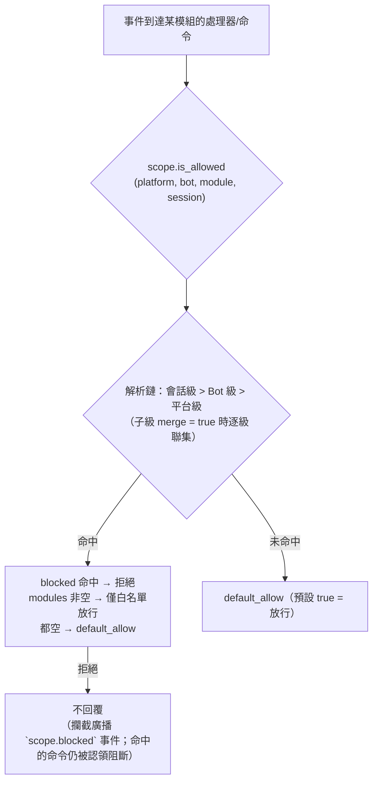
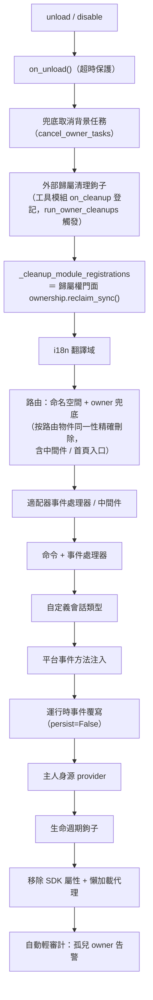
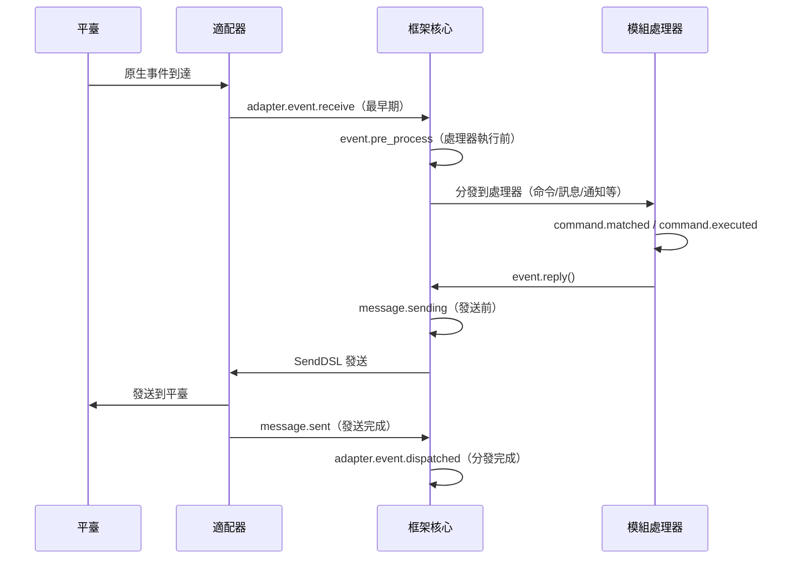

# ErisPulse 权限作用域与归属权

This skill is auto-built from the ErisPulse documentation.
Repository: https://github.com/ErisPulse/ErisPulse
Source paths are annotated per section; see docs/ in the repository for the latest content.

## 内容大纲

AI 按需读取：只读需要的章节即可，不必全文加载。

- 作用域: 51-95 行
- 匹配條目語法（全系統統一）: 97-110 行
- 全局兜底：`default_allow`: 112-126 行
- 配置檔案: 128-161 行
- ① 模組維度: 163-208 行
- ② 身份維度（事件准入）: 210-227 行
- ③ 出站維度（限制模組發起出站呼叫）: 229-279 行
- 運行時 API: 281-383 行
- 拦截可觀測：`scope.blocked` 事件: 385-408 行
- 緩存與熱更新: 410-416 行
- 配置格式校驗: 418-422 行
- 常見問題與注意事項: 424-462 行
- 拓撲樹 API: 464-500 行
- 相關文件: 502-509 行
- 归属权: 511-533 行
- owner 上下文機制: 535-558 行
- 歸屬資源全景: 560-594 行
- 卸載 / 禁用清理序列: 596-621 行
- 歸屬權統一門面（ownership）: 623-650 行
- 熱重載失敗回滾: 652-663 行
- 設計邊界：哪些資源不隨卸載清理: 665-678 行
- 內部實現：歸屬如何運作: 680-731 行
- 模組作者指南: 733-785 行
- 工具模組指南：託管其他模組的句柄: 787-834 行
- 相關文件: 836-843 行
- 生命周期: 845-870 行
- 事件處理機制: 872-976 行
- 鉤子斷點一覽: 978-1192 行
- 標準事件定義: 1194-1218 行
- 完整 API 參考: 1220-1256 行
- 模組中使用示例: 1258-1283 行
- 背景任務歸屬與自動取消: 1285-1314 行
- 注意事項: 1316-1324 行
- 相關文件: 1326-1335 行

## 作用域

> 来源: `docs/zh-TW/advanced/scope.md`（https://github.com/ErisPulse/ErisPulse/blob/main/docs/zh-TW/advanced/scope.md）

# 作用域（scope）

> [!TIP]
> **什麼時候需要讀這篇**：需要控制模組可用性、事件准入或出站動作限制時。不需要則跳過，不影響其它功能的使用。

> **讀完你會知道**：三個作用域維度（模組可用性 / 事件准入 / 出站動作）各自的配置路徑、
> 判定優先級與拒絕行為，執行階段 API 的用法，以及攔截如何可觀測（`scope.blocked` 事件）。
>
> **本篇不涉及**：資源的歸屬與卸載回收（見[歸屬權（owner）系統](ownership.md)）；
> 命令 ACL 與事件覆寫（見[事件處理入門](../getting-started/event-handling.md)）。

> [!NOTE]
> 本功能需要 ErisPulse **2.8.0+**。

作用域回答四個問題：**哪些模組可用、誰的事件收不收、某模組處理什麼文字、
模組能向外做什麼**。
控制權完全交給使用者：在模組 / 配接器 / 處理器 / 出站呼叫註冊的**上層**（配置
`ErisPulse.scope` 或執行階段 `sdk.scope`）統一宣告，事件管線在入口、處理器過濾
與出站閘口自動讀取並執行。

| 維度 | 控制什麼 | 拒絕行為 | 配置路徑 |
|------|---------|---------|---------|
| **① 模組** | 哪些模組可用（平台 / Bot / 會話三級） | 被過濾模組不觸發、不回覆（攔截廣播 `scope.blocked` 事件；命中的命令仍被認領阻斷） | `scope.platforms / bots / sessions` |
| **② 身分** | 事件收不收（配接器 / Bot / 會話 / 使用者四級） | 入口完全丟棄（攔截廣播 `scope.blocked` 事件） | `scope.identity.*` |
| **③ 出站** | 模組能發起哪些出站呼叫（訊息 / API / 請求，方法級白黑名單） | 失敗回應（`retcode=34601`） | `scope.actions` |

> **相關系統**：命令是特殊的訊息事件處理器，其使用者黑白名單（ACL）與
> 實作參數覆寫由命令系統自持（`ErisPulse.event.command`），
> 見 [事件處理入門](../getting-started/event-handling.md) 與 [配置指南](../user-guide/configuration.md)。

{!--< tips >!--}
1. 透過 `from ErisPulse.Core import scope` 匯入單例（`sdk.scope` 同物件）
2. 判定：`scope.is_allowed(...)` / `scope.is_identity_allowed(...)` /
   `scope.is_action_allowed(...)` 對應 ①②③ 三個閘口
3. 讀寫：維度化參數方法（IDE 可補全）——
   `scope.set_module(...)` / `scope.set_identity(...)` / `scope.set_action(...)`；
   另有字典式兜底 `scope.get(path)` / `scope.set(path, v)` / `scope.delete(path)`
4. 事件處理器文字條件覆寫見
   [事件處理入門 · 事件覆寫](../getting-started/event-handling.md#事件覆寫不改模組程式碼覆寫任意事件類型的行為)；
   命令 ACL / 參數覆寫見[事件處理入門](../getting-started/event-handling.md)
{!--< /tips >!--}

## 匹配條目語法（全系統統一）

作用域所有"名字列表"（模組名、身份鍵、出站條目）共用同一套匹配語法
（`ErisPulse.Core.text_match`）：

| 語法 | 示例 | 說明 |
|------|------|------|
| 精確名 | `"Chat"` | 全值比較，**大小寫不敏感** |
| glob | `"Tool*"`、`"spam_*"` | `*` 任意串 / `?` 单字符 / `[seq]` 字符集，大小寫不敏感 |
| 正則 | `"re:^Danger.*"` | 以 `re:` 前綴聲明，正則 `search` 匹配，預設大小寫不敏感 |

- 非法正則**靜默降級**為"不匹配"（不拋錯、不崩潰）
- 裝飾器參數（`pattern=` / `regex=`）為固定語義：`pattern` 是 glob、`regex` 是正則源碼
  （不加 `re:` 前綴）；作用域配置裡的正則條目**必須**帶 `re:` 前綴

## 全局兜底：`default_allow`

`default_allow` 是**全局唯一**的兜底開關（預設 `true`），
對兩個判定維度統一生效：

- **模組維度**：未命中任何綁定 → `default_allow` 決定放行 / 拒絕
- **身份維度**：未命中任何策略 → `default_allow` 決定放行 / 拒絕

設為 `false` 即開啟"隱式拒絕"嚴格模式：白名單式管理，
**沒顯式允許的一律拒絕**。

> **例外**：③ 出站維度**不受** `default_allow` 影響——它是獨立的緊收開關，
> 預設全允許，僅顯式規則才限制（框架層 owner 為空的呼叫恆放行）。
> 這樣嚴格的全局模式不會意外掐斷所有模組的訊息回覆。
> 命令 ACL 有獨立的 `ErisPulse.event.command.default_allow` 兜底，互不影響。

## 配置檔案

```toml
[ErisPulse.scope]
default_allow = true        # 全局兜底（false = 隱式拒絕嚴格模式）
cache_size = 1024           # LRU 緩存大小

# ── ① 模組維度（優先級：會話 > Bot > 平台）──
[ErisPulse.scope.platforms.onebot11]
modules = ["Chat", "Tool*"]   # 白名單：精確名 / glob / re: 正則
blocked = ["re:^Danger"]
[ErisPulse.scope.bots.onebot11."123456"]
modules = ["Chat"]
merge = true                  # 在平台級綁定基礎上追加（預設整體覆蓋）
[ErisPulse.scope.sessions.onebot11."789012345"]
modules = ["Chat"]

# ── ② 身份維度（優先級：用戶 > 會話 > Bot > 適配器）──
[ErisPulse.scope.identity.adapters.onebot11]
deny = true                   # 整個適配器的事件全部丟棄
[ErisPulse.scope.identity.bots.onebot11."123456"]
deny = true
[ErisPulse.scope.identity.sessions.onebot11."g_blocked"]
deny = true
[ErisPulse.scope.identity.users.onebot11]
allow = ["u_admin"]           # 用戶鍵支援 glob / re: 正則
deny = ["u_bad", "spam_*"]

# ── ③ 出站維度（預設全允許，顯式緊收才禁）──
[ErisPulse.scope.actions.MyModule]
send = { deny = true }                                    # 全禁發送
api = { allow = ["get_*"] }                               # 僅允許查詢類標準 API
request = { deny = true }                                 # 禁止處理請求
```

## ① 模組維度

**一句話**：按平台 / Bot / 會話三級綁定控制「這個上下文裡哪些模組可用」，被過濾模組不觸發、不回覆（命中的命令仍被認領阻斷）。

回答「某個上下文裡，哪些模組可用」。預設全部開放；配置綁定後才開始過濾，
**模組與適配器無需任何改動**。



- **解析優先級：會話級 > Bot 級 > 平台級**，高優先級綁定**整體覆蓋**低優先級；
  子級綁定寫 `merge = true` 時改為與低優先級**逐條目聯集**（modules / blocked 各自合併，
  `merge` 本身是控制鍵，不算條目）
- **預設語義**：被過濾模組的命令與處理器不觸發、不回覆，TRACE 級日誌可見
  （`core.scope.denied`）；攔截同時廣播 `scope.blocked` 生命週期事件（訂閱
  即可觀測誰被攔、為何被攔）；命中的**命令**仍會被認領阻斷——命令文字不再漏給
  低優先級訊息處理器，消除「命令被拒後訊息處理器又回應一次」的雙重回應歧義
- **框架級處理器**（`scope_exempt=True` 或 owner 為空）不受影響；模組名為空（框架層資源）始終放行
- **會話感知說明與命令查詢**：命令查詢 API（`command.help` /
  `get_command` / `get_commands` / `get_group_commands` / `get_visible_commands`，
  以及 `module.get_commands_overview`）均支援可選 `event=` 或顯式
  `platform=` / `bot_id=` / `session_id=` 關鍵字——當前會話不可用模組的命令
  不再出現在結果中（`get_command` 回傳 None、單命令說明按「未註冊」處理，
  與預設語義一致）；不傳上下文則保持全量行為

### 綁定繼承（merge）

預設整體覆蓋的語義清晰可預測；需要在上級基礎上**追加**時，在子級寫 `merge = true`：

```toml
[ErisPulse.scope.platforms.onebot11]
modules = ["Chat", "Tool"]      # 平台級：允許 Chat、Tool

[ErisPulse.scope.bots.onebot11."123456"]
modules = ["Music"]
merge = true                    # 該 Bot 實際生效 = ["Chat", "Tool", "Music"]
```

- 合併規則：`modules` 與 `blocked` 各自取**聯集**；綁定內 `blocked` 仍優先於 `modules`
- 鏈式合併：平台 → Bot → 會話逐級疊加，每一級獨立決定 `merge` 或覆蓋

## ② 身份維度（事件准入）

**一句話**：按用戶 / 會話 / Bot / 適配器四級策略在分發入口完全丟棄「不該收的事件」，deny 優先於 allow。

回答「誰的事件收不收」。被拒絕的事件在**分發入口完全丟棄**——
不進入中介軟體與任何處理器（含框架級），僅 TRACE 級日誌可見（`core.scope.identity_denied`）。

- **解析優先級：用戶 > 會話 > Bot > 適配器**，取最具體的已配置策略；deny 優先於 allow
- 每級綁定是二元策略：`{ allow = true }` 或 `{ deny = true }`
- 用戶鍵支援 glob / 正規表示式（如 `"spam_*"` 封鎖一批垃圾用戶）
- 典型用法——上級 deny、個人 allow 做「例外放行」：

```toml
[ErisPulse.scope.identity.adapters.onebot11]
deny = true
[ErisPulse.scope.identity.users.onebot11]
allow = ["u_admin"]   # 即使適配器級拒絕，u_admin 的事件仍然放行
```

## ③ 出站維度（限制模組發起出站呼叫）

**一句話**：以方法級白黑名單約束模組發起的訊息 / API / 請求呼叫，被拒呼叫不發起任何網路請求、直接回傳 `retcode=34601`。

約束模組**發起的出站動作**：訊息傳送 / 標準 API 動作 / 請求操作。
三類動作對應底層 DSL：`Event.reply` 與 `Send`（send）、`Api` / `call_api`（api）、
`Request` 的 accept/reject（request）。模組在事件 handler 執行期發起的出站呼叫
攜帶模組 owner，由本維度統一判定。

### 規則形態（內聯表）

每個動作的規則是一張內聯表：`{ allow = [...], deny = true|[...] }`。
同一動作只能有一種規則（TOML 鍵不可重複，全禁與細粒度二選一）：

```toml
[ErisPulse.scope.actions.MyModule]
send = { deny = true }                                  # 全禁傳送（Event.reply / Send DSL）
# 或方法級細粒度：send = { allow = ["Text", "Image*"], deny = ["File"] }
api = { allow = ["get_*"] }                             # 僅放行查詢類標準 API
# 或動作級黑名單：api = { deny = ["set_*", "leave_*"] }
request = { deny = true }                               # 禁止處理請求 accept/reject
```

- `send` 的條目符合**傳送方法名**（`Text` / `Image` / `File` ...），
  `api` 的條目符合**標準動作名**（`get_group_info` / `set_group_name` ...）
- 條目支援精確名 / glob / `re:` 正規表示式（與全系統統一語法一致，不區分大小寫）
- `allow` 寫單個字串等價於單條目列表：`send = { allow = "Text" }`

### 判定語義

**預設全允許**——未設定、或 owner 為空（框架層內部呼叫）均放行。
設定規則後按以下順序判定：

1. `deny = true` → 拒絕
2. `deny` 列表命中呼叫名 → 拒絕
3. `allow` 列表非空且呼叫名未命中（或呼叫無名稱）→ 拒絕
4. 其餘放行

被拒呼叫不發起任何網路請求，直接回傳標準失敗回應
（`retcode = 34601`，見 [api-response §5.3](../standards/api-response.md#53-框架擴充回傳碼34xxx-平台錯誤段的低三位自訂)）。
三個動作互相獨立，可只限其一。

```python
# 執行階段 API
sdk.scope.set_action("MyModule", "send", deny=True)              # 全禁傳訊息
sdk.scope.set_action("MyModule", "send", allow=["Text"])         # 僅允許傳文字
sdk.scope.is_action_allowed("MyModule", "send", name="Image")    # False
sdk.scope.is_action_allowed("MyModule", "api", name="get_user_info")  # 按規則判定
sdk.scope.delete_action("MyModule", "send")                      # 恢復允許
sdk.scope.get_action("MyModule", "send")                         # 該動作目前規則
```

## 運行時 API

作用域運行時 API 分三層：**判定**（三問）、**維度化讀寫**（每維 `set` / `get` / `delete`
參數化方法，簽名全類型標註，IDE 可補全）、**字典式兜底**（點分路徑直達任意節）。

```python
from ErisPulse import sdk

scope = sdk.scope
```

### 判定（三問）

```python
scope.is_allowed("onebot11", "123456", "Chat")                 # ① 模組維度
scope.is_allowed("onebot11", "123456", "Chat", "789012345")    # 含會話級
scope.is_allowed("onebot11", "123456", None)                   # 框架層資源 -> True

scope.is_identity_allowed("onebot11", "123456", "group_9", "u1")   # ② 身份維度

scope.is_action_allowed("MyModule", "send")                    # ④ 出站維度
scope.is_action_allowed("MyModule", "send", name="Image")      # 方法級細粒度
```

### ① 模組維度

```python
# 綁定（層級由參數決定：session_id > bot_id > 平台級）
scope.set_module("onebot11", bot_id="123456", modules=["Chat", "Tool*"])
scope.set_module("onebot11", blocked=["re:^Danger"])                       # 平台級
scope.set_module("onebot11", bot_id="123456", session_id="g9", modules=["Chat"])  # 會話級
scope.set_module("onebot11", bot_id="123456", modules=["Music"], merge=True)      # 與現有條目並集
scope.set_module("onebot11", bot_id="123456", modules=["Chat"], persist=False)    # 僅運行時

# 讀 / 刪
scope.get_module("onebot11", bot_id="123456")   # {"modules": ["Chat"], "blocked": []}
scope.delete_module("onebot11", bot_id="123456")
```

> `merge=True` 是**寫時並集**（與該級現有綁定合併條目）；跨級解析期的
> `merge = true` 配置鍵見上文[綁定繼承](#綁定繼承merge)——兩者是獨立機制。

> **運行時綁定（`persist=False`）語義**：運行時綁定保存在獨立的覆蓋層中，
> **任意後續配置寫入 / 配置檔案熱更新都不會沖掉它們**（配置樹重建後按寫入順序
> 自動重放，含運行時刪除）。它們不落盤，進程重啟後丟失；模組卸載時該模組寫入的
> 運行時綁定會被兜底清理。隨後對同一路徑執行 `persist=True` 寫入（用戶持久化語義）
> 將取代運行時規則。

### ② 身份維度

```python
# 綁定策略（層級由參數決定：user > session > bot > adapter；allow / deny 二選一）
scope.set_identity("onebot11", user_id="u_bad", deny=True)
scope.set_identity("onebot11", user_id="spam_*", deny=True)    # 鍵支援 glob / re: 正則
scope.set_identity("onebot11", bot_id="123456", session_id="g9", allow=True)

# 讀 / 刪
scope.get_identity("onebot11", user_id="u_bad")   # {"deny": True}
scope.delete_identity("onebot11", user_id="u_bad")
```

### ③ 出站維度

```python
# 設置限制規則（allow: str|list；deny: bool|str|list；整規則替換語義）
scope.set_action("MyModule", "send", deny=True)                    # 全禁發送
scope.set_action("MyModule", "send", allow=["Text"])               # 僅允許發文本
scope.set_action("MyModule", "api", deny=["set_*", "leave_*"])     # 禁管理類 API

# 讀 / 刪
scope.get_action("MyModule", "send")       # {"allow": ["Text"]} 原始規則
scope.delete_action("MyModule", "send")    # 移除單動作
scope.delete_action("MyModule")            # 移除該模組全部動作限制
```

### 通用

```python
scope.get("platforms")   # 字典式兜底：點分路徑讀任意節
scope.topology()         # 全量配置樹（供 Dashboard）
scope.stats()
# {"module_calls": .., "module_filtered": .., "identity_checks": .., "identity_denied": ..,
#  "action_checks": .., "action_denied": .., "cache_hits": .., "cache_misses": ..}
scope.reset_stats()
scope.clear()           # 清空全部配置（僅記憶體生效）
```

### 高級：字典式點分路徑兜底

維度化方法覆蓋日常場景；需要直達任意節點（或未來新增的維度）時，
可用字典式 API——`get` / `set` / `delete` 接受點分路徑（dict 深合併、寫後立讀），
並提供 `scope[path]` / `scope[path] = v` / `del scope[path]` / `path in scope` 協議：

```python
scope.set("bots.onebot11.123456", {"modules": ["Chat"], "blocked": []})
scope.set("identity.users.onebot11.u_bad", {"deny": True})
scope.get("actions.MyModule.send")

scope["platforms.onebot11"]        # 讀（不存在拋 KeyError）
scope["platforms.onebot11"] = {...}  # 寫
del scope["platforms.onebot11"]      # 刪
"actions.MyModule" in scope          # 存在性
```

## 拦截可觀測：`scope.blocked` 事件

作用域攔截（模組過濾 / 身份拒絕）發生時會廣播生命週期事件 **`scope.blocked`**，
讓"誰被擋、在哪一層被擋"可訂閱、可統計、可在 Dashboard 呈現——攔截預設
不回覆，但不再是不可知的黑盒。

| 字段 | 說明 |
|------|------|
| `dimension` | `"module"`（模組維度過濾）/ `"identity"`（身份准入拒絕） |
| `module` | 被過濾的模組名（僅模組維度） |
| `platform` / `bot_id` / `session_id` / `user_id` | 攔截發生的來源上下文 |

```python
from ErisPulse.Core.lifecycle import lifecycle

@lifecycle.on("scope.blocked")
def on_blocked(data):
    print(f"已攔截：{data['dimension']} {data.get('module') or data.get('user_id')}")
```

- 事件經 `fire` 後台廣播（無監聽者時零開銷，不拖熱路徑）
- 緩存命中的重複攔截**不**重複廣播——同一組合只在緩存失效時廣播一次
- 與 `adapter.event.blocked`（中間件否決）相區分：那個是事件級丟棄，本
  事件是作用域准入門的模組 / 身份過濾

## 緩存與熱更新

- `is_allowed` / `is_identity_allowed` / `is_action_allowed` 結果帶 **LRU 緩存**
  （`scope.cache_size` 可調），`set` / `delete` /
  配置熱更新（`config.updated` / `config.set`）自動失效
- 所有維度配置改了**立即生效**，無需重啟
- 作用域是"逐事件"判斷，不跨事件記憶：配置變了，下一條事件即按新規則

## 配置格式校驗

加載 / 熱更新時逐節校驗配置格式：類型錯誤的節（如 `platforms` 寫成了字串）、
非法的出站規則（如 `allow` 寫成數字）、未知動作名、未知的頂層鍵（如 `alow` 拼寫錯誤）
會輸出 **WARNING** 並忽略對應節 / 條目，其餘合法配置照常生效——寫錯不再靜默失效。

## 常見問題與注意事項

### 1. 配置層級與覆蓋

- 模組維度：會話級 > Bot 級 > 平台級，**整體覆蓋**（子級 `merge = true` 時逐條目並集）。
  想"平台允許 Chat，Bot 再加 Music"，可在 Bot 級寫 `merge = true`，或同時列出兩者
- 身份維度：用戶 > 會話 > Bot > 適配器，取**最具體**的已配置策略（可做例外放行）
- 命令用戶黑白名單：精確命令名優先於 glob 鍵（見 `event.command.acl`）

### 2. 模組/命令沒反應

先懷疑作用域而不是模組本身：

```python
from ErisPulse import sdk

print(sdk.scope.is_allowed(event.get_platform(), bot_id, "MyModule", session_id))
print(sdk.scope.is_identity_allowed(event.get_platform(), bot_id, session_id, user_id))
print(sdk.scope.stats())   # module_filtered / identity_denied > 0 說明有攔截記錄
```

被過濾預設不回覆（模組維度與身份維度，避免暴露規則），但會廣播 `scope.blocked` 生命週期事件、統計持續累計；
命令維度被 ACL 拒絕會顯式回覆"權限不足"。

### 3. 出站動作被拒時排查

```python
from ErisPulse import sdk

print(sdk.scope.get("actions.MyModule"))
print(sdk.scope.stats())   # action_denied > 0 說明有呼叫被攔截
```

攔截是**顯式**的：被拒呼叫返回 `retcode = 34601` 的標準失敗回應（不發起網路請求）。

### 4. 會話標識跨平台隔離

`(platform, session_id)` 組合才是唯一標識。`scope.sessions.onebot11."789"`
只作用於 onebot11，不影響 telegram 上同為 `789` 的會話。身份維度的用戶鍵同理。

## 拓撲樹 API

`ModuleManager.get_topology()` 與 `AdapterManager.get_topology()` 提供模組/適配器歸屬關係資料，
`sdk.get_topology()` 一鍵聚合（含作用域 `scope`）：

```python
from ErisPulse import sdk

topology = sdk.get_topology()
# {
#   "modules": {                                   # 模組 → 擁有的資源
#     "Chat": {
#       "loaded": True, "enabled": True,
#       "commands": ["chat", "translate"],
#       "handlers": {"message": 2, "notice": 1},
#       "routes": {"http": ["/Chat/api"], "ws": [], "sse": []},
#       "lifecycle_hooks": 3,
#     }
#   },
#   "adapters": {                                  # 適配器 → Bot → 作用域
#     "onebot11": {
#       "status": "started", "enabled": True,
#       "bots": {"123456": {"status": "online", "scope": {...}}},
#       "scope": {"modules": [...], "blocked": [...]},
#     }
#   },
#   "scope": {                                     # 作用域（模組 / 身份 / 出站動作）
#     "platforms": {...}, "bots": {...}, "sessions": {...},
#     "identity": {"adapters": {...}, "bots": {...}, "sessions": {...}, "users": {...}},
#     "actions": {...},
#   },
# }
```

- 模組拓撲聚合了該模組註冊的命令、事件處理器、HTTP/WS/SSE 路由與生命週期鉤子，便於繪製模組資源樹。
- 適配器拓撲聚合了各適配器狀態、下屬 Bot 狀態及平台級/Bot 級作用域綁定（模組維度）。
- **JSON 安全輸出**：`get_topology(json_safe=...)` 預設 `True`，返回的結構可直接 `json.dumps`——模組 `info` 僅保留純資料的 `meta` 子表（丟棄 `module_class` / `strategy` 等執行時物件），並對其餘節點（含適配器作者塞入 Bot `info` 的任意物件）做兜底淨化（類物件取 `__name__`、不可序列化物件退化 `str()`）。Dashboard / WebUI 可直接序列化返回；需要原始物件時傳 `json_safe=False`。

## 相關文件

依下一步意圖選擇：

- **想控制資源歸屬與卸載回收** → [歸屬權（owner）系統](ownership.md)——作用域管「資源是否生效」，歸屬權管「資源歸誰、誰卸載時被回收」
- **想稽核跨模組呼叫** → [模組間通訊](module-communication.md)——`module.call` 如何以呼叫方身分通過出站閘口
- **想灰度發布模組新版本** → [影子模組與灰度轉正](shadow.md)——以獨立 owner 並行試運行
- **查配置節寫法與熱更新行為** → [配置指南](../user-guide/configuration.md)

## 归属权

> 来源: `docs/zh-TW/advanced/ownership.md`（https://github.com/ErisPulse/ErisPulse/blob/main/docs/zh-TW/advanced/ownership.md）

# 所屬權（owner）系統

> [!TIP]  
> **何時需要閱讀本文**：排查資源洩漏、理解卸載清理鏈路或宣告所屬資源時。不需要則跳過，不會影響其他功能的使用。

> **閱讀完你將知道**：owner 上下文如何自動歸屬資源、所屬資源全景表、卸載/禁用時清理鏈的完整時序，以及哪些資源不會隨卸載清理（設計邊界）。
>
> **本文不涉及**：資源「何時生效」的權限判定（見[作用域（scope）](scope.md)）；後台任務的推薦寫法與強制取消邊界（見[生命週期管理 · 後台任務歸屬與自動取消](lifecycle.md#後台任務歸屬與自動取消)）。

所屬權是模組「即插即用」的基石：模組在載入期間註冊的一切框架資源會自動記名，卸載/禁用時按記名一鍵回收——模組作者只需宣告資源，無需手寫清理邏輯。

> **相關系統**：作用域（scope）在事件分發時決定「資源是否生效」，所屬權在生命週期中決定「資源歸誰、誰卸載時被回收」。作用域詳見[統一控制面（scope）](scope.md)，後台任務詳見 [生命週期管理](lifecycle.md#後台任務歸屬與自動取消)。

{!--< tips >!--}
1. 所屬權在**註冊瞬間**按 `current_owner` 自動記錄，模組程式碼無需修改
2. 卸載/禁用共用同一條清理鏈（`_cleanup_module_registrations`），每一步失敗僅發出警告而不中斷
3. 用戶設定語意的資源（持久化覆寫 / scope 規則 / 命令 ACL）**不**會隨模組卸載清理
4. 工具模組托管的外部句柄可用 `on_cleanup(cb)` 掛入清理鏈，對方模組卸載時自動回呼（見[工具模組指南](#工具模組指南托管其它模組的句柄)）
{!--< /tips >!--}

## owner 上下文機制

owner 透過上下文變數 `current_owner` 傳遞（`ErisPulse.runtime.context`）：

```python
from ErisPulse.runtime import owner_scope, get_current_owner

with owner_scope("MyModule"):
    # 此區間內註冊的一切資源自動歸屬 MyModule
    assert get_current_owner() == "MyModule"
```

框架在以下時機自動注入 owner（模組/適配器程式碼無需手動包裝）：

| 時機 | owner 值 | 位置 |
|------|----------|------|
| 模組 `load()` | 模組名 | 實例化 + `on_load` 全程 |
| 適配器 `start()` / `restart()` | 平台名 | 適配器啟動全程 |
| `activate_on` 慢載入 stub 註冊 | 模組名 | 占位命令/處理器註冊 |
| 事件處理器執行期 | 處理器歸屬模組名 | handler / 命令入口重注入 |

執行期重注入意味著：模組在 `on_load` 裡宣告的命令處理器**執行中**呼叫
註冊型 API（如 `sdk.adapter.on()`、`overrides.*.set(persist=False)`），
同樣會自動歸屬本模組。

## 歸屬資源全景

模組在載入上下文內註冊的以下資源均記錄歸屬，卸載/禁用時自動回收：

| 資源 | 註冊方式 | 清理調用 |
|------|----------|----------|
| 命令 | `@command()` / 命令 dict 聲明 | `command.unregister_by_owner()` |
| 事件處理器 | `@message` / `@notice` / `@request` / `@meta` | `handler.unregister_by_owner()` |
| 適配器事件監聽 | `sdk.adapter.on()` / `raw=True` | `adapter.unregister_handlers_by_owner()` |
| 適配器中間件 | `@sdk.adapter.middleware` | 同上 |
| 路由（HTTP/WS/SSE） | `router.http()` / `websocket()` / `sse()` | 按命名空間 + 按 owner 雙重兜底 |
| 路由中間件 | `@router.middleware()` / `add_middleware()` | `router.unregister_all_by_owner()` |
| Dashboard 首頁入口 | `router.register_home_entry()` | `unregister_home_entries_by_owner()` |
| 自定義會話類型 | `register_custom_type()` | `unregister_custom_types_by_owner()` |
| 平台事件方法注入 | `register_event_method()` / `register_event_mixin()` | `unregister_event_methods_by_owner()`（模組卸載自動回收，舊閉包不再泄漏） |
| 後台任務 | `self.spawn()` | `cancel_owner_tasks()` |
| 外部歸屬清理鈎子（工具模組托管） | `runtime.on_cleanup(cb)` | `run_owner_cleanups()`（卸載/禁用/適配器關閉鏈內觸發） |
| 生命週期鈎子 | `lifecycle.register()` | `lifecycle.unregister_by_owner()` |
| 主人身源 provider | `master.provider` | `master.unregister_by_owner()` |
| i18n 翻譯鍵 | `I18nClass` 聲明（domain=模組名） | `i18n.unregister_domain()` |
| 事件覆寫（執行時） | `overrides.*.set(persist=False)` | `overrides.unregister_by_owner()` |
| 互動會話（wait_reply 等待 / 租約） | `event.wait_reply()` / `sdk.interaction.acquire()` | `interaction.cancel_by_owner()`（等待方立即收到取消） |
| 上下文數據 | `runtime/context` 按 owner 記錄 | 按模組精確清理 |

適配器側的對應資源（以平台名為 owner）在適配器 `shutdown()` / `restart()`
時由 `_cleanup_adapter_resources` 回收，另含：

| 資源 | 清理調用 |
|------|----------|
| 適配器自有的 `on()` 處理器與中間件 | `adapter.unregister_handlers_by_owner(platform)` |
| 平台事件方法擴展（`EventMixin`） | `unregister_platform_event_methods(platform)` |
| 自定義會話類型 | `unregister_custom_types_by_owner(platform)` |
| 互動會話（該平台掛起的 wait_reply / 租約） | `interaction.cancel_by_platform(platform)` |
| i18n 翻譯域（domain=配置鍵） | `i18n.unregister_domain(配置鍵)` |
| 細顆粒命名空間路由 | `router.unregister_all_by_owner(platform)` |

## 卸載 / 禁用清理序列

`unload()` 與 `disable()` 共用同一条清理鏈（每步獨立 try/except，失敗僅記日誌，**不中斷後續清理**）：



`sdk.uninit()` 退出時另有全局兜底：全部適配器 shutdown → 全部模組 unload →
`router.stop()`（清空路由 / 中間件 / 首頁入口）→ `cancel_all_background_tasks()` →
清空事件處理器與鉤子。

## 歸屬權統一門面（ownership）

清理鏈的十六個步驟收斂在歸屬權統一門面 `ErisPulse.Core.ownership` 下，  
四個動詞覆蓋「註銷、計數、掃描、審計」——子系統各自的 `*_by_owner` 註銷  
函數保持不變，作為門面的內部實現：

| 動詞 | 用途 |
|------|------|
| `ownership.reclaim(owner)` | 統一註銷 owner 名下全部資源（任務取消 → 清理鉤子 → 註冊類資源；異步完整版） |
| `ownership.reclaim_sync(owner)` | 註冊類資源註銷（同步版，供同步卸載路徑） |
| `ownership.counts(owner=None)` | 只讀統計 owner 在冊資源（None 為全部 owner） |
| `ownership.orphans()` | 孤兒掃描：資源在冊而 owner 已註銷（泄漏實錘清單） |
| `ownership.audit(owner, deep=)` | 泄漏審計報告（計數 + 孤兒 + 可選 gc 實例普查） |

```python
from ErisPulse.Core import ownership

ownership.reclaim_sync("MyModule")       # {'commands': 1, 'routes_http': 2, ...}
ownership.counts("MyModule")             # 在冊資源計數
ownership.orphans()                      # [{"owner": "ghost", "total": 2, ...}]
```

**審計入口**：

- 卸載 / 重載後**自動輕審計**：發現孤兒 owner 資源即 WARNING 告警（零開銷計數掃描）
- `sdk.module.audit(name, deep=True)`：模組實例 gc 普查——實例不可回收時  
  給出引用方類型（定位「誰攥著舊實例」）；有全局暫停開銷，僅顯式排障使用
- 深普查屬顯式操作，不設配置鍵、不做自動修復

## 熱重載失敗回滾

熱重載改為 "**卸載前快照 → 失敗自動恢復**"：當新版本出現語法錯誤、依賴缺失、
加載失敗時，舊實例與註冊狀態（註冊表條目、sdk 屬性、sys.modules 條目）
會自動還原，服務不中斷，並在日誌中提示「已回滾到舊實例繼續服務」。

盡力而為語義（文件化的邊界）：

- `on_unload` 已執行的副作用（斷開的連接、取消的任務）不可撤銷——
  恢復後舊實例處於「已收尾」狀態，需再次觸發加載才能完全可用
- 第三方在執行期手動緩存的對舊實例的引用不在恢復範圍內
- 目標包已被卸載（entry-point 消失）視作卸載成功，不做回滾

## 設計邊界：哪些資源不隨卸載清理

所有權只回收**模組程式碼註冊的執行時資源**。以下資源屬**用戶配置語意**
（控制權在用戶，可能刻意配置），模組卸載後隨配置持久保留：

| 資源 | 語意 | 說明 |
|------|------|------|
| `overrides.*.set(persist=True)` | 持久化覆寫 | 寫入配置檔案，跨重啟生效；模組卸載不刪（用戶顯式配置） |
| `scope.set_action()` 等作用域規則 | 權限控制面 | 由用戶/Dashboard 管理，卸載模組不回收規則 |
| `overrides.acl.set(persist=True)` | 命令 ACL | 同上 |
| Conversation `save()` 持久化 | 多輪對話存檔 | 數據資產不清理 |

執行時臨時寫入（`persist=False`）則隨 owner 回收——**持久化與否即**
"用戶資產"與"模組執行時狀態"的分界線。

## 內部實現：歸屬如何運作

**一句話**：歸因鏈（contextvar 传播）決定「記在誰頭上」，取消鏈（任務登記表）決定「卸載時能否被取消」——兩條鏈路獨立運作，資源被正確清理需二者兼備。

歸屬系統由**兩條獨立鏈路**構成，理解它們的分工是排查歸屬問題的前提：

### 歸因鏈（contextvar 传播）

`runtime/context.py` 的 `current_owner` 等 ContextVar 負責**歸因**——  
「此刻這段代碼註冊的資源 / 發起的調用記在誰頭上」。傳播規則遵循 Python  
contextvars 語義：

| 執行路徑 | context 是否傳播 | 歸因結果 |
|---------|----------------|---------|
| 同步調用鏈 / `await` 鏈 | ✅ 傳播 | 正確歸因 |
| `owner_scope` 內 `asyncio.create_task` | ✅ 傳播（task 拷貝創建時刻的 context） | 任務**內部**的框架調用正確歸因 |
| `run_in_executor` / 裸線程 | ❌ 不傳播 | 歸因丟失 |
| 自建事件循環 | ❌ 不傳播 | 歸因丟失 |

> 歸因 ≠ 登記：context 傳播只影響「記在誰頭上」，資源能否被清理  
> 取決於是否進入了下述取消鏈。

### 取消鏈（任務登記表）

`runtime/tasks.py` 的 `_owner_tasks` 登記表負責**生命週期**——  
「owner 名下有哪些未完成任務，卸載時統一取消」。任務進入登記表的途徑：

1. **顯式調度**：`spawn_background()` / `self.spawn()` → 創建時捕獲  
   `current_owner`（或顯式 `owner=` 參數）→ 登記入表；
2. **Task Factory 自動登記**（2.8.3）：`install_owner_task_factory()`  
   在框架啟動時安裝到主事件循環——**任何**任務創建（含第三方庫內部的  
   `create_task`）經過工廠時讀取 `current_owner`，非 None 即登記。

登記表自清理：每個任務帶 `done_callback`，完成即從表中移除，無泄漏。

### 取消時序（模組卸載）

```
module.unload()
  → on_unload(event)                    # 模組自行清理（兜底超時保護）
  → 框架註銷該 owner 的命令/事件/鉤子/路由
  → cancel_owner_tasks(owner)           # 任務登記表兜底取消
      → 逐個 task.cancel()              # 排除當前執行取消邏輯的任務自身
      → await gather(pending, timeout)  # 等待回收（超時不再阻塞）
```

### 排查思路

- **資源沒被清理** → 查登記表：`get_owner_tasks("MyModule")` 是否含該任務；  
  不含即註冊路徑未經過歸屬鏈（import 期 / 線程 / 獨立循環），對照上表定位。
- **歸因錯誤** → 查 `get_current_owner()` 在出錯時刻的值；異步延遲執行  
  （回調 / 任務）的歸因取自創建時刻 context，而非執行時刻。

## 模組作者指南

### 推薦寫法

```python
from ErisPulse import sdk
from ErisPulse.Core.Event import command
from ErisPulse.runtime import owner_scope, spawn_background

class MyModule(BaseModule):
    async def on_load(self, event):
        # 框架資源：自動歸屬，無需手動清理
        self.task = self.spawn(self.polling())      # 背景任務
        sdk.router.register_home_entry("我的模組", "/my")  # 首頁入口

        # 模組自有資源：包進 owner_scope 即納入所有權體系
        with owner_scope("MyModule"):
            self.client.on_event(self._handle)      # 假想的自定義註冊

    async def on_unload(self, event):
        # 框架資源已被自動回收，只需清理 owner_scope 覆蓋不到的自有資源
        await self.client.close()
```

### 注意事項

- **import 期註冊無所有權**：模組頂層（import 時）註冊的鈎子/處理器發生在
  `owner_scope` 之前，會被視為框架級資源（owner=None）而**不被清理**。
  一律放到 `on_load()` 內註冊。
- **自定義 domain 的 i18n 註冊**：`i18n.register(domain=...)` 的 domain
  不等於模組名時不會被自動回收，請保持 domain=模組名。
- **背景任務推薦 `self.spawn()`**：2.8.3 起裸 `asyncio.create_task` 也會**自動隱式所有權**
  （Task Factory 自動登記，卸載時兜底取消）；但 `self.spawn()` 仍是推薦寫法——
  支援非主迴圈執行緒調度回主迴圈、顯式 `owner=` 指定與 fire-and-forget 防 GC。
  **2.8.3 之前的版本**裸任務不所有權，必須用 `self.spawn()`。
- 清理鏈"失敗僅警告"：單步清理異常不會阻斷其餘資源回收，日誌 DEBUG/WARNING
  級別可見，排障時可開啟 TRACE。

### 註冊時機 → 所有權結果對照表

| 註冊場景 | 所有權結果 | 說明 |
|---------|---------|------|
| `on_load()` 內經框架 API（命令/事件/lifecycle/路由裝飾器）註冊 | 歸屬模組 | 卸載時自動註銷 |
| 模組頂層（import 期）註冊 | **無所有權**（owner=None） | 不被清理，請勿使用 |
| `self.spawn()` 建立的背景任務 | 歸屬模組 | 卸載時自動取消 |
| `owner_scope("Name")` 內經第三方 API 註冊 | 歸屬模組 | 依賴第三方回調在 scope 內同步執行 |
| 裸 `asyncio.create_task`（含 `loop.create_task` / `ensure_future`） | **自動所有權**（Task Factory，2.8.3+） | 建立瞬間讀取 `current_owner`，owner 上下文內自動登記、卸載兜底取消；見下文[內部實現](#內部實現所有權如何工作) |
| 第三方庫異步回調（aiohttp / APScheduler 等）內部建立的任務 | **自動所有權**（Task Factory，2.8.3+） | 回調執行時若 `current_owner` 已注入（如框架處理器執行期間），任務自動登記 |
| `run_in_executor`（執行緒池） | **無所有權**（非 asyncio.Task） | 執行緒不受任務工廠管轄，須自行管理生命週期 |
| 獨立事件迴圈（自建 loop）中的註冊 | **無所有權** | Task Factory 僅安裝於主迴圈；contextvars 也不跨事件迴圈傳播 |

> 原則：**所有權跟隨註冊瞬間的 `current_owner` 上下文**；任何異步延遲、
> 執行緒池、獨立迴圈都會脫離該上下文——需要所有權時請顯式進入 `owner_scope`。

## 工具模組指南：託管其他模組的句柄

**場景**：定時任務、註冊表、連接池之類的「工具模組」會替其他模組保管物件——
對方在 `on_load` 中呼叫 `sdk.Cron.on_trigger(handler)`，你的容器中就會儲存下
一個指向對方實例的回調。框架會自動清理對方註冊的所有框架資源，但無法清理
你**私有容器中的引用**：對方卸載後你的容器仍持有它的實例，它就無法被
GC 回收（記憶體洩漏，`purge` 泄漏診斷報告「不可回收」）。

**解法**：在登記對方物件的同一個函數中呼叫 `on_cleanup()`，
框架會在對方卸載 / 禁用時自動回呼你的清理函數：

```python
from ErisPulse.Core.Bases import BaseModule
from ErisPulse.runtime import off_cleanup, on_cleanup

class CronModule(BaseModule):
    def __init__(self):
        self._entries = {}  # {模組名: 該模組託管的回調列表}

    def on_trigger(self, handler):
        # 自動識別呼叫方模組名（on_load 直接呼叫 / module.call 均正確），
        # 返回值是解析出的 owner，可直接用作記名鍵
        owner = on_cleanup(self._drop)
        self._entries.setdefault(owner, []).append(handler)

    def _drop(self, owner: str):
        """對方模組被卸載/禁用時由框架自動呼叫：拋棄它的句柄即可"""
        self._entries.pop(owner, None)

    async def on_unload(self, event):
        off_cleanup(self._drop)  # ③ 自己卸載前註銷鉤子，避免鉤子表持有 self
```

框架保證的行為：

| 關注點 | 行為 |
|--------|------|
| 觸發時機 | 對方模組 unload / disable，或適配器關閉——均在框架清理鏈內觸發，早於 purge 泄漏診斷 |
| 呼叫方識別 | 直接呼叫取 `current_owner`；經 `module.call()` 被呼叫取呼叫方（`current_caller`）；也可 `on_cleanup(cb, owner="模組名")` 明確指定。**強制校驗**：owner 無法解析（三種來源均缺失）時拋 `ValueError`——私有工具模組應在自身載入上下文中登記鉤子 |
| 回呼簽名 | `cb(owner: str)`，同步 / 異步均可；異步帶超時保護（`CLEANUP_CALLBACK_TIMEOUT_SECS`，預設 10 秒） |
| 容錯 | 單個回呼異常 / 超時只記錄日誌，不影響其餘鉤子與清理鏈 |
| 重複登記 | 同一 `(owner, callback)` 幂等去重 |

**什麼時候不需要**：如果對方註冊的是框架資源（命令、事件處理器、路由、
後台任務……），框架已自動清理（見上文[歸屬資源全景](#歸屬資源全景)）。
只有你私有容器中持有的對方句柄才需要 `on_cleanup`。
模組開發視角的速查版見
[最佳實踐 · 工具模組](../developer-guide/modules/best-practices.md#工具模組託管別人東西時要接住卸載通知)。

## 相關文件

請依下一步意圖選擇：

- **想控制「資源是否生效」（權限面）** → [作用域（scope）](scope.md)——歸屬權管理「資源歸誰、卸載誰回收」，作用域管理「資源何時生效」
- **背景工作 / 定時器的兜底取消** → [生命週期管理 · 背景工作歸屬與自動取消](lifecycle.md#背景工作歸屬與自動取消)
- **以獨立 owner 隔離進行灰階發佈** → [影子模組與灰階轉正](shadow.md)
- **模組開發視角的速查與推薦寫法** → [模組最佳實踐](../developer-guide/modules/best-practices.md)

## 生命周期

> 来源: `docs/zh-TW/advanced/lifecycle.md`（https://github.com/ErisPulse/ErisPulse/blob/main/docs/zh-TW/advanced/lifecycle.md）

# 生命週期管理

> [!TIP]
> **什麼時候需要讀這篇**：需要訂閱框架生命週期事件（啟動 / 載入 / 狀態變化）時。不需要則跳過，不影響其它功能的使用。

> **讀完你會知道**：生命週期事件的註冊 / 觸發 / 定向傳播機制，四套觸發 API 的
> 差異與選用，以及框架預埋的全部鉤子斷點（core / module / adapter / server / message
> 等）各自的資料格式。
>
> **本篇不涉及**：模組自身要實作的生命週期方法（`on_load` / `on_unload`，見
> [模組開發指南](../developer-guide/modules/getting-started.md)）；啟動鏈路各階段的
> 來龍去脈（見[啟動流程與手動控制](startup.md)）。


想在模組載入失敗、配置被修改、訊息發出、命令執行這些節點上收到通知並執行自己的
邏輯（審計、統計、告警、聯動），訂閱框架生命週期事件即可——框架在每個關鍵節點
預埋了鉤子斷點，`@sdk.lifecycle.on("事件名")` 一行接入，本文末尾附全部斷點一覽。

系統支援三種觸發方式：
- `await lifecycle.emit("event", data)` — 精簡版，傳遞任意資料（`to="Owner"` 時定向投遞）
- `lifecycle.emit_sync("event", data)` — 同步版（用於非非同步上下文）
- `await lifecycle.submit_event("event", ...)` — 相容舊版，自動建構標準事件格式

## 事件處理機制

### 註冊處理器

```python
from ErisPulse import sdk

# 裝飾器模式
@sdk.lifecycle.on("module.load")
async def on_module_load(data):
    print(f"模組加載: {data}")

# 編程式註冊
sdk.lifecycle.register("module.load", on_module_load, priority=10)

# 取消註冊
sdk.lifecycle.unregister("module.load", on_module_load)

# 按所有者批量取消註冊（模組/適配器卸載時框架自動調用）
removed = sdk.lifecycle.unregister_by_owner("MyModule")
print(f"清理了 {removed} 個生命週期鉤子")
```

### 優先級

處理器支援 `priority` 參數，數值越大越先執行（與模組加載器一致）：

```python
@sdk.lifecycle.on("adapter.event.receive", priority=10)  # 最先執行
async def first_handler(data):
    pass

@sdk.lifecycle.on("adapter.event.receive", priority=0)  # 後執行
async def second_handler(data):
    pass
```

### 點式結構事件

觸發具體事件時，也會觸發其父級事件：
- 觸發 `module.load` 時，也會觸發 `module`
- 觸發 `adapter.event.receive` 時，也會觸發 `adapter.event` 和 `adapter`

### 通配符

註冊 `*` 捕獲所有事件：

```python
@sdk.lifecycle.on("*")
async def on_anything(data):
    print(f"收到事件: {data}")
```

### 定向傳播（emit to=）

> [!NOTE]
> 本特性需要 ErisPulse **2.8.0+**。

`emit()` 指定 `to` 參數後進入定向傳播：事件只分發給以該擁有者（owner）身份註冊的
處理器（模組在 `on_load` 內註冊的鉤子自動歸屬本模組），其它模組與通配符 `*`
處理器不感知。

```python
# 投遞方：事件只投給 Chat 模組註冊的鉤子
await sdk.lifecycle.emit("message_received", {"text": "hi"}, to="Chat")

# 訂閱方（Chat 模組內）：註冊同名鉤子，owner 在註冊時自動記錄
@sdk.lifecycle.on("message_received")
async def on_message_received(data): ...

@sdk.lifecycle.on("message")   # 點式父級前綴同樣生效（按 owner 過濾）
async def on_any(data): ...
```

- 目標 owner 無已註冊鉤子 → 事件**不被消費**（可用 `has_handlers()` 提前探測）
- `data` 為 dict 時自動攜帶 `_trace_id`（不覆蓋已有值）
- `emit_sync` / `submit_event` 同樣支援 `to=` 參數
- 模組間通訊的三層模型（RPC / 定向 / 廣播）見
  [模組間通訊](module-communication.md)

### 一次性註冊（once）

從 2.7.0 起，`lifecycle.once()` 註冊的處理器在**觸發一次後自動註銷**，適合"首次就緒"這類一次性鉤子：

```python
@sdk.lifecycle.once("core.init.complete")
async def on_first_ready(data):
    print("首次就緒，後續不再觸發")
```

- 與 `on()` 同優先級參數語義（`priority` 數值越大越先執行）
- 自動註銷，無需手動 `unregister`
- 同步/異步處理器均支援

### 監聽者查詢（has_handlers）

熱路徑短路場景可先用 `has_handlers()` 判斷是否有監聽者，避免無謂的事件遍歷與任務調度：

```python
if sdk.lifecycle.has_handlers("message.sending"):
    await sdk.lifecycle.emit("message.sending", send_ctx)
```

- 覆蓋**精確事件名、通配符 `*`、父級事件**三種匹配
- 無任何監聽者時返回 `False`，可安全跳過 `emit`

## 鉤子斷點一覽

一條訊息從平臺進入框架到處理完成的典型生命週期事件時序：



框架內建了以下鉤子斷點，使用者可以透過 `@sdk.lifecycle.on()` 監聽任意斷點實現自訂邏輯。

### 核心初始化

| 鉤子名稱 | 觸發時機 | 資料 |
|---------|---------|------|
| `core.init.start` | SDK 初始化開始 | `{}` |
| `core.init.stage` | 初始化各階段開始（背景發出） | `{"stage": str}`，取值 `discovery` / `adapter_register` / `adapter_start` / `module_register` / `module_init` / `adapter_start_deferred` / `router_start` |
| `core.init.complete` | SDK 初始化完成 | `{"duration": float, "success": bool, "stages": {stage: float}, "adapters": {"enabled": [str], "disabled": [str]}, "modules": {"enabled": [str], "disabled": [str]}, "error": str(僅失敗時)}` |
| `core.uninit.complete` | SDK 反初始化完成 | `{"duration": float, "success": bool, "adapters_closed": int, "modules_unloaded": int, "module_properties_cleared": int, "module_properties_to_clear": [str], "error": str(僅失敗時)}` |

**範例：啟動進度展示**

```python
@sdk.lifecycle.on("core.init.stage")
def show_stage(data):
    print(f"[啟動] 進入階段: {data['stage']}")
```

### 設定變更

| 鉤子名稱 | 觸發時機 | 資料 |
|---------|---------|------|
| `config.set` | 設定項被修改 | `{"key": str, "old_value": Any, "new_value": Any}` |
| `config.updated` | 外部編輯 config.toml 後偵測到整樹變更 | `{"old_config": dict, "new_config": dict, "config_file": str}` |

**範例：設定稽核**

```python
@sdk.lifecycle.on("config.set")
def audit_config(data):
    print(f"[稽核] {data['key']}: {data['old_value']} -> {data['new_value']}")
```

### 模組生命週期

| 鉤子名稱 | 觸發時機 | 資料 |
|---------|---------|------|
| `module.register` | 模組類別註冊到管理器 | `{"module_name": str, "success": bool}` |
| `module.load` | 模組載入完成（實例化成功）；失敗時 payload 額外攜帶 `"error": str, "traceback": str`（失敗現場亦可經 `module.last_error(名字)` 查詢） | `{"module_name": str, "success": bool}` |
| `module.init` | 模組初始化完畢（含懶載入） | `{"module_name": str, "success": bool}` |
| `module.before_unload` | 卸載流水線第一步（先於 `on_unload` 與資源回收；模組實例鉤子 `on_before_unload` 同步觸發） | `{"module_name": str, "reason": str}`；`reason` 取值：`unload` / `reload` / `disable` / `cascade` / `dormant` |
| `module.sleep` | 模組歸眠完成（懶載入休眠：資源已釋放，存取時自動喚醒） | `{"module_name": str, "success": bool}` |
| `module.unload` | 模組卸載或停用（`disable` 與 `unload` 對等通知依賴方，`on_dependency_lost` 契約含「停用」） | `{"module_name": str, "success": bool}` |
| `module.reload` | 模組熱重載完成（含級聯重載依賴者） | `{"module_name": str, "success": bool, "full": bool, "duration_ms": int}`；單模組額外攜帶 `"identity_changed": bool`（False = 行程內可能仍執行舊程式碼，如 C 擴充套件快取）與 `"version_old": str, "version_new": str`；全量重載（`reload_all`）時 `module_name` 為 `"All"`，payload 額外攜帶 `"results": dict[str, bool]` |

> **模組實例鉤子 `on_before_unload`**：與 `module.before_unload` 事件對應的可選生命週期方法——`event["reason"]` 標註來意，適合在資源釋放前把狀態儲存到 `sdk.storage`，喚醒 / 重載後在 `on_load` 中恢復（懶載入休眠的狀態接續即基於此）。鉤子失敗僅告警，不阻塞卸載流程。

### 適配器生命週期

| 鉤子名稱 | 觸發時機 | 資料 |
|---------|---------|------|
| `adapter.load` | 適配器註冊完成 | `{"platform": str, "success": bool}` |
| `adapter.reload` | 適配器程式碼級熱重載完成 | `{"adapter_name": str, "success": bool, "full": bool, "duration_ms": int, "identity_changed": bool, "version_old": str, "version_new": str, "was_started": bool, "source": str}`；`identity_changed=False` = 行程內可能仍執行舊程式碼 |
| `adapter.start` | 適配器啟動 | `{"platforms": [str]}` |
| `adapter.status.change` | 適配器狀態變化 | `{"platform": str, "status": str, "retry_count": int, "error": str(僅失敗時)}`；status 完整取值：`starting` / `started` / `start_failed` / `stopping` / `stopped` / `stop_failed` / `skipped-dependency` / `disabled` |
| `adapter.stop` | 適配器關閉 | `{"platforms": [str]}` |
| `adapter.stopped` | 適配器關閉完成 | `{"platforms": [str]}` |
| `adapter.bot.online` | Bot 上線 | `{"platform": str, "bot_id": str, "info": dict, "status": str}` |
| `adapter.bot.offline` | Bot 下線 | `{"platform": str, "bot_id": str, "status": str}` |

### 事件接收與處理

| 鉤子名稱 | 觸發時機 | 資料 |
|---------|---------|------|
| `adapter.event.receive` | 收到外部平臺事件（最早期） | `{"platform": str, "event_type": str, "raw_event_type": str}` |
| `adapter.event.blocked` | 中介軟體否決事件（回傳 `False`，事件被丟棄不進入任何處理器） | `{"middleware": str, "platform": str, "event_type": str, "detail_type": str, "event": dict, "_trace_id": str}` |
| `adapter.event.dispatched` | 事件分發完成 | `{"platform": str, "event_type": str, "raw_event_type": str, "onebot_handlers_count": int}` |
| `event.pre_process` | 事件處理器開始執行前 | `{"event_type": str, "platform": str, "detail_type": str}` |

**範例：事件統計**

```python
event_counter = {}

@sdk.lifecycle.on("adapter.event.receive")
def count_events(data):
    platform = data["platform"]
    event_counter[platform] = event_counter.get(platform, 0) + 1

@sdk.lifecycle.on("adapter.event.dispatched")
def log_unhandled(data):
    if data["onebot_handlers_count"] == 0:
        print(f"[未處理] {data['platform']}/{data['event_type']}")
```

### 訊息發送

| 鉤子名稱 | 觸發時機 | 資料 |
|---------|---------|------|
| `message.sending` | 訊息即將發送 | `{"platform": str, "method": str, "detail_type": str, "target_id": str, "bot_id": str}` |
| `message.sent` | 訊息發送完成 | `{"platform": str, "method": str, "detail_type": str, "target_id": str, "bot_id": str}` |

**範例：訊息發送稽核**

```python
@sdk.lifecycle.on("message.sending")
def log_sending(data):
    print(f"[發送] -> {data['platform']}/{data['detail_type']}/{data['target_id']} via {data['method']}")
```

### 命令系統

| 鉤子名稱 | 觸發時機 | 資料 |
|---------|---------|------|
| `command.matched` | 命令被匹配並即將執行 | `{"command": str, "args": list[str], "platform": str, "user_id": str}` |
| `command.executed` | 命令執行完成 | `{"command": str, "args": list[str], "platform": str, "user_id": str, "success": bool, "error": str(僅失敗時)}` |

**範例：命令統計**

```python
@sdk.lifecycle.on("command.matched")
def count_commands(data):
    print(f"[命令] /{data['command']} from {data['user_id']}@{data['platform']}")
```

### HTTP 路由

| 鉤子名稱 | 觸發時機 | 資料 |
|---------|---------|------|
| `server.request` | HTTP 請求接收 | `{"method": str, "path": str, "client_ip": str, "request_id": str}` |
| `server.response` | HTTP 回應發送 | `{"method": str, "path": str, "status_code": int, "client_ip": str, "request_id": str}` |

> `request_id` 即 [X-Request-ID 請求關聯 ID](router.md#請求關聯-idx-request-id)：優先沿用用戶端請求標頭，否則自動產生 UUID，可用它把請求與回應兩條事件串聯。

**範例：請求日誌**

```python
@sdk.lifecycle.on("server.response")
def log_http(data):
    print(f"[HTTP] {data['method']} {data['path']} -> {data['status_code']}")
```

### WebSocket

| 鉤子名稱 | 觸發時機 | 資料 |
|---------|---------|------|
| `server.start` | 路由伺服器啟動 | `{"base_url": str, "host": str, "port": int, "success": bool, "error": str(僅失敗時)}` |
| `server.stop` | 路由伺服器停止 | `{}` |
| `server.websocket.connect` | WebSocket 連線建立 | `{"path": str, "module_name": str, "client_ip": str}` |
| `server.websocket.disconnect` | WebSocket 連線中斷 | `{"path": str, "module_name": str, "reason": str, "error": str(僅異常時)}` |

**範例：WebSocket 連線監控**

```python
@sdk.lifecycle.on("server.websocket.connect")
def on_ws_connect(data):
    print(f"[WS] 連線: {data['path']} from {data['client_ip']}")

@sdk.lifecycle.on("server.websocket.disconnect")
def on_ws_disconnect(data):
    print(f"[WS] 中斷: {data['path']} ({data['reason']})")
```

### 儲存連線狀態

儲存後端連線池的建立、故障與恢復（均於背景發出，不阻塞儲存操作）：

| 鉤子名稱 | 觸發時機 | 資料 |
|---------|---------|------|
| `storage.ready` | 儲存後端連線池就緒（每事件迴圈首次建池成功） | `{"backend": str}` |
| `storage.unreachable` | 連線重試耗盡進入冷卻期（期間操作快速失敗） | `{"backend": str, "error": str, "cooldown": float}` |
| `storage.recovered` | 冷卻結束重連成功，儲存恢復可用 | `{"backend": str}` |

**範例：儲存故障告警**

```python
@sdk.lifecycle.on("storage.unreachable")
def alert_storage_down(data):
    print(f"[告警] 儲存後端 {data['backend']} 不可達: {data['error']}，{data['cooldown']}s 後自動重連")

@sdk.lifecycle.on("storage.recovered")
def notify_storage_back(data):
    print(f"[恢復] 儲存後端 {data['backend']} 已恢復可用")
```

### HTTP 用戶端

`sdk.client` 的請求與連線事件（均於背景發出）：

| 鉤子名稱 | 觸發時機 | 資料 |
|---------|---------|------|
| `client.request.success` | HTTP 請求成功 | `{"method": str, "url": str, "status": int, "elapsed": float}` |
| `client.request.failed` | HTTP 請求重試耗盡最終失敗 | `{"method": str, "url": str, "error": str, "attempts": int, "elapsed": float}` |
| `client.ws.connect` | WebSocket 連線建立 | `{"url": str}` |

### 國際化

| 鉤子名稱 | 觸發時機 | 資料 |
|---------|---------|------|
| `i18n.language.changed` | 框架語言切換（`i18n.set_language`） | `{"language": str, "previous": str}` |

## 標準事件定義

```python
STANDARD_EVENTS = {
    "core": ["init.start", "init.stage", "init.complete", "uninit.complete"],
    "module": ["load", "before_unload", "init", "sleep", "unload", "register", "reload"],
    "adapter": [
        "load", "start", "status.change", "reload", "stop", "stopped",
        "event.receive", "event.blocked", "event.dispatched",
        "bot.online", "bot.offline",
    ],
    "server": [
        "start", "stop",
        "request", "response",
        "websocket.connect", "websocket.disconnect",
    ],
    "event": ["pre_process"],
    "message": ["sending", "sent"],
    "command": ["matched", "executed"],
    "config": ["set", "updated"],
    "storage": ["ready", "unreachable", "recovered"],
    "client": ["request.success", "request.failed", "ws.connect"],
    "i18n": ["language.changed"],
}
```

## 完整 API 參考

### 註冊與取消

| 方法 | 說明 |
|------|------|
| `@lifecycle.on(event, *, priority=0)` | 裝飾器註冊處理器 |
| `lifecycle.register(event, handler, *, priority=0)` | 程式化註冊 |
| `lifecycle.unregister(event, handler=None)` | 取消註冊（handler=None 時取消該事件全部處理器） |

### 觸發

| 方法 | 說明 |
|------|------|
| `await lifecycle.emit(event, data=None, *, to=None)` | 非同步觸發，處理器**並行執行**（互不阻塞，回傳時全部完成），回傳非 None 值按優先順序回放鏈式替換 data；`to` 指定 owner 時定向投遞 |
| `lifecycle.fire(event, data=None, *, to=None)` | **背景發射（扔桶即走）**：處理器在背景任務中並行執行、不等待、無回傳值；無監聽者時零開銷。適用於高頻熱路徑與純觀測事件；關停序列與順序敏感消費（如 `config.set`）請用 `emit` |
| `lifecycle.emit_sync(event, data=None, *, to=None)` | 同步觸發，非同步處理器以 create_task 排程 |
| `await lifecycle.submit_event(event_type, *, source, msg, data, to=None, background=False)` | 相容舊版，自動建構標準事件格式；`background=True` 時走 `fire` 背景發射 |

**四套觸發 API 對照**：

| 方法 | 呼叫形態 | 是否等待處理器完成 | 典型場景 |
|------|---------|------------------|---------|
| `emit` | `await`（非同步） | **等待**——處理器並行執行，回傳時全部完成，回傳值鏈式回放 | 常規觸發；順序敏感消費（`config.set`）與關停序列必須用它 |
| `fire` | 直接呼叫（同步回傳） | **不等待**——背景任務並行執行，無回傳值；無監聽者時零開銷 | 高頻熱路徑與純觀測事件（`server.request` / `storage.ready`） |
| `emit_sync` | 直接呼叫（同步） | 同步處理器立即完成；非同步處理器以 `create_task` 排程（回傳值無法回傳） | 非非同步情境（同步程式碼）中觸發事件 |
| `submit_event` | `await`（非同步） | 等待（`background=True` 時同 `fire` 不等待） | 相容舊版：自動建構標準事件格式（`source` / `msg` / `timestamp`） |

### 工具

| 方法 | 說明 |
|------|------|
| `lifecycle.start_timer(timer_id)` | 開始計時 |
| `lifecycle.get_duration(timer_id)` | 取得已持續時間（秒） |
| `lifecycle.stop_timer(timer_id)` | 停止計時並回傳持續時間 |
| `lifecycle.list_hooks()` | 列出所有已註冊鉤子及處理器數量 |
| `lifecycle.clear()` | 清除所有處理器和計時器 |

## 模組中使用示例

```python
from ErisPulse.Core.Bases import BaseModule
from ErisPulse import sdk

class Main(BaseModule):
    async def on_load(self, event):
        # 實現簡單的訊息統計
        self.msg_count = 0
        
        @sdk.lifecycle.on("adapter.event.receive")
        async def count(data):
            if data["event_type"] == "message":
                self.msg_count += 1
        
        # 監控所有命令
        @sdk.lifecycle.on("command.matched")
        async def log_cmd(data):
            sdk.logger.info(f"命令執行: /{data['command']} by {data['user_id']}")
        
        # 配置變更審計
        @sdk.lifecycle.on("config.set")
        def audit(data):
            sdk.logger.info(f"配置變更: {data['key']} = {data['new_value']}")
```

## 背景任務歸屬與自動取消

> [!NOTE]
> 本特性需要 ErisPulse **2.8.0+**。

模組創建的 asyncio 背景任務若未在 `on_unload` 中取消，會持有 `self` 引用導致模組實例無法被回收（熱重載後舊實例殘留）。框架提供以下兜底機制：

- **`self.spawn(coro)`**（模組內推薦）：任務自動歸屬模組名，模組卸載時框架在 `on_unload` **之後**兜底取消未結束的任務並記錄警告
- **`spawn_background(coro)`**（`ErisPulse.runtime`）：自動捕獲當前 `owner_scope` 上下文；`cancel_owner_tasks(owner)` 按歸屬取消，`cancel_all_background_tasks()` 供 `sdk.uninit()` 兜底
- **適配器**：關閉時對平台名下的背景任務同樣兜底取消

```python
async def on_load(self, event):
    # 推薦：背景任務用 self.spawn()，卸載時框架自動兜底取消
    self.spawn(self._poll())

async def on_unload(self, event):
    # 精細控制的場景仍建議自行取消並等待收尾
    if self._poll_task:
        self._poll_task.cancel()
        await asyncio.gather(self._poll_task, return_exceptions=True)

async def _poll(self):
    while True:
        await asyncio.sleep(60)
        ...
```

> [!IMPORTANT]
> 框架兜底是**強制 cancel**（`cancel_owner_tasks`），它發生在 `on_unload` 返回之後。因此需要優雅收尾的任務（flush 緩衝、持久化狀態、關閉連接）**必須**在 `on_unload` 裡自行 `cancel()` + `await` 完成——別指望兜底能保留收尾邏輯。框架只保證「不殘留持有 `self` 的任務」，不保證「優雅」。需要 `await` 結果的任務請直接 `await`，不要丟給背景任務。

## 注意事項

1. **處理器可以是同步或異步**：系統自動識別並正確調用
2. **數據傳遞**：`emit()` 模式下，處理器返回非 None 值會修改傳遞給後續處理器的 data
3. **事件命名規範**：建議使用點式結構命名事件，便於使用父級監聽
4. **錯誤隔離**：單個處理器異常不會影響其他處理器執行
5. **同步觸發限制**：`emit_sync()` 中異步處理器以 fire-and-forget 方式調度，返回值無法回傳
6. **生命週期清理**：調用 `sdk.uninit()` 時，所有已註冊的處理器和計時器會被清理
7. **加載優先性**：如需在框架初始化階段就監聽事件，建議設置高優先級並禁用懶加載

## 相關文件

依下一步意圖選擇：

- **想看事件從配接器到處理器的全鏈路怎麼流動** → [架構概覽](../architecture.md)
- **寫模組時該實作哪些生命週期方法（on_load / on_unload）** → [模組開發指南](../developer-guide/modules/getting-started.md)
- **想兜底背景任務與資源回收** → [歸屬權（owner）系統](ownership.md)
- **啟動鏈路各階段（`core.init.*` 事件的來源）** → [啟動流程與手動控制](startup.md)
- **生命週期事件的使用建議** → [模組最佳實務](../developer-guide/modules/best-practices.md)
