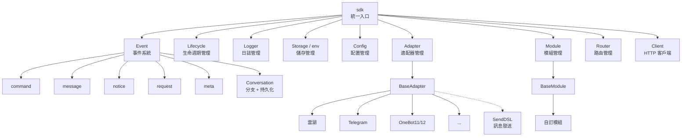
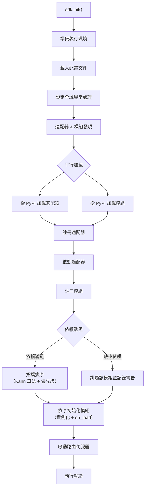
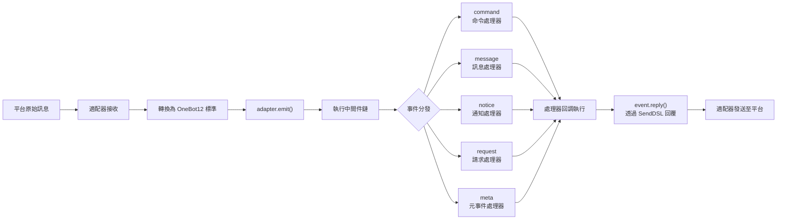
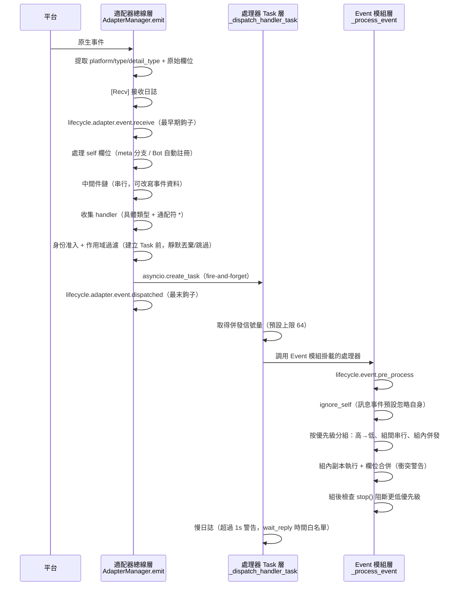
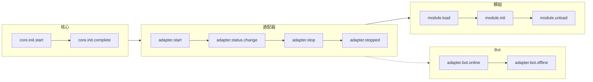
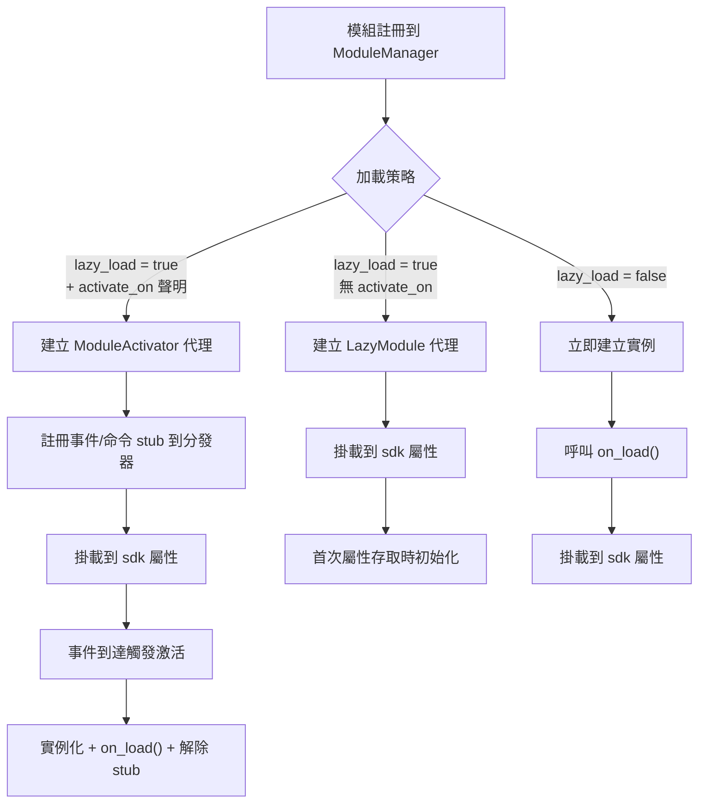
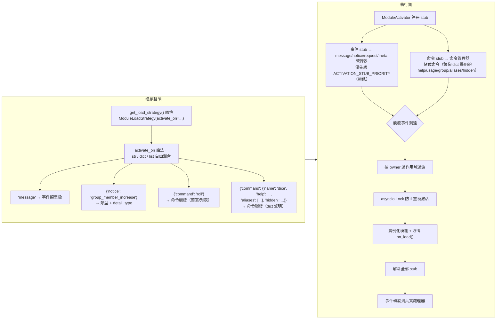
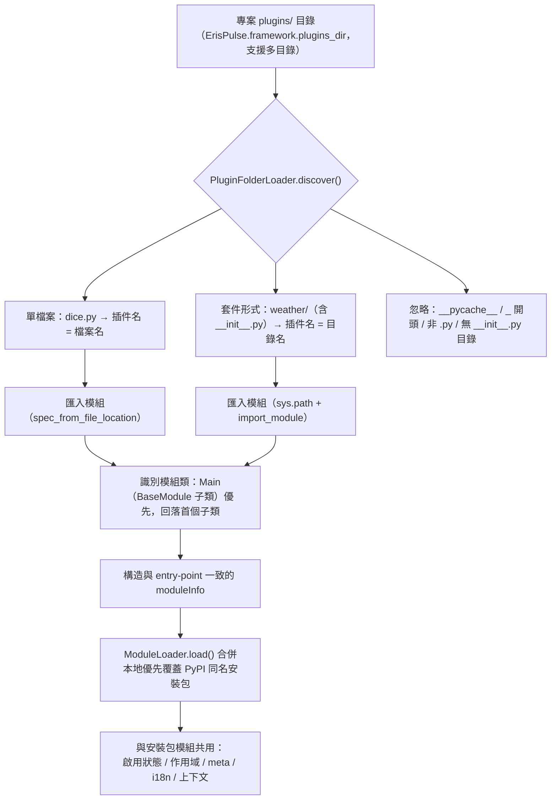
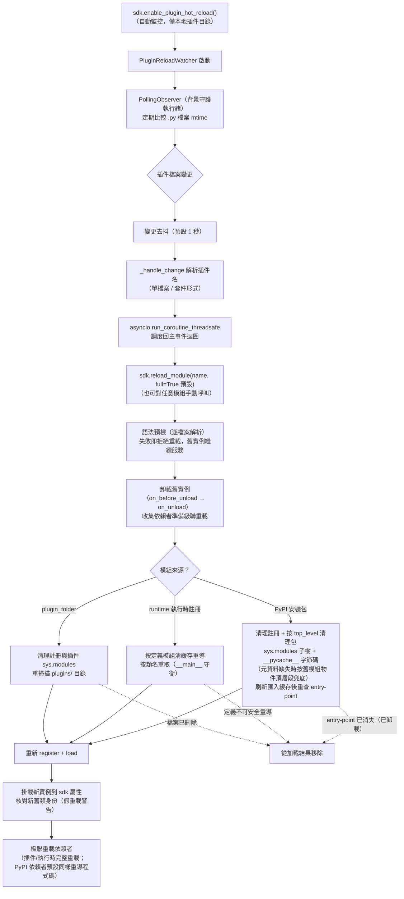
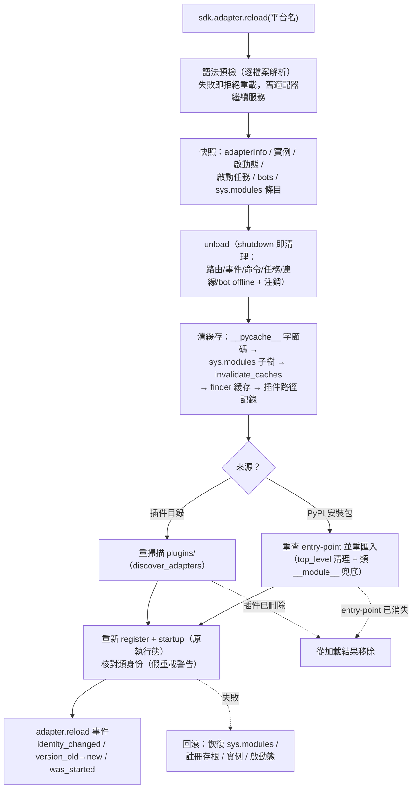

# 架構概覽

本文檔透過視覺化圖表介紹 ErisPulse SDK 的技術架構，幫助你快速理解框架的設計理念與模組關係。

## SDK 核心架構

下圖展示了 SDK 的核心模組組成及其關係：

### 核心模組說明

| 模組 | 說明 |
|------|------|
| **Event** | 事件系統，提供 command / message / notice / request / meta 五類事件處理，以及 Conversation 多輪對話 |
| **Adapter** | 適配器管理器，管理多平台適配器的註冊、啟動和關閉 |
| **Module** | 模組管理器，管理插件的註冊、加載和卸載，支援依賴聲明和拓撲排序 |
| **Lifecycle** | 生命週期管理器，提供事件驅動的生命週期鉤子 |
| **Storage** | 基於 SQLite 的鍵值儲存系統，支援通用 SQL 串流查詢 |
| **Config** | TOML 格式的配置文件管理 |
| **Logger** | 模組化日誌系統，支援子日誌器 |
| **Router** | HTTP/WebSocket 路由管理，透過抽象層封裝底層後端（目前為 FastAPI + Uvicorn），支援裝飾器路由、中間件、分組、限流、CORS |
| **Client** | 統一 HTTP/WS 客戶端（2.8.0 前為 `HttpClient`，保留相容別名），透過抽象層封裝底層請求庫（目前為 aiohttp），提供請求統計、重試、日誌、WebSocket 客戶端、ErisPulse 異常體系等功能。客戶端和服務端 WebSocket 共享 `WebSocketConnectionBase` 基類 |

## 初始化流程

下圖展示了 `sdk.init()` 的完整初始化過程：

### 初始化階段詳解

> 完整的初始化鏈路拆解（Finder / Loader / Manager / Router）、底層入口（`init()` / `init_task()` / `init_sync()`）與手動完整啟動見 [啟動流程與手動控制](advanced/startup.md)。

## 事件處理流程

下圖展示了訊息從平台到處理器的完整傳遞路徑：

### 事件處理鏈路詳解

上面這張圖是「結果」；下面拆開 `adapter.emit()` 之後框架**在背後做了什麼**——這是一條三層分發的鏈路：

**每一步框架做了什麼、你能干預什麼：**

| 階段 | 框架做了什麼 | 你能干預的 |
|------|-------------|-----------|
| 接收 | 提取標準欄位，保留 `{platform}_raw` 原始資料；寫 `[Recv]` 日誌 | 監聽 `adapter.event.receive` 拿到最早期事件 |
| self 欄位 | meta 事件走 connect/disconnect/heartbeat 分支；一般事件自動註冊 Bot 並觸發 `adapter.bot.online` | 監聽 `adapter.bot.online` / `bot.offline` |
| 中間件 | **串行**執行，回傳值非 None 則取代事件資料 | 註冊中間件改寫/攔截事件 |
| 分發收集 | 先取具體類型 handler，再取 `*` 通配符 handler | — |
| 身份維度 | 分發入口按 用戶>會話>Bot>適配器 判定事件收不收（`scope.is_identity_allowed`），**拒絕則整個事件丟棄** | `ErisPulse.scope.identity` 綁定 |
| 作用域過濾 | 按模組 owner 判定 `scope.is_allowed`（會話級>Bot級>平台級），**不通過則靜默跳過** | 配置作用域白名單/黑名單 |
| 調度 | 每個匹配 handler 獨立 `asyncio.Task`，`emit()` **不等待** handler 完成即回傳 | — |
| 優先級 | 高優先級組先執行；**組間串行、組內併發**（組內各自持有事件副本，改欄位合併回原事件，衝突打 WARNING） | `@command(..., priority=N)` / 註冊時指定 priority |
| 阻斷 | 每處理完一組檢查 `event.is_stopped()`，命中則**不再執行更低優先級** | `event.mark_processed(stop=True)` / `event.done()` |

> **常見誤區**：
> 1. **作用域過濾是靜默的**——被屏蔽的 handler 不報錯不回應，只在 TRACE 級日誌可見（`core.scope.denied`）。「我的模組沒收到訊息」優先排查作用域綁定。
> 2. **handler 天然併發**——框架已為每個 handler 建立獨立 Task，你**不需要**再自己 `asyncio.create_task` 包一層。
> 3. **同優先級組內不阻斷**——`mark_processed(stop=True)` 只阻止更低優先級組，同組內已併發的 handler 不會中途被打斷。
> 4. **慢日誌閾值固定 1 秒**——處理器耗時超過 1s 會在日誌打 WARNING（`wait_reply` 等待時間已從耗時中剔除），但不中斷執行。

> 作用域（scope）的模組維度三級綁定、身份維度准入與出站動作限制細節見 [作用域（scope）](advanced/scope.md)；事件作用域文字過濾與命令使用者 ACL 見 [事件處理入門](getting-started/event-handling.md)；併發上限配置見 [配置指南](user-guide/configuration.md#框架配置)。

## 生命週期事件

下圖展示了框架各組件的生命週期事件觸發順序：

### 監聽生命週期事件

> 完整的事件監聽方法（`lifecycle.on()` / `once()` / `has_handlers()`）、全部生命週期事件列表與資料格式見 [生命週期管理](advanced/lifecycle.md)。

## 模組加載策略

ErisPulse 支援三種模組加載策略，由 `get_load_strategy()` 回傳的 `ModuleLoadStrategy` 聲明：

> 更多詳情請參考 [懶加載系統](advanced/lazy-loading.md)、[生命週期管理](advanced/lifecycle.md) 與模組文件。

### 事件驅動懶激活（`activate_on`）觸發架構

> [!NOTE]
> 本特性需要 ErisPulse **2.8.0+**。

`activate_on` 允許模組在**首個匹配事件/命令到達時**才加載，避免常駐記憶體，同時保證事件不遺失：

**觸發語義要點：**

> 完整的 `activate_on` 語法（str / dict / list）、命令 dict 聲明、佔位命令 help 回退鏈、作用域過濾與失敗語義見 [懶加載系統](advanced/lazy-loading.md#事件驅動懶激活activate_on)。

## 本地插件檔案夾架構

> [!NOTE]
> 本特性需要 ErisPulse **2.8.0+**。

本地插件（`plugins/` 目錄）無需打包發布，框架啟動時自動發現並加載：

**約定與特性：**

- 插件名來源：單檔案取檔案名，套件形式取目錄名
- 本地插件 `moduleInfo.meta.source == "plugin_folder"`，與 PyPI 安裝包模組無縫共存
- 同名時本地優先（便於本地覆蓋調試），被禁用時同時移除同名 entry-point 條目

## 模組熱重載架構

熱重載對**全部模組來源**一致：本地插件（`plugins/` 目錄）、執行時註冊（`sdk.module.register()`）、PyPI 安裝包模組均可透過 `sdk.reload_module()` / `sdk.module.reload()` 熱重載——**預設即全量重載**（按頂層包名清除 import 緩存並重導依賴者程式碼，`full=False` 為輕量逃生門）；`sdk.reload_all_modules()` / `sdk.module.reload_all()` 可一次全量重載所有已註冊模組（pip 批量升級後呼叫即可全部生效）：

**三種來源的差異僅在發現階段**，預檢、卸載、級聯重載完全一致：

- **本地插件**（`moduleInfo.meta.source == "plugin_folder"`）：清理插件名對應 `sys.modules` 後重掃描 `plugins/` 目錄；檔案已刪除則從加載結果移除
- **執行時註冊**（`source == "runtime"`）：按定義模組重導、按類名重取並重建註冊；定義於 `__main__` / 無源檔案的類拒絕重導（守衛警告，避免重執行入口腳本）
- **PyPI 安裝包**：按 `meta.top_level` 清理包的 `sys.modules` 子樹，刷新匯入緩存（突破 entry-point 60 秒緩存）後重查並重新匯入；entry-point 已消失（pip 卸載）則從加載結果移除

**預設語義與可靠性保障（2.11）：**

- **reload 即全量重載**：預設按頂層包名清理 `sys.modules` 並重導依賴者程式碼；`full=False` 僅按元資料清理、PyPI 依賴者直接重新實例化（超大依賴樹的效能逃生門）
- **語法預檢閘門**：進入卸載流程之前逐檔案語法解析，失敗即拒絕重載——舊實例未卸載、繼續服務，語法錯誤永遠不會把模組推進"半死狀態"（超大包超過檔案數上限時跳過預檢）
- **緩存兜底**：`top_level` 元資料缺失時按「舊模組物件 `__name__` 前綴 → 模組類 `__module__` 前綴」兩級推導清理範圍；重載同時清除源檔案字節碼緩存（`__pycache__`），同秒同長度的小改寫也能生效
- **身份核對**：重載成功後斷言新舊類身份變化，未變化（C 扩展等清不掉的緩存）顯式警告並隨 `module.reload` 事件攜帶 `identity_changed: false`；`module.get_info()` 以 `running_identity` / `stale` 欄位暴露"註冊版本 ≠ 運行版本"
- **失敗可查**：load 失敗現場（異常 + traceback）可經 `module.last_error(名字)` / `get_info()["last_error"]` 直接查詢，失敗路徑同時清洗該模組 import 緩存——"改完程式碼再 reload 一次"必定讀到新程式碼
- 重載會把原本懶加載的模組強制激活（顯式日誌）；`reload_all_modules()` 則保持懶加載策略、僅將重載前處於已加載態的模組重新激活，歸眠（休眠）中的模組保持歸眠
- `reload_all_modules()` 按依賴拓撲序重新加載，單模組失敗僅記錄診斷並跳過（無整體回滾——on_unload 副作用不可撤銷，與單模組熱重載的盡力而為語義一致）；重載失敗已回滾的場景同樣如此，日誌會明確提示舊實例處於已收尾狀態

## 適配器熱重載架構

適配器程式級熱重載（2.11）與模組管線同構：`sdk.adapter.reload(平台名)` / `sdk.reload_adapter(平台名)` 對**本地插件**與 **PyPI 安裝包**兩種來源執行——

**與模組管線的差異：**

- 適配器無懶加載與依賴級聯：重載**不級聯**依賴它的其它適配器（僅告警——依賴方經註冊表間接消費，無實例級聯語義）
- 啟動是異步鏈（`startup` 經 `_run_adapter` 派發，含依賴跳過與指數退避重試）：啟動暫時失敗**不判重載失敗**（程式碼已換新），結果經 `adapter.status.change` 播報
- `register()` 的實例重用陷阱（類同物件則舊實例被重用）由「pyc 清理 + sys.modules 清除 + 身份核對」三件套兜底
- 生命週期事件：`adapter.reload`（payload 携帶 `adapter_name` / `success` / `full` / `duration_ms` / `identity_changed` / `version_old→new` / `was_started` / `source`）