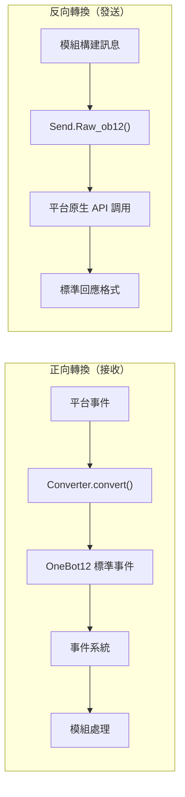

# 適配器開發入門

> [!TIP]
> **何時需要閱讀這篇**：適配器開發路徑的入門篇（必讀）。從零寫一個適配器、了解適配器的職責邊界與專案結構都在這裡；讀完後再按需進入 [事件轉換器](converter.md) 與 [SendDSL 詳解](send-dsl.md)。

跟著這篇走完，你會得到一個能收事件、發訊息的最小可用適配器（主類 + 轉換器 + Send），並清楚每個部件的職責邊界——接入一個新平台的所有工作都從這裡展開。

## 適配器簡介

### 什麼是適配器

適配器是 ErisPulse 與各個訊息平台之間的橋樑，負責：

1. **正向轉換**：接收平台事件並轉換為 OneBot12 標準格式（Converter）
2. **反向轉換**：將 OneBot12 訊息段轉換為平台 API 調用（`Raw_ob12`）
3. 管理與平台的連接（WebSocket/WebHook）
4. 提供統一的 SendDSL 訊息發送介面

### 適配器架構



## 目錄結構

標準的適配器包結構：

```
MyAdapter/
├── pyproject.toml          # 專案配置
├── README.md               # 專案說明
├── LICENSE                 # 許可證
└── MyAdapter/
    ├── __init__.py          # 包入口
    ├── Core.py               # 適配器主類
    └── Converter.py          # 事件轉換器
```

## 快速開始

### 1. 建立專案

建議直接用鷹架生成完整骨架（含 pyproject、主類別、轉換器）：

```bash
# 標準專案（打包發佈用）
epsdk create adapter -n MyAdapter

# 本地適配器外掛（免打包，放入 plugins/ 目錄即可被自動載入，見下方「本地開發」）
epsdk create adapter -n MyAdapter --local
```

鷹架預設生成 WebSocket 伺服器端骨架；平台連接方式不同時可經 `--template`
選擇通訊模式模板（生成即用對應的半成品基類，`start`/`shutdown` 都不需要自己寫）：

```bash
epsdk create adapter -n MyAdapter --template polling   # HTTP 輪詢型（getUpdates 拉取）
epsdk create adapter -n MyAdapter --template webhook   # HTTP 回呼型（平台推送）
```

> 三種連接模式的差異與半成品基類的最小實作面見
> [適配器核心概念 - 連接模式半成品基類](core-concepts.md#連接模式半成品基類)。
> 完整可執行範例參考儲存庫 `examples/example-adapter-polling/` 與 `examples/example-adapter-webhook/`。

也可以手動建立：

```bash
mkdir MyAdapter && cd MyAdapter
```

### 2. 建立 pyproject.toml

```toml
[project]
name = "ErisPulse-MyAdapter"
version = "1.0.0"
description = "MyAdapter平台適配器"
readme = "README.md"
requires-python = ">=3.10"
license = { file = "LICENSE" }
authors = [ { name = "yourname", email = "your@mail.com" } ]

dependencies = [
    "ErisPulse>=2.4.0"  # ErisPulse 已內建 aiohttp，通常無需單獨依賴
]

[project.urls]
"homepage" = "https://github.com/yourname/MyAdapter"

[project.entry-points."erispulse.adapter"]
"MyAdapter" = "MyAdapter:MyAdapter"
```

### 3. 建立適配器主類別

框架提供了 `ConfigClass` / `AccountConfigClass` 宣告式設定管理，適配器只需宣告設定類別即可自動載入、驗證和產生設定模板。

```python
# MyAdapter/Core.py
from dataclasses import dataclass, field
# 建議根匯入（2.10+）：常用符號直接從根套件匯入，深路徑仍相容
from ErisPulse import BaseAdapter, BaseConfig

@dataclass
class MyAdapterConfig(BaseConfig):
    """MyAdapter 設定"""
    api_endpoint: str = field(
        default="https://api.example.com",
        metadata={
            "description": {"i18n": "my_adapter.api_endpoint", "default": "API 位址"},
            "required": False,
            "ui": {"widget": "text", "group": "connection", "order": 1},
        },
    )
    token: str = field(
        default="",
        metadata={
            "description": {"i18n": "my_adapter.token", "default": "平台 Token"},
            "required": True,
            "secret": True,
            "ui": {"widget": "password", "group": "basic", "order": 2},
        },
    )

class MyAdapter(BaseAdapter):
    ConfigClass = MyAdapterConfig  # 宣告設定類別，框架自動管理
    
    # 不需要覆寫 __init__！框架自動處理：
    # - self.sdk / self.logger 自動設定
    # - self.cfg 即時讀取設定
    # - self.Send / self.Request 自動初始化
    
    def _setup_converter(self):
        from .Converter import MyPlatformConverter
        return MyPlatformConverter()
```

> ⚠️ **關於 `__init__`**：新版本中 `BaseAdapter.__init__(self, sdk=None)` 會自動處理 SDK 引用、日誌初始化和設定載入。大多數適配器**不再需要覆寫 `__init__`**。詳見 [__init__ 注意事項](#init-注意事項)。

> ⚠️ **關於 `super().__init__()`**：`BaseAdapter.__init__()` 負責建立 `Send` 和 `Request` 工廠實例。如果忘記呼叫，所有訊息傳送和請求操作都會報 `AttributeError`。詳見 [__init__ 注意事項](#init-注意事項)。

### 4. 實作必需方法

```python
class MyAdapter(BaseAdapter):
    # ... __init__ 程式碼 ...
    
    async def start(self):
        """啟動適配器（必須實作）"""
        # 註冊 WebSocket 或 WebHook 路由
        router.register_websocket(
            module_name="myplatform",
            path="/ws",
            handler=self._ws_handler
        )
        self.logger.info("適配器已啟動")
    
    async def shutdown(self):
        """關閉適配器（必須實作）"""
        router.unregister_websocket(
            module_name="myplatform",
            path="/ws"
        )
        # 清理連接和資源
        self.logger.info("適配器已關閉")
    
    async def call_api(self, endpoint: str, **params):
        """呼叫平台 API（必須實作）"""
        raise NotImplementedError("需要實作 call_api")
```

#### 主動發送 Meta 事件

適配器應主動發送 meta 事件，讓框架追蹤 Bot 的線上狀態。使用 `emit_meta()` 一行即可完成：

```python
class MyAdapter(BaseAdapter):
    async def _ws_handler(self, websocket):
        bot_id = self._get_bot_id()

        # Bot 上線
        await self.emit_meta("connect", bot_id, user_name="MyBot")

        try:
            while True:
                data = await websocket.receive_text()
                event = self.convert(data)
                if event:
                    await self.adapter.emit(event)
        except WebSocketDisconnect:
            pass
        finally:
            # Bot 離線
            await self.emit_meta("disconnect", bot_id)
```

> 詳細的 Bot 狀態管理和 Meta 事件說明請參閱 [適配器最佳實踐 - Bot 狀態管理](best-practices.md#bot-狀態管理與-meta-事件)。

### 5. 實作 Send 類別

`At`/`AtAll`/`Reply` 修飾器已由框架 SendDSL 基類內建實作，適配器只需實作 `Raw_ob12` 和具體的發送方法即可。

框架提供兩個關鍵輔助方法：
- `self._apply_modifiers(message)` — 自動合併 At/AtAll/Reply 修飾器到訊息段
- `self.send_context` — 取得發送上下文字典（`target_type`、`target_id`、`account_id`）

```python
import asyncio

class MyAdapter(BaseAdapter):
    # ... 其他程式碼 ...

    class Send(BaseAdapter.Send):

        def Raw_ob12(self, message, **kwargs):
            """
            發送 OneBot12 格式訊息（必須實作）

            使用 _apply_modifiers 自動合併修飾器狀態，
            使用 send_context 取得發送上下文。
            """
            async def _do_send():
                segments = self._apply_modifiers(message)
                return await self._adapter.call_api(
                    endpoint="/send_message",
                    message=segments,
                    **self.send_context,
                    **kwargs
                )
            return asyncio.create_task(_do_send())

        # Text/Image/Voice/Video/File 已從 SendDSL 基類繼承，
        # 預設委託給 Raw_ob12，無需重複實作。
        # 如需平台特定邏輯，可覆寫單個方法：
        # def Text(self, text: str):
        #     return self.Raw_ob12([{"type": "text", "data": {"text": text}}])
```

**媒體類發送方法（Image/Video/File）實作要點：**

- 基類的預設實作會將 `file` 參數封裝為 OneBot12 訊息段傳給 `Raw_ob12`，適配器需在 `Raw_ob12` 中處理下載/上傳
- `file` 參數應同時支援 `bytes` 二進位資料和 `str` URL 兩種類型
- 當傳入 URL 時，需先下載檔案再上傳到平台
- 平台通常需要先呼叫上傳介面取得檔案識別碼，再呼叫發送介面

**`__getattr__` 魔術方法：**

- 實作方法名稱大小寫不敏感（`Text`、`text`、`TEXT` 都能呼叫）
- 未定義的方法應回傳提示訊息而非報錯

**`Raw_ob12` 方法：**

- 將 OneBot12 標準訊息格式轉換為平台格式發送
- 使用 `self._apply_modifiers(message)` 自動處理 At/AtAll/Reply 修飾器
- 使用 `**self.send_context` 傳遞發送目標資訊和帳號資訊

### 6. 實作轉換器

```python
# MyAdapter/Converter.py
import time
import uuid

class MyPlatformConverter:
    def convert(self, raw_event):
        """將平台原生事件轉換為 OneBot12 標準格式"""
        if not isinstance(raw_event, dict):
            return None
        
        onebot_event = {
            "id": str(raw_event.get("event_id", uuid.uuid4())),
            "time": int(time.time()),
            "type": self._convert_event_type(raw_event.get("type")),
            "detail_type": self._convert_detail_type(raw_event),
            "platform": "myplatform",
            "self": {
                "platform": "myplatform",
                "user_id": str(raw_event.get("bot_id", ""))
            },
            "myplatform_raw": raw_event,
            "myplatform_raw_type": raw_event.get("type", "")
        }
        
        return onebot_event
    
    def _convert_event_type(self, event_type):
        """轉換事件類型"""
        type_map = {
            "message": "message",
            "notice": "notice"
        }
        return type_map.get(event_type, "unknown")
    
    def _convert_detail_type(self, raw_event):
        """轉換詳細類型"""
        return "private"  # 簡化範例
```

### 7. 實作 Request 類別（請求操作）

如果你的平台支援好友請求、群組邀請等需要 Bot 做出決策的請求，可以實作 `Request` 內部類別：

```python
from ErisPulse import BaseAdapter, RequestDSL

class MyAdapter(BaseAdapter):
    # ... Send 和其他程式碼 ...

    class Request(RequestDSL):
        """請求操作實作（好友請求、群組邀請等）"""

        def accept(self, **kwargs):
            """同意請求"""
            async def _do():
                result = await self._adapter.call_api(
                    endpoint="/set_request",
                    request_id=self._request_id,
                    approve=True,
                    **kwargs,
                )
                return {
                    "status": "ok" if result.get("code") == 0 else "failed",
                    "retcode": result.get("code", 0),
                    "data": None,
                    "message_id": "",
                    "message": result.get("message", ""),
                }
            return self._create_task(_do())

        def reject(self, **kwargs):
            """拒絕請求"""
            async def _do():
                result = await self._adapter.call_api(
                    endpoint="/set_request",
                    request_id=self._request_id,
                    approve=False,
                    **kwargs,
                )
                return {
                    "status": "ok" if result.get("code") == 0 else "failed",
                    "retcode": result.get("code", 0),
                    "data": None,
                    "message_id": "",
                    "message": result.get("message", ""),
                }
            return self._create_task(_do())
```

模組開發者使用方式：

```python
from ErisPulse import request

@request.on_friend_request()
async def handle_friend_request(event):
    # 透過 Event 便利方法
    await event.approve()
    # 或透過適配器直接操作
    await adapter.myplatform.Request("req_id").accept()
```

> 如果平台不支援請求操作，可以不實作 `Request` 內部類別。基類預設回傳 `retcode=10002`（不支援的操作）。詳見 [請求操作規範](../../standards/request-action-spec.md)。

### 8. 建立套件進入點

```python
# MyAdapter/__init__.py
from .Core import MyAdapter
```

## 本地開發（免打包）

與模組一致，適配器也可以放入項目的本地插件目錄（預設 `plugins/`，可透過 `ErisPulse.framework.plugins_dir` 配置）直接開發，**無需 `pip install -e .`**：

```bash
# 產生本地適配器插件
epsdk create adapter -n MyAdapter --local
# 產生結構：
# plugins/
# └── MyAdapter/
#     ├── __init__.py
#     ├── Core.py
#     └── Converter.py
```

框架啟動時自動掃描插件目錄並加載其中的模組與適配器（與 entry-point 安裝包同等待遇：啟用狀態、配置聲明、熱更新、卸載清理全部一致）：

- **識別規則**：套件目錄（含 `__init__.py`）或單個 `.py` 檔均可；優先識別 `Main` 命名類，否則取插件內首個 `BaseAdapter` / `BaseModule` 子類
- **同名覆蓋**：本地插件與 PyPI 安裝的適配器同名時，本地插件優先（便於覆蓋調試）
- **熱重載**：`sdk.enable_plugin_hot_reload()` 開啟的插件目錄監控同樣覆蓋適配器；適配器程式碼級熱重載自 2.11 提供——`await sdk.adapter.reload("平台名")` 或 `await sdk.reload_adapter("平台名")`（語法預檢 → 卸載清理 → 清快取重導 → 重新註冊拉起，失敗自動回滾；詳見[架構概覽](../../architecture.md)）

### 從本地插件到發布

本地驗證完成後，用 `pack` 子命令把插件一鍵轉換為可發布的標準專案（互動式選擇插件、補全元資訊，產生含 entry-point 的 pyproject）：

```bash
epsdk create pack
# 選擇插件目錄中的插件 → 輸入專案名/描述/作者 → 產生 MyAdapter/ 專案目錄
cd MyAdapter
pip install -e .   # 轉為標準安裝；隨後按發布流程上傳 PyPI
```

> **提示**：轉換完成後建議移除 `plugins/` 中的原件，避免本地插件與安裝包重複加載（兩者同名時本地優先，會讓你誤以為安裝包生效）。

## 依賴聲明（可選，2.8.0+）


適配器可以聲明對其它適配器或模組的依賴，實現適配器間聯動與可選功能：

```python
from typing import ClassVar

class MyAdapter(BaseAdapter):
    # 硬依賴：缺失時跳過啟動（警告 + status=skipped-dependency 事件）
    depends: ClassVar[dict] = {
        "adapters": ["onebot11"],   # 依賴的適配器（按平台名）
        "modules": ["TranslateEngine"],  # 依賴的模組（按註冊名）
    }
    # 軟依賴：缺失不影響啟動；模組加載/卸載時收到回調（可選功能模式）
    optional_modules: ClassVar[list] = ["TranslateEngine"]
```

- **啟動順序**：聲明了模組硬依賴的適配器會**延遲到模組初始化完成後**再啟動
- **軟依賴通知**：`optional_modules`（或模組硬依賴）中的模組被加載時呼叫 `on_dependency_ready(module_name)`；被卸載時呼叫 `on_dependency_lost(module_name)`（預設空實作，可覆寫）——覆寫晚加載與熱重載場景：

```python
async def on_dependency_ready(self, module_name):
    """軟依賴模組就緒：啟用對應可選功能"""
    if module_name == "TranslateEngine":
        self._translate = self.sdk.TranslateEngine

async def on_dependency_lost(self, module_name):
    """軟依賴模組丟失：降級功能"""
    if module_name == "TranslateEngine":
        self._translate = None
```

> [!NOTE]
> 本特性需要 ErisPulse **2.8.0+**。

## `__init__` 注意事項

適配器開發中有三個層面可能涉及 `__init__` 重寫。以下是每個層面的正確做法。

### 1. BaseAdapter 層（大多數情況不需要重寫）

`BaseAdapter.__init__(self, sdk=None)` 負責建立 `Send` / `Request` 工廠實例，並自動完成以下工作：

- 接受 `sdk` 參數並設定 `self.sdk`、`self.logger`
- 如果聲明了 `ConfigClass`，可透過 `self.cfg` 實時讀取全域配置
- 如果聲明了 `AccountConfigClass`，可透過 `self.accounts` 實時讀取多帳號配置

**大多數情況下不需要覆寫 `__init__`**，只需聲明 `ConfigClass` 即可：

```python
class MyAdapter(BaseAdapter):
    ConfigClass = MyAdapterConfig  # 聲明後框架自動管理配置
    
    async def start(self):
        cfg = self.cfg  # 類型安全，實時讀取
        ...
```

如果確實需要自訂初始化，呼叫 `super().__init__(sdk)` 即可：

```python
class MyAdapter(BaseAdapter):
    ConfigClass = MyAdapterConfig
    
    def __init__(self, sdk=None):
        super().__init__(sdk)  # 傳入 sdk
        self.converter = self._setup_converter()
        self.convert = self.converter.convert
```

### 2. Send 內部類（大多數情況不需要重寫）

`SendDSL.__init__` 負責鏈式呼叫的狀態傳遞（目標類型、目標ID、帳號等）。**大多數情況下，你只需要重寫方法**（`Raw_ob12`、`Text` 等），不需要重寫 `__init__`。

如果確實需要（比如初始化平台特有的狀態），**必須透傳所有參數**：

```python
class MyAdapter(BaseAdapter):
    class Send(BaseAdapter.Send):
        # 參數：adapter, target_type, target_id, account_id
        def __init__(self, adapter, target_type=None, target_id=None, account_id=None):
            super().__init__(adapter, target_type, target_id, account_id)  # ← 必須透傳
            self._my_state = None  # 平台特有初始化
```

**為什麼必須透傳？** 鏈式呼叫的每一步都透過 `self.__class__(...)` 建立新實例：

```python
adapter.Send.To("user", "123")               # → Send(adapter, "user", "123", None)
adapter.Send.To("user", "123").Using("bot1")  # → Send(adapter, "user", "123", "bot1")
```

如果 `__init__` 簽名不匹配或沒呼叫 `super()`，鏈式呼叫就會中斷。

### 3. Request 內部類（大多數情況不需要重寫）

與 Send 同理。參數為 `adapter`, `request_id`, `account_id`：

```python
class MyAdapter(BaseAdapter):
    class Request(RequestDSL):
        # 參數：adapter, request_id, account_id
        def __init__(self, adapter, request_id=None, account_id=None):
            super().__init__(adapter, request_id, account_id)  # ← 必須透傳
            self._my_state = None  # 平台特有初始化
```

### 總結

| 層面 | 什麼時候重寫 | 必須做的事 |
|------|------------|-----------|
| **BaseAdapter** | 需要自訂初始化邏輯時 | `super().__init__(sdk)` （傳入 sdk 參數） |
| **Send 內部類** | 需要初始化發送相關狀態時 | `super().__init__(adapter, target_type, target_id, account_id)` |
| **Request 內部類** | 需要初始化請求相關狀態時 | `super().__init__(adapter, request_id, account_id)` |
| 三個層面 | 大多數情況 | **聲明 ConfigClass 即可，不碰 `__init__`** |

### 9. 連接資訊與路由發現

適配器註冊路由後，框架會記錄所有路由資訊。使用者可以透過以下 API 查看適配器的連接位址：

```python
from ErisPulse import sdk

# 獲取適配器完整連接資訊
info = sdk.adapter.get_connection_info("myplatform")
# {
#   "platform": "myplatform",
#   "status": "started",
#   "connection": {
#     "base_url": "http://localhost:8080",
#     "http_routes": [
#       {"path": "/myplatform/webhook", "method": "POST",
#        "url": "http://localhost:8080/myplatform/webhook"}
#     ],
#     "websocket_routes": [
#       {"path": "/myplatform/ws",
#        "url": "ws://localhost:8080/myplatform/ws"}
#     ]
#   }
# }

# 列出所有命名空間（適配器/模組）的路由
namespaces = sdk.router.list_namespaces()
# {"myplatform": {"http": ["/myplatform/webhook"], "websocket": ["/myplatform/ws"]}}

# 獲取命名空間的完整連接 URL
urls = sdk.router.get_module_urls("myplatform")
# {"base_url": "http://localhost:8080", "http": [...], "websocket": [...]}

# 獲取命名空間的詳細路由資訊
routes = sdk.router.get_module_routes("myplatform")
# {"http": [{"path": "/myplatform/webhook", "methods": ["POST"]}],
#  "websocket": [{"path": "/myplatform/ws", "auth": false}]}
```

> **提示**：`get_connection_info()` 回傳的資訊適合展示給使用者（如 WebUI），幫助使用者配置平台側的回調位址或 WebSocket 連接位址。路由註冊時的 `module_name` 必須與適配器在 ErisPulse 中註冊的 `platform` 名稱完全一致，否則路由發現將無法正確關聯。

### 10. SSE (Server-Sent Events) 支援

ErisPulse 內建了伺服器無關的 SSE 支援，模組和適配器可以透過 `@sdk.router.sse()` 註冊 SSE 端點。

#### 基本使用

```python
import asyncio
from ErisPulse import sdk

@sdk.router.sse("MyModule", "/events")
async def event_stream(sse):
    """推送 SSE 事件"""
    count = 0
    while not sse.closed:
        await sse.send({"count": count}, event="update")
        count += 1
        await asyncio.sleep(1)
```

#### 使用請求參數

處理器可以聲明 `request` 參數來存取客戶端請求資訊：

```python
@sdk.router.sse("MyModule", "/events")
async def event_stream(request, sse):
    token = request.query_params.get("token")
    if not validate_token(token):
        await sse.close()
        return

    while not sse.closed:
        data = await fetch_data(token)
        await sse.send(data)
        await asyncio.sleep(5)
```

#### SseEmitter API

| 方法 | 說明 |
|------|------|
| `sse.send(data, event=None, id=None, retry=None)` | 發送 SSE 事件。非 str 的 data 自動 JSON 序列化 |
| `sse.close()` | 優雅關閉 SSE 連接（安全呼叫，可多次） |
| `sse.closed` | 連接是否已關閉 |
| `sse.request` | 底層請求物件（可用於讀取 query params、headers） |

#### 在 RouteGroup 中使用

```python
api = sdk.router.group("MyModule", "/api", version="1")

@api.sse("/events")
async def events(sse):
    await sse.send({"msg": "hello"})
```

#### 路由發現

SSE 路由會自動出現在路由發現 API 中：

```python
# list_namespaces 會包含 "sse" 鍵
sdk.router.list_namespaces()
# {"MyModule": {"http": [...], "websocket": [...], "sse": ["/MyModule/events"]}}

# get_module_routes 會標記 streaming: true
sdk.router.get_module_routes("MyModule")
# {"http": [...], "websocket": [...], "sse": [{"path": "/MyModule/events", "streaming": true}]}

# get_module_urls 會產生完整 URL
sdk.router.get_module_urls("MyModule")
# {"sse": [{"path": "/MyModule/events", "url": "http://localhost:8080/MyModule/events"}]}
```

> **伺服器無關設計**：`SseEmitter` 透過回呼與底層 HTTP 框架解耦。框架提供了 `register_sse()` 和 `@sse` 裝飾器作為統一的註冊入口，適配器無需直接依賴任何底層 HTTP 框架即可實現 SSE 端點。

## 下一步

### 補齊適配器的三大件

- [事件轉換器](converter.md) - 平台事件 → OneBot12 的實現細節與常見陷阱
- [SendDSL 詳解](send-dsl.md) - 訊息發送鏈、修飾方法與發送規則
- [適配器核心概念](core-concepts.md) - BaseAdapter / 生命週期 / 多帳號的機制說明

### 骨架跑通之後

- [適配器最佳實踐](best-practices.md) - 連接重試、心跳、錯誤處理的工程化收尾
- [發布與模組商店指南](../publishing.md) - 發布到 PyPI 與模組商店